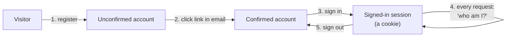
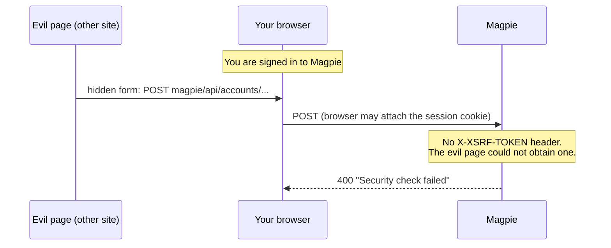
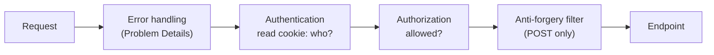
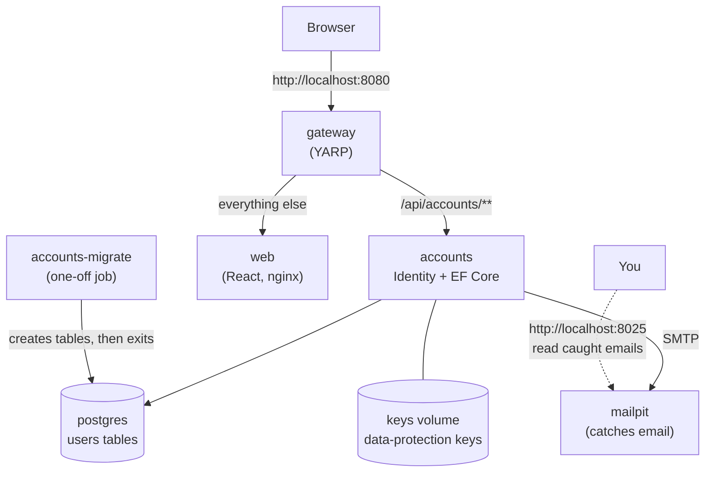
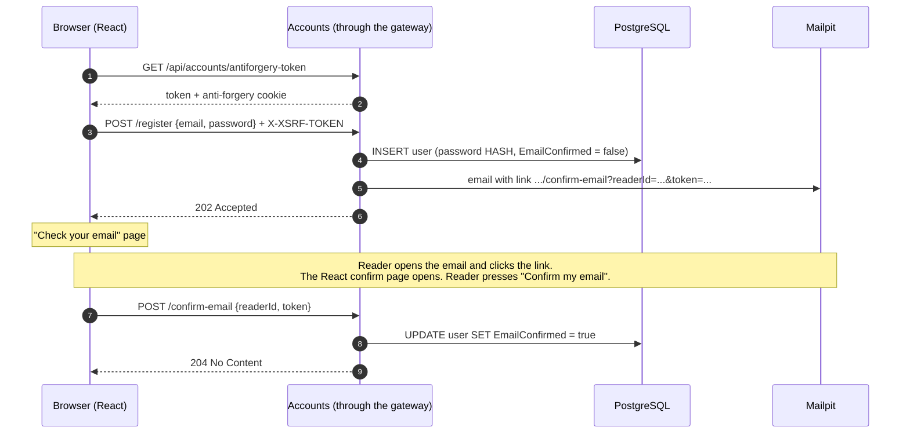
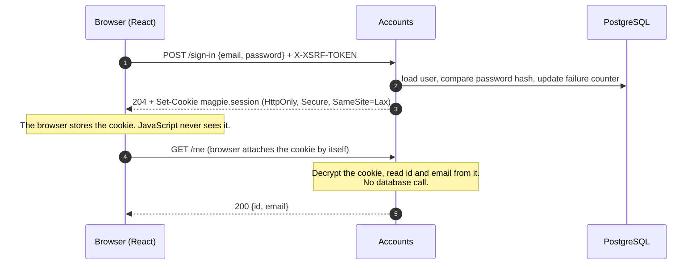
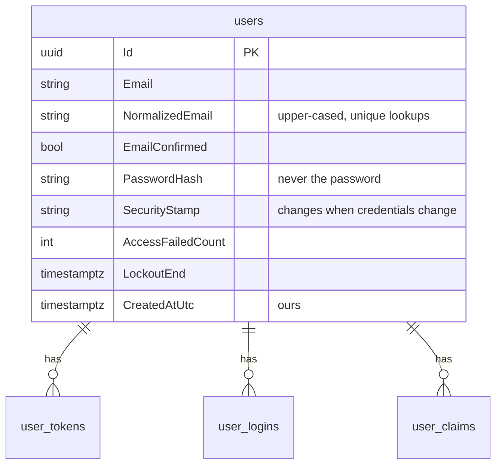
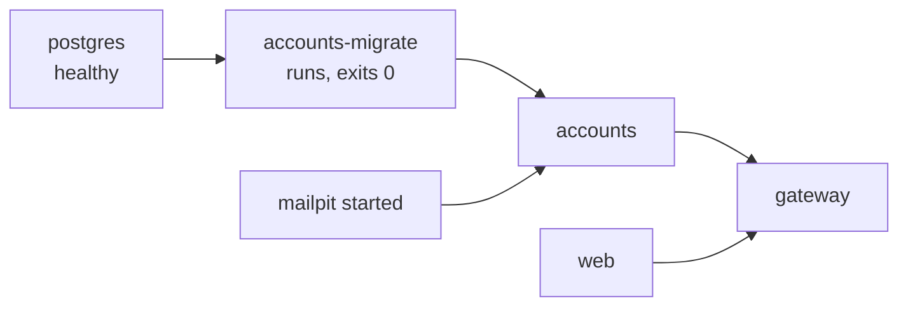
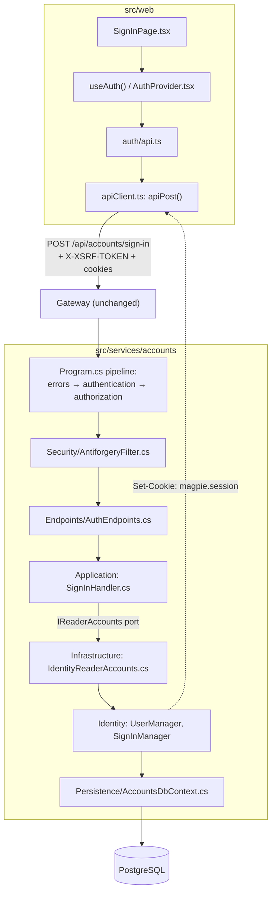
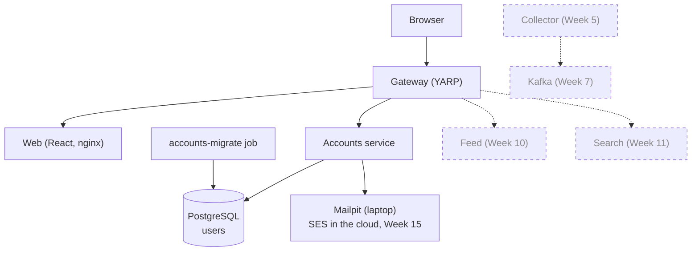

# Building Magpie: A Guided Journey from Empty Folder to Production-Grade System

## Chapter 2 (Week 2): Who Goes There? Sign-up, Email Confirmation and Sign-in

> **What you will have at the end of this chapter:** a visitor can create an account, receive a confirmation email, confirm it, sign in, be recognised on every later request, and sign out. No password is ever stored, no login secret is ever readable by JavaScript, and the system never tells a stranger whether an email address has an account.

| | |
|---|---|
| **Week** | 2 of 26 |
| **Plan step** | Step 2, Login and signup (part 1 of 2) |
| **Time budget** | About 8 hours |
| **You need** | Chapter 1 finished and running |
| **Repository** | https://github.com/ankitchoubey800/magpie |
| **Code for this chapter** | Commit `{{sha7}}` on branch `week-02` (pull request #1). Every link in this chapter points at that exact commit |

---

### How this chapter was checked (read this first)

| What | Where it was run | Result |
|---|---|---|
| Website: lint, 20 tests, production build | Author's workspace (Node 22) and GitHub Actions (Node 26) | Passed |
| .NET: build of all projects, 43 tests (30 unit, 13 against a real PostgreSQL 18 started by Testcontainers) | GitHub Actions | `Passed! - Failed: 0, Passed: 43, Skipped: 0, Total: 43` |
| The first database migration, created with `dotnet ef migrations add` | GitHub Actions; the generated files were then committed | Created and applied |
| Whole system in Docker Compose: register → email caught by Mailpit → confirm → sign in → who-am-I → sign out, all through the gateway | GitHub Actions (`infra/smoke/auth_flow.py`) | Passed; output quoted in Step 11 |
| A signed-in session survives a restart of the Accounts container | GitHub Actions | Passed |
| Break-it experiment (copied cookie after sign-out) | Author's workspace and GitHub Actions | Result quoted in section 6 |
| Week 1 experiments (stop PostgreSQL, stop Accounts) still behave the same | GitHub Actions | Passed |
| **Not yet checked:** the pages in a real browser, including the cookie flags in browser tools | | You do this (Step 11) |
| **Not yet run:** anything on your own laptop | | You do this. It is closing item 2 |

The full evidence is public: {{run}}

Three bugs were found by running the code rather than by reading it. They are described where they happened (Steps 5 and 10), because how they were found is as useful as the fix.

---

## 1. The big picture

### What are we building this week?

Last week's skeleton lets anybody in. This week we put a door on it.

Think of a members-only library:

1. You fill in a form at the desk (**register**).
2. The library posts a letter to the address you gave. Only someone who really lives there can open it (**confirm email**).
3. Next visit you show ID at the desk (**sign in**) and get a **wristband**.
4. For the rest of the day, staff glance at the wristband instead of asking for ID again (**session**).
5. When you leave, you cut the wristband off (**sign out**).



**Reading the diagram:** an account moves left to right exactly once (visitor → unconfirmed → confirmed). After that, a reader loops between "confirmed" and "signed in" for as long as they use Magpie.

### Why does it matter?

Almost every later feature begins with "for *this* reader": their interests, their feed, their saved items, their plan. If the system cannot say reliably who is asking, none of that can be built. And login is the one place where a mistake does not just annoy people, it hurts them. So this chapter is as much about what could go wrong as about making it work.

> 🧠 **Pause and think**
> A sign-in form answers "No account with that email" for one address and "Wrong password" for another. That seems helpful. What has a stranger just learned, and why might that matter for, say, a clinic's patient portal? (Answer in section 11.)

### This week's deliverables

1. Six new addresses on the Accounts service: register, resend confirmation, confirm email, sign in, sign out, "who am I".
2. A real `users` table, created by a **migration**.
3. A **session cookie** with three safety flags, plus **anti-forgery** protection.
4. Confirmation emails, caught on the laptop by **Mailpit**.
5. Settings that are **checked when the service starts**.
6. React pages: sign up, check your email, confirm email, sign in, and a home page only signed-in readers can open.
7. Tests against a **real PostgreSQL** that is started and thrown away automatically.

---

## 2. Concepts first

### 2.1 Authentication and authorization

Two words that sound alike and mean different things:

- **Authentication** = *who are you?* (Showing ID at the desk.)
- **Authorization** = *what are you allowed to do?* (Members may borrow books; only staff may enter the back office.)

This week is almost entirely authentication. The only authorization rule is the simplest possible one: "you must be signed in to ask who you are".

### 2.2 Passwords: why we never store them

If we stored passwords as typed, anyone who stole a copy of the database could sign in as everyone, here and on every other site where people reused the password.

Instead we store a **hash**: the password put through a one-way grinder. Meat goes in, mince comes out, and you cannot turn mince back into meat. At sign-in we grind what the reader typed and compare mince with mince.

Three details make this safe in practice:

- **Salt.** A random value mixed in per account, so two readers with the same password get different hashes, and an attacker cannot use a pre-computed list.
- **Slowness on purpose.** A good password hash takes a noticeable fraction of a second. One sign-in does not notice. An attacker trying a billion guesses does.
- **Never write your own.** The details are subtle and mistakes are invisible until the breach. We use ASP.NET Core Identity's hasher.

### 2.3 Sessions and cookies

The web is forgetful: every request arrives with no memory of the previous one. A **session** is how the server remembers "this browser signed in a minute ago".

A **cookie** is a small labelled value the server asks the browser to keep and send back with every later request to the same site. Our session cookie is the wristband. It is encrypted by the server, so the browser carries it without being able to read or alter it.

Three flags on the cookie do most of the security work:

| Flag | Plain meaning | Attack it blocks |
|---|---|---|
| `HttpOnly` | JavaScript on the page cannot read this cookie | A malicious script stealing the session |
| `Secure` | Only send this over an encrypted (HTTPS) connection | Someone on the same Wi-Fi reading it in transit |
| `SameSite=Lax` | Do not send this on requests *started by other websites*, except when the reader simply clicks a link to us | Another site quietly making requests as you |

> ❓ **No silly questions**
> **Q: Our laptop site is `http://localhost`, not HTTPS. Will a `Secure` cookie work?**
> A: Chrome, Edge and Firefox treat `localhost` as a trustworthy address and accept `Secure` cookies there. Safari does not. Use one of the first three on the laptop. Real HTTPS arrives with the cloud weeks (20 and 21).

### 2.4 Cookies or tokens?

The other common design is a **token** (often a "JWT"): the server hands the browser's JavaScript a signed string, the JavaScript keeps it (usually in `localStorage`) and attaches it to each request.

| | Token in browser storage | Cookie set by the server (ours) |
|---|---|---|
| Can a script on the page read it? | Yes | No |
| Who attaches it to requests? | Our code | The browser |
| Biggest risk | A malicious script copies it and uses it from anywhere | Another site tricks the browser into sending a request (section 2.6) |
| Good for mobile apps and outside API clients | Yes | No |

Our only client is our own website, served from the same address as the API. In that situation the cookie's weakness does not apply and its risk has a mechanical defence. The full comparison is this week's design note (`docs/design-notes/week-02-cookies-or-tokens.md`) and ADR-0003.

### 2.5 "Backend for frontend": why the gateway now matters

A browser only sends a cookie back to **the site that set it**. Last week we made the website and the API share one address through the gateway. This week that decision pays off: because the React app calls `/api/...` on its own address, the browser attaches the session cookie by itself. No login secret ever passes through our JavaScript.

This arrangement, where the browser talks only to its own backend and that backend holds the session, is called **backend for frontend (BFF)**.

### 2.6 Forged requests (CSRF) and the anti-forgery token

"The browser attaches the cookie automatically" has a dark side. Suppose you are signed in to Magpie and, in another tab, open a malicious page. That page contains a hidden form that submits to `magpie.example/api/accounts/delete-everything`. Your browser sends the request, **and attaches your cookie**, because it always does. The server sees a perfectly valid signed-in request. This is **cross-site request forgery (CSRF)**.

A bank analogy: a signature on a cheque proves it is your chequebook. It does not prove you wrote the amount.

Two defences, used together:

1. **`SameSite=Lax`** already stops the browser attaching the cookie to most cross-site requests.
2. An **anti-forgery token**: before changing anything, our page asks the server for a one-off secret and sends it back in a request header (`X-XSRF-TOKEN`). A page on another site cannot read our server's answers and cannot set that header, so its forged request arrives without the token and is refused.



**Reading the diagram:** the forged request does reach Magpie. What saves us is that it cannot carry the token, because only a page loaded from our own address can ask for it.

### 2.7 Proving an email address, and the keys behind it

Typing an address proves nothing. Receiving mail at it does. So we send a link containing a **confirmation token**: a tamper-proof slip that says "account X, issued at time T", sealed by the server. Only our server can create or check one, and it expires after 24 hours.

Both the session cookie and these tokens are sealed with secret keys managed by ASP.NET Core's **data protection** system. Two consequences that surprise people in production:

- If the keys are lost (for example a container restarts with a fresh disk), **every reader is signed out and every emailed link stops working**. Keys must live somewhere durable.
- If there are several copies of the service, they must **share** the keys, or a cookie written by copy A is gibberish to copy B.

### 2.8 Not revealing who has an account

If the sign-up form answers "that email is already registered", anyone can type in addresses and learn who uses the service. This is **account enumeration**. Our rule: **the screen says the same thing either way** ("check your email"), and the truth is delivered privately to the inbox of the address's owner. Likewise sign-in has **one** failure message, whatever the reason.

### 2.9 Slowing down password guessing

After five wrong passwords in a row, the account refuses all sign-ins for five minutes, even with the right password. This is **lockout**. It is a blunt tool (an attacker can lock a victim out on purpose), which is why Week 3 adds **rate limiting** by network address in front of it.

### 2.10 ASP.NET Core Identity: the parts we use

**Identity** is the framework's membership system. We use three of its parts:

| Part | Its job |
|---|---|
| `UserManager` | Create accounts, hash and check passwords, issue and check tokens, count failed attempts |
| `SignInManager` | Decide whether a sign-in may proceed and write or remove the session cookie |
| A **store** | Save and load accounts. Ours is the EF Core store on PostgreSQL |

### 2.11 EF Core, DbContext and migrations

**EF Core** (Entity Framework Core) lets C# work with table rows as ordinary objects. Three words:

- An **entity** is a class whose objects become rows (`ApplicationUser` → the `users` table).
- A **DbContext** is one short work session with the database: it loads objects, tracks what you change, and writes the changes back together.
- A **migration** is a small, numbered recipe: "to get from the previous database shape to this one, create these tables". Migrations are committed to Git, so the database shape has a history just like the code.

Think of migrations as the building's renovation log. Nobody knocks down a wall on a whim; each change is a dated entry that every copy of the building can replay.

> ⚠️ **Watch out**
> Migrations are applied by a **separate, one-off step**, never automatically when the service starts. With several copies starting at once, they would all try to change the tables at the same moment.

### 2.12 The Options pattern

Last week, a missing connection string was only discovered on the first request. The **Options pattern** fixes that class of problem: settings are read into a small typed class, checked against rules (`[Required]`, `[Range]`), and the check runs **when the service starts**. A bad setting stops the service immediately with a readable message.

Here is the real message from starting the service without a connection string:

```
Microsoft.Extensions.Options.OptionsValidationException: DataAnnotation validation failed for
'PostgresOptions' members: 'AccountsDb' with the error: 'Connection string 'AccountsDb' is missing.
Set it with user-secrets (local run) or the ConnectionStrings__AccountsDb environment variable (containers).'.
```

A service that refuses to start is annoying for one minute. A service that starts and fails strangely at 3 a.m. is annoying for much longer.

### 2.13 The request pipeline (middleware)

Every request passes through a chain of steps before it reaches an endpoint, like airport checks: passport, then security, then the gate. Each step is a **middleware**. Order matters: you cannot check a boarding pass before you know who the passenger is.



**Reading the diagram:** error handling is first so that it wraps everything after it. Authentication must come before authorization. The anti-forgery check is attached to our endpoint group, so it runs last, just before our own code.

### 2.14 React: context, router and protected routes

- A **router** shows different pages for different addresses without reloading the site (`/sign-in`, `/sign-up`, `/`).
- A **context** is a value that any component can read without it being handed down through every level by hand. Ours holds one fact: who is signed in.
- A **protected route** sends signed-out visitors to the sign-in page.

> ⚠️ **Watch out**
> A protected route is a **courtesy**, not a lock. Anyone can change JavaScript in their own browser. The lock is the server answering 401 without a valid cookie.

### 2.15 Testcontainers

A fake database cannot tell you whether your real tables, column types and SQL work. **Testcontainers** starts a real PostgreSQL in Docker just before the tests, hands the tests its address, and deletes it afterwards. The tests are slower (seconds, not milliseconds) and far more trustworthy.

### 2.16 Side lesson: OAuth and OpenID Connect in outline

Next week adds "Continue with Google". The idea, in a hotel analogy:

- **OAuth** is a valet key: you let an app do a limited thing on your behalf without giving it your password.
- **OpenID Connect (OIDC)** adds an ID card on top: the provider tells the app *who you are*.

The flow we will use: (1) our site sends you to Google; (2) you sign in **at Google**, so we never see that password; (3) Google sends your browser back to us with a short-lived **code**; (4) our *server* swaps the code for an **ID token** directly with Google; (5) we read your email from it and start **our own** cookie session. Google proves who you are; the wristband is still ours.

---

## 3. Architecture and decisions

### 3.1 The architecture after Week 2



**Reading the diagram:** two new boxes and one new job. **Mailpit** stands in for a real mail service. **accounts-migrate** is the same program as Accounts, started with `--migrate`; it updates the tables and exits before Accounts starts. The **keys volume** keeps the data-protection keys across restarts.

### 3.2 Register and confirm



**Reading the diagram:** steps 1 and 2 are the anti-forgery handshake that precedes every change. Step 6 answers `202 Accepted`, which means "received; the next step happens somewhere else". The link opens a **page** on our site (not an API address), and that page makes the real `POST`.

### 3.3 Sign in, then an ordinary request



**Reading the diagram:** the password travels exactly once, in step 1. From step 4 on, the cookie is the proof. `/me` is answered from the cookie alone, which is why it is fast.

### 3.4 Decisions

| # | Decision | Why | Recorded in |
|---|---|---|---|
| 1 | Cookie session, not a token in browser storage | Scripts cannot read it; our only client is our own same-address website | ADR-0003 |
| 2 | ASP.NET Core Identity for accounts and password hashing | Never write your own; it is maintained by people whose job this is | Guide |
| 3 | Identity sits behind our own port, `IReaderAccounts` | Use cases stay free of framework types and testable with a 60-line fake | This chapter |
| 4 | The email link opens a React page with a button; the page makes a `POST` | A link (`GET`) must never change data; some mail programs open every link to scan it | This chapter |
| 5 | Same answer whether or not an email is registered; one sign-in failure message | Account enumeration | Guide |
| 6 | Added a **resend confirmation** address (not in the guide) | Without it, a reader whose email never arrived is stuck forever | Guide refinement, section 14 |
| 7 | Links in emails are built from a **configured** site address | The incoming request's host name can be forged; we must not email it to readers | This chapter |
| 8 | Password rule: at least 10 characters, no forced symbols | Length defeats guessing far better than "must contain !" | This chapter |
| 9 | Migrations run as a one-off `--migrate` job | Safe with several copies; schema changes are a deliberate act | Guide (week 4), adopted early |
| 10 | Data-protection keys in a folder on a Docker volume | Simplest durable store for one laptop. Changes for the cloud | Carried forward, section 14 |
| 11 | Built-in `SmtpClient` for the laptop mail adapter | Zero extra packages for something used only with Mailpit; Amazon SES replaces it in Week 15 | This chapter |
| 12 | Keep HTTP on the laptop | Browsers accept `Secure` cookies on `localhost`; certificates on a laptop are friction with no lesson. HTTPS arrives in Weeks 20-21 | Carried forward, section 14 |
| 13 | The ping endpoint stays | CI and the break-it experiments use it | Closes a Week 1 open item |

### 3.5 What is stored



**Reading the diagram:** one main table, `users`, and three helpers that Identity defines. Only `users` is used this week; `user_logins` will hold "this account is linked to Google" in Week 3. The only column we added ourselves is `CreatedAtUtc`.

### 3.6 Files changed from Week 1

So that nothing is a surprise, here is every Week 1 file this chapter modifies:

| File | Change |
|---|---|
| `Magpie.Defaults/UnhandledExceptionHandler.cs` | Unreadable requests become 400 instead of 500 |
| `Accounts.Infrastructure/DependencyInjection.cs` | Rewritten: options, EF Core, Identity, email. `AddAccountsInfrastructure()` no longer takes a parameter |
| `Accounts.Infrastructure/*.csproj` | `Npgsql` package replaced by the EF Core provider (which brings Npgsql with it) |
| `Accounts.Api/Program.cs`, `appsettings.json`, `.csproj` | New registrations, pipeline steps, settings, one tool package |
| `Accounts.Tests/*` | Tests moved into `Unit/` and `Integration/`; the factory now starts a real PostgreSQL |
| `src/web/src/shared/api/apiClient.ts`, `main.tsx`, `app/App.tsx`, `index.css`, `test/setup.ts` | `apiPost`, router, sign-in state |
| `src/services/accounts/Dockerfile`, `infra/docker-compose.yml`, `.github/workflows/ci.yml` | Keys folder, Mailpit, migration job, journey checks |

Nothing in the gateway changes. Every new address begins with `/api/accounts/`, which it already forwards.

---

## 4. Implementation guide

Same conventions as Chapter 1: Bash-style commands from the repository root, a **GitHub** line after every step, a **Check**, and now a short **Q&A** after every step.

### Step 0: Before you start

1. Chapter 1 runs on your machine (`docker compose ... up` shows the status page).
2. Docker is running. From this week the .NET tests need it.
3. Install the EF Core command-line tool, pinned to the 10.x line:

```bash
dotnet tool install --global dotnet-ef --version "10.0.*"
dotnet ef --version        # expect a line starting with 10.0
```

4. Store a local connection string outside the repository (this was optional in Chapter 1 and is needed now; use the password from your `infra/.env`):

```bash
dotnet user-secrets set "ConnectionStrings:AccountsDb" \
  "Host=localhost;Port=5432;Database=magpie_accounts;Username=magpie;Password=YOUR_PASSWORD;Timeout=5;Command Timeout=5" \
  --project src/services/accounts/Magpie.Accounts.Api
```

5. Work on a branch: `git switch -c week-02`.

> ❓ **Q&A**
> **Q: Why a branch?** Last week there was nothing to break. Now `main` works, and a branch lets you keep it working until the new code is proven. You then open a **pull request**, CI runs on it, and you merge when it is green.

### Step 1: Domain, an email address you can trust

**What:** a small **value object**, `EmailAddress`.
**Why:** a plain `string` could be anything. Once a value is an `EmailAddress`, every piece of code that receives it knows the basic checks have already been done.

{{file:src/services/accounts/Magpie.Accounts.Domain/EmailAddress.cs}}

Notice the shape `TryCreate(input, out email)`: it returns `true` or `false` instead of throwing. A badly typed email is an everyday event, not an exceptional one, and everyday events should not use exceptions.

{{gh:src/services/accounts/Magpie.Accounts.Domain/EmailAddress.cs}}

**Check:** `dotnet build src/services/accounts/Magpie.Accounts.Domain` succeeds.

> ❓ **Q&A**
> **Q: Why are the checks so light? There are whole standards about valid email addresses.**
> A: Because the only real proof is delivery. A perfectly formatted address can still belong to nobody. We reject obvious typos here and let the confirmation email do the proving.
> **Q: Where is the `User` class? Isn't a user the most "domain" thing there is?**
> A: Identity already defines the stored user, and duplicating it would be ceremony. Our Domain holds only rules that are truly ours. It will grow in Week 4, when interests arrive.

### Step 2: Application, the ports and use cases

**What:** three ports (accounts, email, link building) and four use cases.
**Why:** this is the part of the system that says, in plain C#, what "registering" *means*, including the enumeration rule, with no framework in sight.

Create folders `Registration` and `SignIn` in `Magpie.Accounts.Application` (`Abstractions` exists from Week 1).

The accounts port. Read the comments on `SignInAsync`: the return type itself enforces a security rule.

{{file:src/services/accounts/Magpie.Accounts.Application/Abstractions/IReaderAccounts.cs}}

The email port:

{{file:src/services/accounts/Magpie.Accounts.Application/Abstractions/IEmailSender.cs}}

The link builder:

{{file:src/services/accounts/Magpie.Accounts.Application/Abstractions/AccountLinks.cs}}

The words of the emails, in one place:

{{file:src/services/accounts/Magpie.Accounts.Application/Registration/AccountEmails.cs}}

The registration use case. This is the most important file of the week:

{{file:src/services/accounts/Magpie.Accounts.Application/Registration/RegisterReaderHandler.cs}}

Trace the three cases with your finger:

| The email is... | What is stored | What is emailed | What the caller hears |
|---|---|---|---|
| New | A new unconfirmed account | Confirmation link | "Check your email" |
| Registered, not yet confirmed | Nothing new | Confirmation link again | "Check your email" |
| Registered and confirmed | Nothing new | "You already have an account" | "Check your email" |

Three different situations, one identical answer to the caller.

The remaining use cases are small:

{{file:src/services/accounts/Magpie.Accounts.Application/Registration/ResendConfirmationHandler.cs}}

{{file:src/services/accounts/Magpie.Accounts.Application/Registration/ConfirmEmailHandler.cs}}

{{file:src/services/accounts/Magpie.Accounts.Application/SignIn/SignInHandler.cs}}

{{gh:src/services/accounts/Magpie.Accounts.Application/Abstractions/IReaderAccounts.cs|src/services/accounts/Magpie.Accounts.Application/Abstractions/IEmailSender.cs|src/services/accounts/Magpie.Accounts.Application/Abstractions/AccountLinks.cs|src/services/accounts/Magpie.Accounts.Application/Registration/AccountEmails.cs|src/services/accounts/Magpie.Accounts.Application/Registration/RegisterReaderHandler.cs|src/services/accounts/Magpie.Accounts.Application/Registration/ResendConfirmationHandler.cs|src/services/accounts/Magpie.Accounts.Application/Registration/ConfirmEmailHandler.cs|src/services/accounts/Magpie.Accounts.Application/SignIn/SignInHandler.cs}}

**Check:** `dotnet build src/services/accounts/Magpie.Accounts.Application` succeeds, and its `.csproj` still references only Domain.

> ❓ **Q&A**
> **Q: If the weak-password error is shown to the caller, doesn't that leak something?**
> A: No. It says something about the password the caller just typed, and nothing about anyone else. (Identity checks the password rules *before* it looks for a duplicate, so the answer is the same whether or not the email exists.)
> **Q: What happens if the mail server is down during registration?**
> A: The account is created, sending fails, and the caller gets a 503 "try again shortly". Trying again lands in the "registered, not yet confirmed" row above and simply sends the link. This was run for real: mail server stopped → `503 ... "dependency":"email"`; mail server started, same request repeated → `202`.
> **Q: Why is there no `SignOutHandler`?**
> A: It would contain one line that forwards to the port. A class that decides nothing is ceremony, so the endpoint calls the port directly. Patterns are tools, not rituals.

### Step 3: Infrastructure, the database side

**What:** the user entity, the DbContext, and the registration code for EF Core.
**Why:** this is where "an account" becomes rows in PostgreSQL.

Swap the packages. The EF Core provider brings the Npgsql driver with it at a matching version, so the direct reference from Week 1 goes away:

```bash
I=src/services/accounts/Magpie.Accounts.Infrastructure
dotnet remove $I package Npgsql
dotnet add $I package Npgsql.EntityFrameworkCore.PostgreSQL --version "10.0.*"
dotnet add $I package Microsoft.AspNetCore.Identity.EntityFrameworkCore --version "10.0.*"
```

The project file should now read:

{{file:src/services/accounts/Magpie.Accounts.Infrastructure/Magpie.Accounts.Infrastructure.csproj}}

Create folders `Identity`, `Persistence` and `Email`. The entity:

{{file:src/services/accounts/Magpie.Accounts.Infrastructure/Identity/ApplicationUser.cs}}

The DbContext:

{{file:src/services/accounts/Magpie.Accounts.Infrastructure/Persistence/AccountsDbContext.cs}}

Everything that mentions EF Core is gathered in one file:

{{file:src/services/accounts/Magpie.Accounts.Infrastructure/Persistence/PersistenceRegistration.cs}}

{{gh:src/services/accounts/Magpie.Accounts.Infrastructure/Magpie.Accounts.Infrastructure.csproj|src/services/accounts/Magpie.Accounts.Infrastructure/Identity/ApplicationUser.cs|src/services/accounts/Magpie.Accounts.Infrastructure/Persistence/AccountsDbContext.cs|src/services/accounts/Magpie.Accounts.Infrastructure/Persistence/PersistenceRegistration.cs}}

**Check:** the project will not build until Step 4 adds the files it refers to. That is expected.

> ❓ **Q&A**
> **Q: Why does EF Core reuse the Week 1 `NpgsqlDataSource`?**
> A: One connection pool for the whole service. Two pools would mean twice the open connections to PostgreSQL for no benefit.
> **Q: Why a random `Guid` id instead of 1, 2, 3?**
> A: Counting ids leak how many readers you have and invite "what if I ask for reader 42?". The code uses the *version 7* kind of Guid, which starts with a timestamp, so new rows are still added at the end of the index and the database stays fast.

### Step 4: Infrastructure, Identity, email and wiring

**What:** the adapter behind `IReaderAccounts`, the mail adapter, two settings classes and the registration method.
**Why:** this is where our ports meet the real framework.

The Identity adapter:

{{file:src/services/accounts/Magpie.Accounts.Infrastructure/Identity/IdentityReaderAccounts.cs}}

Two things to notice. `SignInAsync` returns `result.Succeeded` and throws away *why* it failed: the adapter is physically unable to leak the reason upward. And the token is re-encoded before it goes into a link, because the raw one contains `+` and `/`, which web addresses mangle.

Settings for the database (replacing last week's "read on first use"):

{{file:src/services/accounts/Magpie.Accounts.Infrastructure/Postgres/PostgresOptions.cs}}

Settings and adapter for email:

{{file:src/services/accounts/Magpie.Accounts.Infrastructure/Email/EmailOptions.cs}}

{{file:src/services/accounts/Magpie.Accounts.Infrastructure/Email/SmtpEmailSender.cs}}

Look at what the log line does **not** contain: the address or the body. The body holds a link that confirms an account. Logs are read by more people, and kept for longer, than you expect.

Replace `DependencyInjection.cs`:

{{file:src/services/accounts/Magpie.Accounts.Infrastructure/DependencyInjection.cs}}

`PostgresTimeSource.cs` and `PostgresHealthCheck.cs` from Week 1 are unchanged.

{{gh:src/services/accounts/Magpie.Accounts.Infrastructure/Identity/IdentityReaderAccounts.cs|src/services/accounts/Magpie.Accounts.Infrastructure/Postgres/PostgresOptions.cs|src/services/accounts/Magpie.Accounts.Infrastructure/Email/EmailOptions.cs|src/services/accounts/Magpie.Accounts.Infrastructure/Email/SmtpEmailSender.cs|src/services/accounts/Magpie.Accounts.Infrastructure/DependencyInjection.cs}}

**Check:** `dotnet build src/services/accounts/Magpie.Accounts.Infrastructure` succeeds.

> ❓ **Q&A**
> **Q: What do `.BindConfiguration(...).ValidateDataAnnotations().ValidateOnStart()` do, one by one?**
> A: *Bind*: copy the named configuration section into the class. *Validate*: apply the `[Required]`/`[Range]` rules. *OnStart*: do it when the service starts, not when the setting is first used.
> **Q: Microsoft's own documentation says `SmtpClient` is not recommended for new work. Why use it?**
> A: True, because it lacks modern sign-in methods that real mail providers need. Mailpit needs none of them, this adapter never leaves the laptop, and it costs zero packages. The port means swapping it is a one-class change. If you would rather start with the MailKit library, that is a reasonable alternative (section 9).

### Step 5: Api, cookie, anti-forgery and keys

**What:** one settings class, one setup method for everything security-related, and the anti-forgery filter.
**Why:** these are HTTP-facing policies, so they belong in the Api layer.

Create folders `Options` and `Security` in `Magpie.Accounts.Api`.

{{file:src/services/accounts/Magpie.Accounts.Api/Options/AccountsOptions.cs}}

{{file:src/services/accounts/Magpie.Accounts.Api/Security/SecuritySetup.cs}}

Read the cookie block slowly; it is the centre of this chapter. The two `Events` lines deserve a word: by default, cookie sign-in answers "not signed in" by **redirecting** to a login page, which suits old server-rendered sites. An API must answer with a status code (401) and let the React app decide what to show.

The filter:

{{file:src/services/accounts/Magpie.Accounts.Api/Security/AntiforgeryFilter.cs}}

> 🔎 **Two bugs that running the code found here**
>
> 1. The first version set the anti-forgery cookie to `Secure: Always`, like the session cookie. Every request then failed with a 500, and the log said: *"The antiforgery system has the configuration value AntiforgeryOptions.Cookie.SecurePolicy = Always, but the current request is not an SSL request."* The anti-forgery system refuses to run at all over plain HTTP in that mode, and on the laptop the gateway talks to Accounts over HTTP. Hence `SameAsRequest`, with a note to revisit when HTTPS arrives.
> 2. The first version of the filter validated **every** request. Even the `GET` that *fetches* the token was refused for not having a token. The framework's validation method does not skip read-only requests by itself, so the filter does.
>
> Neither is visible by reading the code. Both took one run to find. That is why "run it and paste the output" is a closing item every week.

{{gh:src/services/accounts/Magpie.Accounts.Api/Options/AccountsOptions.cs|src/services/accounts/Magpie.Accounts.Api/Security/SecuritySetup.cs|src/services/accounts/Magpie.Accounts.Api/Security/AntiforgeryFilter.cs}}

> ❓ **Q&A**
> **Q: The anti-forgery cookie is `HttpOnly`. How does JavaScript send the token then?**
> A: There are two halves. The *cookie* half stays hidden. The *request* half is returned in the body of `GET /antiforgery-token`, and our JavaScript puts it in a header. The server checks that the two halves match.
> **Q: Why does the token stop working after sign-in?**
> A: A token is tied to who was signed in when it was issued. After sign-in you are a different "who", so the client fetches a new one. Observed for real: a sign-out sent with the pre-sign-in token got `400 "Security check failed"`; with a fresh token, `204`.

### Step 6: Api, endpoints, composition root and settings

The JSON shapes:

{{file:src/services/accounts/Magpie.Accounts.Api/Endpoints/AuthContracts.cs}}

The endpoints:

{{file:src/services/accounts/Magpie.Accounts.Api/Endpoints/AuthEndpoints.cs}}

| Address | Success | Failure |
|---|---|---|
| `GET /api/accounts/antiforgery-token` | 200 `{token}` | |
| `POST /api/accounts/register` | 202 | 400 with validation messages |
| `POST /api/accounts/resend-confirmation` | 202, always | |
| `POST /api/accounts/confirm-email` | 204 | 400 "link does not work" |
| `POST /api/accounts/sign-in` | 204 + session cookie | 401 "Sign-in failed" |
| `POST /api/accounts/sign-out` | 204 | |
| `GET /api/accounts/me` | 200 `{id, email}` | 401 |

Replace `Program.cs`:

{{file:src/services/accounts/Magpie.Accounts.Api/Program.cs}}

Replace `appsettings.json` (non-secret defaults for running with `dotnet run`):

{{file:src/services/accounts/Magpie.Accounts.Api/appsettings.json}}

Add the package the `dotnet ef` tool needs:

```bash
dotnet add src/services/accounts/Magpie.Accounts.Api package Microsoft.EntityFrameworkCore.Design --version "10.0.*"
```

One small change to last week's shared library. A request whose body cannot be read (broken JSON) is the caller's mistake and must be a 400, not a 500. Replace `UnhandledExceptionHandler.cs` in `Magpie.Defaults`:

{{file:src/shared/Magpie.Defaults/UnhandledExceptionHandler.cs}}

{{gh:src/services/accounts/Magpie.Accounts.Api/Endpoints/AuthContracts.cs|src/services/accounts/Magpie.Accounts.Api/Endpoints/AuthEndpoints.cs|src/services/accounts/Magpie.Accounts.Api/Program.cs|src/services/accounts/Magpie.Accounts.Api/appsettings.json|src/services/accounts/Magpie.Accounts.Api/Magpie.Accounts.Api.csproj|src/shared/Magpie.Defaults/UnhandledExceptionHandler.cs}}

**Check:** `dotnet build Magpie.slnx` succeeds. (The test project will fail to build until Step 8 updates it; build the Api project alone if you want a green result now.)

> ❓ **Q&A**
> **Q: Why 202 for register but 204 for sign-in?**
> A: `204 No Content` means "done, nothing more to say". `202 Accepted` means "received, but not finished": the reader still has to click a link.
> **Q: The sign-in failure message mentions three possible reasons. Isn't that vague?**
> A: Deliberately. It lists every reason without saying which one applies. Real responses from a run: wrong password, unknown email, and unconfirmed email all returned the identical 401 body.
> **Q: `/me` reads the email from the cookie. What if the reader's email changes?**
> A: The cookie would be stale until it is refreshed. We have no "change email" feature yet; when we do, it must re-issue the cookie. Noted for later.

### Step 7: Create the first migration

**What:** ask EF Core to compare the DbContext with "no database at all" and write the recipe that creates the tables.
**Why:** from now on the database shape is code, reviewed and versioned like everything else.

```bash
dotnet ef migrations add InitialIdentity \
  --project src/services/accounts/Magpie.Accounts.Infrastructure \
  --startup-project src/services/accounts/Magpie.Accounts.Api \
  --output-dir Persistence/Migrations
```

Expected last line (this is what the GitHub runner printed): `Done. To undo this action, use 'ef migrations remove'`

Three files appear in `Persistence/Migrations`:

| File | What it is |
|---|---|
| `<timestamp>_InitialIdentity.cs` | The recipe: `Up` creates tables, `Down` removes them |
| `<timestamp>_InitialIdentity.Designer.cs` | A snapshot EF Core keeps for itself |
| `AccountsDbContextModelSnapshot.cs` | "The shape after all migrations", used to compute the next one |

Open the first and read `Up`. It begins like this in the repository:

```csharp
migrationBuilder.CreateTable(
    name: "users",
    columns: table => new
    {
        Id = table.Column<Guid>(type: "uuid", nullable: false),
        CreatedAtUtc = table.Column<DateTimeOffset>(type: "timestamp with time zone", nullable: false),
        ...
        PasswordHash = table.Column<string>(type: "text", nullable: true),
```

**Always read a migration before committing it.** It is generated, but you are responsible for it. Commit all three files. (Your timestamp will differ from the repository's; that is fine if you are building from scratch.)

{{gh:src/services/accounts/Magpie.Accounts.Infrastructure/Persistence/Migrations/20261115183224_InitialIdentity.cs|src/services/accounts/Magpie.Accounts.Infrastructure/Persistence/Migrations/AccountsDbContextModelSnapshot.cs}}

**Check:** the three files exist and `dotnet build Magpie.slnx` (Api and below) still succeeds.

> ❓ **Q&A**
> **Q: The command needs two projects. Why?**
> A: `--project` is where the migration files go (Infrastructure, next to the DbContext). `--startup-project` is the program EF Core starts to learn how the DbContext is configured (Api, the composition root).
> **Q: I got "Connection string 'AccountsDb' is missing".**
> A: The tool starts your program far enough to build the DbContext, which needs the setting, although it never connects. Do item 4 of Step 0.
> **Q: When does the migration actually run?**
> A: Not now. Creating a recipe and cooking it are separate acts. It is applied by `--migrate` (Step 10) and by the tests (Step 8).

### Step 8: Tests

**What:** 43 tests. 30 run with no outside help; 13 run against a real PostgreSQL.
**Why:** the fast ones pin down our rules; the real-database ones prove the pieces actually fit.

```bash
T=src/services/accounts/Magpie.Accounts.Tests
dotnet add $T package Testcontainers.PostgreSql
mkdir -p $T/Unit $T/Integration
git mv $T/DatabaseHeartbeatTests.cs $T/GetPingHandlerTests.cs $T/Unit/
git rm $T/PingEndpointTests.cs $T/AccountsApiFactory.cs      # rewritten below
```

In the two moved files, change the first namespace line to `namespace Magpie.Accounts.Tests.Unit;`.

Two new fakes in `Fakes/`:

{{file:src/services/accounts/Magpie.Accounts.Tests/Fakes/FakeReaderAccounts.cs}}

{{file:src/services/accounts/Magpie.Accounts.Tests/Fakes/CapturingEmailSender.cs}}

Unit tests for the value object. `[Theory]` runs one test body once per `[InlineData]` line:

{{file:src/services/accounts/Magpie.Accounts.Tests/Unit/EmailAddressTests.cs}}

Unit tests for the registration rules. The second test is the enumeration rule, written down as something a machine checks forever:

{{file:src/services/accounts/Magpie.Accounts.Tests/Unit/RegisterReaderHandlerTests.cs}}

Now the integration side. The factory starts PostgreSQL, applies the migration, and boots the real API:

{{file:src/services/accounts/Magpie.Accounts.Tests/Integration/AccountsApiFactory.cs}}

A helper that behaves like our React client:

{{file:src/services/accounts/Magpie.Accounts.Tests/Integration/ApiSession.cs}}

The sign-up and sign-in tests: one happy path and the failure cases.

{{file:src/services/accounts/Magpie.Accounts.Tests/Integration/AuthFlowTests.cs}}

Last week's ping tests, now against the real database:

{{file:src/services/accounts/Magpie.Accounts.Tests/Integration/PingEndpointTests.cs}}

Run (Docker must be running):

```bash
dotnet test Magpie.slnx
```

Result on GitHub Actions for this commit:

```
Passed!  - Failed:     0, Passed:    43, Skipped:     0, Total:    43, Duration: 17 s - Magpie.Accounts.Tests.dll (net10.0)
```

{{gh:src/services/accounts/Magpie.Accounts.Tests/Magpie.Accounts.Tests.csproj|src/services/accounts/Magpie.Accounts.Tests/Fakes/FakeReaderAccounts.cs|src/services/accounts/Magpie.Accounts.Tests/Fakes/CapturingEmailSender.cs|src/services/accounts/Magpie.Accounts.Tests/Unit/EmailAddressTests.cs|src/services/accounts/Magpie.Accounts.Tests/Unit/RegisterReaderHandlerTests.cs|src/services/accounts/Magpie.Accounts.Tests/Integration/AccountsApiFactory.cs|src/services/accounts/Magpie.Accounts.Tests/Integration/ApiSession.cs|src/services/accounts/Magpie.Accounts.Tests/Integration/AuthFlowTests.cs|src/services/accounts/Magpie.Accounts.Tests/Integration/PingEndpointTests.cs}}

**Check:** 43 passed on your machine. Save the output.

> ❓ **Q&A**
> **Q: Why does the test client use `https://localhost` when nothing is really encrypted?**
> A: The in-memory test server does not care, but the cookie rules do: a client will not send a `Secure` cookie back to an `http` address. With `http`, sign-in would "succeed" and the very next request would be anonymous. This is one of the most confusing test failures in ASP.NET Core, and now you know its cause.
> **Q: Each test invents a random email. Why not clean the database between tests?**
> A: Cleaning is slow and easy to get wrong. Tests that cannot collide do not need it. One container, one schema, many independent tests.
> **Q: The first test run was slow.**
> A: Docker downloaded the `postgres:18` image. Later runs start in a few seconds.

### Step 9: The web app

**What:** an API client that can change things, one place that knows who is signed in, four pages, and routes.
**Why:** to see the security design from the browser's side. Notice throughout what the JavaScript **never** holds: a password after submit, or any login secret at all.

```bash
cd src/web
npm install react-router
mkdir -p src/features/auth src/features/home
```

Replace the API client. New: `apiPost`, the anti-forgery handling, and `toApiError`:

{{file:src/web/src/shared/api/apiClient.ts}}

The feature's API calls:

{{file:src/web/src/features/auth/api.ts}}

The sign-in state lives in a context, split over three small files (one type, one provider, one hook):

{{file:src/web/src/features/auth/AuthContext.ts}}

{{file:src/web/src/features/auth/AuthProvider.tsx}}

{{file:src/web/src/features/auth/useAuth.ts}}

The protected route:

{{file:src/web/src/features/auth/ProtectedRoute.tsx}}

One component that shows any error the same way on every form:

{{file:src/web/src/features/auth/ErrorNotice.tsx}}

The four pages:

{{file:src/web/src/features/auth/SignUpPage.tsx}}

{{file:src/web/src/features/auth/CheckEmailPage.tsx}}

{{file:src/web/src/features/auth/ConfirmEmailPage.tsx}}

{{file:src/web/src/features/auth/SignInPage.tsx}}

The first page behind the login:

{{file:src/web/src/features/home/HomePage.tsx}}

Routes, and the entry file that provides the router and the sign-in state to everything:

{{file:src/web/src/app/App.tsx}}

{{file:src/web/src/main.tsx}}

Append the form styles to `src/index.css` (the whole file is linked below).

Tests. A tiny pretend backend so each test reads like a story:

{{file:src/web/src/test/fakeServer.ts}}

{{file:src/web/src/test/setup.ts}}

{{file:src/web/src/shared/api/apiClient.test.ts}}

{{file:src/web/src/features/auth/auth.test.tsx}}

`SystemStatusCard.test.tsx` from Week 1 is unchanged.

```bash
npm run lint && npm test && npm run build
```

Real output:

```
 Test Files  3 passed (3)
      Tests  20 passed (20)
✓ built in 165ms
```

{{gh:src/web/package.json|src/web/src/shared/api/apiClient.ts|src/web/src/features/auth/api.ts|src/web/src/features/auth/AuthContext.ts|src/web/src/features/auth/AuthProvider.tsx|src/web/src/features/auth/useAuth.ts|src/web/src/features/auth/ProtectedRoute.tsx|src/web/src/features/auth/ErrorNotice.tsx|src/web/src/features/auth/SignUpPage.tsx|src/web/src/features/auth/CheckEmailPage.tsx|src/web/src/features/auth/ConfirmEmailPage.tsx|src/web/src/features/auth/SignInPage.tsx|src/web/src/features/home/HomePage.tsx|src/web/src/app/App.tsx|src/web/src/main.tsx|src/web/src/index.css|src/web/src/test/fakeServer.ts|src/web/src/test/setup.ts|src/web/src/shared/api/apiClient.test.ts|src/web/src/features/auth/auth.test.tsx}}

> ❓ **Q&A**
> **Q: Where is the code that attaches the cookie to requests?**
> A: There is none, and that is the design. The browser does it because the address is our own site.
> **Q: Why does `ProtectedRoute` have a "loading" state?**
> A: On a page refresh, React starts before the answer to "who am I?" arrives. Without the loading state, a signed-in reader would be bounced to the sign-in page for a split second on every refresh.
> **Q: Why three files for the context?**
> A: The development tool that hot-reloads React components works best when a file exports only components. The linter warned about exactly this while the chapter was being written, so the type, the provider and the hook live apart.
> **Q: Why do the tests render the whole `App`?**
> A: Sign-in is about how pages hand over to each other. Testing one page alone would miss the redirect, which is the behaviour that matters.

### Step 10: Containers and CI

**What:** a keys folder in the image, two new Compose services, and a script that walks the whole journey.
**Why:** "one command starts everything" must still be true, now including tables and email.

In `src/services/accounts/Dockerfile`, add the keys folder just before the `USER` line (the whole file is linked below):

```dockerfile
RUN mkdir /keys && chown $APP_UID /keys
```

The folder must belong to the non-root user *before* we switch to that user, or the service could not write its keys into the volume.

Replace `infra/docker-compose.yml`:

{{file:infra/docker-compose.yml}}

Follow the start-up order the file creates:



**Reading the diagram:** each arrow is a `depends_on`. Accounts will not start until the tables exist, which is exactly what `service_completed_successfully` means.

A script that plays the part of a browser from start to finish. Create `infra/smoke/auth_flow.py`:

{{file:infra/smoke/auth_flow.py}}

> 🔎 **A third bug, in the test script this time**
> The first version of this script built the request headers, *then* fetched the anti-forgery token. Fetching the token is also what stores the anti-forgery cookie, so the first `POST` went out without that cookie and was refused with 400. The fix was one reordering. The lesson: a failing check is sometimes a bug in the check.

In `.github/workflows/ci.yml` the smoke job gains three checks (the whole file is linked below): who-am-I without a session is 401; the full journey script passes; and a session survives `docker compose restart accounts`, which proves the keys volume works.

{{gh:src/services/accounts/Dockerfile|infra/docker-compose.yml|infra/smoke/auth_flow.py|.github/workflows/ci.yml}}

> ❓ **Q&A**
> **Q: `accounts` and `accounts-migrate` both have a `build` section. Is the image built twice?**
> A: Both name the same image (`magpie-accounts`) and the same recipe, so Docker's cache makes the second build instant.
> **Q: The migration log shows an "Error ... Failed executing DbCommand ... `__EFMigrationsHistory`". Did it fail?**
> A: No. On a brand-new database EF Core first asks "which migrations have run?", and the table that records them does not exist yet. It logs that, creates the table, and carries on. You will see it once per new database. The next line in our CI log was `Applying migration '20261115183224_InitialIdentity'.`
> **Q: Why can CI not use `docker compose up --wait` any more?**
> A: `--wait` expects every container to keep running, and the migration job exits on purpose. The retry loop in the next CI step does the waiting instead.

### Step 11: Run it and walk through it

```bash
docker compose -f infra/docker-compose.yml up --build
```

Then, in **Chrome, Edge or Firefox**:

| # | Do this | You should see (expected; check and note it) |
|---|---|---|
| 1 | Open http://localhost:8080 | Redirected to **Sign in** |
| 2 | "Create an account", enter an email and a 10+ character password | **Check your email** |
| 3 | Open http://localhost:8025 | One email, "Confirm your email for Magpie" |
| 4 | Click the link in it | **Confirm your email** page; press the button → "Email confirmed" |
| 5 | Sign in | **Welcome**, "Signed in as ...", and the Week 1 status card |
| 6 | Browser tools → Application (Chrome) or Storage (Firefox) → Cookies → `http://localhost:8080` | `magpie.session` with **HttpOnly ✓, Secure ✓, SameSite Lax** |
| 7 | In the browser console type `document.cookie` | The session cookie is **not** in the output |
| 8 | Refresh the page | Still signed in |
| 9 | Sign out | Back to **Sign in** |

Step 6 is a "done when" item for the week. Step 7 is `HttpOnly` made visible.

Or let the script do the same journey:

```bash
python3 infra/smoke/auth_flow.py
```

Real output from GitHub Actions:

```
ok   who-am-I before signing in: 401
ok   register: 202
ok   sign in before confirming: 401
ok   link in the email points at the public address: http://localhost:8080
ok   confirm email: 204
ok   sign in with a wrong password: 401
ok   sign in: 204
ok   session cookie flags: ['httponly', 'path=/', 'samesite=lax', 'secure']
ok   who-am-I after signing in: (200, 'smoke-1794768191@example.com')
ok   sign out: 204
ok   who-am-I after signing out: 401
note who-am-I with a COPIED cookie after sign-out: 200 (200 here is the week 2 break-it finding, see the chapter)
All steps passed.
```

Look at the tables you created:

```bash
docker compose -f infra/docker-compose.yml exec postgres psql -U magpie -d magpie_accounts -c '\dt'
docker compose -f infra/docker-compose.yml exec postgres psql -U magpie -d magpie_accounts \
  -c 'SELECT "Email", "EmailConfirmed", left("PasswordHash", 12) AS hash_starts FROM users;'
```

Expected: five tables (`users`, `user_claims`, `user_logins`, `user_tokens`, `__EFMigrationsHistory`), and a row with your email and the first characters of a hash that looks nothing like your password.

> ❓ **Q&A**
> **Q: Why the double quotes around `"Email"` in the SQL?**
> A: PostgreSQL lower-cases unquoted names, and EF Core created the columns with capital letters. Quotes keep the capitals.
> **Q: The link in my email goes to `localhost:5173`, not `8080`.**
> A: You are running Accounts with `dotnet run`, where `PublicBaseUrl` defaults to the Vite address. In Compose it is overridden to `8080`.

### Step 12: Write it down, push, open a pull request

This week's decision is recorded in `docs/adr/0003-cookie-sessions-not-browser-tokens.md`, and the design note draft is `docs/design-notes/week-02-cookies-or-tokens.md`.

```bash
git add -A
git commit -m "Week 2: sign-up, email confirmation and cookie sign-in"
git push -u origin week-02
```

Open a pull request from `week-02` into `main` on GitHub and wait for three green ticks. When you merge, choose **"Create a merge commit"** (not "Squash"), so the commit this chapter links to stays part of the history.

{{gh:docs/adr/0003-cookie-sessions-not-browser-tokens.md|docs/design-notes/week-02-cookies-or-tokens.md|README.md}}

> ❓ **Q&A**
> **Q: What is a pull request for when I work alone?**
> A: It is a checkpoint with a robot reviewer. CI runs before the change reaches `main`, and the page becomes a permanent record of what changed and why.

---

## 5. How the pieces fit together



**Reading the diagram:** the same journey as section 3.3, with file names. The dotted arrow is the cookie travelling back. Compare it with the Week 1 picture: the shape (page → hook → api → client → gateway → endpoint → use case → port → adapter → database) is identical. Only the names changed. That sameness is what an architecture buys you.

---

## 6. Break it on purpose

### Experiment A (the week's official one): copy the wristband

1. Sign in using Chrome.
2. Browser tools → Application → Cookies → copy the **value** of `magpie.session`.
3. Open a different browser (or a different Chrome profile), go to http://localhost:8080, and in its browser tools add a cookie named `magpie.session` with that value, path `/`. Refresh.
4. In the **first** browser, sign out.
5. Refresh the **second** browser.

> ✏️ **Pencil time**
> Predict before you try: after step 5, is the second browser still signed in?

Observed (in the author's run and again in CI):

```
note who-am-I with a COPIED cookie after sign-out: 200
```

**Yes, the copy still works.** Why: the cookie is self-contained. It *is* the proof; the server keeps no list of "currently valid wristbands". Signing out only tells one browser to throw its copy away.

Is that acceptable? Decide for yourself and write it in the design note. Things to weigh:

- To get a copy, an attacker needs access to the browser's cookie store, which `HttpOnly` and `Secure` make hard without controlling the machine.
- The copy dies at the cookie's expiry (14 days without use).
- **What would fix it:** every cookie carries the account's **security stamp**. If the server changes the stamp, all existing cookies for that account stop being accepted the next time they are re-checked (Identity re-checks periodically, every 30 minutes by default). Week 3 uses exactly this so that a password reset signs out every device. Stricter still is keeping sessions in a server-side store so each one can be cancelled instantly, at the cost of a lookup on every request.

### Experiment B: guess the password

Enter a wrong password six times, then the right one. Observed in the author's run: the right password is **still refused** with the same generic 401. Wait five minutes and it works. Then ask: could someone use this to lock *you* out on purpose? (Yes. That is why Week 3 adds rate limits.)

### Experiment C: lose the keys

```bash
docker compose -f infra/docker-compose.yml restart accounts     # still signed in afterwards (CI: HTTP 200)
docker compose -f infra/docker-compose.yml down
docker volume rm magpie_accounts-keys
docker compose -f infra/docker-compose.yml up -d
```

Expected after the second part: you are signed out, and any confirmation link sent before now says "This confirmation link does not work". You have just seen why key storage is a production concern.

### Experiment D: forge a request

```bash
curl -i -X POST http://localhost:8080/api/accounts/sign-out
```

Observed in the author's run for a `POST` with no token:

```json
{"title":"Security check failed","status":400,"detail":"The request did not carry a valid anti-forgery token. Reload the page and try again.","code":"antiforgery","service":"accounts", ...}
```

---

## 7. Production considerations

| Area | In place this week | Deliberately later |
|---|---|---|
| **Security** | Hashed passwords; `HttpOnly`/`Secure`/`SameSite` session cookie; anti-forgery on every change; no account enumeration; lockout; email links built from configuration; secrets and email bodies kept out of logs | Rate limiting, password reset, Google sign-in (Week 3). HTTPS and forwarded headers (Weeks 20-21). Threat model, per-service database user (Week 18) |
| **Known gap: timing** | | Sign-in for an unknown email returns faster than for a known one, because no hash is computed. A patient attacker could measure that. Rate limiting (Week 3) makes it impractical; note it in your threat model |
| **Reliability** | Settings validated at start-up; mail outage gives a clean 503 and a safe retry; migration as a separate job; keys survive restarts | Email sent through a queue instead of inside the request (Week 15) |
| **Data** | Schema under version control | Backups (Week 22). Deleting an account (Week 18) |
| **Scalability** | The session lives in the cookie, so any copy of Accounts can serve any request | **Sharing data-protection keys between copies**; today they are in one container's volume |
| **Logging** | Dependency failures logged as warnings with the trace id | Sign-in success and failure counts as metrics, and alerts on spikes (Week 19) |
| **Testing** | Unit, real-database integration, component tests, whole-journey script in CI | Browser end-to-end tests with Playwright (Week 3) |
| **Privacy** | We store: email, password hash, sign-in counters, creation time. Nothing else | The written privacy promise (this week's non-technical task) becomes a policy in Week 18 |

---

## 8. Architect's perspective

**Risks worth naming now**

| Risk | How likely / how bad | What we do about it |
|---|---|---|
| Losing the data-protection keys signs out every reader and voids every emailed link | Certain eventually, if ignored / high | Volume on the laptop, proven by a restart test in CI. A shared, backed-up store before the cloud weeks |
| Running two copies of Accounts with separate keys: sign-in works "sometimes" | Certain when we scale / high, and very confusing | Same fix; flagged so Week 17 and 21 do not rediscover it the hard way |
| Sending email inside the request ties sign-up to the mail provider's health and speed | Likely at scale / medium | Accepted for now; the retry path is safe. A queue in Week 15 |
| The service believes it is on HTTP because the gateway speaks HTTP to it | Certain in the cloud / medium | Today harmless. When HTTPS arrives, the gateway must pass on "the original request was HTTPS" (forwarded headers) and the anti-forgery cookie then becomes `Secure` |
| Identity brings features we have not configured (two-factor, external logins) | Low / low | We registered only what we use. On sign-out it clears two extra cookies it manages; that is expected |
| Building login ourselves at all | Medium / high | It is the right choice for *learning*. Week 3's design note compares it honestly with a managed service |

**The question an interviewer will ask: "How do you sign a user out of all devices?"**

With self-contained cookies you cannot delete what you do not hold. You invalidate instead: change the account's security stamp, and every existing cookie fails its next re-check. The trade-off is the re-check interval: shorter means faster revocation and more database reads. If "instantly" is a hard requirement, sessions move to a server-side store. Being able to explain both, and when each is appropriate, is the answer.

**What a reviewer would check first**

1. Is there any path where the server's answer differs between "known email" and "unknown email"? (Two tests pin this down.)
2. Does any `GET` change data? (No.)
3. Can any secret reach a log or the repository? (Search for `Password` in logging calls: none.)
4. What happens on restart? (Proven: session survives.)
5. Can it start with bad settings? (No; shown in section 2.12.)

---

## 9. Alternatives and trade-offs

| Decision | We chose | Alternative | When the alternative is better |
|---|---|---|---|
| Session proof | Server-set cookie | Token (JWT) held by JavaScript | Mobile apps, third-party API clients, or APIs on a different address from the site |
| Who runs login | Our own service on ASP.NET Core Identity | A managed service (Amazon Cognito, Auth0) or a self-hosted identity server (Keycloak) | Most real products with a small team. Less to build and to get wrong; costs money and control. Week 3's design note |
| Identity endpoints | Our own six endpoints | `MapIdentityApi`, the framework's ready-made set | Quick prototypes. We write our own to control every response (enumeration rules, Problem Details) and to learn |
| CSRF defence | Anti-forgery token + `SameSite` | Require a custom header only (for example `X-Requested-With`) and rely on `SameSite` | Often acceptable for same-site single-page apps and simpler. Tokens are the stricter, well-trodden path |
| Email link | Opens a page; a button makes a `POST` | Link straight to a `GET` endpoint that confirms | Simpler, but breaks the "GET never changes data" rule and can be triggered by mail scanners |
| Password rule | Length 10+, no forced symbols | Complexity rules; checking against lists of breached passwords | The breached-password check is a good optional extra later |
| Lockout | 5 attempts, 5 minutes | Growing delays; challenge (CAPTCHA) after failures | High-value targets; combined with rate limits |
| Key storage | Folder on a volume | Database table; a cloud key store | As soon as there is more than one copy of the service |
| Mail library | Built-in `SmtpClient` | MailKit | If you ever point the laptop adapter at a real mail provider |
| Data access | EF Core | Dapper or plain SQL | Performance-critical read paths; we will meet one in Week 10 |
| Applying migrations | One-off `--migrate` run | At service start-up; SQL scripts applied by a pipeline | Start-up is tolerable for a single-copy hobby app. Scripts suit teams with database administrators |
| React sign-in state | Context | A state library (Zustand, Redux) | Large apps with much shared client state. One fact does not need a library |

**Essential or optional?**

| Essential | Optional enhancements |
|---|---|
| Hashed passwords from a maintained library | Breached-password check |
| The three cookie flags | The `__Host-` cookie name prefix (stricter; needs real HTTPS) |
| CSRF protection on every change | Double-submit cookie variants |
| Identical answers for known and unknown emails | Equalising response *time* as well |
| Settings validated at start-up | Friendlier snake_case column names (needs one more package) |
| Tests against a real database | Running those tests in parallel collections |

---

## 10. Common mistakes and troubleshooting

### Mistakes beginners make this week

1. **Storing a login token in `localStorage` "just for now".** "For now" is how it reaches production.
2. **Different messages for "wrong password" and "no such user".**
3. **Forgetting anti-forgery because "we use `SameSite`".** Use both.
4. **Trusting the frontend's protected route as security.**
5. **Logging the request body of the sign-in endpoint** while debugging. That is a password in your logs.
6. **Letting a `GET` link change data.**
7. **Building email links from the incoming request's host name.**
8. **Applying migrations at start-up** because it is convenient.
9. **Losing the keys on every deploy** and wondering why users complain about being signed out.

### When something goes wrong

| Symptom | Likely cause | Fix |
|---|---|---|
| Every request is a 500; log says *"...Cookie.SecurePolicy = Always, but the current request is not an SSL request"* | Anti-forgery cookie set to `Always` on an HTTP connection | Use `SameAsRequest` (Step 5) |
| `GET /antiforgery-token` returns 400 "Security check failed" | The filter validates read-only requests | Skip `GET`/`HEAD`/`OPTIONS` in the filter (Step 5) |
| Every `POST` returns 400 with `"code":"antiforgery"` | Token header missing, or the anti-forgery **cookie** was not sent with it | Fetch the token first with the same cookie jar; send `X-XSRF-TOKEN` |
| `POST` fails with the same 400 right after signing in | Token was issued before sign-in | Fetch a fresh token (our client does this automatically) |
| Sign-in returns 204 but the next request is 401 | The `Secure` cookie is not being sent: Safari on `http://localhost`, or a test client on an `http` base address | Use Chrome/Edge/Firefox; in tests use `https://localhost` |
| Service will not start: `OptionsValidationException` | A setting is missing or out of range | Read the message; it names the setting |
| `dotnet ef` says the connection string is missing | No user-secret set | Step 0, item 4 |
| `dotnet ef` says it cannot find the tool | Tool not installed, or the tools folder is not on your `PATH` | `dotnet tool install --global dotnet-ef --version "10.0.*"`; open a new terminal |
| Migration log shows an error about `__EFMigrationsHistory` | First run on an empty database | Harmless (Step 10 Q&A) |
| `relation "users" does not exist` | The migration was not applied | Check that `accounts-migrate` exited with code 0: `docker compose ... ps -a` |
| Tests fail immediately with a Docker error | Docker is not running | Start Docker; Testcontainers needs it |
| Register returns 503 with `"dependency":"email"` | Mailpit is not reachable | `docker compose ... up -d mailpit`; with `dotnet run`, port 1025 must be published (it is, in our Compose file) |
| No email in Mailpit | You registered an address that already has a confirmed account | Look for "You already have a Magpie account" instead. That is the design working |
| "This confirmation link does not work" on a fresh link | Keys changed since the link was made (container recreated without the volume), or the link was cut off when copied | Request a new link; check the `accounts-keys` volume exists |
| Signed out after every `docker compose up` | Keys path not set or volume missing | `Accounts__DataProtectionKeysPath=/keys` and the `accounts-keys:/keys` volume |
| The right password is refused | Locked out after five failures | Wait five minutes |
| Page keeps bouncing to sign-in although you just signed in | `/me` is failing; open the Network tab and read its response | Usually the cookie rule two rows up |

Debugging method for login problems: open the browser's **Network** tab and look at three things in order. (1) Did the sign-in response carry `Set-Cookie`? (2) Did the *next* request carry `Cookie`? (3) What did the server answer? The first "no" is your bug.

---

## 11. Knowledge check

### Pause-and-think answer (from section 1)

The stranger learned which email addresses have accounts. For most sites that helps attackers aim password guesses and phishing. For a clinic, a debt service or a dating site, the mere fact of having an account is private information.

### Concept questions

1. What is the difference between authentication and authorization?
2. What do `HttpOnly`, `Secure` and `SameSite=Lax` each prevent?
3. Why can a malicious website make your browser send a request to Magpie, and why does that request fail?
4. Why does registering an already-registered email answer "check your email"?
5. What are data-protection keys used for, and what happens if they are lost?
6. Why are migrations applied by a separate job?
7. What does `ValidateOnStart` buy us?
8. Why is the protected route in React not a security measure?

### Practical exercises

1. **Change the rule, watch the tests.** Set `RequiredLength` to 12. Which tests fail and why? Fix the tests, not the rule.
2. **Add a column.** Add `LastSignInAtUtc` to `ApplicationUser`, set it on successful sign-in, create a second migration, and read it before committing.
3. **Prove the enumeration rule by hand.** With `curl` or the browser's Network tab, register a new address and an existing one. Compare status, body and headers.
4. **Read a cookie you cannot read.** In the console run `document.cookie`. Then find the session cookie in the browser tools. Explain the difference to a rubber duck.
5. **Break the pipeline order.** Move `app.UseAuthorization()` above `app.UseAuthentication()` and call `/me` while signed in. What happens, and why? Put it back.
6. **Shorten the session.** Set `Accounts__SessionLifetimeDays=0` in Compose and start the service. What happens, and which line of which class caused it?

### Interview-style questions with model answers

Write yours first. These are for comparison.

**Q1. Why is an `HttpOnly` cookie safer than a token in browser storage?**
Browser storage is readable by any script on the page, including one injected through a bug or a compromised package. Such a script can copy the token and use it from anywhere until it expires. An `HttpOnly` cookie cannot be read by script at all, so the worst a script can do is make requests while the page is open. The price is that cookies are attached automatically, which creates the forged-request problem, and that has a mechanical fix.

**Q2. What attack does anti-forgery protection stop?**
Cross-site request forgery: another site causes the victim's browser to send a state-changing request to our site, and the browser attaches the victim's cookie. We require a token that only a page from our own address can obtain, sent in a header a foreign page cannot set, alongside `SameSite` cookies.

**Q3. How would you force sign-out of every device for one user?**
Our cookies are self-contained, so there is nothing to delete on the server. I would change the account's security stamp; each cookie carries the old stamp and is rejected at its next validation. The lever is the validation interval: shorter is safer and costs more database reads. If immediate revocation were required I would move to server-side sessions in a shared store and accept a lookup per request.

**Q4. Walk me through what happens when a user registers.**
The page fetches an anti-forgery token, then posts email and password. The service checks the email's shape, asks Identity to create the account (which hashes the password and enforces the password rules), creates a signed, time-limited confirmation token, builds a link from our *configured* address and emails it. The response is 202 regardless of whether the email was already registered; in that case the owner gets a different email instead. Until the link is used, sign-in is refused.

**Q5. Where would you store the keys that protect cookies, and why does it matter?**
Somewhere durable and shared by all copies of the service: a database table or a managed key store, ideally encrypted at rest. If keys are lost, everyone is signed out and outstanding links die. If copies do not share keys, a cookie from one copy is unreadable by another and users see random sign-outs.

**Q6. Why not apply migrations when the application starts?**
With more than one copy starting, they race to change the schema. A failed migration also becomes a failed deployment of every copy. A separate step runs once, can be watched, and fails before any new copy takes traffic.

**Q7. Your sign-in endpoint returns the same message for every failure. Is the endpoint now safe against enumeration?**
Not entirely. Response *time* can still differ: checking a real account computes a slow hash, an unknown email does not. I would add rate limiting first, since it makes measuring impractical and is needed anyway, and consider equalising the work if the threat model demands it.

### Self-marking

Mark each concept question **solid**, **shaky** or **gap**. Anything not solid goes in your notes before Week 3.

---

## 12. Completion checklist

**Built**

- [ ] `dotnet test Magpie.slnx` shows 43 passed on your machine
- [ ] `npm test` shows 20 passed
- [ ] `docker compose ... up --build` starts everything, including `mailpit`, and `accounts-migrate` exits with code 0
- [ ] Register, confirm, sign in and sign out all work in your browser
- [ ] The session cookie shows `HttpOnly`, `Secure`, `SameSite=Lax` in browser tools
- [ ] `python3 infra/smoke/auth_flow.py` ends with "All steps passed."
- [ ] The pull request's three checks are green

**Understood**

- [ ] Why we hash, and why we do not write the hasher
- [ ] The three cookie flags and what each blocks
- [ ] CSRF and how the token defeats it
- [ ] Why answers must not reveal whether an account exists
- [ ] What data-protection keys do
- [ ] What a migration is and when it runs
- [ ] What the Options pattern checks and when

**The five closing items**

- [ ] 1. **Design note** "Cookies or tokens?" edited by you (`docs/design-notes/week-02-cookies-or-tokens.md` is a draft)
- [ ] 2. **Working code and tests on your machine**, output saved
- [ ] 3. **Break-it experiment A** done by you, with your decision on whether the result is acceptable
- [ ] 4. **Explain-back**, 150 to 300 words, in `docs/explain-back/week-02.md`
- [ ] 5. **Interview questions** answered without notes and marked

**Non-technical**

- [ ] One plain-language paragraph: what Magpie stores about a reader and why. (Start from the Privacy row in section 7.) It becomes the privacy policy in Week 18

When every box is ticked, merge the pull request (merge commit) and tag: `git tag week-02-done && git push --tags`.

---

## 13. Cumulative architecture overview (version 2, after Week 2)

### System map



**Reading the diagram:** solid boxes run today. New since version 1: the users tables, the mail catcher and the migration job.

### What exists

| Component | Responsibility today | Added | Changed |
|---|---|---|---|
| Gateway | Routes `/api/accounts/**` and the website | Week 1 | |
| Accounts service | Ping; register, confirm, sign in, sign out, who-am-I | Week 1 | Week 2 |
| Web | Sign-up, confirm and sign-in pages; protected home page | Week 1 | Week 2 |
| PostgreSQL | `users` and Identity helper tables | Week 1 | Week 2 |
| Mailpit | Catches all outgoing email on the laptop | Week 2 | |
| accounts-migrate | Applies migrations, then exits | Week 2 | |
| Magpie.Defaults | Logging, Problem Details, health; unreadable requests are 400 | Week 1 | Week 2 |
| CI | Build, tests, whole-system checks including the full sign-up journey | Week 1 | Week 2 |

### Conventions (additions this week in **bold**)

| Topic | Convention |
|---|---|
| Public API addresses | `/api/<service>/...`, forwarded unchanged |
| Health | `/health/live` and `/health/ready` on every service |
| Errors | Problem Details with `service` and `traceId`; **optional `code` for errors the client must recognise; validation messages under `errors`** |
| Dependency failures | `DependencyUnavailableException` → 503 |
| Layers | `Domain` ← `Application` ← `Infrastructure`; `Api` is the composition root |
| **Sign-in** | **Cookie `magpie.session`: `HttpOnly`, `Secure`, `SameSite=Lax`. No login secret in JavaScript, ever** |
| **Changing data** | **Only `POST`/`PUT`/`DELETE`, always with `X-XSRF-TOKEN`. A `GET` never changes anything** |
| **Privacy of existence** | **Responses never reveal whether an account exists** |
| **Settings** | **Typed options classes, validated at start-up. Nothing in `Program.cs` reads configuration values directly** |
| **Database changes** | **EF Core migrations, committed to Git, applied only by the `--migrate` job** |
| **Email** | **Through `IEmailSender`; links built from `Accounts:PublicBaseUrl`** |
| **Tests** | **`Unit/` (no outside help) and `Integration/` (real PostgreSQL through Testcontainers)** |
| Frontend | Feature folders; all calls through `apiClient.ts`; **sign-in state only in `AuthProvider`** |
| **Git** | **One branch and one pull request per week; merge with a merge commit** |

### Decision log

| ADR | Decision | Week |
|---|---|---|
| 0001 | Separate services behind one gateway | 1 |
| 0002 | Clean Architecture layers inside each .NET service | 1 |
| 0003 | Cookie sessions for the browser, not tokens in browser storage | 2 |

---

## 14. Before we start Week 3

### Things only you can do

1. Pull the `week-02` branch, run everything on your machine, and walk through Step 11 in a browser. That browser walk-through is the one thing nobody has done yet.
2. Do break-it experiment A and write your verdict into the design note.
3. Write the explain-back, answer the interview questions, write the privacy paragraph.
4. Merge pull request #1 with a merge commit once you are satisfied.
5. Still open from Week 1: its five closing items, the AWS account with multi-factor sign-in and a budget alarm, and the `week-01-done` tag.

### Differences from the weekly guide (to record in the progress log)

| What the guide said | What we built | Why |
|---|---|---|
| Endpoints: register, confirm email, sign in, sign out, who-am-I | The same, plus **resend confirmation** and an **anti-forgery token** address | A reader whose email never arrived must not be stuck; the web app needs a way to obtain the token |
| Cookie marked `Secure` | Session cookie: `Secure` always. Anti-forgery cookie: `Secure` only when the request is HTTPS | The anti-forgery system refuses to run over HTTP otherwise (found by running it) |
| Email confirmation link | Opens a React page; the page `POST`s | A link must not change data |
| (not stated) | Migrations applied by a one-off `--migrate` job | Adopts the Week 4 rule now |
| (not stated) | Data-protection keys on a Docker volume | Closes a Week 1 open item |

### Carried into Week 3 (login and signup, part 2)

| Item | Why it matters |
|---|---|
| **Rate limiting** on register, sign-in, resend | Lockout alone can be abused; resend can be used to flood an inbox |
| **Password reset**, ending all sessions afterwards | Uses the security stamp from break-it experiment A |
| **Google sign-in** and safe account linking | The side lesson in section 2.16 becomes code |
| **Playwright** end-to-end tests | The browser walk-through becomes automatic |
| **Decide:** shorten the security-stamp re-check interval? | Follows from your verdict on experiment A |

### Carried further ahead

| Item | When |
|---|---|
| Forwarded headers so services know the original request was HTTPS; anti-forgery cookie becomes `Secure`; consider the `__Host-` cookie prefix | Weeks 17, 20-21 |
| Shared, backed-up store for data-protection keys | Before more than one copy of Accounts runs (Week 17/21) |
| Email through a queue; Amazon SES adapter | Week 15 |
| Sign-in metrics and alerts | Week 19 |
| Equalise sign-in response time (if the threat model asks for it) | Week 18 |

### Sources checked while writing this chapter

- Testcontainers PostgreSQL module, current constructor form `new PostgreSqlBuilder("postgres:16")`: https://testcontainers.com/modules/postgresql/
- Package versions actually resolved on the GitHub runner: Microsoft.AspNetCore.Identity.EntityFrameworkCore 10.0.15, Npgsql.EntityFrameworkCore.PostgreSQL 10.0.3 (bringing Npgsql 10.0.3)
- Everything about behaviour: the runs linked at the top of this chapter, and the author's local runs quoted in the text
