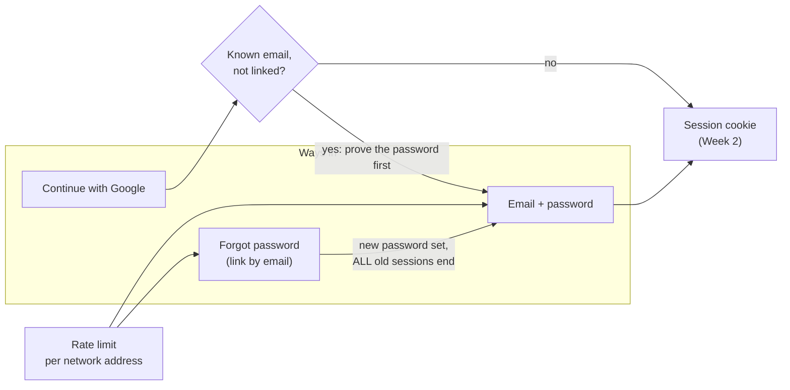
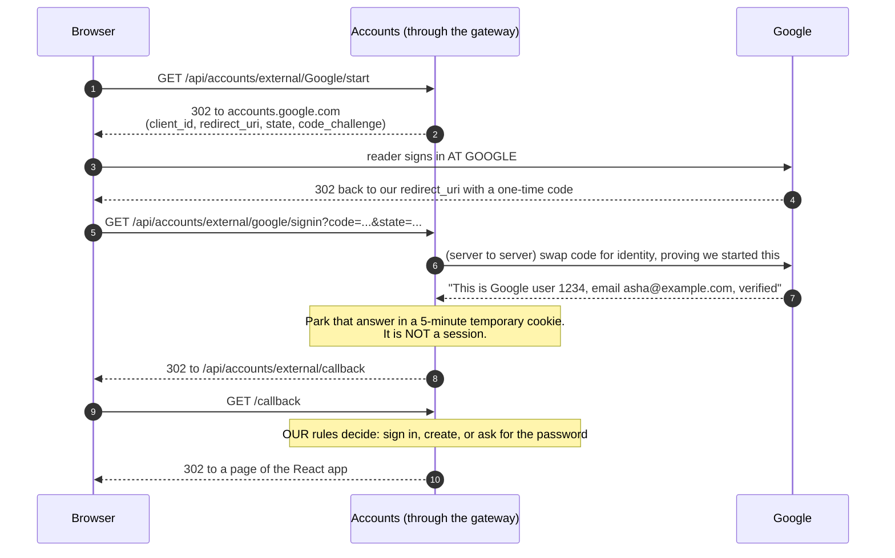
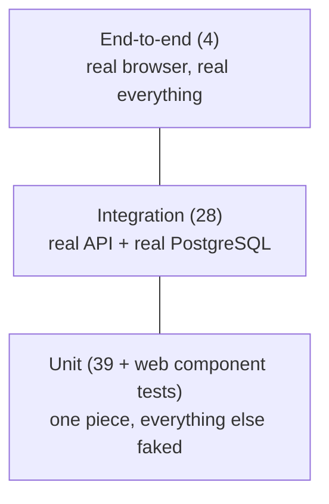
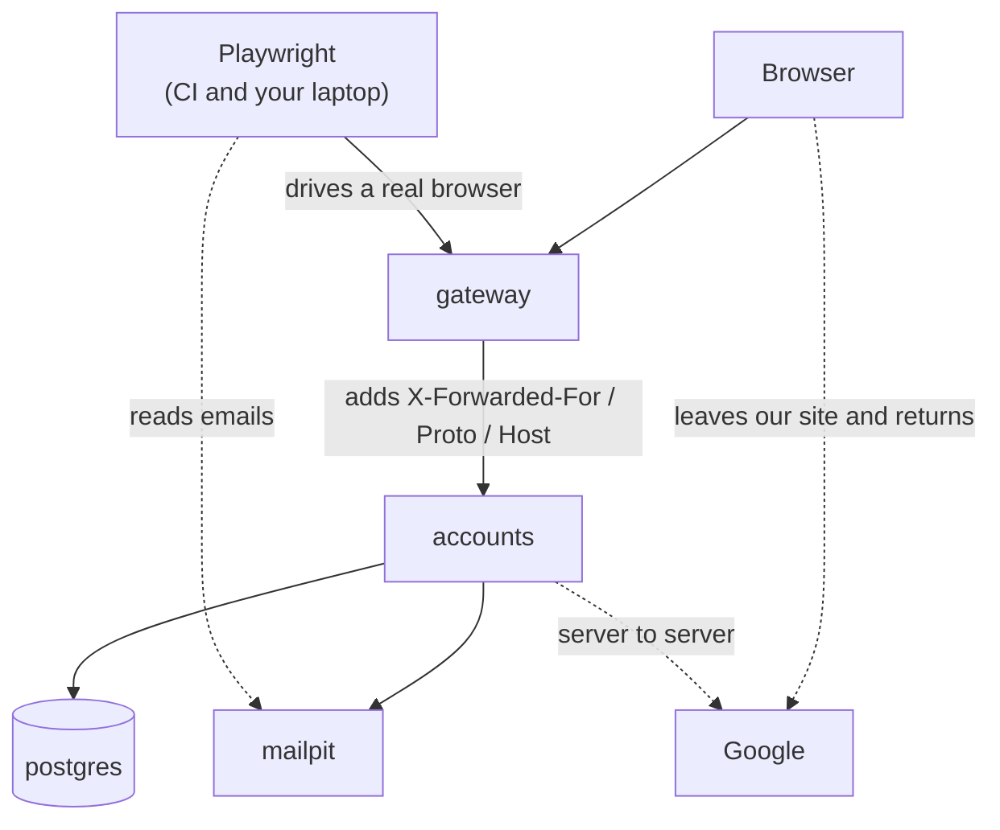
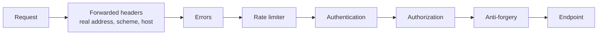
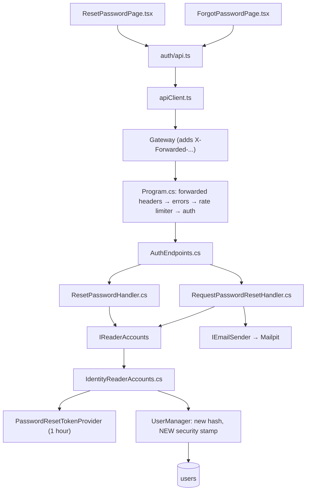
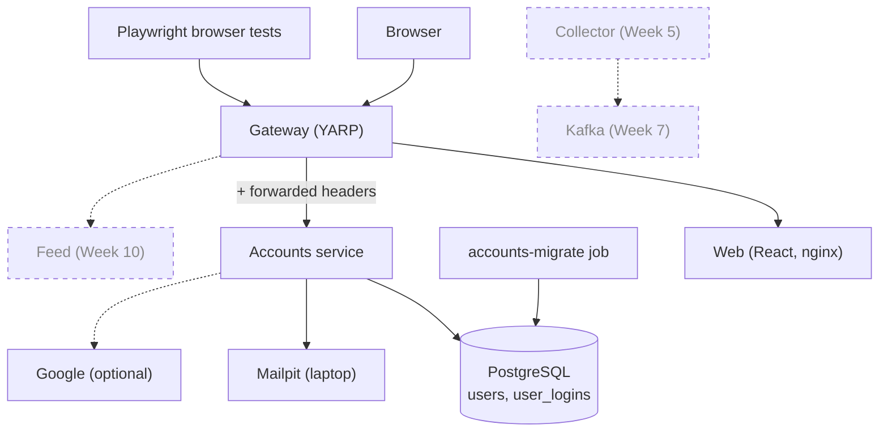

# Building Magpie: A Guided Journey from Empty Folder to Production-Grade System

## Chapter 3 (Week 3): Locking the Door Properly. Password Reset, Google Sign-in and Rate Limits

> **What you will have at the end of this chapter:** a reader who forgets their password can get back in safely; a reader can press "Continue with Google"; an attacker guessing passwords is slowed to a crawl; and a real browser, driven by a robot, proves all the journeys work on every push.

| | |
|---|---|
| **Week** | 3 of 26 |
| **Plan step** | Step 2, Login and signup (part 2 of 2) |
| **Time budget** | About 8 hours |
| **You need** | Chapter 2 finished and running |
| **Repository** | https://github.com/ankitchoubey800/magpie |
| **Code for this chapter** | Commit `{{sha7}}` on branch `week-03` (pull request #2, stacked on `week-02`). Every link in this chapter points at that exact commit |

---

### How this chapter was checked (read this first)

| What | Where it was run | Result |
|---|---|---|
| .NET: 67 tests (39 unit, 28 against a real PostgreSQL) | GitHub Actions | `Passed! - Failed: 0, Passed: 67, Skipped: 0, Total: 67` |
| Website: lint, 29 tests, build | Author's workspace and GitHub Actions | Passed |
| **Browser tests: 4 journeys in real Chromium** against the Docker Compose system, including the cookie flags as the browser reports them | GitHub Actions (Playwright) | `4 passed (7.5s)`, after fixing a flaky test (Step 9) |
| Password reset end to end, including "old sessions end" | Integration tests and browser test | Passed |
| Rate limit and lockout under fast guessing | GitHub Actions (`infra/smoke/guess_passwords.py`) | Real output in section 6 |
| "Continue with Google" **up to the moment the browser leaves for Google**: the redirect carries our correct public address | GitHub Actions | Real output in Step 8 |
| The account-linking rules after Google answers | Integration tests with a stand-in for Google | Passed (8 tests) |
| **Not verified by anyone:** the round trip through the **real** Google. It needs a Google client id and secret that only you can create | | You do this (Step 8). Everything on our side of that round trip is tested |
| **Not yet run:** anything on your own laptop | | You do this. It is closing item 2 |

The full evidence is public: {{run}}

One item from Chapter 2's "nobody has done this yet" list is now closed: the pages have been opened in a real browser, and the session cookie's `HttpOnly`, `Secure` and `SameSite=Lax` flags were read back from Chromium itself.

---

## 1. The big picture

### What are we building this week?

Last week we fitted a door and a lock. This week is everything a locksmith would tell you that you forgot:

1. **A spare-key procedure.** People forget passwords. The way back in must not become the way in for a burglar.
2. **A second entrance.** "Continue with Google" lets a reader in without creating yet another password. The danger is two entrances leading to the same room by accident.
3. **A slow lock.** Someone trying every key on the ring should get eight tries a minute, not eight thousand.
4. **A night watchman.** A robot that walks every journey in a real browser, every time the code changes.



**Reading the diagram:** three ways in, one kind of session at the end. Two of the ways pass through a rate limit. The diamond is this week's most important rule: Google may not open an *existing* account until its owner has proven the password once.

### Why does it matter?

Attackers rarely break the front door. They use the side paths: the reset form, the "sign in with" button, the endpoint nobody thought to slow down. An architect is judged less by the happy path than by these edges.

> 🧠 **Pause and think**
> You own `asha@example.com` at Magpie, with a password. Tomorrow a new sign-in provider is added, and it happens to let anyone register *any* email address without checking it. If Magpie links accounts whenever emails match, what can a stranger do? (Answer in section 11.)

### This week's deliverables

1. Forgot-password and reset-password, by a short-lived, single-use emailed link.
2. A reset ends every existing session.
3. "Continue with Google", switched on only when configured, with safe account linking.
4. Rate limiting on every sign-up, sign-in and reset address.
5. The service learns the reader's real network address from the gateway.
6. Playwright browser tests in CI.

---

## 2. Concepts first

### 2.1 Password reset: a spare key by post

The reset link is the confirmation link's dangerous cousin. A confirmation link only proves an address; a reset link **hands over the account**. So it gets stricter rules:

| Rule | Why |
|---|---|
| Lives for **1 hour** (confirmation: 24 hours) | Old emails sit in inboxes for years |
| Works **once** | A link in browser history or a forwarded email must be dead |
| Using it **ends every session** | If the reset is because someone else got in, they must be thrown out |
| The form says the same thing for known and unknown emails | The enumeration rule from Week 2 |
| Only sent to **confirmed** accounts | An unconfirmed address has not proven it is reachable |

### 2.2 The security stamp: one switch that does two jobs

Every account has a **security stamp**: a random value that changes whenever the account's credentials change. Two things are built from it:

- The reset **token** is sealed together with the stamp. After a successful reset the stamp changes, so the same token no longer matches. That is how "works once" happens without us storing used tokens anywhere.
- Every session **cookie** carries the stamp it was issued with. The server re-checks cookies against the account from time to time. After the stamp changes, old cookies fail the check. That is "ends every session".

This is the fix for last week's break-it finding (a copied cookie outliving sign-out). The re-check interval is a dial:

| Re-check every... | Stolen cookie works for at most... | Cost |
|---|---|---|
| 30 minutes (framework default) | 30 minutes after a reset | Almost nothing |
| **5 minutes (our setting)** | 5 minutes | One small database read per reader every 5 minutes |
| Every request | 0 | A database read on every request |

### 2.3 OAuth and OpenID Connect, now for real

Last chapter's side lesson becomes code. When a reader presses "Continue with Google":



**Reading the diagram:** Google's password never touches us (step 3 happens on Google's site). The browser only ever carries a one-time **code**; the real identity is fetched by our server directly (steps 6 and 7). Steps 1 to 8 are handled by a Microsoft library. Step 10 is ours, and it is where the security decision lives.

Words you will meet:

- **Client id / client secret**: our application's username and password *at Google*.
- **Redirect URI**: the exact address Google may send the browser back to. Registered at Google in advance, so a stolen code cannot be delivered elsewhere.
- **State**: a random value we send and expect back, proving the return trip belongs to a journey *we* started. It is the anti-forgery token of this flow.
- **Code challenge (PKCE)**: a second proof, so a code intercepted on the way back is useless to anyone else. You can see `code_challenge` in our real redirect in Step 8.

### 2.4 The account-linking trap

Three situations when Google says "this is `asha@example.com`":

| We have... | We do... |
|---|---|
| This exact Google identity, already linked | Sign in |
| Nobody with that email | Create an account (no password; email counts as confirmed because Google verified it) and sign in |
| **An account with that email, not linked** | **Neither.** Ask for the existing password once, then link |

The third row is the trap. Linking automatically "because the emails match" makes every account only as safe as the sloppiest provider you ever add. Proof of ownership first; then link. This is ADR-0004.

### 2.5 Rate limiting

A **rate limit** caps how many requests one caller may make in a period. Ours: 10 per minute per network address, on the sensitive addresses only.

A nightclub analogy for the common methods:

| Method | How it works | Feel |
|---|---|---|
| **Fixed window** (ours) | "10 people per minute", counter resets on the minute | Simple; allows a burst at the boundary (10 at 0:59, 10 at 1:00) |
| Sliding window | The same, but measured over the *last 60 seconds* | Smoother, a little more bookkeeping |
| Token bucket | A bucket refills at a steady rate; each request takes a token | Allows short bursts, enforces a long-run average |

Fixed window is the easiest to reason about and enough for sign-in. Week 17 compares them properly at the gateway.

**Rate limit and lockout are different tools:**

| | Lockout (Week 2) | Rate limit (this week) |
|---|---|---|
| Counts by | Account | Caller's network address |
| Stops | Many guesses at **one** account | Many guesses from **one** place, across any accounts |
| Weakness | Attacker can lock a victim out on purpose | Attacker with many addresses spreads out |
| Answer | 401 (indistinguishable, on purpose) | 429 with `Retry-After` |

Each covers the other's weakness. You want both.

### 2.6 "Who is really calling?" Forwarded headers

Here is a subtle problem. Every request reaches Accounts **from the gateway**. So from Accounts' point of view, every reader has the same address: the gateway's. A rate limit per address would then be one shared limit for the whole world.

The gateway knows the truth, and passes it on in three headers:

| Header | Carries |
|---|---|
| `X-Forwarded-For` | The reader's real network address |
| `X-Forwarded-Proto` | Whether the reader used `http` or `https` |
| `X-Forwarded-Host` | The address the reader typed (`localhost:8080`) |

Accounts must be told to believe them. Like a letter forwarded by a hotel reception: you trust the "originally from" note because you trust the reception.

> ⚠️ **Watch out**
> Only believe these headers from something you control. A service that can be reached directly from the internet and trusts `X-Forwarded-For` lets any caller *type* their own address and dodge every limit. This is why Week 17 closes the direct port.

The third header fixes a second problem: without it, Accounts would tell Google to send people back to `http://accounts:8080/...`, an address that only exists inside Docker.

### 2.7 Open redirects

Our start address accepts `returnUrl`, so the reader lands where they were heading. If we redirected to *any* value, an attacker could send people a genuine Magpie link that, after a genuine sign-in, drops them on a fake look-alike site asking them to "sign in again". This is an **open redirect**. The rule: only ever redirect to a path on our own site.

### 2.8 End-to-end tests

So far our tests poke at parts. An **end-to-end (E2E)** test drives the whole system through a real browser, exactly as a person would: click, type, read the email, click the link.



**Reading the diagram:** the same pyramid as Chapter 1, with a new top. End-to-end tests are the slowest and the most fragile, so there are few of them, and each covers a whole journey. They catch what nothing else can: the pieces working individually but not together.

We use **Playwright**, which controls a real Chromium.

---

## 3. Architecture and decisions

### 3.1 What changes



**Reading the diagram:** no new containers. Two new relationships: Accounts now talks to Google (only when configured), and a test robot drives the system from outside, reading Mailpit like a person reading an inbox.

### 3.2 The pipeline now



**Reading the diagram:** two new stations. Forwarded headers must be **first**, because everything after it (the rate limiter's "who is this?", Google's "where do I send them back?") depends on the corrected values. The rate limiter sits before authentication: a refused request should cost us as little work as possible.

### 3.3 Decisions

| # | Decision | Why | Recorded in |
|---|---|---|---|
| 1 | Reset tokens from their own token maker with a 1-hour life | A reset link is far more dangerous than a confirmation link | This chapter |
| 2 | Session re-check every 5 minutes (was the 30-minute default) | Your Week 2 break-it finding; bounded cost | This chapter; `Accounts:SessionRecheckMinutes` |
| 3 | A successful reset also lifts lockout | The reader has just proven they own the mailbox | This chapter |
| 4 | Never link an outside identity by email alone | See 2.4 | ADR-0004 |
| 5 | Google is registered only if a client id and secret are configured | The laptop and CI must work with no Google account; the button simply does not appear | This chapter |
| 6 | Outside sign-in sits behind a port, `IExternalSignIn` | The linking rules are testable with a stand-in for Google | This chapter |
| 7 | Rate limit inside Accounts now; the gateway takes over the general case in Week 17 | The guide's order; the service knows which of its addresses are sensitive | Guide |
| 8 | Services trust the gateway's forwarded headers | Needed for both the rate limit and Google's return address | Closes a Week 2 carried item |
| 9 | Playwright tests run against Docker Compose, not a special test build | Tests what readers will actually get | This chapter |

### 3.4 Files changed from earlier weeks

| File | Change |
|---|---|
| `Magpie.Defaults/MagpieDefaultsExtensions.cs` | New `TrustGatewayForwardedHeaders()` |
| `Application/Abstractions/IReaderAccounts.cs`, `AccountLinks.cs`, `Registration/AccountEmails.cs` | Reset methods, reset link, reset email |
| `Infrastructure/Identity/IdentityReaderAccounts.cs`, `DependencyInjection.cs` | Reset implementation; token maker; new adapter registered |
| `Api/Options/AccountsOptions.cs`, `Security/SecuritySetup.cs`, `Endpoints/AuthEndpoints.cs`, `AuthContracts.cs`, `Program.cs`, `appsettings.json`, `.csproj` | Two settings, Google, rate limiting, two endpoints, two pipeline steps |
| `Tests/Fakes/FakeReaderAccounts.cs`, `Integration/AccountsApiFactory.cs`, `ApiSession.cs` | New port methods; test settings; stand-in Google; reset-link reader |
| `web`: `features/auth/api.ts`, `SignInPage.tsx`, `app/App.tsx`, `index.css`, `test/fakeServer.ts`, `vite.config.ts` | New calls, Google button, routes |
| `infra/docker-compose.yml`, `.env.example`, `smoke/auth_flow.py`, `.github/workflows/ci.yml` | New settings; shared pretend browser; browser tests and experiments in CI |

---

## 4. Implementation guide

Start a branch from last week's: `git switch week-02 && git switch -c week-03`.

### Step 1: Teach services who is really calling

**What:** one method in the shared library, called by services that sit behind the gateway.
**Why:** see 2.6. Without it, this week's rate limit and Google redirect are both wrong.

Replace `MagpieDefaultsExtensions.cs`. The new part is `TrustGatewayForwardedHeaders`:

{{file:src/shared/Magpie.Defaults/MagpieDefaultsExtensions.cs}}

Verified with a small sample before it went into the project: a request carrying `X-Forwarded-For: 203.0.113.9`, `X-Forwarded-Proto: https`, `X-Forwarded-Host: magpie.example` was seen by the endpoint as coming from `203.0.113.9` over `https` at `magpie.example`.

{{gh:src/shared/Magpie.Defaults/MagpieDefaultsExtensions.cs}}

**Check:** `dotnet build src/shared/Magpie.Defaults` succeeds.

> ❓ **Q&A**
> **Q: Why is this not simply part of `AddMagpieDefaults`?**
> A: Because the gateway also uses the defaults, and the gateway must **not** trust these headers: its callers are the open internet. A separate, loudly named method makes the choice visible in each `Program.cs`.
> **Q: "Accept any sender" sounds dangerous.**
> A: It would be on a service reachable from outside. Ours is reachable only through the gateway (plus a laptop-only debugging port that Week 17 removes). The risk is written down in section 8.

### Step 2: Application, the reset use cases and the outside sign-in port

Extend the accounts port with two methods and their result types:

{{file:src/services/accounts/Magpie.Accounts.Application/Abstractions/IReaderAccounts.cs}}

Add the reset link (whole file shown):

{{file:src/services/accounts/Magpie.Accounts.Application/Abstractions/AccountLinks.cs}}

Add the reset email:

{{file:src/services/accounts/Magpie.Accounts.Application/Registration/AccountEmails.cs}}

Create a `PasswordReset` folder with the two use cases:

{{file:src/services/accounts/Magpie.Accounts.Application/PasswordReset/RequestPasswordResetHandler.cs}}

{{file:src/services/accounts/Magpie.Accounts.Application/PasswordReset/ResetPasswordHandler.cs}}

And the new port. Read the comment on each outcome: this `enum` is section 2.4 written as code.

{{file:src/services/accounts/Magpie.Accounts.Application/Abstractions/IExternalSignIn.cs}}

{{gh:src/services/accounts/Magpie.Accounts.Application/Abstractions/IReaderAccounts.cs|src/services/accounts/Magpie.Accounts.Application/Abstractions/AccountLinks.cs|src/services/accounts/Magpie.Accounts.Application/Registration/AccountEmails.cs|src/services/accounts/Magpie.Accounts.Application/PasswordReset/RequestPasswordResetHandler.cs|src/services/accounts/Magpie.Accounts.Application/PasswordReset/ResetPasswordHandler.cs|src/services/accounts/Magpie.Accounts.Application/Abstractions/IExternalSignIn.cs}}

**Check:** `dotnet build src/services/accounts/Magpie.Accounts.Application` succeeds; the project still references only Domain.

> ❓ **Q&A**
> **Q: `ResetPasswordHandler` checks for an empty password *before* calling the port. Why does the order matter?**
> A: A reset token is spent when it is used successfully. We never want a reader to burn their one link on a mistake we could have caught first. A test in Step 6 goes further: a *weak* password is refused and the same link still works afterwards.
> **Q: Why three result values for a reset instead of true/false?**
> A: The reader needs different help in each case: "ask for a new link" versus "choose a stronger password". Unlike sign-in, telling them apart leaks nothing about other people.

### Step 3: Infrastructure, reset tokens and the outside sign-in adapter

A token maker used only for reset links:

{{file:src/services/accounts/Magpie.Accounts.Infrastructure/Identity/PasswordResetTokenProvider.cs}}

The accounts adapter gains the two reset methods (whole file shown; the link-safe encoding from Week 2 is now two small helper methods):

{{file:src/services/accounts/Magpie.Accounts.Infrastructure/Identity/IdentityReaderAccounts.cs}}

The outside sign-in adapter. Match each "Case" comment to a row of the table in 2.4:

{{file:src/services/accounts/Magpie.Accounts.Infrastructure/Identity/IdentityExternalSignIn.cs}}

Register the new pieces. Replace `DependencyInjection.cs`:

{{file:src/services/accounts/Magpie.Accounts.Infrastructure/DependencyInjection.cs}}

{{gh:src/services/accounts/Magpie.Accounts.Infrastructure/Identity/PasswordResetTokenProvider.cs|src/services/accounts/Magpie.Accounts.Infrastructure/Identity/IdentityReaderAccounts.cs|src/services/accounts/Magpie.Accounts.Infrastructure/Identity/IdentityExternalSignIn.cs|src/services/accounts/Magpie.Accounts.Infrastructure/DependencyInjection.cs}}

**Check:** `dotnet build src/services/accounts/Magpie.Accounts.Infrastructure` succeeds.

> ❓ **Q&A**
> **Q: Where is the code that makes a reset link single-use?**
> A: There is none of ours. `ResetPasswordAsync` changes the security stamp, and the token was sealed with the old stamp (2.2). A test proves it: the second use of the same link gets "This reset link does not work".
> **Q: In `LinkPendingToReaderAsync`, the reader is already signed in. Why check the email again?**
> A: Otherwise a signed-in attacker could hold a pending Google identity for *someone else's* email and attach it to their own account, or more dangerously the reverse flow in a shared browser. The check pins the waiting identity to the one account it was offered for. There is a test named for exactly this.
> **Q: An account made through Google has no password. Is that a problem?**
> A: No. Sign-in with a password simply fails for it (with the usual generic message), and "Forgot password" lets the reader add one.

### Step 4: Api, rate limiting, Google, and two new settings

Two settings (whole file shown):

{{file:src/services/accounts/Magpie.Accounts.Api/Options/AccountsOptions.cs}}

Rate limiting:

{{file:src/services/accounts/Magpie.Accounts.Api/Security/AuthRateLimiting.cs}}

Google:

```bash
dotnet add src/services/accounts/Magpie.Accounts.Api package Microsoft.AspNetCore.Authentication.Google --version "10.0.*"
```

{{file:src/services/accounts/Magpie.Accounts.Api/Security/GoogleSignIn.cs}}

Wire both into the security setup (whole file shown):

{{file:src/services/accounts/Magpie.Accounts.Api/Security/SecuritySetup.cs}}

{{gh:src/services/accounts/Magpie.Accounts.Api/Options/AccountsOptions.cs|src/services/accounts/Magpie.Accounts.Api/Security/AuthRateLimiting.cs|src/services/accounts/Magpie.Accounts.Api/Security/GoogleSignIn.cs|src/services/accounts/Magpie.Accounts.Api/Security/SecuritySetup.cs|src/services/accounts/Magpie.Accounts.Api/Magpie.Accounts.Api.csproj}}

> ❓ **Q&A**
> **Q: Last week's rule was "`Program.cs` reads no configuration values directly". `AddGoogleIfConfigured` reads two.**
> A: Yes, and the comment in the file says why it is the one exception. Options answer "what value?". This asks "does the feature exist?", which has to be known while the application is being assembled. If Google were always registered, the framework would fail on every request when no client id is set.
> **Q: Why does the limiter read the limit on every request instead of once?**
> A: So it comes from the validated options like every other setting, and tests can lower it for one copy of the service.
> **Q: What is `QueueLimit = 0`?**
> A: Limiters can make extra callers wait in line. For password guessing we want the opposite: an immediate, cheap "no".

### Step 5: Api, endpoints and pipeline

New request shapes (whole file shown):

{{file:src/services/accounts/Magpie.Accounts.Api/Endpoints/AuthContracts.cs}}

The existing endpoints gain `.RequireRateLimiting(...)`, and two are new:

{{file:src/services/accounts/Magpie.Accounts.Api/Endpoints/AuthEndpoints.cs}}

The outside sign-in endpoints:

{{file:src/services/accounts/Magpie.Accounts.Api/Endpoints/ExternalSignInEndpoints.cs}}

`Program.cs` (whole file shown). Note the two new pipeline lines and their positions:

{{file:src/services/accounts/Magpie.Accounts.Api/Program.cs}}

`appsettings.json`:

{{file:src/services/accounts/Magpie.Accounts.Api/appsettings.json}}

| New address | Success | Failure |
|---|---|---|
| `POST /api/accounts/forgot-password` | 202, always | 429 |
| `POST /api/accounts/reset-password` | 204 | 400 "link does not work", or 400 with password messages; 429 |
| `GET /api/accounts/external/providers` | 200 `["Google"]` or `[]` | |
| `GET /api/accounts/external/Google/start` | 302 to Google | 404 if switched off |
| `GET /api/accounts/external/callback` | 302 to a React page | |
| `POST /api/accounts/external/link` | 204 | 400; 401 if not signed in |

{{gh:src/services/accounts/Magpie.Accounts.Api/Endpoints/AuthContracts.cs|src/services/accounts/Magpie.Accounts.Api/Endpoints/AuthEndpoints.cs|src/services/accounts/Magpie.Accounts.Api/Endpoints/ExternalSignInEndpoints.cs|src/services/accounts/Magpie.Accounts.Api/Program.cs|src/services/accounts/Magpie.Accounts.Api/appsettings.json}}

**Check:** `dotnet build Magpie.slnx` succeeds for everything except the test project (updated next).

> ❓ **Q&A**
> **Q: Last week's convention said "a `GET` never changes data". The callback is a `GET` and can create an account.**
> A: A fair catch, and the one sanctioned exception. A sign-in redirect from another site can only be a `GET`; browsers offer nothing else. The protection that anti-forgery gives our `POST`s is provided here by the `state` value (2.3): the library refuses a return trip that does not match a journey this browser started. The convention table in section 13 now says so.
> **Q: Why is `sign-out` not rate limited?**
> A: It cannot be used to guess anything. Limits go where guessing or flooding pays off: register, resend, confirm, sign-in, forgot, reset.
> **Q: Why does `start` have to be a link the browser *navigates* to?**
> A: `fetch()` stays on our page; it cannot take the reader to Google's sign-in screen. The whole flow is a sequence of full-page redirects.

### Step 6: Tests for the service

Update the fake for the new port methods (whole file shown):

{{file:src/services/accounts/Magpie.Accounts.Tests/Fakes/FakeReaderAccounts.cs}}

Unit tests for the reset use cases:

{{file:src/services/accounts/Magpie.Accounts.Tests/Unit/PasswordResetHandlerTests.cs}}

The factory gets two test settings and a stand-in for Google (whole file shown):

{{file:src/services/accounts/Magpie.Accounts.Tests/Integration/AccountsApiFactory.cs}}

The stand-in. Read its comment: it replaces the trip to Google and nothing else.

{{file:src/services/accounts/Magpie.Accounts.Tests/Integration/FakeGoogleHandler.cs}}

`ApiSession` learns to read reset links (whole file shown):

{{file:src/services/accounts/Magpie.Accounts.Tests/Integration/ApiSession.cs}}

Reset tests:

{{file:src/services/accounts/Magpie.Accounts.Tests/Integration/PasswordResetTests.cs}}

The rate-limit test, on a copy of the service with a limit of 3:

{{file:src/services/accounts/Magpie.Accounts.Tests/Integration/RateLimitTests.cs}}

The linking rules, one test per row of the table in 2.4 plus the attacks:

{{file:src/services/accounts/Magpie.Accounts.Tests/Integration/ExternalSignInTests.cs}}

```bash
dotnet test Magpie.slnx
```

```
Passed!  - Failed:     0, Passed:    67, Skipped:     0, Total:    67, Duration: 16 s - Magpie.Accounts.Tests.dll (net10.0)
```

{{gh:src/services/accounts/Magpie.Accounts.Tests/Fakes/FakeReaderAccounts.cs|src/services/accounts/Magpie.Accounts.Tests/Unit/PasswordResetHandlerTests.cs|src/services/accounts/Magpie.Accounts.Tests/Integration/AccountsApiFactory.cs|src/services/accounts/Magpie.Accounts.Tests/Integration/FakeGoogleHandler.cs|src/services/accounts/Magpie.Accounts.Tests/Integration/ApiSession.cs|src/services/accounts/Magpie.Accounts.Tests/Integration/PasswordResetTests.cs|src/services/accounts/Magpie.Accounts.Tests/Integration/RateLimitTests.cs|src/services/accounts/Magpie.Accounts.Tests/Integration/ExternalSignInTests.cs}}

**Check:** 67 passed on your machine.

> ❓ **Q&A**
> **Q: Isn't a fake Google cheating?**
> A: It replaces the one part we do not own and cannot run in a test: Google's sign-in page. Everything after "Google says who you are" is our real code against a real database. What it cannot prove is that our settings match Google's expectations, which is why the table at the top says so plainly and Step 8 has you try the real thing.
> **Q: Why are the test settings `100000` and `0`?**
> A: All tests look like one caller, so the real limit would trip constantly; one test lowers it deliberately. And "a reset ends all sessions" would take five minutes to observe with the real re-check interval, so tests re-check on every request.
> **Q: How does a test know where a chain of redirects ended?**
> A: The test client follows redirects like a browser. `response.RequestMessage.RequestUri` is the address of the *last* request, which is where the journey landed.

### Step 7: The web app

New calls (whole file shown):

{{file:src/web/src/features/auth/api.ts}}

The sign-in page grows a Google button (only if the server says the provider is on), two notices, and the link step:

{{file:src/web/src/features/auth/SignInPage.tsx}}

Two new pages:

{{file:src/web/src/features/auth/ForgotPasswordPage.tsx}}

{{file:src/web/src/features/auth/ResetPasswordPage.tsx}}

Routes (whole file shown):

{{file:src/web/src/app/App.tsx}}

In `src/test/fakeServer.ts` add one default reply, so every existing test that renders the sign-in page still works:

```ts
server.on('GET', '/api/accounts/external/providers', { status: 200, body: [] })
```

In `vite.config.ts` add `xfwd: true` to the proxy entry, so development mode also sends the forwarded headers. Append the two small style rules to `index.css` (linked below).

Tests:

{{file:src/web/src/features/auth/passwordAndGoogle.test.tsx}}

```
 Test Files  4 passed (4)
      Tests  29 passed (29)
```

{{gh:src/web/src/features/auth/api.ts|src/web/src/features/auth/SignInPage.tsx|src/web/src/features/auth/ForgotPasswordPage.tsx|src/web/src/features/auth/ResetPasswordPage.tsx|src/web/src/app/App.tsx|src/web/src/test/fakeServer.ts|src/web/vite.config.ts|src/web/src/index.css|src/web/src/features/auth/passwordAndGoogle.test.tsx}}

> ❓ **Q&A**
> **Q: If fetching the provider list fails, the page shows no Google button and no error. Is that right?**
> A: Yes. Password sign-in must never depend on an optional feature. Failing quietly to "password only" is the safe direction.
> **Q: What if linking fails after a successful password sign-in?**
> A: The reader is signed in anyway, which is what they came for; the temporary identity lasts only five minutes. They can press the Google button again later to retry.

### Step 8: Switch on the real Google (optional, and only you can do it)

Everything works without this step. To try the real round trip:

1. In the Google Cloud console create a project, configure the OAuth consent screen, and create an **OAuth client ID** of type "Web application". (The console's layout changes often; follow Google's current guide rather than screenshots from a book.)
2. Under "Authorized redirect URIs" add **exactly**: `http://localhost:8080/api/accounts/external/google/signin`
3. Put the two values in `infra/.env` (which is not in Git):

```
GOOGLE_CLIENT_ID=your-id.apps.googleusercontent.com
GOOGLE_CLIENT_SECRET=your-secret
```

4. `docker compose -f infra/docker-compose.yml up -d accounts`, open the sign-in page, press "Continue with Google".

What CI proved with a placeholder client: the service sent the browser to Google with our **public** address as the return address (this is the forwarded-host header from Step 1 doing its job through the real gateway):

```
https://accounts.google.com/o/oauth2/v2/auth?client_id=ci-placeholder&scope=openid%20profile%20email&response_type=code
  &redirect_uri=http%3A%2F%2Flocalhost%3A8080%2Fapi%2Faccounts%2Fexternal%2Fgoogle%2Fsignin
  &code_challenge=...&code_challenge_method=S256&state=...
```

What has **not** been proven by anyone: Google accepting that request and the return trip. If it fails for you, section 10 lists the usual causes.

> ❓ **Q&A**
> **Q: Where does the client secret live in development mode (`dotnet run`)?**
> A: In user-secrets: `dotnet user-secrets set "Authentication:Google:ClientSecret" "..." --project src/services/accounts/Magpie.Accounts.Api` (and the same for `ClientId`). Never in `appsettings.json`.
> **Q: Do I need a second redirect URI for development mode?**
> A: Yes: `http://localhost:5173/api/accounts/external/google/signin`, because there the address the reader types is Vite's.

### Step 9: Browser tests with Playwright

**What:** a small separate project, `e2e/`, with four journeys.
**Why:** the walk-through you did by hand last week, done by a robot on every push.

```bash
mkdir -p e2e/tests && cd e2e
npm init -y
npm install -D @playwright/test typescript @types/node
npx playwright install chromium        # downloads the browser (about 150 MB), once
```

{{file:e2e/playwright.config.ts}}

A helper that reads the inbox the way a person would:

{{file:e2e/tests/mailbox.ts}}

The journeys. They are written to be read aloud:

{{file:e2e/tests/auth.spec.ts}}

Run them with the system up (and `AUTH_REQUESTS_PER_MINUTE=1000` in `infra/.env`, or the tests will trip the limit; see the Q&A):

```bash
docker compose -f infra/docker-compose.yml up -d --build
cd e2e && npx playwright test
```

Real output from GitHub Actions:

```
  ✓  1 [chromium] › tests/auth.spec.ts:27:1 › a signed-out visitor is sent to the sign-in page (255ms)
  ✓  2 [chromium] › tests/auth.spec.ts:33:1 › sign up, confirm by email, sign in, stay signed in, sign out (2.4s)
  ✓  3 [chromium] › tests/auth.spec.ts:58:1 › a wrong password shows the generic message and stays on the page (916ms)
  ✓  4 [chromium] › tests/auth.spec.ts:68:1 › forgot password: reset by email, old password stops working, new one works (1.7s)
  4 passed (7.5s)
```

> 🔎 **A flaky test, and how it was caught**
> The fourth test passed on the first run and then failed on the next two, with no change to the product. The failure said the "Check your email" heading never appeared. The service log showed that **no forgot-password request had arrived at all**, and a separate check that sent 60 emails in a row found nothing slow. So the fault was in the test: it clicked the "Forgot your password?" link and immediately typed into "the box labelled Email". Both pages have such a box. When the browser was quick, the text went into the *old* page's box, the new page appeared empty, and the browser's own "this field is required" check silently blocked the submit. The fix is the line that waits for the new page's heading before typing.
>
> Two lessons. A test that sometimes fails is a bug report about the test, not bad luck, so never "just re-run it". And look at what the *server* saw before theorising: the missing request ruled out every server-side explanation in one step.

Try `npx playwright test --headed` once to watch the browser being driven. It is worth the thirty seconds.

{{gh:e2e/package.json|e2e/playwright.config.ts|e2e/tsconfig.json|e2e/tests/mailbox.ts|e2e/tests/auth.spec.ts}}

> ❓ **Q&A**
> **Q: Why find things by label and role (`getByLabel('Email')`, `getByRole('button', ...)`) instead of by CSS class?**
> A: That is how a person, and a screen reader, finds them. Tests written this way survive restyling, and they fail when you break accessibility, which is a failure you want.
> **Q: The tests make many sign-in requests from one address. What about our own rate limit?**
> A: Exactly the conflict you would expect, and a real one in every company. Test environments raise the limit (`AUTH_REQUESTS_PER_MINUTE=1000`); a separate experiment then proves the real limit works (section 6). Never "solve" it by switching the limit off in code.
> **Q: Why is there no browser test for Google?**
> A: It would need a real Google account's password inside CI, and Google actively blocks automated sign-ins. The rules behind the button are covered by the integration tests instead.

### Step 10: Compose, CI and the experiment script

Settings for Compose. In the `accounts` service's `environment` add:

```yaml
      Accounts__AuthRequestsPerMinute: "${AUTH_REQUESTS_PER_MINUTE:-10}"
      Authentication__Google__ClientId: "${GOOGLE_CLIENT_ID:-}"
      Authentication__Google__ClientSecret: "${GOOGLE_CLIENT_SECRET:-}"
```

`${NAME:-10}` means "the value of `NAME`, or `10` if it is not set".

{{file:infra/.env.example}}

The two smoke scripts now share one pretend browser:

{{file:infra/smoke/browser.py}}

The break-it script:

{{file:infra/smoke/guess_passwords.py}}

CI's whole-system job now also runs the Playwright tests, then restarts Accounts with the real limit and a placeholder Google client, checks the Google redirect, and runs the guessing experiment. The whole file is linked below.

Commit, push, and open a pull request **into `week-02`** (not `main`): this is a *stacked* pull request, each week reviewed on top of the previous one.

{{gh:infra/docker-compose.yml|infra/.env.example|infra/smoke/browser.py|infra/smoke/auth_flow.py|infra/smoke/guess_passwords.py|.github/workflows/ci.yml|docs/adr/0004-outside-sign-in-never-links-by-email-alone.md|docs/design-notes/week-03-build-or-buy-login.md}}

**Check:** three green ticks on the pull request.

> ❓ **Q&A**
> **Q: Why does CI restart Accounts halfway through?**
> A: To test two configurations in one run: a generous limit for the journeys, then the real limit for the experiment. A value given on the command line (`AUTH_REQUESTS_PER_MINUTE=10 docker compose up ...`) overrides the one in `.env`.

---

## 5. How the pieces fit together



**Reading the diagram:** the same shape as every feature so far (page → api → client → gateway → endpoint → use case → port → adapter → database). The new idea is at the bottom: one write to `users` changes the password hash *and* the security stamp, and the stamp change is what kills the token and the old sessions.

---

## 6. Break it on purpose

### Experiment A (the week's official one): guess passwords fast

Set `AUTH_REQUESTS_PER_MINUTE=10` in `infra/.env`, restart Accounts, then:

```bash
python3 infra/smoke/guess_passwords.py 30
```

> ✏️ **Pencil time**
> Predict: of 30 wrong guesses, how many get as far as the password check? What happens if you then try the *correct* password? And is the account locked?

Real output from GitHub Actions:

```
two requests (register, confirm) already count towards this minute's limit
30 wrong guesses in 0.5 seconds: 401 401 401 401 401 401 401 401 429 429 429 429 429 429 429 429 429 429 429 429 429 429 429 429 429 429 429 429 429 429
guesses that reached the password check (401): 8
first 429 at guess number: 9
the CORRECT password straight afterwards: 429

 failed_count | locked
            0 | t
```

What this shows:

- **Eight guesses** were examined (ten per minute, minus the two requests the script used to create the account). The other 22 were refused before any password work was done.
- **The correct password got 429 too.** The rate limit does not care whether you are right. This is the honest cost of the defence: a real reader who mistypes ten times waits a minute.
- **The account is locked** (`locked = t`): the fifth wrong guess triggered lockout, and guesses six to eight got a 401 that *looks identical* but never checked the password. `failed_count` is 0 because the counter restarts when a lockout begins.
- From outside, nobody can tell which 401s were real checks. That is the point.

Now do the arithmetic an attacker does: 8 guesses a minute is about 11,500 a day from one address, against one account that locks after 5. A 10-character password is out of reach. The remaining attacks are many addresses (Week 17: limits at the gateway, and by account as well as address) and stolen password lists (the optional breached-password check).

### Experiment B: is the spare key really single-use?

Request a reset, open the link, set a new password. Press the browser's Back button and submit again. Expected, and proven by an integration test: "This reset link does not work".

### Experiment C: does a reset throw the burglar out?

Repeat last week's copied-cookie experiment, then reset the password. Within five minutes the copied cookie stops working. (The integration test proves it with the interval set to zero.) Write in your design note whether five minutes is the right dial setting for Magpie.

### Experiment D: an open redirect attempt

Open `http://localhost:8080/api/accounts/external/Google/start?returnUrl=https://example.org` (with Google switched on). After sign-in you land on Magpie's home page, not on `example.org`. Two integration tests cover this.

---

## 7. Production considerations

| Area | In place this week | Deliberately later |
|---|---|---|
| **Security** | Short-lived single-use reset; sessions end on reset; no enumeration on forgot-password; safe linking; only verified provider emails; open-redirect guard; rate limit and lockout together; secrets for Google outside Git | Limits by account as well as address, and at the gateway (Week 17). Breached-password check (optional). Notify the reader by email when their password changes (a good small exercise). Passkeys (later list) |
| **Reliability** | Sign-in still works if the provider list cannot be fetched; password sign-in is independent of Google | If Google is down, Google-only readers cannot sign in. "Forgot password" gives them a way to add a password |
| **Scalability** | | **The rate-limit counters live in one process's memory.** Two copies of Accounts means the real limit is doubled, and counters vanish on restart. Shared counters arrive with Valkey (Week 10 / Week 17) |
| **Cost** | Session re-check: one small read per active reader every five minutes | Cache the stamp in Valkey if it ever shows up in measurements |
| **Privacy** | From Google we store only its identifier for the reader and use the email. We ask for the smallest set of permissions | Explain this in the privacy policy (Week 18) |
| **Testing** | Unit, integration, component and browser tests; experiments in CI | Browser tests in Firefox and WebKit (one line each in the Playwright config), when the value justifies the minutes |
| **Operations** | 429s carry `Retry-After` and the standard error shape with `code: rate_limited` | Count 401s, 429s and resets as metrics and alert on spikes (Week 19) |

---

## 8. Architect's perspective

**Risks worth naming**

| Risk | Likely / bad | What we do |
|---|---|---|
| In-memory rate-limit counters with several copies | Certain when we scale / medium | Written down here and in the progress log; fixed when Valkey arrives |
| Trusting forwarded headers on a directly reachable service | Possible / high (limit bypass) | Direct port is laptop-only and removed in Week 17; the gateway overwrites the headers |
| Many readers behind one address (office, campus, mobile carrier) share one limit | Likely / medium (false refusals) | 10 a minute is generous for humans; Week 17 adds per-account limits so the per-address one can be looser |
| An attacker uses "forgot password" to fill someone's inbox | Possible / low | Same rate limit; only confirmed accounts get mail |
| Our Google setup has never met the real Google | Certain until you try / low | Stated plainly; Step 8 |
| Depending on one outside provider | Low / medium | Password remains a first-class way in; the port makes a second provider a small change |

**The interview question behind this week: "Design the password reset flow."**

A strong answer covers, in order: no enumeration; a random, signed, short-lived, single-use token delivered only to the registered address; the link opens a page and the page posts; rate limits on both the request and the reset; on success, invalidate the token and all sessions, lift lockout, and tell the user by email; log the event without logging the token. You have now built every item but the notification email.

**A question with no single right answer: where should rate limiting live?**

At the edge (gateway), it protects everything cheaply and can be shared, but it knows nothing about which requests are sensitive beyond their path. In the service, it understands the domain ("this is a password check") but each service must do it again. Mature systems do both: coarse limits at the edge, precise ones in the service. We built the precise one first because the guide's order is by feature; Week 17 adds the coarse one.

---

## 9. Alternatives and trade-offs

| Decision | We chose | Alternative | When the alternative is better |
|---|---|---|---|
| Recovering access | Emailed reset link | "Magic link" sign-in with no passwords at all; security questions (do not); SMS codes | Magic links suit products where email is always at hand. SMS adds cost and SIM-swap risk |
| Ending sessions | Security stamp, re-checked every 5 minutes | Server-side session store with instant revocation | Banking-grade requirements; costs a lookup per request |
| Outside sign-in | Google through the framework's handler | A managed identity service doing all providers; generic OpenID Connect handler | More than two or three providers, or enterprise single sign-on |
| Linking | Prove the password first | Email a confirmation link to the existing address instead | Works for readers who forgot their password; slightly more code. A good later improvement |
| Limiter algorithm | Fixed window | Sliding window or token bucket | Public APIs where boundary bursts matter |
| Limiter key | Network address | Account; address + account; device fingerprint | Add per-account as soon as counters are shared |
| Limiter place | In the service | At the gateway or a CDN/WAF | Always *also* at the edge in production |
| Browser tests | Playwright against Compose | Cypress; Selenium; testing against a deployed staging site | Team familiarity; staging once it exists (Week 21) |
| Build or buy | Build | Amazon Cognito, Auth0 and similar | See this week's design note |

**Essential or optional?**

| Essential | Optional enhancements |
|---|---|
| Single-use, short-lived reset links | Email "your password was changed" |
| Reset ends sessions | Showing the reader a list of their devices |
| Never link by email alone | More providers |
| A rate limit on anything that checks a secret | CAPTCHA after repeated failures |
| At least one end-to-end test of the main journey | Cross-browser runs, visual comparison |

---

## 10. Common mistakes and troubleshooting

### Mistakes beginners make this week

1. **Auto-linking accounts by email.** The headline mistake.
2. **Reset links that still work after use**, or that live for days.
3. **"No account with that email" on the forgot-password form.**
4. **Committing the Google client secret.**
5. **Rate limiting by an address that is always the proxy's.**
6. **Trusting `X-Forwarded-For` from anyone.**
7. **Redirecting to whatever `returnUrl` says.**
8. **Keeping rate-limit counters in memory and then running several copies.** (We do this knowingly, for now, and wrote it down. That is the difference between a decision and a mistake.)
9. **Disabling the limit to make tests pass.**

### When something goes wrong

| Symptom | Likely cause | Fix |
|---|---|---|
| Everything returns 429 during development | You hit 10 requests a minute | Wait a minute, or raise `AUTH_REQUESTS_PER_MINUTE` in `infra/.env` and restart Accounts |
| Playwright tests fail with "Too many attempts" on screen | Same | Use `AUTH_REQUESTS_PER_MINUTE=1000` for test runs |
| Every reader seems to share one rate limit | Forwarded headers not processed, or `UseForwardedHeaders()` is not first | Step 1 and the order in `Program.cs` |
| Google: "Error 400: redirect_uri_mismatch" | The address registered at Google differs from the one we send | Compare with the `redirect_uri` in the browser's address bar, character by character: scheme, port, path, no trailing slash |
| Google redirect contains `accounts:8080` | Forwarded host not trusted | Step 1 |
| Back from Google: "Correlation failed" | The small correlation cookie did not come back: cookies blocked, a different host on the return trip (`127.0.0.1` vs `localhost`), or more than 15 minutes on Google's page | Use one host name consistently; try again |
| No Google button | Client id or secret empty, or Accounts not restarted | Check `infra/.env`; `docker compose ... up -d accounts` |
| Sent to `/sign-in?error=external` | Provider returned no verified email, or the temporary cookie expired | Try again; check the Google account's email is verified |
| `/sign-in?link=pending` every time | Working as designed: sign in with the password once | |
| Reset link "does not work" immediately | More than an hour old, already used, or a newer reset happened since | Request a new one. (Any password change invalidates older links) |
| Signed out about five minutes after someone reset your password | Working as designed | |
| `npx playwright test`: "Executable doesn't exist" | Browser not downloaded | `npx playwright install chromium` |
| A browser test fails only *sometimes*, at a step right after a click that changes the page | The test typed or clicked before the new page was showing | Wait for something that only exists on the new page (its heading) first. See the callout in Step 9 |
| Playwright cannot find a field | The label text changed | Tests find things by label and role; update the test or, better, ask whether the label change was intended |
| A browser test fails only in CI | Timing, or a different limit setting | Open the saved trace: `npx playwright show-trace test-results/.../trace.zip` |

---

## 11. Knowledge check

### Pause-and-think answer (from section 1)

The stranger registers `asha@example.com` at the sloppy provider, presses "Continue with" it at Magpie, and, if we link by email, is signed in to your existing account with all its data. Your password was never involved. This is why the rule is proof first, link second, and why we only accept emails the provider states it verified.

### Concept questions

1. Name four properties a password-reset link must have, and the risk each addresses.
2. How does one change to the security stamp both kill the reset token and end sessions?
3. What is the difference between lockout and rate limiting? Why keep both?
4. Why can a service behind a gateway not use the connection's address for rate limiting, and what must be true before it may trust `X-Forwarded-For`?
5. In the Google flow, what are `redirect_uri` and `state` each protecting against?
6. Why is the third row of the linking table handled differently from the second?
7. What can an end-to-end test catch that integration tests cannot? Why not write only end-to-end tests?

### Practical exercises

1. **Tell the owner.** After a successful reset, send a "your password was changed" email. Which layer does the code belong in? Add a unit test.
2. **Change the dial.** Set `Accounts__SessionRecheckMinutes=1`, repeat Experiment C, and time it.
3. **Limit by account too.** Add a second partition keyed by the email in the sign-in request. What new problem appears? (Hint: the body must be read before the limiter runs.)
4. **Break the order.** Move `app.UseForwardedHeaders()` below `app.UseRateLimiter()`. Predict what `guess_passwords.py` shows from two different machines. Put it back.
5. **A fifth journey.** Write a Playwright test for "register with an address that already has an account": the screen must look identical, and the inbox must contain the "already have an account" email.
6. **Watch it.** Run `npx playwright test --headed --debug` and step through a journey.

### Interview-style questions with model answers

**Q1. Walk through what happens when someone clicks "Continue with Google".**
The browser navigates to our start address; we redirect to Google with our client id, the registered return address, a random state and a PKCE challenge. The user signs in at Google. Google redirects back with a one-time code. Our server exchanges the code directly with Google for the user's identity and checks the state. We then apply our own rules: sign in if this identity is already linked; create an account if the verified email is new; otherwise require the existing password before linking. Finally we issue our own session cookie. Google proves identity; the session is ours.

**Q2. How do you stop password-guessing attacks?**
In layers. A slow password hash makes each guess expensive. Lockout caps guesses per account. Rate limiting caps guesses per caller and is applied before any password work. Identical responses hide which guesses were even examined. Beyond that: limits at the edge and per account with shared counters, breached-password checks, and offering passkeys or multi-factor sign-in. I would also monitor failure rates and alert on spikes.

**Q3. What would make you move to a managed login service?**
A compliance or enterprise single-sign-on requirement, a security incident, or login work crowding out product work. I would compare cost per monthly active user at our expected scale against our engineering time, and I would want the code structured so the swap is contained: here that is two ports.

**Q4. A user reports "I reset my password but my old phone is still signed in." Explain.**
Sessions are self-contained cookies that are re-validated against the account's security stamp at an interval, five minutes in our case. Until the next re-check the old cookie is accepted. If that window is unacceptable I can shorten the interval at the cost of more database reads, or move to server-side sessions for instant revocation.

**Q5. Why is your rate limiter wrong the moment you run two copies of the service?**
The counters are in each process's memory. Two copies each allow the full limit, and a restart forgets everything. The fix is a shared store for the counters, with care about what happens when that store is unavailable: fail open and lose protection, or fail closed and lock everyone out. For sign-in I would fail closed only for the strict policy.

**Q6. What is an open redirect and how did you prevent it?**
An endpoint that redirects to an address supplied by the caller. Attackers use a trusted site's link to land victims on a malicious one. We accept only paths that begin with a single slash, so the destination is always on our own site.

### Self-marking

Mark each concept question **solid**, **shaky** or **gap**.

---

## 12. Completion checklist

**Built**

- [ ] `dotnet test Magpie.slnx` shows 67 passed on your machine
- [ ] `npm test` in `src/web` shows 29 passed
- [ ] `npx playwright test` in `e2e` shows 4 passed
- [ ] Forgot password and reset work in your browser, by hand
- [ ] `guess_passwords.py` shows 429s starting where you predicted
- [ ] The pull request's three checks are green
- [ ] (Optional) Real Google sign-in tried, and the result noted either way

**Understood**

- [ ] The five rules of a reset link
- [ ] What the security stamp does
- [ ] The three linking cases and why the third is special
- [ ] Lockout versus rate limit
- [ ] Why forwarded headers exist and when they may be trusted
- [ ] Where end-to-end tests sit in the pyramid

**The five closing items**

- [ ] 1. **Design note** "Build login ourselves or buy it?" with real prices filled in by you (`docs/design-notes/week-03-build-or-buy-login.md` is a draft)
- [ ] 2. **Working code and tests on your machine**, output saved
- [ ] 3. **Break-it experiment A** done by you, with your predictions and the results
- [ ] 4. **Explain-back**, 150 to 300 words, in `docs/explain-back/week-03.md`
- [ ] 5. **Interview questions** answered without notes and marked

**Non-technical**

- [ ] Register the Google sign-in app and read its consent-screen requirements
- [ ] First public post (LinkedIn or blog): "Why I chose cookies over tokens". Writing in public is interview evidence

When every box is ticked: merge (merge commit) and `git tag week-03-done && git push --tags`.

---

## 13. Cumulative architecture overview (version 3, after Week 3)

### System map



**Reading the diagram:** no new boxes of our own this week; the login system gained depth rather than width. Step 2 of the plan (login and signup) is now complete.

### What exists

| Component | Responsibility today | Added | Changed |
|---|---|---|---|
| Gateway | Routes; passes on the reader's address, scheme and host | Week 1 | |
| Accounts service | Register, confirm, sign in/out, who-am-I, **password reset, Google sign-in with linking, rate limits** | Week 1 | Weeks 2, 3 |
| Web | **Forgot/reset pages, Google button** | Week 1 | Weeks 2, 3 |
| PostgreSQL | `users`; `user_logins` now used for linked Google identities | Week 1 | Week 2 |
| Mailpit | Catches email | Week 2 | |
| Magpie.Defaults | Logging, errors, health, **forwarded-header trust for services behind the gateway** | Week 1 | Weeks 2, 3 |
| Tests | Unit, integration, component, **browser (Playwright)** | Week 1 | Weeks 2, 3 |

### Conventions (additions this week in **bold**)

| Topic | Convention |
|---|---|
| Public API addresses | `/api/<service>/...`, forwarded unchanged |
| Health | `/health/live`, `/health/ready` |
| Errors | Problem Details with `service`, `traceId`, optional `code` and `errors`. **429 carries `Retry-After` and `code: rate_limited`** |
| Layers | `Domain` ← `Application` ← `Infrastructure`; `Api` is the composition root |
| Sign-in | Cookie `magpie.session`; no login secret in JavaScript |
| Changing data | `POST`/`PUT`/`DELETE` with `X-XSRF-TOKEN`; a `GET` never changes anything, **with one exception: the return leg of an outside sign-in, which is protected by the flow's `state` value** |
| Privacy of existence | Responses never reveal whether an account exists |
| Settings | Typed options validated at start-up. **The only start-up read of raw configuration is "is an optional feature configured at all?"** |
| **Behind the gateway** | **Every service calls `TrustGatewayForwardedHeaders()` and `UseForwardedHeaders()` first in its pipeline. The gateway never does** |
| **Sensitive addresses** | **Anything that checks or issues a secret is rate limited** |
| **Redirects** | **Only to paths on our own site** |
| **Outside identities** | **Never linked by email alone (ADR-0004)** |
| Database changes | Migrations, applied only by `--migrate` |
| Tests | `Unit/`, `Integration/`, **and `e2e/` (Playwright, a few whole journeys)** |
| Git | One branch and pull request per week, **stacked on the previous week's branch until merged**; merge commits |

### Decision log

| ADR | Decision | Week |
|---|---|---|
| 0001 | Separate services behind one gateway | 1 |
| 0002 | Clean Architecture layers inside each .NET service | 1 |
| 0003 | Cookie sessions for the browser | 2 |
| 0004 | An outside sign-in is never linked by email alone | 3 |

---

## 14. Before we start Week 4

### Things only you can do

1. Run everything locally and do the hand walk-through of forgot/reset.
2. Do Experiment A with your own predictions.
3. Try the real Google (Step 8) and note what happened.
4. Fill in the prices in the design note; explain-back; interview questions; the public post.
5. Merge the stacked pull requests in order (#1, then #2), each with a merge commit.

### Differences from the weekly guide (to record in the progress log)

| What the guide said | What we built | Why |
|---|---|---|
| "After a reset, all existing sessions end" | They end within the re-check interval (5 minutes, configurable; 0 in tests) | Self-contained cookies cannot be deleted remotely; the interval is the dial |
| Rate limits on sign-in, register and reset | Also on resend-confirmation, confirm-email and forgot-password | Each checks or issues a secret, or sends mail |
| Google secret in user-secrets | user-secrets for `dotnet run`; `infra/.env` for Compose | Both are outside Git |
| Playwright tests for the full flows | Four journeys, password paths only; Google covered by integration tests with a stand-in | A real Google sign-in cannot be automated responsibly |
| (carried from Week 2) forwarded headers "in the cloud weeks" | Done now | The rate limit and Google's return address both need them |

### Carried into Week 4 (interests)

| Item | Why it matters |
|---|---|
| A small **mediator** for commands and queries | The use-case count is growing; Week 4 introduces one way to dispatch them |
| Second **migration** (categories, reader interests) | First schema change on a database that already has data |
| **TanStack Query** in the web app | The hand-written hooks from Weeks 1 and 2 meet their replacement |
| First **"who owns this?"** authorization rule | A reader may change only their own interests |

### Carried further ahead

| Item | When |
|---|---|
| Shared rate-limit counters; limits per account; limits at the gateway | Weeks 10 and 17 |
| Remove the direct Accounts port (forwarded-header trust depends on it) | Week 17 |
| Real HTTPS; anti-forgery cookie then becomes `Secure` by itself (forwarded scheme is already honoured) | Weeks 20-21 |
| Shared store for data-protection keys | Before a second copy of Accounts |
| Passkeys | Later list |
| Sign-in metrics and alerts | Week 19 |

### Sources checked while writing this chapter

- Forwarded headers, rate limiting, the reset token maker and the stand-in sign-in handler were each compiled and run in a small sample before entering the project (results quoted in Steps 1 and 4).
- Playwright version installed: 1.65 (`e2e/package.json`).
- Google's authorization address and parameters: taken from the real redirect our service produced in CI (Step 8), not from memory.
- Everything else about behaviour: the run linked at the top of this chapter.
