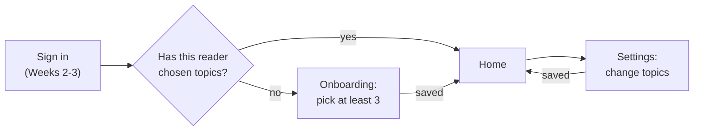
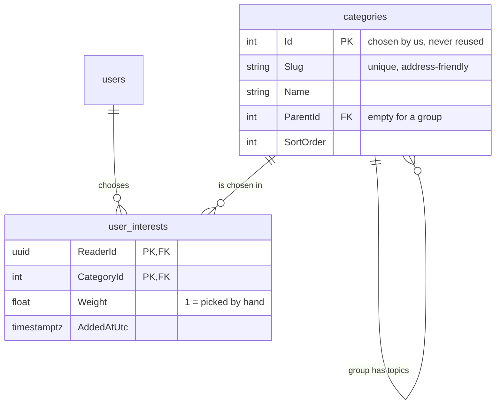
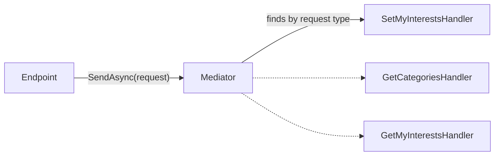
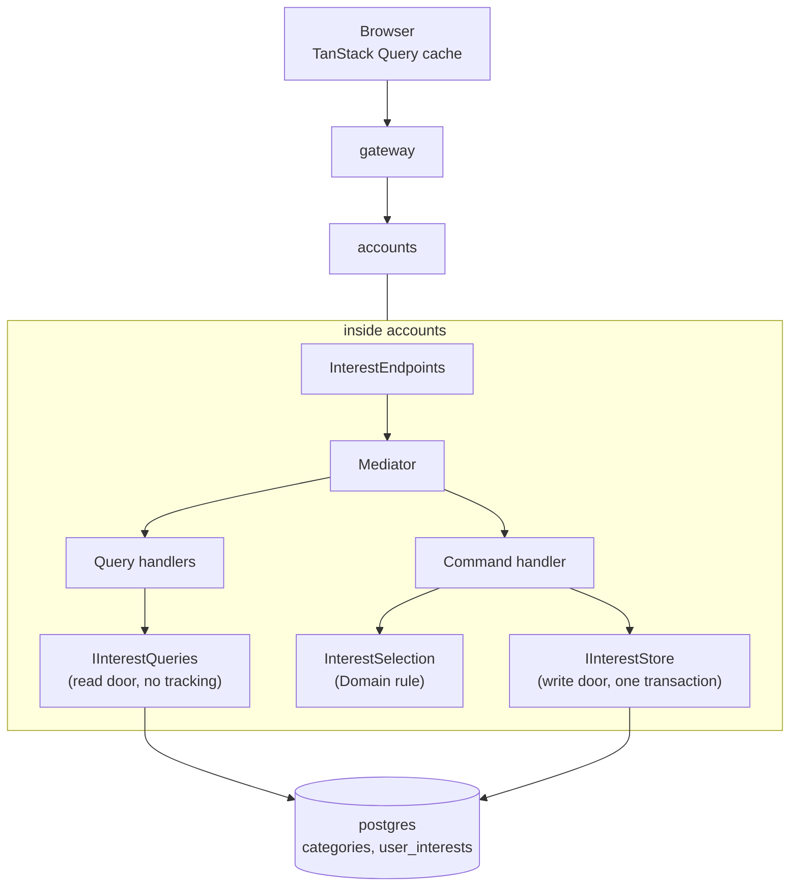
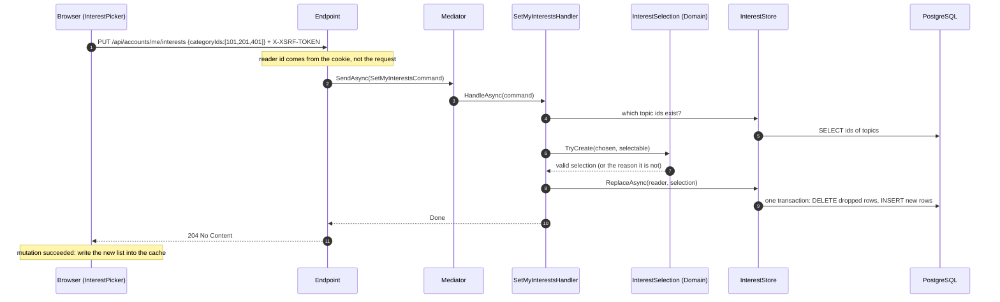
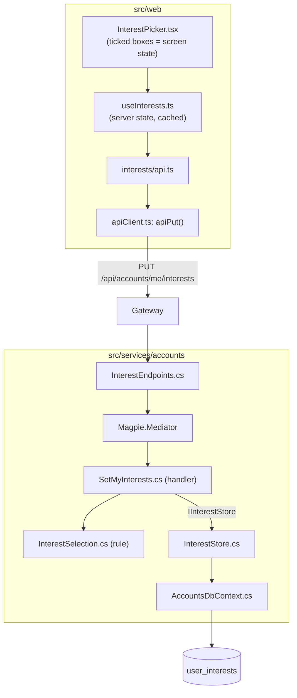
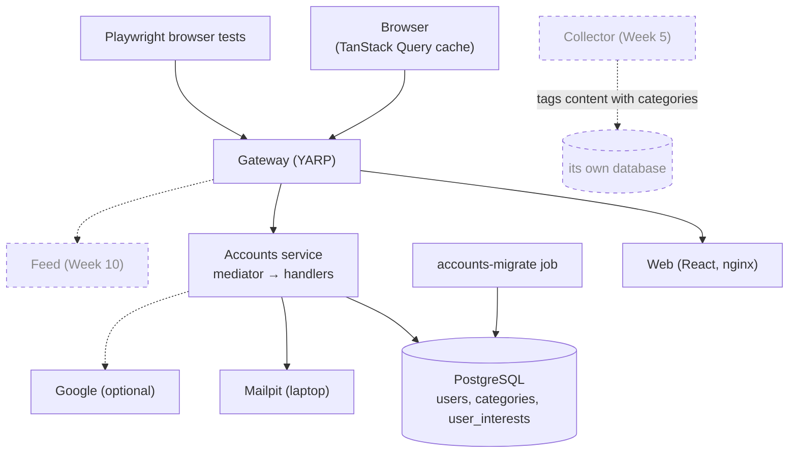

# Building Magpie: A Guided Journey from Empty Folder to Production-Grade System

## Chapter 4 (Week 4): Tell Me What You Like. Interests, Tables That Stay True, and Asking Questions Properly

> **What you will have at the end of this chapter:** a new reader picks topics on a welcome screen, can change them later, and finds them still there after signing out and in. Underneath, you will have designed your first tables of your own, measured what an index buys and costs on five million rows, and given the system one tidy way to run every use case.

| | |
|---|---|
| **Week** | 4 of 26 |
| **Plan step** | Step 3, Interests |
| **Time budget** | About 8 hours |
| **You need** | Chapter 3 finished and running |
| **Repository** | https://github.com/ankitchoubey800/magpie |
| **Code for this chapter** | Commit `{{sha7}}` on branch `week-04` (pull request #3, stacked on `week-03`). Every link in this chapter points at that exact commit |

---

### How this chapter was checked (read this first)

| What | Where it was run | Result |
|---|---|---|
| .NET: 90 tests (51 unit, 39 against a real PostgreSQL) | GitHub Actions | `Passed! - Failed: 0, Passed: 90, Skipped: 0, Total: 90` |
| Website: lint, 35 tests, build | Author's workspace and GitHub Actions | Passed |
| Browser tests: 5 journeys in real Chromium, including "topics survive signing out and in" | GitHub Actions (Playwright) | `5 passed (7.6s)` |
| The second migration, created by `dotnet ef migrations add` | GitHub Actions; generated files committed | Created; applied by the tests and by the Compose migration job |
| The index experiment on 5,000,000 rows | GitHub Actions, PostgreSQL 18 on a shared runner | Real figures in section 6 |
| **Not yet run:** anything on your own laptop, including your own index figures | | You do this. Your numbers will differ from the runner's; the *shape* should not |

The full evidence is public: {{run}}

Two things broke on the way and are described where they happened: a Docker build that did not know about a new project (Step 9), and an experiment whose first result contradicted its own heading (section 6). The second one is the better lesson.

---

## 1. The big picture

### What are we building this week?

Until now Magpie knows *who* you are. This week it learns *what you care about*, which is the whole reason the product exists.



**Reading the diagram:** a first-time reader is steered to the welcome screen exactly once. After that the choice lives in the database and follows them to any browser.

The feature is small on purpose. It is the smallest real feature that needs everything a business application needs: tables designed by us, rules that must hold, reads and writes with different shapes, and a screen that stays in step with the server. So this is the week we learn to do those things *properly*, while the feature is still simple enough to see through.

### Why does it matter?

Two reasons, one for the product and one for you.

For the product: every later week reads this data. The collector (Week 5) tags content with these categories. The feed (Week 10) is "newest items in my topics". Notifications (Week 15) need "who follows topic X?".

For you: "what is an index and what does it cost?", "how do you organise data access?" and "what problem does separating reads from writes solve?" are asked in almost every backend interview. After this week you answer with numbers you measured.

> 🧠 **Pause and think**
> A reader follows 5 topics. You could store that as one row per reader with a list (`["Programming","Space",...]`) or as five small rows, one per (reader, topic) pair. Which makes "rename *Space* to *Astronomy*" a one-row change? Which makes "who follows Space?" answerable without reading every reader? (Answer in section 11.)

### This week's deliverables

1. Two tables, `categories` and `user_interests`, created by the second migration, with the starter list of 30 categories.
2. Three addresses: list categories, read my interests, replace my interests.
3. A small **mediator** of our own, and the first commands and queries that use it.
4. Separate **read** and **write** doors to the data.
5. An onboarding page and a settings page, using **TanStack Query** for server data.
6. An **index experiment** with recorded numbers.

---

## 2. Concepts first

### 2.1 Normalised tables: say each thing once

A library keeps one card per book. A loan slip does not copy out the title and author; it says "book #4417, borrowed by member #212". If the book's title is corrected, one card changes and every loan slip is automatically right.

That is **normalisation**: each fact is stored in exactly one place, and other tables point to it by **id**.



**Reading the diagram:** `categories` points at itself: a topic's `ParentId` is its group. `user_interests` is a **join table**: it holds no facts of its own except "this reader, this topic". Its key is the **pair** of ids.

Three promises the database itself now keeps, with no code of ours:

| Promise | How |
|---|---|
| A reader cannot have the same topic twice | The pair `(ReaderId, CategoryId)` is the **primary key** |
| A choice cannot point at a topic that does not exist | **Foreign key** to `categories` |
| Deleting a reader removes their choices; deleting a topic people follow is refused | **Cascade** on one foreign key, **restrict** on the other |

Rules enforced by the database cannot be skipped by a buggy service, a script, or a future developer in a hurry.

### 2.2 Indexes: the book's index, with a price

To find every page mentioning "Kafka" in a book you can read all 400 pages, or look in the index at the back. A database **index** is the same: a sorted side-list that says where rows with a given value live.

A table has two natural questions here:

- "What does **reader X** follow?" The primary key `(ReaderId, CategoryId)` is itself an index sorted by reader first. Fast for free.
- "Who follows **topic X**?" The primary key is no help: it is sorted by reader, like a phone book when you only know the first name. This needs its **own** index on `CategoryId`.

And the price, which tutorials skip:

| An index costs... | Why |
|---|---|
| Disk space | It is a second copy of the indexed columns, sorted |
| Time on **every** insert, update and delete | The side-list must be kept in order |
| Thought | An index nobody uses is pure cost |

So the rule is: **index for the questions you actually ask, and measure.** Section 6 does exactly that.

### 2.3 Reading a query plan

Before running a query, PostgreSQL decides *how* (its **plan**). `EXPLAIN ANALYZE` runs the query and shows the plan with real timings. Four words are enough to read one:

| You see | It means |
|---|---|
| `Seq Scan` | Read every row of the table ("read the whole book") |
| `Index Scan` / `Bitmap Heap Scan` | Use an index to find where matching rows are, then fetch those rows from the table |
| `Index Only Scan` | The index alone contains everything asked for; the table is not touched |
| `Buffers: ... read=N` | How many 8-kilobyte pages were read. Often more telling than the time |

### 2.4 Repository and unit of work (and why we do not write them)

Two classic patterns:

- A **repository** makes stored objects feel like an in-memory collection: "give me", "add", "remove".
- A **unit of work** remembers everything you changed during one task and saves it together, all or nothing.

Older tutorials have you write `IRepository<T>` and `IUnitOfWork` classes. Here is the lesson of the week in one sentence: **EF Core already is both.** A `DbSet<T>` is a repository. The `DbContext` tracks your changes and `SaveChangesAsync()` writes them in one **transaction** (all or nothing). Wrapping them again in generic classes of your own adds a layer that only hides useful features.

What we write instead are **small, specific ports**: an interface that names exactly the questions and changes one feature needs.

### 2.5 CQRS in its light form

**CQRS** stands for Command Query Responsibility Segregation. Behind the long name is a plain observation: *reading for a screen* and *changing data* want different things.

| | Query (read) | Command (write) |
|---|---|---|
| Purpose | Fill a screen | Change something, safely |
| Shape of the answer | Whatever the screen needs, ready-made | Almost nothing: "done" or "no, because..." |
| Uses domain rules? | No | Yes |
| EF Core mode | No tracking (faster) | Tracking (so changes can be saved) |
| May change data? | **Never** | Yes |

A restaurant analogy: the menu (reading) and the kitchen order slip (changing) are different documents for different jobs, even though both are about the same food.

"Light" means: same database, two doors. The "full" form, with a separately stored read copy, arrives in Week 10 when the feed needs it.

### 2.6 A mediator

We now have a growing pile of use cases. Endpoints currently name each handler class and `Program.cs` registers each one by hand. A **mediator** is a switchboard: the endpoint hands over a small **request** object ("set these interests for this reader") and the mediator finds the one **handler** that knows how.



**Reading the diagram:** the endpoint depends on one thing, the mediator, however many use cases exist. Each request type has exactly one handler.

What it buys: endpoints stop knowing handler classes; new handlers are discovered automatically; every use case has the same shape (a request record in, a result out), which later makes it easy to wrap all of them with the same extra step.

What it costs: one more hop to follow when reading the code ("who handles this?"). That is why it should stay small. Ours is about forty lines. The popular libraries moved to commercial licences in 2025, and we need a fraction of what they offer.

### 2.7 "Who owns this?": authorization by construction

So far the only rule was "must be signed in". Interests are the first data that belongs to *a particular* reader. The classic bug is an address like `/readers/42/interests` where the server checks that you are signed in but not that you are reader 42. Change the number, read someone else's data.

Our addresses are `/api/accounts/me/interests`. There is **no id in the address**. The reader id comes from the session cookie and nowhere else. One reader cannot even *ask* for another's interests. The safest permission check is the one you never have to write.

### 2.8 Server state versus screen state, and TanStack Query

A React app holds two very different kinds of state:

| | Screen state | Server state |
|---|---|---|
| Example | Which boxes are ticked right now | Which topics are saved |
| Who owns the truth? | This component | The server; we hold a **copy** |
| Can it be out of date? | No | Always, potentially |

Our hand-written hooks from Weeks 1 and 2 treated server data like screen state. That works for one call. It does not answer: two components need the same data (fetch twice?), when is our copy stale, what happens after we save?

**TanStack Query** is a cache for server state. You describe *what* to fetch under a **key**; it handles sharing, loading and error states, retrying, and refreshing. Changes go through a **mutation**, after which you tell the cache what is now true.

### 2.9 Side lesson: vertical slices

We organise by layer: a feature's files are spread over Domain, Application, Infrastructure and Api. **Vertical-slice architecture** organises by feature instead: one folder, `Interests/`, holding the endpoint, the handler, the data access and the tests.

| | Layers (ours) | Vertical slices |
|---|---|---|
| A new feature touches | Four projects | One folder |
| Boundaries enforced by | The compiler (project references) | Discipline and code review |
| Best when | Rules are rich and infrastructure will be swapped (our Weeks 20-24) | Many simple, independent features |

Notice we are already halfway: inside each layer, files are grouped by feature (`Application/Interests/`, `web/features/interests/`). Many teams combine the two in exactly this way.

---

## 3. Architecture and decisions

### 3.1 What changes



**Reading the diagram:** no new containers. Inside Accounts, requests now pass through the mediator and then split: queries go straight to the read door; the command passes through a Domain rule first and then the write door.

### 3.2 Saving interests, step by step



**Reading the diagram:** the rule ("3 to 15 real topics, no repeats") is checked in the Domain, before the store is asked to change anything. The store's change is one transaction: a reader never ends up with half of the old set and half of the new.

### 3.3 Decisions

| # | Decision | Why | Recorded in |
|---|---|---|---|
| 1 | Normalised tables with a join table | Small, exact, asked about from both directions | Design note |
| 2 | Category ids chosen by hand (group × 100 + n), never reused | Readers' choices refer to them; they must be stable across environments | This chapter |
| 3 | The starter list is part of the migration | Every environment gets the same list, in the same change as the tables | This chapter |
| 4 | Explicit index on `CategoryId` | The "who follows topic X?" question; measured in section 6 | This chapter |
| 5 | Specific read and write ports; no generic repository | EF Core already is one | ADR-0005 |
| 6 | Our own small mediator, in a shared project | One shape for every use case; no licence | ADR-0005 |
| 7 | Earlier handlers are left as they are | Rewriting working, tested code for uniformity is churn. They move when next touched | ADR-0005 |
| 8 | `PUT` replaces the whole set | Sending it twice gives the same result, so retries are harmless (**idempotent**) | This chapter |
| 9 | No reader id in the address | Ownership by construction | This chapter |
| 10 | Between 3 and 15 topics | A product decision, encoded as a Domain rule so it has one home | This chapter; yours to change |
| 11 | TanStack Query for server data; the cache is emptied on sign-in and sign-out | Shared cache for server state; one reader must never see another's cached data | This chapter |

### 3.4 Files changed from earlier weeks

| File | Change |
|---|---|
| `Magpie.slnx`, both Dockerfiles | New shared project `Magpie.Mediator` |
| `Magpie.Defaults` | New `MediatorRegistration.cs`; references the mediator |
| `Accounts.Application.csproj` | References the mediator |
| `Infrastructure/Persistence/AccountsDbContext.cs`, `DependencyInjection.cs` | Two tables; two ports registered |
| `Api/Program.cs` | Registers the mediator; maps the new endpoints |
| `Tests/Integration/ApiSession.cs` | `PutAsync`, `SignUpAndSignInAsync` |
| `web`: `apiClient.ts`, `main.tsx`, `AuthProvider.tsx`, `HomePage.tsx`, `App.tsx`, `index.css`, `test/fakeServer.ts`, the two auth test files | `apiPut`; query client; cache clearing; onboarding redirect; routes; shared test renderer |
| `e2e/tests/auth.spec.ts`, `.github/workflows/ci.yml` | Onboarding step; new journey; the experiment |

---

## 4. Implementation guide

Branch: `git switch week-03 && git switch -c week-04`.

### Step 1: The mediator

**What:** a new shared project with five small interfaces and one class, plus a registration helper.
**Why:** one tidy way to invoke every use case from now on.

```bash
dotnet new classlib -n Magpie.Mediator -o src/shared/Magpie.Mediator
rm src/shared/Magpie.Mediator/Class1.cs
dotnet sln add src/shared/Magpie.Mediator
dotnet add src/services/accounts/Magpie.Accounts.Application reference src/shared/Magpie.Mediator
dotnet add src/shared/Magpie.Defaults reference src/shared/Magpie.Mediator
```

The vocabulary:

{{file:src/shared/Magpie.Mediator/Contracts.cs}}

The switchboard:

{{file:src/shared/Magpie.Mediator/Mediator.cs}}

How to read `SendAsync`: the request's type (say `SetMyInterestsCommand`) decides which handler interface to look for. Working that out needs **reflection** (code inspecting types at run time), which is slow, so it is done once per request type and remembered in a dictionary. After the first call it is a dictionary lookup and a method call.

The registration helper lives in `Magpie.Defaults`, where the other "how we wire services" code is:

{{file:src/shared/Magpie.Defaults/MediatorRegistration.cs}}

{{gh:src/shared/Magpie.Mediator/Contracts.cs|src/shared/Magpie.Mediator/Mediator.cs|src/shared/Magpie.Mediator/Magpie.Mediator.csproj|src/shared/Magpie.Defaults/MediatorRegistration.cs}}

**Check:** `dotnet build src/shared/Magpie.Defaults` succeeds. Open `Magpie.Mediator.csproj`: no references at all.

> ❓ **Q&A**
> **Q: Does the Application layer referencing `Magpie.Mediator` break "Application references only Domain"?**
> A: The rule's purpose is to keep frameworks and infrastructure out. `Magpie.Mediator` is five interfaces with no dependencies of its own, and it is ours. The conventions table in section 13 now states the rule precisely: Domain, plus our own dependency-free shared abstractions.
> **Q: `ICommand` and `IQuery` are empty. What are they for?**
> A: For people, today: the type name says whether a request may change data. Later they let us treat the two differently, for example wrapping only commands in an extra step.
> **Q: Why is a missing handler an exception rather than a result?**
> A: It is a programming mistake (you forgot to register an assembly), not something a reader can cause. Mistakes of ours should fail loudly, with a message that says how to fix it. A test checks the message.

### Step 2: Domain, categories and the selection rule

A category:

{{file:src/services/accounts/Magpie.Accounts.Domain/Category.cs}}

The starter list. **This is your product decision to review**; the list below is a reasonable first draft, not a fact.

{{file:src/services/accounts/Magpie.Accounts.Domain/StarterCategories.cs}}

The rule, as a value object in the same style as `EmailAddress`:

{{file:src/services/accounts/Magpie.Accounts.Domain/InterestSelection.cs}}

One stored choice:

{{file:src/services/accounts/Magpie.Accounts.Domain/ReaderInterest.cs}}

{{gh:src/services/accounts/Magpie.Accounts.Domain/Category.cs|src/services/accounts/Magpie.Accounts.Domain/StarterCategories.cs|src/services/accounts/Magpie.Accounts.Domain/InterestSelection.cs|src/services/accounts/Magpie.Accounts.Domain/ReaderInterest.cs}}

**Check:** the Domain project builds and still references nothing.

> ❓ **Q&A**
> **Q: Why does `TryCreate` turn the input into a set before counting?**
> A: So nobody reaches "at least 3" by sending `[101, 101, 101]`. There is a test named for exactly that.
> **Q: Why hand-written ids like 101 instead of letting the database count 1, 2, 3?**
> A: Counted ids depend on the order rows were inserted, which can differ between your laptop, CI and production. These ids are *meaning* that other data refers to, so we fix them ourselves. The numbering also makes a topic's group readable at a glance.
> **Q: What is `Weight` for?**
> A: Nothing yet; every hand-picked topic gets 1. It is the one column added for a known future need: the recommender (Weeks 13-14) will adjust it. Adding a column now is free; adding it later to millions of rows is a migration to plan.

### Step 3: Application, two doors, two queries and a command

The two ports and the screen shapes:

{{file:src/services/accounts/Magpie.Accounts.Application/Interests/InterestPorts.cs}}

Each use case is one file holding the request and its handler together:

{{file:src/services/accounts/Magpie.Accounts.Application/Interests/GetCategories.cs}}

{{file:src/services/accounts/Magpie.Accounts.Application/Interests/GetMyInterests.cs}}

{{file:src/services/accounts/Magpie.Accounts.Application/Interests/SetMyInterests.cs}}

{{gh:src/services/accounts/Magpie.Accounts.Application/Interests/InterestPorts.cs|src/services/accounts/Magpie.Accounts.Application/Interests/GetCategories.cs|src/services/accounts/Magpie.Accounts.Application/Interests/GetMyInterests.cs|src/services/accounts/Magpie.Accounts.Application/Interests/SetMyInterests.cs}}

**Check:** `dotnet build src/services/accounts/Magpie.Accounts.Application` succeeds.

> ❓ **Q&A**
> **Q: The two query handlers do nothing but call the port. Isn't that the "ceremony" we avoided with sign-out in Week 2?**
> A: A fair challenge. The difference is that these are now part of a uniform system: the endpoint talks only to the mediator, and every use case, however thin, has the same shape and is found the same way. When a query later needs a rule (say, hiding topics behind a paid plan in Week 16), the handler is already there to hold it. Thin is fine; *inconsistent* is what costs.
> **Q: Why does the command carry `ReaderId` instead of the handler looking up "the current user"?**
> A: So the handler has no idea HTTP exists and can be tested by passing any id. The endpoint is the only place that knows where the id comes from (the cookie).

### Step 4: Infrastructure, tables and the two doors

The DbContext gains two tables (whole file shown). Every line in the two `Entity<...>` blocks is one of the promises from 2.1:

{{file:src/services/accounts/Magpie.Accounts.Infrastructure/Persistence/AccountsDbContext.cs}}

The read door:

{{file:src/services/accounts/Magpie.Accounts.Infrastructure/Persistence/InterestQueries.cs}}

The write door. Read its opening comment; it is ADR-0005 in six lines:

{{file:src/services/accounts/Magpie.Accounts.Infrastructure/Persistence/InterestStore.cs}}

Register both in `DependencyInjection.cs` (whole file linked below):

```csharp
        services.AddScoped<IInterestQueries, InterestQueries>();
        services.AddScoped<IInterestStore, InterestStore>();
```

{{gh:src/services/accounts/Magpie.Accounts.Infrastructure/Persistence/AccountsDbContext.cs|src/services/accounts/Magpie.Accounts.Infrastructure/Persistence/InterestQueries.cs|src/services/accounts/Magpie.Accounts.Infrastructure/Persistence/InterestStore.cs|src/services/accounts/Magpie.Accounts.Infrastructure/DependencyInjection.cs}}

> ❓ **Q&A**
> **Q: `ReplaceAsync` removes some rows and adds others. What if the service crashes halfway?**
> A: It cannot be halfway. Nothing is sent to the database until `SaveChangesAsync`, and that one call wraps all the deletes and inserts in a single transaction: all happen, or none do. That is the unit of work, provided by EF Core.
> **Q: Why keep the rows that did not change instead of deleting everything and inserting the new set?**
> A: Delete-all-insert-all is simpler but destroys `AddedAtUtc` and, later, the learned `Weight` of topics the reader kept. Comparing the sets costs four lines and preserves history.
> **Q: Why does the category tree load all rows and build the tree in C#?**
> A: There are thirty. One trivial query and a loop is clearer than a clever SQL statement. If there were thirty thousand, the answer would change. Design for the numbers you have.

### Step 5: Api, three addresses

A helper that is the single source of the current reader's id:

{{file:src/services/accounts/Magpie.Accounts.Api/Security/ClaimsPrincipalExtensions.cs}}

The endpoints. They know the mediator and nothing else:

{{file:src/services/accounts/Magpie.Accounts.Api/Endpoints/InterestEndpoints.cs}}

`Program.cs` gains two lines (whole file shown):

{{file:src/services/accounts/Magpie.Accounts.Api/Program.cs}}

| Address | Who | Success | Failure |
|---|---|---|---|
| `GET /api/accounts/categories` | Anyone | 200, the tree | |
| `GET /api/accounts/me/interests` | Signed in | 200 `{categoryIds:[...]}` | 401 |
| `PUT /api/accounts/me/interests` | Signed in | 204 | 400 with a message; 401 |

{{gh:src/services/accounts/Magpie.Accounts.Api/Security/ClaimsPrincipalExtensions.cs|src/services/accounts/Magpie.Accounts.Api/Endpoints/InterestEndpoints.cs|src/services/accounts/Magpie.Accounts.Api/Program.cs}}

> ❓ **Q&A**
> **Q: Does the anti-forgery filter cover `PUT`?**
> A: Yes. It skips only `GET`, `HEAD` and `OPTIONS`; everything else needs the token. A test confirms a `PUT` without it gets the `antiforgery` error.
> **Q: Why `PUT` and not `POST`?**
> A: `PUT` means "make it exactly this". Repeat it and the result is the same. `POST` means "do this" and might do it twice. Choosing the verb that matches the behaviour tells every client, proxy and future developer that a retry is safe.
> **Q: The gateway did not change again?**
> A: Correct. Everything is still under `/api/accounts/`. A gateway that needs editing for every feature would be doing too much.

### Step 6: The second migration

```bash
dotnet ef migrations add AddInterests \
  --project src/services/accounts/Magpie.Accounts.Infrastructure \
  --startup-project src/services/accounts/Magpie.Accounts.Api \
  --output-dir Persistence/Migrations
```

Expected last line (as printed on the GitHub runner): `Done. To undo this action, use 'ef migrations remove'`

Read the generated `Up` method. In the repository's copy it contains, in order: `CreateTable` for `categories`, `CreateTable` for `user_interests`, one `InsertData` with the thirty starter rows, and three `CreateIndex` calls (the unique slug, the parent link, and `ix_user_interests_category`).

This is the first migration applied to a database that **already has data** (your users). It only adds things, so existing rows are untouched. That will not always be true; the Q&A below says what to watch for.

{{gh:src/services/accounts/Magpie.Accounts.Infrastructure/Persistence/Migrations/20261116051854_AddInterests.cs|src/services/accounts/Magpie.Accounts.Infrastructure/Persistence/Migrations/AccountsDbContextModelSnapshot.cs}}

**Check:** `docker compose -f infra/docker-compose.yml up --build` and then:

```bash
docker compose -f infra/docker-compose.yml exec postgres psql -U magpie -d magpie_accounts \
  -c 'SELECT "Id", "Name", "ParentId" FROM categories ORDER BY "Id" LIMIT 6;'
```

Expected: `Technology` with an empty `ParentId`, then groups 2 to 6. Your existing users are still there.

> ❓ **Q&A**
> **Q: How do you change a table safely while the application is live?** (This week's interview question.)
> A: In small steps that old and new code can both live with. *Adding* a table or a nullable column is safe. *Renaming or removing* a column is not, because the old code is still running during the rollout. The safe recipe is "expand, then contract": add the new column; release code that writes both; copy old data across; release code that reads the new one; only then remove the old column, in a later migration. Never one big step.
> **Q: Can I edit a migration after generating it?**
> A: Before it has been applied anywhere but your laptop, yes (or remove and regenerate). After it has been applied to a shared database, never: write a new migration instead. The history must be the same everywhere.
> **Q: How would I undo this one?**
> A: Its `Down` method drops the two tables. Note what that means once readers have chosen topics: undoing is data loss. "Can it be rolled back?" must be asked before applying, not after.

### Step 7: Tests for the service

A fake write door:

{{file:src/services/accounts/Magpie.Accounts.Tests/Fakes/FakeInterestStore.cs}}

Unit tests for the rule, the mediator and the command:

{{file:src/services/accounts/Magpie.Accounts.Tests/Unit/InterestSelectionTests.cs}}

{{file:src/services/accounts/Magpie.Accounts.Tests/Unit/MediatorTests.cs}}

{{file:src/services/accounts/Magpie.Accounts.Tests/Unit/SetMyInterestsHandlerTests.cs}}

`ApiSession` gains `PutAsync` and a one-line way to get a signed-in reader (whole file shown):

{{file:src/services/accounts/Magpie.Accounts.Tests/Integration/ApiSession.cs}}

Integration tests against the real tables:

{{file:src/services/accounts/Magpie.Accounts.Tests/Integration/InterestsTests.cs}}

```
Passed!  - Failed:     0, Passed:    90, Skipped:     0, Total:    90, Duration: 19 s - Magpie.Accounts.Tests.dll (net10.0)
```

{{gh:src/services/accounts/Magpie.Accounts.Tests/Fakes/FakeInterestStore.cs|src/services/accounts/Magpie.Accounts.Tests/Unit/InterestSelectionTests.cs|src/services/accounts/Magpie.Accounts.Tests/Unit/MediatorTests.cs|src/services/accounts/Magpie.Accounts.Tests/Unit/SetMyInterestsHandlerTests.cs|src/services/accounts/Magpie.Accounts.Tests/Integration/ApiSession.cs|src/services/accounts/Magpie.Accounts.Tests/Integration/InterestsTests.cs}}

**Check:** 90 passed on your machine.

> ❓ **Q&A**
> **Q: The rule is tested in `InterestSelectionTests` *and* in `InterestsTests`. Duplication?**
> A: Different questions. The unit tests ask "is the rule right?" in milliseconds, with every edge case. The integration test asks "is the rule actually *wired in*, and does a refusal leave the stored data unchanged?". One of each kind is the pyramid at work.
> **Q: A test was written as `Assert.Equal([101, 103, 204], await MyInterestsAsync(session))` and the compiler refused it.**
> A: It did, in CI, with `error CS4007: Instance of type 'System.ReadOnlySpan<int>' cannot be preserved across 'await'`. The `[...]` list was being turned into a special fast type that cannot live across an `await`. The fix was to do the `await` on its own line first (see the small `AssertInterestsAsync` helper). The compiler found it, not a test; that is the cheapest place a mistake can be found.

### Step 8: The web app

```bash
cd src/web
npm install @tanstack/react-query
mkdir -p src/features/interests
```

The API client learns `PUT` (whole file shown; `apiPost` and `apiPut` now share one `send` function):

{{file:src/web/src/shared/api/apiClient.ts}}

The cache, created by a small function so tests can make a fresh one each:

{{file:src/web/src/app/queryClient.ts}}

{{file:src/web/src/main.tsx}}

**An easy-to-miss privacy bug, fixed before it happens.** The cache outlives sign-out unless told otherwise. On a shared computer the next reader could briefly see the previous reader's topics. `AuthProvider` now empties the cache whenever the signed-in reader changes (whole file shown):

{{file:src/web/src/features/auth/AuthProvider.tsx}}

The feature. Server calls:

{{file:src/web/src/features/interests/api.ts}}

The hooks. This file replaces the kind of hand-written state handling you saw in `useSystemStatus.ts`:

{{file:src/web/src/features/interests/useInterests.ts}}

The picker, shared by both pages. Notice the split from 2.8: the ticked boxes are **screen state** (`useState`); everything from the server comes through the hooks.

{{file:src/web/src/features/interests/InterestPicker.tsx}}

{{file:src/web/src/features/interests/OnboardingPage.tsx}}

{{file:src/web/src/features/interests/InterestsSettingsPage.tsx}}

The home page sends topic-less readers to onboarding:

{{file:src/web/src/features/home/HomePage.tsx}}

Routes (whole file shown):

{{file:src/web/src/app/App.tsx}}

Tests. All app-level tests now share one renderer that includes the cache:

{{file:src/web/src/test/renderApp.tsx}}

The pretend server gains `PUT` and two default replies (whole file shown):

{{file:src/web/src/test/fakeServer.ts}}

{{file:src/web/src/features/interests/interests.test.tsx}}

In `auth.test.tsx` and `passwordAndGoogle.test.tsx`, delete the local `renderAppAt` function and import the shared one instead (both files are linked below).

```
 Test Files  5 passed (5)
      Tests  35 passed (35)
```

{{gh:src/web/package.json|src/web/src/shared/api/apiClient.ts|src/web/src/app/queryClient.ts|src/web/src/main.tsx|src/web/src/features/auth/AuthProvider.tsx|src/web/src/features/interests/api.ts|src/web/src/features/interests/useInterests.ts|src/web/src/features/interests/InterestPicker.tsx|src/web/src/features/interests/OnboardingPage.tsx|src/web/src/features/interests/InterestsSettingsPage.tsx|src/web/src/features/home/HomePage.tsx|src/web/src/app/App.tsx|src/web/src/index.css|src/web/src/test/renderApp.tsx|src/web/src/test/fakeServer.ts|src/web/src/features/interests/interests.test.tsx|src/web/src/features/auth/auth.test.tsx|src/web/src/features/auth/passwordAndGoogle.test.tsx}}

> ❓ **Q&A**
> **Q: The button is disabled until three boxes are ticked. Isn't that the rule, written twice?**
> A: The browser's copy is a *courtesy* so people are not surprised. The server's copy is the *rule*. If they ever disagree, the server wins and its message is shown (a test covers that). Never rely on the courtesy.
> **Q: After saving, why write into the cache instead of fetching again?**
> A: We know precisely what the server now holds: what we just sent and it accepted. The last test in the file proves the home page shows the new count with no extra request. When you *cannot* know the result, tell the cache to refetch instead (`invalidateQueries`).
> **Q: What happened to `useSystemStatus.ts` from Week 1?**
> A: It still works and is left alone, like the earlier backend handlers. Rewriting it with `useQuery` is this week's first exercise, and a satisfying one: about twenty lines disappear.
> **Q: Why does the retry rule skip 4xx answers?**
> A: A 401 or 404 is the server saying a clear "no". Asking twice more just delays showing the reader what happened. Network failures and 5xx are worth another try.

### Step 9: Browser test, Docker and CI

The browser journeys learn about onboarding, and a fifth one covers this week's "done when" (whole file shown):

{{file:e2e/tests/auth.spec.ts}}

```
  ✓  1 [chromium] › tests/auth.spec.ts:36:1 › a signed-out visitor is sent to the sign-in page (198ms)
  ✓  2 [chromium] › tests/auth.spec.ts:42:1 › sign up, confirm by email, sign in, stay signed in, sign out (2.6s)
  ✓  3 [chromium] › tests/auth.spec.ts:68:1 › a wrong password shows the generic message and stays on the page (765ms)
  ✓  4 [chromium] › tests/auth.spec.ts:78:1 › forgot password: reset by email, old password stops working, new one works (1.6s)
  ✓  5 [chromium] › tests/auth.spec.ts:104:1 › topics chosen at onboarding survive signing out and in, and can be changed (1.6s)
  5 passed (7.6s)
```

Both .NET Dockerfiles need one new line, because both services reference `Magpie.Defaults`, which now references the mediator:

```dockerfile
COPY src/shared/Magpie.Mediator/Magpie.Mediator.csproj src/shared/Magpie.Mediator/
```

> 🔎 **Found by running it**
> The first push of this week had green unit and integration tests and a red Docker job: `error NETSDK1004: Assets file '/src/src/shared/Magpie.Mediator/obj/project.assets.json' not found`. Our Dockerfiles copy project files one by one before restoring packages (the caching trick from Chapter 1). A new project that is not on that list is invisible to the restore step. The lesson is general: **every optimisation is also a list someone must remember to update.** The whole-system job exists to remember for us.

{{gh:e2e/tests/auth.spec.ts|src/services/accounts/Dockerfile|src/gateway/Dockerfile|infra/experiments/week-04-index.sql|.github/workflows/ci.yml|docs/adr/0005-specific-ports-no-generic-repository.md|docs/design-notes/week-04-normalise-or-duplicate.md}}

**Check:** push, open the pull request into `week-03`, three green ticks.

> ❓ **Q&A**
> **Q: Last week's browser tests expected "Signed in as" right after the first sign-in. They would fail now.**
> A: They did need changing: a new reader now lands on onboarding. This is the cost side of end-to-end tests. They follow real journeys, so when a journey changes they must change too. Keeping them few (five) keeps that cost small.

---

## 5. How the pieces fit together



**Reading the diagram:** compare with the same picture in Chapters 1 to 3. One new box, the mediator, sits between endpoint and handler. Everything else is the shape you already know, which is the point of having a shape.

---

## 6. Break it on purpose: what does an index buy, and what does it cost?

Run the experiment. It works in a throwaway schema and deletes it afterwards:

```bash
docker compose -f infra/docker-compose.yml exec -T postgres \
  psql -U magpie -d magpie_accounts < infra/experiments/week-04-index.sql
```

It builds 1,000,000 fake readers with 5 topics each (5,000,000 rows), asks questions with and without the index, and measures what the index costs.

> ✏️ **Pencil time**
> Each topic is followed by about 4% of readers, spread evenly through the table. Predict: how many times faster will "who follows topic 204?" be with the index? 2×? 100×? 1000×?

Real figures from the GitHub runner (PostgreSQL 18, shared hardware; yours will differ):

| Step | Question | Plan PostgreSQL chose | Pages read | Time |
|---|---|---|---|---|
| 2 | Who follows topic 204? (208,334 rows) **no index** | `Parallel Seq Scan` | 41,667 | **514 ms** |
| 5 | The same, **with the index** | `Bitmap Index Scan` + `Bitmap Heap Scan` | 41,845 | **128 ms** |
| 6 | *How many* follow topic 204? with the index | `Index Only Scan` | 180 | **19 ms** |
| 3 | Does reader X follow topic 204? (primary key) | `Index Only Scan` | 3 | **0.03 ms** |

And the costs:

| Cost | Figure |
|---|---|
| Building the index on 5,000,000 rows | 1.6 s |
| Disk: table / primary key / our index | 326 MB / 271 MB / **33 MB** |
| Inserting 100,000 rows **with** the index | 307 ms |
| Inserting 100,000 rows **without** it | 208 ms (so the index made writes about 1.5× slower) |

Now read those numbers like an architect, because they are more interesting than "indexes make things fast".

**1. The index helped by 4×, not 1000×.** Look at "pages read" in steps 2 and 5: almost identical. The index told PostgreSQL exactly *which* rows match, but those 208,334 rows are scattered over nearly every page of the table, so it still had to fetch nearly every page. An index shines when a question matches *few* rows. Ours matches 4% spread everywhere. If you guessed 1000×, you assumed a selective question.

**2. The same index answered a slightly different question 27× faster still.** Step 6 only *counts*. The count can be answered from the index alone (180 pages instead of 41,845). The shape of the question matters as much as the existence of the index. If notifications in Week 15 need only "how many?" or "is there anyone?", they will be cheap. If they need every reader id, they will not.

**3. The primary key question is in a different league** (0.03 ms): three pages, because it asks for one specific row.

**4. The index is not free:** 33 MB of disk and writes 1.5× slower, forever, whether or not anyone asks the question.

> 🔎 **The experiment contradicted its own heading**
> Step 6 is titled "a question the index answers ALONE". On the first run it did not: the plan was a `Bitmap Heap Scan` that read 41,848 pages, and it took 95 ms. The heading was wrong, or something was missing. What was missing: after a big load, PostgreSQL does not yet know which pages are "settled" (visible to everyone), and until it does, it must check the table for every row an index finds. A `VACUUM` records that. On a live database this happens by itself in the background; in a script that loads five million rows and immediately asks questions, it has not happened yet. Adding `VACUUM` gave the `Index Only Scan` and 19 ms shown above.
>
> Keep this as a habit: **when a measurement disagrees with your explanation, the measurement is right.** Find out why before you write the explanation down.

**So, was adding the index the right call?** For a table that is read often and written rarely (interests change maybe a few times a year per reader), a 1.5× write cost is irrelevant and a 4× to 27× read gain is real. Yes. On a table written thousands of times a second (reader actions, Week 12), the same index might be the wrong call. Write your own conclusion, with your own numbers, in the design note.

---

## 7. Production considerations

| Area | In place this week | Deliberately later |
|---|---|---|
| **Data integrity** | Rules enforced by the database (composite key, foreign keys); whole-set replacement in one transaction; ids stable across environments | Soft-retiring a topic instead of deleting it, when the product needs to |
| **Security** | No id in the address; reader id only from the cookie; anti-forgery on `PUT`; server-side validation regardless of the browser; client cache emptied when the reader changes | Plan limits on the number of topics (Week 16) |
| **Performance** | No-tracking reads; one-column projection for interest ids; the index is measured, not assumed; category tree cached for an hour in the browser | Cache the category tree at the gateway (Week 17). Readers' interests in Valkey for the feed (Week 10) |
| **Concurrency** | Two saves at once from two tabs: the last one wins, and the key prevents duplicates | If "last write wins" ever becomes a problem, add a version check (optimistic concurrency). Not needed for tick-boxes |
| **Migrations** | Additive only; applied by the one-off job; reviewed before commit | "Expand, then contract" for the first destructive change |
| **Other services** | | Feed and notifications will need to know when interests change. That is the **outbox** in Week 12; nothing announces changes yet |
| **Testing** | Rule, mediator, handler, real tables, component tests, one browser journey | |
| **Maintainability** | One shape for new use cases; handlers discovered automatically; ADR written | Move the earlier handlers to the mediator when next touched |

---

## 8. Architect's perspective

**Risks worth naming**

| Risk | Likely / bad | What we do |
|---|---|---|
| Two styles of handler in one service (direct and through the mediator) | Certain / low | Stated in ADR-0005 with a rule for when the old ones move. A known, bounded inconsistency beats a risky rewrite |
| The mediator hides control flow ("who handles this?") | Likely as it grows / low | One handler per request, request and handler in the same file, and it stays forty lines |
| Category ids are forever | Certain / medium | Documented in the code; retiring a topic will be a flag, not a delete |
| The category list is a guess | Likely / medium | It is a product decision flagged for you; changing it later is a small migration |
| Other services will copy this data and drift | Certain from Week 10 / medium | Planned: events through the outbox (Week 12) |
| Over-indexing later because "indexes make things fast" | Likely / medium | You now have a measured counter-example |

**The design question behind this week: where does each rule live?**

"At least three topics" could live in the browser, the endpoint, the handler, the domain or the database. We put each rule in the *innermost place that can express it*:

| Rule | Home | Why there |
|---|---|---|
| No duplicate (reader, topic) | Database key | Nothing can bypass the database |
| Chosen topic must exist | Database foreign key, *and* the Domain check | The database is the guarantee; the Domain check gives a friendly message before the database has to refuse |
| 3 to 15 topics | Domain (`InterestSelection`) | It is a business decision, not a storage fact; one home, easy to change |
| Only your own interests | Address design + the cookie | Cannot be forgotten |
| Button disabled below three | Browser | Courtesy only |

Being able to place a rule and say why is a large part of what "architect" means day to day.

**What a reviewer would check first**

1. Can a reader reach another reader's data by editing a request? (No id to edit.)
2. Does any query load more than it needs? (Ids only; no tracking.)
3. Is the migration additive, and what does its `Down` destroy? (Yes; the two new tables.)
4. Is the index justified by a real question and a measurement? (Section 6.)
5. Does the cache ever show one reader's data to another? (Emptied on sign-in and sign-out; a line that is easy to forget.)

---

## 9. Alternatives and trade-offs

| Decision | We chose | Alternative | When the alternative is better |
|---|---|---|---|
| Storing choices | Join table | An array or JSON column on the user row | Data read only together with its owner, never searched from the other side, and not referenced by anything |
| Category tree | `ParentId` on each row | A separate groups table; PostgreSQL's tree types; a "path" column | Deep trees that are queried by subtree. Ours has two levels |
| Ids | Hand-chosen integers | Database-generated; slugs as keys | Generated ids for data created by users. Slugs if you are certain they never change |
| Data access | Specific ports over EF Core | Generic repository; DbContext in handlers; Dapper | DbContext-in-handlers is common and fine if you accept EF Core in the Application layer. Dapper for hot read paths |
| Dispatching use cases | Own mediator | Call handlers directly; MediatR or similar | Direct calls for small services. A library when you need its pipeline features and accept its licence |
| Reads vs writes | Two ports, one database | One port for both; separate read database | One port for trivial features. A separate read store when reads need a different shape or scale (Week 10) |
| Replace vs edit | `PUT` the whole set | `POST`/`DELETE` one topic at a time | Very large sets, or when each change must be recorded as an event |
| Seeding | In the migration | A seed script; an admin screen | Data that operators edit at run time |
| Server state in React | TanStack Query | Hand-written hooks; SWR; Redux Toolkit Query | Hand-written for one or two calls. The others are comparable; pick one and be consistent |
| Service boundary | Interests inside Accounts | A separate Profile service | When a second team owns it, or it scales differently. Today it would be a network hop for a join |

**Essential or optional?**

| Essential | Optional enhancements |
|---|---|
| Keys and foreign keys for rules that must hold | Check constraints for value ranges |
| Reading the plan before and after adding an index | Automated slow-query logging (Week 19) |
| Reads that do not track; writes in one transaction | Compiled queries |
| Server-side validation of everything | Sharing validation rules with the browser |
| Emptying the client cache when the reader changes | Optimistic updates (Week 12) |

---

## 10. Common mistakes and troubleshooting

### Mistakes beginners make this week

1. **A generic repository on top of EF Core** that hides projections and no-tracking.
2. **Returning database entities straight to the browser.** The screen then depends on the table shape, and a new column can leak.
3. **Migrations that cannot be rolled back**, or that rename a column in one step.
4. **Trusting an id from the request** for "my" data.
5. **Adding indexes by instinct** and never looking at the plan.
6. **Treating server data as component state**, then fighting stale screens.
7. **Forgetting the client cache at sign-out.**
8. **Validating only in the browser.**
9. **Loading whole rows to use one column.**

### When something goes wrong

| Symptom | Likely cause | Fix |
|---|---|---|
| `No handler is registered for X` | The handler's assembly was not passed to `AddMagpieMediator`, or the class is `abstract`/not implementing `IRequestHandler<,>` | Check the one registration line in `Program.cs` |
| Docker build: `NETSDK1004 ... Magpie.Mediator/obj/project.assets.json not found` | New project not copied before `dotnet restore` in the Dockerfile | Add the `COPY ...Magpie.Mediator.csproj` line (Step 9) |
| `relation "categories" does not exist` | Migration not applied | `docker compose ... up` runs `accounts-migrate`; check it exited 0 |
| `dotnet ef migrations add` produces an **empty** migration | The DbContext did not change, or you built an old copy | Save, rebuild, check `OnModelCreating` |
| `23503: insert or update ... violates foreign key constraint` | A category id that does not exist reached the database | Should be caught earlier by `InterestSelection`; check the `selectable` set |
| `error CS4007: ... ReadOnlySpan<int> cannot be preserved across 'await'` | `Assert.Equal([..], await ...)` in a test | `await` on its own line first (Step 7 Q&A) |
| PUT returns 400 `antiforgery` | Token header missing | Use `apiPut`, not `fetch` directly |
| Onboarding appears again after choosing topics | The save failed and the error was missed, or the cache holds an old empty list | Network tab: did the `PUT` return 204? |
| A different reader's topics flash after sign-in | Cache not cleared | `queryClient.clear()` in `AuthProvider` (Step 8) |
| Home page fetches interests on every visit | `staleTime` is 0 | See `queryClient.ts` |
| A component test fails with "No QueryClient set" | Rendered without the provider | Use `renderAppAt` from `src/test/renderApp.tsx` |
| Index experiment: step 6 shows `Bitmap Heap Scan`, not `Index Only Scan` | No `VACUUM` since the load | See the callout in section 6 |
| Index experiment is slow or runs out of disk | 5,000,000 rows need about 700 MB for a minute | Reduce `1000000` in the script; the shape of the result stays the same |
| `EXPLAIN` shows a `Seq Scan` on a tiny table that has an index | Correct: for a few rows, reading everything is cheaper | Nothing. The planner chooses by cost |

---

## 11. Knowledge check

### Pause-and-think answer (from section 1)

Five small rows per reader that point at a `categories` row by id. Renaming *Space* is one row in `categories`. "Who follows Space?" is a lookup by `CategoryId` (with an index). With lists inside each reader's row, a rename rewrites every reader who chose it, and the second question means reading every reader.

### Concept questions

1. What does "normalised" mean? Name the three promises the database keeps for `user_interests` and what enforces each.
2. Why is the primary key `(ReaderId, CategoryId)` fast for one of our two questions and useless for the other?
3. Name three costs of an index.
4. In section 6, why did the index speed the first question up only 4×, and the counting question 27× more?
5. What do "repository" and "unit of work" mean, and why did we not write classes with those names?
6. What is different about a query and a command, in purpose, answer, and how EF Core is used?
7. Why is there no reader id in `/api/accounts/me/interests`?
8. What is the difference between screen state and server state?

### Practical exercises

1. **Retire a hook.** Rewrite `useSystemStatus.ts` with `useQuery`. Keep its tests passing.
2. **Move a handler.** Convert `SignInHandler` to a request and handler dispatched by the mediator. What changes in `Program.cs`, the endpoint and the tests?
3. **Add a column safely.** Add `Description` to `Category` as a *nullable* column with a new migration. Then describe, in steps, how you would later make it required without downtime.
4. **Ask a third question.** Extend the experiment: "which readers follow topic 204 *and* topic 101?" Look at the plan. Does a second index help?
5. **Change the product rule.** Make the minimum 5 topics. Which files change? Which tests fail first? (If more than one production file changes, something is in the wrong place.)
6. **Break the cache on purpose.** Remove the two `queryClient.clear()` lines, sign in as two readers in turn in one tab, and watch.
7. **Read your own plan.** Run `EXPLAIN ANALYZE SELECT "CategoryId" FROM user_interests WHERE "ReaderId" = '<your id>';` on the real table. Which index was used?

### Interview-style questions with model answers

**Q1. What is an index and what does it cost?**
A sorted side-structure that lets the database find rows by a column's value without reading the whole table. It costs disk space, and it slows every insert, update and delete on the table because it must be kept in order. In an experiment on five million rows, mine cost 33 MB and made inserts about 1.5 times slower. It is worth it when the question is asked often, matches relatively few rows, and the table is read more than written. I check with `EXPLAIN ANALYZE` rather than assuming.

**Q2. You added an index and the query is only a little faster. Why might that be?**
The query probably matches too large a share of the table, scattered across most pages, so the database still reads nearly everything. I saw exactly this: 4% of rows, spread evenly, gave a 4× gain with the same number of pages read. Options: ask a narrower question; ask one the index can answer alone (an index-only scan, which was 27× faster again for a count); include the needed columns in the index; or accept it.

**Q3. What problem does separating reads from writes solve?**
Reads want a ready-made shape for a screen, as fast as possible, with no business rules. Writes want rules enforced and changes saved atomically. One model for both ends up poor at each: reads drag along change-tracking and objects they do not need; writes are tempted to skip rules. Separating them lets each be simple. Started lightly, as two interfaces over one database, it also prepares for a separately stored read model when scale demands it.

**Q4. How do you change a table safely while the app is live?**
Additive changes first, destructive ones last, in separate releases ("expand, then contract"): add the new column or table; release code that writes both old and new; backfill; switch reads; stop writing the old; only then drop it. Each step must be compatible with the code version before and after it, because both run during a rollout. Migrations are applied by a separate step, reviewed, and I know what `Down` would destroy before applying.

**Q5. Would you use a generic repository over EF Core?**
No. `DbSet` is already a repository and `DbContext` a unit of work. A generic wrapper mostly removes features (projections, no-tracking, includes) and adds a layer to maintain. I define small ports that name what each feature needs, which keeps the application layer free of EF Core without hiding it from the code that uses it.

**Q6. How do you make sure users can only access their own data?**
Preferably by construction: "my" endpoints take no id; it comes from the authenticated session. Where an id must be in the request, the query itself filters by owner (so a wrong id simply finds nothing), and there is a test that tries someone else's id. Never "is signed in" alone.

**Q7. Why a mediator, and what are its downsides?**
It gives every use case one shape and one entry point, so endpoints depend on a single interface and handlers are discovered rather than wired by hand. Cross-cutting steps can later wrap all of them. The downside is indirection: you cannot click from caller to handler. I keep it tiny, one handler per request, in the same file as the request.

### Self-marking

Mark each concept question **solid**, **shaky** or **gap**.

---

## 12. Completion checklist

**Built**

- [ ] `dotnet test Magpie.slnx` shows 90 passed on your machine
- [ ] `npm test` in `src/web` shows 35 passed
- [ ] `npx playwright test` in `e2e` shows 5 passed
- [ ] In your browser: a new reader is sent to onboarding, saves topics, and still has them after signing out and in
- [ ] The index experiment run on your machine, with your figures written down
- [ ] The pull request's three checks are green

**Understood**

- [ ] Normalised tables, keys, foreign keys
- [ ] What an index is and its three costs
- [ ] The four words of a query plan
- [ ] Why we wrote no repository or unit-of-work classes
- [ ] Queries versus commands
- [ ] What the mediator does and costs
- [ ] Server state versus screen state

**The five closing items**

- [ ] 1. **Design note** "Normalise or duplicate?" with your own experiment figures (`docs/design-notes/week-04-normalise-or-duplicate.md` is a draft)
- [ ] 2. **Working code and tests on your machine**, output saved
- [ ] 3. **Break-it experiment** (section 6) run by you, with your prediction and your conclusion
- [ ] 4. **Explain-back**, 150 to 300 words, in `docs/explain-back/week-04.md`
- [ ] 5. **Interview questions** answered without notes and marked

**Non-technical**

- [ ] **Decide the first category list.** Edit `StarterCategories.cs` *before* this reaches a shared database; afterwards, changes need a new migration
- [ ] First checkpoint of the CV: add a "current project" line

When every box is ticked: merge (merge commit) and `git tag week-04-done && git push --tags`.

---

## 13. Cumulative architecture overview (version 4, after Week 4)

### System map



**Reading the diagram:** still one service of ours behind the gateway. It now owns three groups of tables. Next week the second service arrives, with a database of its own.

### What exists

| Component | Responsibility today | Added | Changed |
|---|---|---|---|
| Gateway | Routes; forwards the reader's address, scheme and host | Week 1 | |
| Accounts service | Accounts, sign-in, reset, Google; **categories and reader interests** | Week 1 | Weeks 2, 3, 4 |
| Web | Auth pages; **onboarding and topic settings** | Week 1 | Weeks 2, 3, 4 |
| PostgreSQL | `users` and helpers; **`categories`, `user_interests`** | Week 1 | Weeks 2, 4 |
| Magpie.Defaults | Logging, errors, health, forwarded headers, **mediator registration** | Week 1 | Weeks 2, 3, 4 |
| **Magpie.Mediator** | **Requests, handlers and the switchboard between them** | Week 4 | |
| Tests | Unit, integration, component, browser | Week 1 | every week |

### Conventions (additions this week in **bold**)

| Topic | Convention |
|---|---|
| Public API addresses | `/api/<service>/...`, forwarded unchanged. **Data that belongs to the signed-in reader lives under `/me/` and never takes a reader id** |
| Errors | Problem Details with `service`, `traceId`, optional `code` and `errors` |
| Layers | `Domain` references nothing. **`Application` references `Domain` and our own dependency-free shared abstractions (`Magpie.Mediator`), nothing else.** `Infrastructure` implements ports. `Api` is the composition root |
| **Use cases** | **New ones are a request record (`ICommand<T>` or `IQuery<T>`) and a handler in one file, sent through `IMediator`. Earlier handlers move when next touched** |
| **Data access** | **Specific ports per feature: a read door (no tracking, screen-shaped records, never changes data) and a write door (domain objects, one `SaveChangesAsync` per use case). No generic repository** |
| **Rules** | **Each rule lives in the innermost place that can express it: database constraint, then Domain, then courtesy in the browser** |
| **HTTP verbs** | **`PUT` for "replace with exactly this" (safe to repeat); `POST` for "do this"** |
| **Reference data** | **Ids chosen by hand and never reused; seeded by the migration** |
| **Indexes** | **Added for a named question, with the plan checked before and after** |
| Sign-in | Cookie `magpie.session`; no login secret in JavaScript |
| Changing data | With `X-XSRF-TOKEN`; a `GET` never changes anything (except the outside sign-in return leg) |
| Settings | Typed options validated at start-up |
| Behind the gateway | Trust forwarded headers; the gateway never does |
| Database changes | Migrations, applied only by `--migrate`. **Additive first; destructive changes by "expand, then contract"** |
| Frontend | Feature folders; all calls through `apiClient.ts`; sign-in state only in `AuthProvider`. **Server data through TanStack Query hooks, one hooks file per feature; the cache is emptied when the reader changes. Ticked boxes and typed text are component state** |
| Tests | `Unit/`, `Integration/`, `e2e/`. **App-level web tests use `renderAppAt`** |
| Git | One branch and pull request per week, stacked; merge commits |

### Decision log

| ADR | Decision | Week |
|---|---|---|
| 0001 | Separate services behind one gateway | 1 |
| 0002 | Clean Architecture layers inside each .NET service | 1 |
| 0003 | Cookie sessions for the browser | 2 |
| 0004 | An outside sign-in is never linked by email alone | 3 |
| 0005 | Specific read and write ports; no generic repository; our own mediator | 4 |

---

## 14. Before we start Week 5

### Things only you can do

1. Run everything locally, including the experiment, and write down your own figures and conclusion.
2. Decide the category list.
3. Design note, explain-back, interview questions, CV line.
4. Merge the stacked pull requests in order (#1, #2, #3), each with a merge commit.

### Differences from the weekly guide (to record in the progress log)

| What the guide said | What we built | Why |
|---|---|---|
| "For example 30 categories in a two-level tree" | 6 groups + 24 topics = 30 entries; readers choose among the 24 topics | Groups are headings, not choices |
| "Insert 1,000,000 fake readers with interests" into the tables | The same volume in a throwaway `lab` schema of identical shape | Does not pollute real tables; can be run repeatedly and in CI |
| "Time the query with and without the index" | Also measured pages read, an index-only question, disk size and write cost | The time alone hides the most useful lesson |
| "Our own small mediator (about 50 lines)" | About 40 lines, in its own shared project | Later services will use it too |
| Repository and Unit of Work | Not written; EF Core's are used behind specific ports | The guide's own lesson |

### Carried into Week 5 (collectors, part 1)

| Item | Why it matters |
|---|---|
| **A second service with its own database** | First real test of "services do not share tables". The collector will refer to categories by id or slug, not join to them |
| **A background worker**, not a web API | New hosting shape; health checks still apply |
| **Strategy, Adapter, Factory, Decorator** | The first week where classic design patterns earn their place |
| **Calling other people's servers** | Timeouts, retries with backoff and jitter, politeness, and failure isolation |
| **The mediator in a second service** | Proves it was right to make it shared |

### Carried further ahead

| Item | When |
|---|---|
| Announce "interests changed" to other services (outbox) | Week 12 |
| Readers' interests cached for the feed | Week 10 |
| Plan limits on topics | Week 16 |
| Move earlier handlers to the mediator | When next touched |
| Everything still open from Chapters 2 and 3 | As listed there |

### Sources checked while writing this chapter

- TanStack Query version installed: see `src/web/package.json` in the repository.
- The mediator, its registration and the domain rule were compiled and run locally before the first push; everything touching EF Core was first compiled on GitHub.
- All figures in section 6: the run linked at the top of this chapter. The first, contradictory result is from the run before it and is described in the callout.
