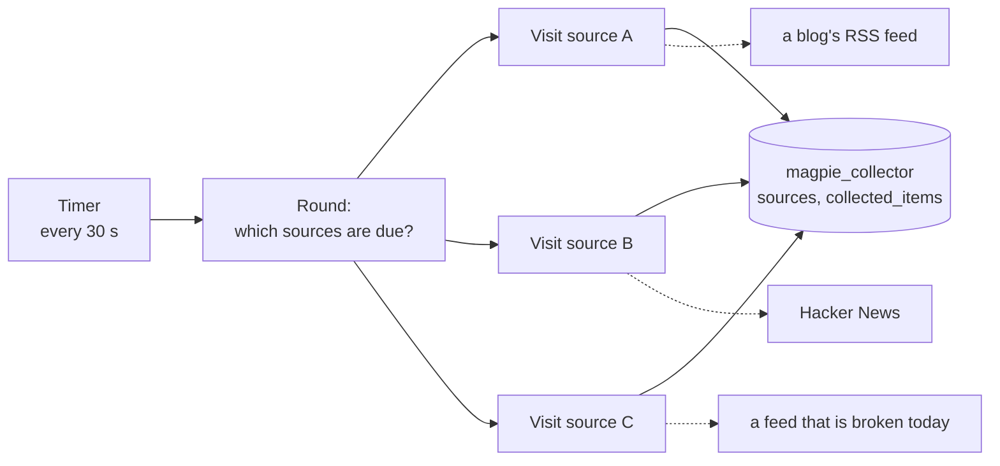
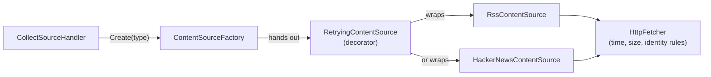
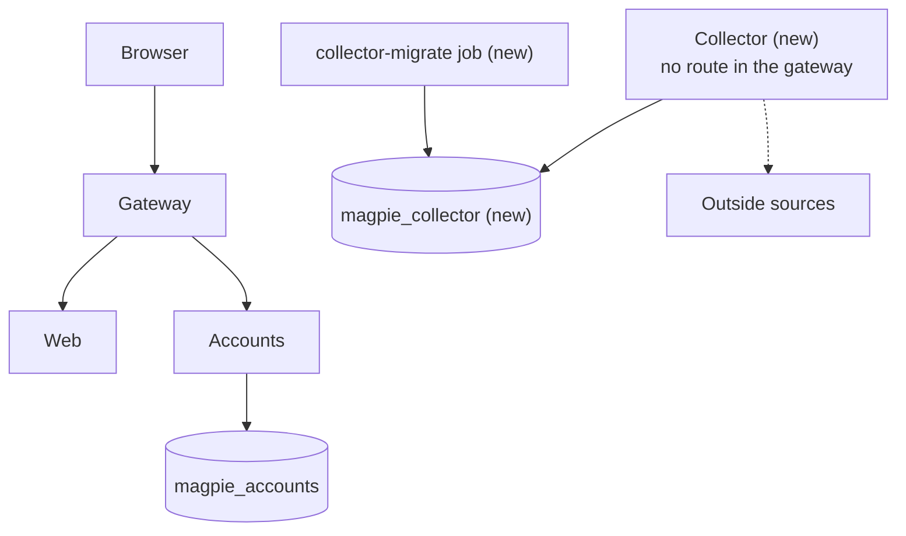
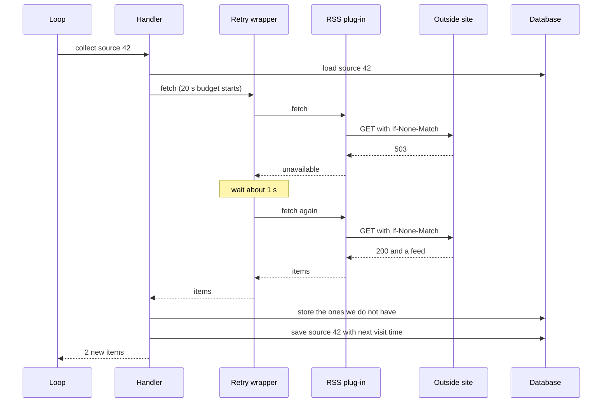
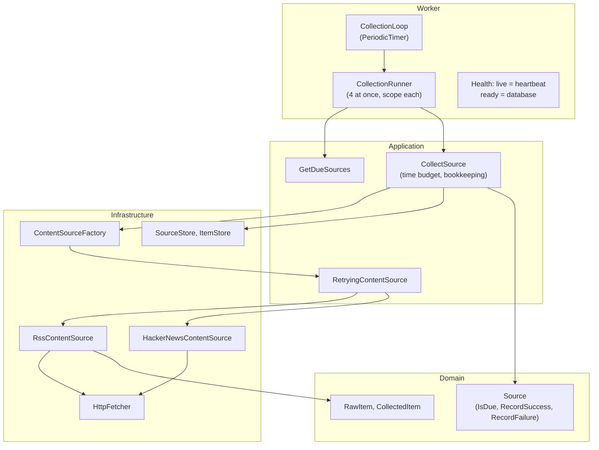
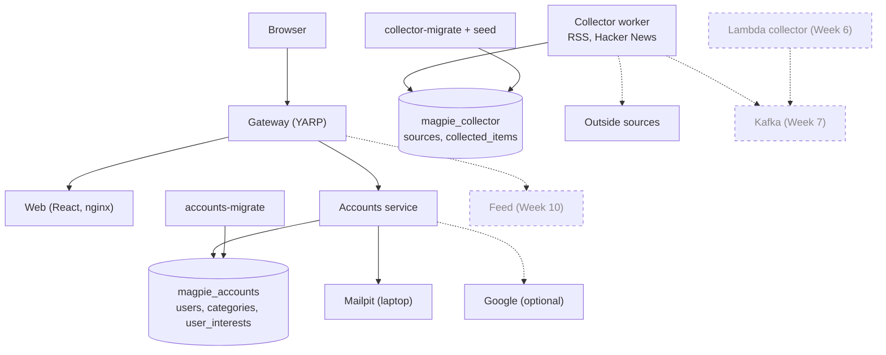

# Building Magpie: A Guided Journey from Empty Folder to Production-Grade System

## Chapter 5 (Week 5): Go Fetch. A Collector That Is Polite, Patient and Hard to Upset

> **What you will have at the end of this chapter:** a second service that wakes up on a timer, visits a list of outside sources (RSS feeds and Hacker News), and stores each new item's title, a short snippet and a link. One source hanging forever, or answering with nonsense, does not slow or stop the others. You will have used four classic design patterns because the problem asked for them, not because a book told you to.

| | |
|---|---|
| **Week** | 5 of 26 |
| **Plan step** | Step 4, Collectors (part 1) |
| **Time budget** | About 8 hours |
| **You need** | Chapter 4 finished and running |
| **Repository** | https://github.com/ankitchoubey800/magpie |
| **Code for this chapter** | Commit `{{sha7}}` on branch `week-05` (pull request #4, stacked on `week-04`). Every link in this chapter points at that exact commit |

---

### How this chapter was checked (read this first)

| What | Where it was run | Result |
|---|---|---|
| Collector: 59 tests (48 unit, 11 against a real PostgreSQL with a pretend internet) | GitHub Actions | `Passed! - Failed: 0, Passed: 59, Skipped: 0, Total: 59` |
| Accounts: 90 tests, unchanged | GitHub Actions | `Passed: 90` |
| Website: lint, 35 tests, build; 5 browser journeys | GitHub Actions | Passed, unchanged |
| The collector's first migration, created by `dotnet ef migrations add` | GitHub Actions; generated files committed | Created; applied by the tests and by the Compose job |
| The break-it experiment: the real collector container against five badly behaved sources | GitHub Actions, Docker Compose | Real output in section 6 |
| The 8 starter sources: one request each, once, to confirm each address answers with a feed | GitHub Actions | All 8 answered `200` in the expected format |
| **Not run by anyone yet:** the collector fetching the real starter sources over hours; anything on your laptop | | You do this. Section 14 says what to watch for |

The full evidence is public: {{run}}

One honest gap against the weekly guide: it asks for 20 RSS feeds. The repository ships 8, because every source needs its terms read by a person first (that is this week's non-technical task, and it is yours). A test does collect 12 sources side by side, and nothing in the design changes between 8 and 20.

Two things broke on the way. A Hacker News story that had been deleted took the whole Hacker News visit down with it (Step 4), and a check script in CI had a quoting mistake that made a passing experiment look like a failure (Step 9).

---

## 1. The big picture

### What are we building this week?

Until now Magpie has had readers and their interests but nothing to show them. This week content starts arriving.

The **collector** is a program with no screen and no visitors. Every 30 seconds it asks its own database one question: "which sources are due for a visit?" For each one it goes to the source's address, reads what is there, and writes down anything new.



**Reading the diagram:** the timer starts a round. A round finds the due sources and visits several at once. Each visit talks to one outside site (dotted lines, because those sites are not ours and may misbehave) and writes its own result to the collector's database.

Think of a newspaper delivery person in reverse: a courier with a list of shops to visit, each on its own schedule. The courier must be **polite** (say who they are, do not come too often), **patient** (a shop that is briefly shut gets another knock) and **hard to upset** (a shop with a locked door must not make the courier miss every other shop).

### Why does it matter?

This is the first time our code depends on computers we do not control. Everything in the first four weeks failed in ways we could predict. Outside sites fail in every way there is: slow, down, half an answer, the wrong answer, an answer that never ends. Most of an architect's work on integration is deciding, calmly and in advance, what happens for each of those.

> 🧠 **Pause and think**
> A source accepts our connection and then says nothing, forever. We have 4 visits running at once and 100 sources. If we do nothing special, what happens to the other 99? (Answer in section 11.)

### This week's deliverables

| # | Deliverable | Where |
|---|---|---|
| 1 | Collector worker with its own database | `src/services/collector/` |
| 2 | Two plug-ins: RSS/Atom and Hacker News | `Infrastructure/Sources/` |
| 3 | A list of sources in a table, loaded from a file | `infra/seed/sources.json` |
| 4 | A holding table for collected items | `collected_items` |
| 5 | Break-it kit: five badly behaved sources | `infra/experiments/bad-sources/` |
| 6 | Design note: "add a new source in under an hour" | `docs/design-notes/` |
| 7 | Non-technical: your "source terms" sheet | yours to write |

---

## 2. Concepts first

### 2.1 A background worker

A web service waits to be asked. A **worker** acts on its own, usually on a timer or when a message arrives. In .NET the base class is `BackgroundService`: you write one method, `ExecuteAsync`, and the host runs it for the life of the program and hands you a token that is cancelled when the program should stop.

For the timer we use `PeriodicTimer`. Its useful property is that it never overlaps itself. If a round takes 50 seconds and the tick is 30, the next round starts when the first has finished, not on top of it.

### 2.2 Four design patterns, each answering a real question

A **design pattern** is a named solution to a problem that keeps coming back. The names matter because they let two developers say in one word what would take a paragraph.

| The question we actually have | Pattern | In our code |
|---|---|---|
| "Sources come in different kinds. How does the loop stay ignorant of the kinds?" | **Strategy**: several interchangeable ways of doing one job, behind one interface | `IContentSource` with `FetchAsync` |
| "Every source describes items its own way. How do we get one shape?" | **Adapter**: translate someone else's shape into ours | each plug-in turns RSS XML or Hacker News JSON into `RawItem` |
| "Given a row that says `Rss`, who picks the right class?" | **Factory**: one place that decides which object to hand out | `ContentSourceFactory` |
| "Every plug-in needs retries. How do we avoid writing them in each?" | **Decorator**: wrap an object in another with the same interface that adds behaviour | `RetryingContentSource` |

Everyday pictures. Strategy: a travel adapter kit where every plug fits the same socket in your bag. Adapter: an interpreter. Factory: the receptionist who sends you to the right desk. Decorator: a phone case, the phone still works the same way, and now it also survives a drop.



**Reading the diagram:** the handler asks the factory for "whatever handles this type". It receives a retrying wrapper and never learns what is inside. Both plug-ins reach the outside world through one shared fetcher, so the safety rules are written once.

> 🪑 **Architect's chair**
> The test of a plug-in design is what a plug-in is *not allowed* to do. Ours may not touch the database, decide when it runs, retry, or hide errors. Because it implements none of the safety rules, it cannot forget one.

### 2.3 Timeouts: every wait needs an end

A call with no time limit is a promise to wait forever. We set three, from inside out:

| Limit | Default | Protects against |
|---|---|---|
| One HTTP request | 8 s | a site that stops answering |
| One whole visit to a source (all tries, parsing, saving) | 20 s | a visit made of many slow steps |
| The size of one answer | 2,000,000 bytes | an answer that never ends, or is absurdly large |

The size limit is a kind of timeout measured in bytes instead of seconds.

### 2.4 Retries, backoff and jitter

Some failures are worth a second try (the site is restarting) and some are not (the page does not exist). We separate them with two exception types:

- `SourceUnavailableException`: "could not get an answer". Network error, timeout, status 5xx, 429 or 408. **Retry.**
- `SourceContentException`: "got an answer and it is no good". Not a feed, 404, too large. **Do not retry**, the same request will give the same nonsense.

**Backoff** means waiting longer before each new try: 1 second, then 2. **Jitter** means adding a little randomness to each wait. Without jitter, a thousand collectors that all failed at the same moment all come back at the same moment, and knock the recovering site over again. That stampede has a name: the *thundering herd*.

We back off at two speeds:

| | Within one visit | Between visits |
|---|---|---|
| Who does it | `RetryingContentSource` | `Source.RecordFailure` |
| Waits | 1 s, 2 s (plus jitter), 3 tries in all | the normal interval, doubled for each failure in a row, at most 24 hours |
| Purpose | ride out a hiccup | stop bothering a site that is really broken |

### 2.5 Isolation: one bad source must not hurt the others

Ships are built with **bulkheads**: walls that keep a leak in one compartment from flooding the ship. Ours are:

1. Each visit has its own time budget (2.3).
2. Each visit gets its own **scope**: its own database session and its own handler objects. A failure cannot leave half-finished work behind for the next visit.
3. Each visit's outcome is written on that source's own row. Errors do not travel upward.
4. A fixed number of visits run at once (4). A flood of due sources cannot exhaust memory or connections.

### 2.6 Being a good guest

We are visiting other people's servers, uninvited. Four courtesies:

- **Say who you are.** Every request carries a `User-Agent` such as `MagpieCollector/0.1 (+https://your-page)`. A site owner who is unhappy can find you instead of blocking you blind.
- **Ask "has it changed?"** A **conditional GET** sends back the label (`ETag`) or date (`Last-Modified`) the site gave us last time. If nothing changed the site answers `304 Not Modified` with no body. Cheap for both sides.
- **Do not come too often.** No source may be visited more often than every 5 minutes; the code refuses.
- **Take little.** A title, a snippet of at most 500 characters and a link back. Never the article.

And one that is not code: **read the terms.** A feed being public does not mean any use of it is allowed.

### 2.7 Reading XML safely

RSS and Atom are XML. Old XML features (a "DTD") let a document refer to other files or expand tiny text into gigabytes. We refuse any document that contains one. This is one line of settings and it closes a whole family of attacks.

### 2.8 `IHttpClientFactory`

Creating a new `HttpClient` per request slowly runs the machine out of network sockets. Keeping one forever misses changes in the site's address. `IHttpClientFactory` manages a pool for you. We register one named client, `"sources"`, with the timeout and User-Agent set once.

### 2.9 A service owns its data

The collector gets its own database, `magpie_collector`, on the same PostgreSQL server. It never reads Accounts' tables. Where it needs to mention a topic it stores the topic's **slug** as plain text (`"programming"`) with no foreign key. That means the two can drift apart. We accept that, and say so in the decision record.

### 2.10 Liveness for a worker

A web service proves it is alive by answering. A worker could have a perfectly healthy web endpoint while its loop died an hour ago. So the loop records a **heartbeat** after each round, and the liveness check asks "when was the last one?"

> ❓ **No silly questions**
> **Q: Why not use a ready-made library such as Polly for retries?**
> A: In real projects you usually would (and .NET ships resilience helpers built on it). Writing 50 lines once teaches what those libraries are doing. Section 9 lists it as the first thing to swap.
> **Q: I come from Azure. What is the equivalent?**
> A: A timer-triggered Azure Function is the same idea with the loop provided for you. Week 6 builds the AWS version of exactly that (a scheduled Lambda).

---

## 3. Architecture and decisions

### 3.1 What changes



**Reading the diagram:** the left side is untouched. The collector stands apart: the gateway does not know it exists, because nothing outside ever calls it.

### 3.2 One visit, step by step



**Reading the diagram:** the handler owns the time budget and the bookkeeping. The retry wrapper sits between it and the plug-in and absorbs one short failure. Whatever happens, the last database step runs.

### 3.3 The two tables

| `sources` | |
|---|---|
| `Id`, `Name`, `Type`, `Address` (unique) | what and where |
| `CategoryHint` | topic slug, or empty |
| `FetchIntervalMinutes`, `Enabled` | schedule |
| `NextFetchAtUtc`, `LastFetchedAtUtc` | when |
| `ConsecutiveFailures`, `LastError` | health |
| `ETag`, `LastModified` | for "has it changed?" |

| `collected_items` | |
|---|---|
| `Id`, `SourceId`, `ExternalId` | unique together: the same item is never stored twice |
| `Url`, `Title`, `Summary`, `Author`, `PublishedAtUtc` | the little we keep |
| `CategoryHint`, `CollectedAtUtc` | copied from the source; when we saw it |

`collected_items` is a **holding table**. In week 7 a message queue replaces it.

### 3.4 Decisions

| Decision | Chosen | Main reason |
|---|---|---|
| Where collecting lives | Its own service and database (ADR-0006) | A hostile outside site must never share resources with sign-in |
| How kinds of source vary | Plug-ins behind one interface | New kind = one class |
| Where safety rules live | Around the plug-ins, never in them | Cannot be forgotten |
| Schedule | A `NextFetchAtUtc` per source, checked every 30 s | Each source has its own pace; survives restarts |
| Retries | Our own small decorator | Teaching; swap for a library later |
| Hosting shape | A small web app with a background loop | Reuses the standard health endpoints |

### 3.5 Files changed from earlier weeks

| File | Change |
|---|---|
| `Magpie.slnx` | five new projects |
| `infra/docker-compose.yml`, `infra/.env.example` | two new services, four new settings |
| `.github/workflows/ci.yml` | break-it step |
| `README.md` | status and folder list |

Nothing in Accounts, the gateway or the website changes this week.

---

## 4. Implementation guide

Branch: `git switch week-04 && git switch -c week-05`.

### Step 1: Five projects

**What:** the same four layers as Accounts, with `Worker` in place of `Api`, plus tests.
**Why:** same conventions, so the second service feels familiar.

```bash
C=src/services/collector
dotnet new classlib -n Magpie.Collector.Domain          -o $C/Magpie.Collector.Domain
dotnet new classlib -n Magpie.Collector.Application     -o $C/Magpie.Collector.Application
dotnet new classlib -n Magpie.Collector.Infrastructure  -o $C/Magpie.Collector.Infrastructure
dotnet new web      -n Magpie.Collector.Worker          -o $C/Magpie.Collector.Worker
dotnet new xunit    -n Magpie.Collector.Tests           -o $C/Magpie.Collector.Tests
rm $C/*/Class1.cs $C/Magpie.Collector.Tests/UnitTest1.cs
for p in Domain Application Infrastructure Worker Tests; do dotnet sln add $C/Magpie.Collector.$p; done
```

Then replace each project file with these. They hold the references and packages:

{{file:src/services/collector/Magpie.Collector.Domain/Magpie.Collector.Domain.csproj}}

{{file:src/services/collector/Magpie.Collector.Application/Magpie.Collector.Application.csproj}}

{{file:src/services/collector/Magpie.Collector.Infrastructure/Magpie.Collector.Infrastructure.csproj}}

{{file:src/services/collector/Magpie.Collector.Worker/Magpie.Collector.Worker.csproj}}

{{file:src/services/collector/Magpie.Collector.Tests/Magpie.Collector.Tests.csproj}}

{{gh:src/services/collector/Magpie.Collector.Domain/Magpie.Collector.Domain.csproj|src/services/collector/Magpie.Collector.Application/Magpie.Collector.Application.csproj|src/services/collector/Magpie.Collector.Infrastructure/Magpie.Collector.Infrastructure.csproj|src/services/collector/Magpie.Collector.Worker/Magpie.Collector.Worker.csproj|src/services/collector/Magpie.Collector.Tests/Magpie.Collector.Tests.csproj|Magpie.slnx}}

**Check:** `dotnet build Magpie.slnx` succeeds (empty projects).

> ❓ **Q&A**
> **Q: Why is the worker made with `dotnet new web` and not `dotnet new worker`?**
> A: So it can serve `/health/live` and `/health/ready` like every other service, with the helpers we already wrote. The cost is a web server that listens and does almost nothing.
> **Q: What is `InternalsVisibleTo`?**
> A: Classes marked `internal` are hidden outside their project. This line lets the test project, and only it, see them.

### Step 2: Domain, the rules about sources and items

**What:** four small files with no dependencies.
**Why:** the scheduling and politeness rules belong where no framework can get in their way, and where they are trivial to test.

{{file:src/services/collector/Magpie.Collector.Domain/SourceType.cs}}

{{file:src/services/collector/Magpie.Collector.Domain/Source.cs}}

Read `RecordFailure` slowly. The wait is the normal interval multiplied by 2 for every failure in a row, never more than 24 hours. One success resets it.

{{file:src/services/collector/Magpie.Collector.Domain/RawItem.cs}}

`TryCreate` returns nothing rather than throwing when an item is unusable. One broken item in a feed of fifty is normal on the real web and must not spoil the other forty-nine.

{{file:src/services/collector/Magpie.Collector.Domain/CollectedItem.cs}}

{{gh:src/services/collector/Magpie.Collector.Domain/SourceType.cs|src/services/collector/Magpie.Collector.Domain/Source.cs|src/services/collector/Magpie.Collector.Domain/RawItem.cs|src/services/collector/Magpie.Collector.Domain/CollectedItem.cs}}

**Check:** `dotnet build src/services/collector/Magpie.Collector.Domain`. Open the project file: no references.

> ❓ **Q&A**
> **Q: Why strip HTML from titles and snippets here?**
> A: Feeds often put HTML inside descriptions. We store plain text so nothing downstream ever has to wonder whether a title is safe to show.
> **Q: Why does the Domain take "now" as a parameter instead of asking the clock?**
> A: So a test can say "it is 31 minutes later" without waiting 31 minutes.

### Step 3: Application, the plug-in contract and the two use cases

**What:** the interface every plug-in implements, the retry wrapper, the ports to storage, one query and one command.
**Why:** this layer is the whole behaviour of the collector with no HTTP and no database in sight.

The contract (Strategy), the factory's interface, and the two kinds of failure:

{{file:src/services/collector/Magpie.Collector.Application/Sources/IContentSource.cs}}

The decorator:

{{file:src/services/collector/Magpie.Collector.Application/Sources/RetryingContentSource.cs}}

Notice it takes the "wait" and the "random number" as functions. Production passes the real ones. Tests pass ones that return at once and record what was asked, so the retry tests run in milliseconds.

The ports:

{{file:src/services/collector/Magpie.Collector.Application/Collecting/CollectorPorts.cs}}

The query, "which sources are due?":

{{file:src/services/collector/Magpie.Collector.Application/Collecting/GetDueSources.cs}}

The command, "visit this one source":

{{file:src/services/collector/Magpie.Collector.Application/Collecting/CollectSource.cs}}

This handler is the most important file of the week. Three details:

1. **The stopwatch.** `CreateLinkedTokenSource` makes a token that is cancelled when *either* the program is stopping *or* our 20 seconds run out.
2. **Telling the two apart.** `catch (OperationCanceledException) when (!cancellationToken.IsCancellationRequested)` means "our stopwatch, not a shutdown". A shutdown is allowed to travel upward.
3. **The final save uses the caller's token.** If it used the stopwatch's, a source that used all its time could never have its failure written down, and would be tried again 30 seconds later, forever.

{{gh:src/services/collector/Magpie.Collector.Application/Sources/IContentSource.cs|src/services/collector/Magpie.Collector.Application/Sources/RetryingContentSource.cs|src/services/collector/Magpie.Collector.Application/Collecting/CollectorPorts.cs|src/services/collector/Magpie.Collector.Application/Collecting/GetDueSources.cs|src/services/collector/Magpie.Collector.Application/Collecting/CollectSource.cs}}

**Check:** `dotnet build src/services/collector/Magpie.Collector.Application`.

> ❓ **Q&A**
> **Q: The handler catches only two exception types. What about everything else?**
> A: Anything else is a bug of ours, and should be loud. The runner (Step 6) catches it one level up, logs it as an error, and carries on with the other sources.
> **Q: Why does `GetDueSources` return ids and not the sources themselves?**
> A: Each visit runs in its own scope and loads its own copy. Passing loaded objects between scopes is how two database sessions end up arguing over one row.

### Step 4: Infrastructure, talking to the outside world

**What:** settings, the one shared fetcher, the feed reader, two plug-ins, the factory.
**Why:** every rule about *how we behave as a guest* lives in `HttpFetcher`, once.

{{file:src/services/collector/Magpie.Collector.Infrastructure/CollectorOptions.cs}}

`ContactUrl` is required. Start the collector without it and it refuses, with a message. A collector that cannot say who runs it should not run.

{{file:src/services/collector/Magpie.Collector.Infrastructure/Sources/HttpFetcher.cs}}

Find, in that file: where the "has it changed?" headers are added, where `304` becomes "nothing new", which statuses mean "try again", and where the size limit is enforced while reading rather than after.

{{file:src/services/collector/Magpie.Collector.Infrastructure/Sources/FeedParser.cs}}

{{file:src/services/collector/Magpie.Collector.Infrastructure/Sources/RssContentSource.cs}}

Look how small the plug-in is. That is the design working.

{{file:src/services/collector/Magpie.Collector.Infrastructure/Sources/HackerNewsContentSource.cs}}

Hacker News has no feed. Its public API gives a list of story numbers, then one small document per story. The plug-in fetches five at a time and adapts each to a `RawItem`.

> 🔎 **Found by running it**
> The first version let any failure on a single story end the whole visit. The test for a deleted story (the API answers `404` for it) failed: one missing story meant zero stories collected. Now a story whose answer is unusable is skipped, while "the site is unavailable" still fails the visit so the retry wrapper can do its job. It is the bulkhead idea again, one level down.

{{file:src/services/collector/Magpie.Collector.Infrastructure/Sources/ContentSourceFactory.cs}}

{{gh:src/services/collector/Magpie.Collector.Infrastructure/CollectorOptions.cs|src/services/collector/Magpie.Collector.Infrastructure/Sources/HttpFetcher.cs|src/services/collector/Magpie.Collector.Infrastructure/Sources/FeedParser.cs|src/services/collector/Magpie.Collector.Infrastructure/Sources/RssContentSource.cs|src/services/collector/Magpie.Collector.Infrastructure/Sources/HackerNewsContentSource.cs|src/services/collector/Magpie.Collector.Infrastructure/Sources/ContentSourceFactory.cs}}

**Check:** it will not build until Step 5 adds the persistence files the registration refers to. Carry on.

> ❓ **Q&A**
> **Q: Why is 429 "try again" but 404 not?**
> A: 429 means "you are asking too fast", which time cures. 404 means "there is nothing here", which time does not.
> **Q: Does the factory's `switch` not break the "no switch on type" idea?**
> A: There has to be exactly one place that knows all the kinds. The pattern's promise is that there is *only* one, and that it does nothing except choose.

### Step 5: Infrastructure, storage and wiring

{{file:src/services/collector/Magpie.Collector.Infrastructure/Persistence/CollectorDbContext.cs}}

Two indexes follow last week's rule, "added for a named question": `ix_sources_due` answers "which enabled sources are due?", and the unique index on source plus external id is what makes storing an item twice impossible, even if our code has a bug.

{{file:src/services/collector/Magpie.Collector.Infrastructure/Persistence/Stores.cs}}

`AddNewAsync` asks one question for the whole batch ("which of these ids do we already have?") instead of one per item.

{{file:src/services/collector/Magpie.Collector.Infrastructure/Persistence/SourceSeeder.cs}}

{{file:src/services/collector/Magpie.Collector.Infrastructure/Persistence/CollectorDatabaseHealthCheck.cs}}

{{file:src/services/collector/Magpie.Collector.Infrastructure/DependencyInjection.cs}}

{{gh:src/services/collector/Magpie.Collector.Infrastructure/Persistence/CollectorDbContext.cs|src/services/collector/Magpie.Collector.Infrastructure/Persistence/Stores.cs|src/services/collector/Magpie.Collector.Infrastructure/Persistence/SourceSeeder.cs|src/services/collector/Magpie.Collector.Infrastructure/Persistence/CollectorDatabaseHealthCheck.cs|src/services/collector/Magpie.Collector.Infrastructure/DependencyInjection.cs}}

**Check:** `dotnet build src/services/collector/Magpie.Collector.Infrastructure` succeeds.

> ❓ **Q&A**
> **Q: Sources are in a table. Why also a JSON file?**
> A: The table is the truth at run time. The file is how a list gets into a fresh database, reviewed in a pull request like code. Seeding only adds addresses that are missing, so running it twice is harmless.
> **Q: Could two collectors store the same item at the same moment?**
> A: With one collector, no. With two, the unique index would reject the second, and that visit would be recorded as failed and tried again later. Section 7 covers running more than one.

### Step 6: The worker

{{file:src/services/collector/Magpie.Collector.Worker/Collecting/CollectionRunner.cs}}

`Parallel.ForEachAsync` with a maximum is bulkhead number 4. `CreateAsyncScope` per source is bulkhead number 2.

{{file:src/services/collector/Magpie.Collector.Worker/Collecting/CollectionLoop.cs}}

{{file:src/services/collector/Magpie.Collector.Worker/Program.cs}}

{{file:src/services/collector/Magpie.Collector.Worker/appsettings.json}}

{{gh:src/services/collector/Magpie.Collector.Worker/Collecting/CollectionRunner.cs|src/services/collector/Magpie.Collector.Worker/Collecting/CollectionLoop.cs|src/services/collector/Magpie.Collector.Worker/Program.cs|src/services/collector/Magpie.Collector.Worker/appsettings.json|src/services/collector/Magpie.Collector.Worker/Properties/launchSettings.json}}

**Check:** `dotnet build Magpie.slnx` succeeds. Do not run it yet: there are no tables.

> ❓ **Q&A**
> **Q: The loop catches every exception and carries on. Is that not hiding errors?**
> A: It logs them as errors, and the heartbeat still beats, because the loop *is* alive. What it must never do is die quietly. If the database is down, readiness reports it (section 6 shows this happening for real).
> **Q: Why is the runner a singleton but the handler created per visit?**
> A: The runner holds no data, only the recipe for a round. The handler holds a database session, which must never be shared between visits running at once.

### Step 7: The first migration

```bash
dotnet tool update --global dotnet-ef --version "10.0.*"
export ConnectionStrings__CollectorDb="Host=localhost;Database=design_time_only"
export Collector__ContactUrl="https://example.com"
dotnet ef migrations add InitialCollector \
  --project src/services/collector/Magpie.Collector.Infrastructure \
  --startup-project src/services/collector/Magpie.Collector.Worker \
  --output-dir Persistence/Migrations
```

The two `export` lines are needed because the tool starts the program to learn about its tables, and the program refuses to start without its required settings. Nothing connects to that database.

{{gh:src/services/collector/Magpie.Collector.Infrastructure/Persistence/Migrations}}

**Check:** three new files under `Persistence/Migrations`. Open the one without `Designer` in its name and find both tables and the three indexes.

> ⚠️ **Watch out**
> On Windows PowerShell use `$env:ConnectionStrings__CollectorDb = "..."` instead of `export`.

### Step 8: Tests

**What:** 48 fast tests of rules and plug-ins, and 11 that run the whole collector against a real PostgreSQL and a pretend internet.

The pretend internet. It replaces the very last link in the chain (the part of `HttpClient` that touches the network), so everything above it is the real code:

{{file:src/services/collector/Magpie.Collector.Tests/Fakes/StubWeb.cs}}

{{file:src/services/collector/Magpie.Collector.Tests/Fakes/SampleFeeds.cs}}

{{file:src/services/collector/Magpie.Collector.Tests/Fakes/ManualClock.cs}}

Unit tests (shown: the retry wrapper; the others follow the same style and are linked below):

{{file:src/services/collector/Magpie.Collector.Tests/Unit/RetryingContentSourceTests.cs}}

The test host, which wires the collector exactly as `Program.cs` does and then swaps three things:

{{file:src/services/collector/Magpie.Collector.Tests/Integration/CollectorTestHost.cs}}

And the tests. The fifth one is this week's break-it experiment in miniature:

{{file:src/services/collector/Magpie.Collector.Tests/Integration/CollectingTests.cs}}

{{gh:src/services/collector/Magpie.Collector.Tests/Fakes/StubWeb.cs|src/services/collector/Magpie.Collector.Tests/Fakes/SampleFeeds.cs|src/services/collector/Magpie.Collector.Tests/Fakes/ManualClock.cs|src/services/collector/Magpie.Collector.Tests/Unit/SourceTests.cs|src/services/collector/Magpie.Collector.Tests/Unit/RawItemTests.cs|src/services/collector/Magpie.Collector.Tests/Unit/FeedParserTests.cs|src/services/collector/Magpie.Collector.Tests/Unit/PlugInTests.cs|src/services/collector/Magpie.Collector.Tests/Unit/RetryingContentSourceTests.cs|src/services/collector/Magpie.Collector.Tests/Integration/CollectorTestHost.cs|src/services/collector/Magpie.Collector.Tests/Integration/CollectingTests.cs}}

**Check** (Docker must be running):

```bash
dotnet test src/services/collector/Magpie.Collector.Tests
```

Expected last line, as seen on GitHub: `Passed!  - Failed: 0, Passed: 59, Skipped: 0, Total: 59`.

> ❓ **Q&A**
> **Q: Why a separate database for every test?**
> A: The collector visits "all sources that are due". Tests sharing one table would visit each other's sources. A fresh database costs a fraction of a second and removes the problem entirely.
> **Q: No test visits a real website. Is that not a gap?**
> A: Deliberately. A test that depends on someone else's site fails when *they* have a bad day, and hammers them every time we push. The real sites are checked once, by hand (Step 9), and then by watching the collector run.

### Step 9: Sources, Docker, Compose and CI

The starter list. Comments are allowed in this file:

{{file:infra/seed/sources.json}}

Each address was requested once from a GitHub runner while writing this chapter and answered with a feed in the expected format. That is all that was checked. **Their terms were not reviewed for you**; that is your task before you rely on them.

The image:

{{file:src/services/collector/Dockerfile}}

Add to `infra/docker-compose.yml`, above `web:`:

```yaml
  collector-migrate:
    image: magpie-collector
    build:
      context: ..
      dockerfile: src/services/collector/Dockerfile
    command: ["--migrate", "--seed-sources", "/seed/sources.json"]
    environment:
      ConnectionStrings__CollectorDb: "Host=postgres;Port=5432;Database=magpie_collector;Username=${POSTGRES_USER};Password=${POSTGRES_PASSWORD};Timeout=5;Command Timeout=30"
    volumes:
      - ${COLLECTOR_SEED_FILE:-./seed/sources.json}:/seed/sources.json:ro
    depends_on:
      postgres:
        condition: service_healthy
    restart: "no"

  collector:
    image: magpie-collector
    build:
      context: ..
      dockerfile: src/services/collector/Dockerfile
    environment:
      ConnectionStrings__CollectorDb: "Host=postgres;Port=5432;Database=magpie_collector;Username=${POSTGRES_USER};Password=${POSTGRES_PASSWORD};Timeout=5;Command Timeout=10"
      Collector__ContactUrl: "${COLLECTOR_CONTACT_URL}"
      Collector__TickSeconds: "${COLLECTOR_TICK_SECONDS:-30}"
      Collector__PerSourceTimeoutSeconds: "${COLLECTOR_PER_SOURCE_TIMEOUT_SECONDS:-20}"
      Collector__HttpTimeoutSeconds: "${COLLECTOR_HTTP_TIMEOUT_SECONDS:-8}"
    depends_on:
      postgres:
        condition: service_healthy
      collector-migrate:
        condition: service_completed_successfully
    extra_hosts:
      - "host.docker.internal:host-gateway"
    ports:
      - "127.0.0.1:5102:8080"
```

Add to `infra/.env.example` **and to your own `infra/.env`** (Compose reads `.env`; the example is only the template):

```bash
COLLECTOR_CONTACT_URL=https://github.com/ankitchoubey800/magpie
COLLECTOR_TICK_SECONDS=30
COLLECTOR_SEED_FILE=./seed/sources.json
# COLLECTOR_SEED_FILE=./experiments/bad-sources/sources.json
```

Change `COLLECTOR_CONTACT_URL` to a page of your own.

{{gh:infra/seed/sources.json|src/services/collector/Dockerfile|infra/docker-compose.yml|infra/.env.example|.github/workflows/ci.yml}}

**Check:**

```bash
docker compose -f infra/docker-compose.yml up --build -d
curl http://localhost:5102/health/ready
docker compose -f infra/docker-compose.yml exec -T postgres psql -U magpie -d magpie_collector -c \
  'SELECT s."Name", count(i."Id") AS items, s."ConsecutiveFailures", s."LastError" FROM sources s LEFT JOIN collected_items i ON i."SourceId" = s."Id" GROUP BY s."Id" ORDER BY 1;'
```

Within a minute you should see every source with items and no errors. This is the first time anyone runs the collector against the real sources, so if one shows an error, read section 10 before assuming you made a mistake.

> ⚠️ **Watch out**
> The migration job's log shows one alarming line, `database "magpie_collector" does not exist`, just before it creates that database. It is the tool checking, not a failure. The same happened in CI.

> 🔎 **Found by running it**
> The first CI run reported failure even though the experiment's table showed exactly the right result. The check script used `$$` to quote SQL, and in a shell `$$` means "this process's number". The experiment was right and the check was wrong. Lesson: when a check fails, read what it printed before you touch the code under test.

> ❓ **Q&A**
> **Q: Both collector services name the same image. Is it built twice?**
> A: No. One image, two ways of starting it: once with `--migrate --seed-sources` (runs and exits), once with no arguments (runs the loop).
> **Q: What is `extra_hosts` for?**
> A: It lets the container reach a program on your own machine under the name `host.docker.internal`. Only the experiment in section 6 needs it.

### Step 10: Write down the decision

{{gh:docs/adr/0006-collector-plug-ins-and-own-database.md|docs/design-notes/week-05-add-a-source-in-under-an-hour.md|README.md}}

The design note is a draft. Exercise 1 in section 11 asks you to add a plug-in and time yourself; put your real time in the note.

Commit and push:

```bash
git add -A && git commit -m "Week 5: collector worker with RSS and Hacker News plug-ins"
git push -u origin week-05
```

---

## 5. How the pieces fit together



**Reading the diagram:** arrows point inward and downward, as in Accounts. The Worker knows about a timer and nothing about RSS. The Domain knows about schedules and nothing about HTTP. Swap PostgreSQL or add a source type and only the Infrastructure box changes.

---

## 6. Break it on purpose: one source hangs, one talks nonsense

The kit is a tiny web server with five addresses:

{{file:infra/experiments/bad-sources/server.py}}

> ✏️ **Pencil time**
> Before running: for each of `good`, `flaky`, `garbage`, `hang`, `huge`, predict the number of items collected, and the error text if any. Then predict how long the first round takes with a 12 second budget per source.

Run it:

```bash
# terminal 1
python3 infra/experiments/bad-sources/server.py

# terminal 2: in infra/.env set
#   COLLECTOR_SEED_FILE=./experiments/bad-sources/sources.json
#   COLLECTOR_TICK_SECONDS=3
# and add
#   COLLECTOR_PER_SOURCE_TIMEOUT_SECONDS=12
#   COLLECTOR_HTTP_TIMEOUT_SECONDS=2
docker compose -f infra/docker-compose.yml down -v     # -v wipes your local data: fresh start
docker compose -f infra/docker-compose.yml up --build -d
```

After about 20 seconds, run the query from Step 9. The real result from GitHub Actions:

```text
  source   | items | failures |                last_error
-----------+-------+----------+------------------------------------------
 1 good    |     3 |        0 |
 2 flaky   |     3 |        0 |
 3 garbage |     0 |        1 | The answer is not a readable feed.
 4 hang    |     0 |        1 | The source took too long to answer.
 5 huge    |     0 |        1 | The answer is larger than 2000000 bytes.
```

And what the "sources" saw, proof that we introduce ourselves:

```text
request: /good.xml   user-agent: MagpieCollector/0.1 (+https://github.com/ankitchoubey800/magpie)
```

What to notice:

- **good** was collected in the first second. The collector's own log shows the two instant failures and the good source finishing together, and the hanging source giving up about ten seconds later, alone.
- **flaky** failed twice with 503 and then succeeded, inside one visit. Zero failures recorded: the retry wrapper absorbed it.
- **garbage** and **huge** failed at once and were not retried.
- **hang** was tried three times at 2 seconds each, then recorded. It will next be tried in 5 minutes, then 10, then 20.
- The liveness check stayed healthy throughout.

A second, unplanned experiment came free. Later in the same CI job an older test stops the database on purpose. The collector logged `A collection round failed; trying again on the next tick`, stayed alive, and its liveness check kept answering. That is the loop's catch-all doing its job.

**Now break the protection** to see what it was for: set `COLLECTOR_HTTP_TIMEOUT_SECONDS=600` and `COLLECTOR_PER_SOURCE_TIMEOUT_SECONDS=600`, start fresh, and watch. Predict first, then write down what happens to the hanging source's row, and to the *second* round.

---

## 7. Production considerations

| Topic | Today | Before real users |
|---|---|---|
| **More than one collector** | One. Two would both pick the same due sources and do double work | Claim sources with a database lock (`FOR UPDATE SKIP LOCKED`) or hand visits out through a queue. Week 7 brings the queue |
| **Where requests can go** | Any address in the table | If readers can ever submit sources, block private network addresses first. A collector that fetches any URL is a classic way into an internal network (the attack is called SSRF) |
| **robots.txt** | Not read. We only fetch feeds and APIs made for programs | Read and obey it before fetching ordinary web pages |
| **Per-site pace** | Minimum interval per source | Also limit requests per *host*, since many feeds can live on one site |
| **Watching it** | Log lines and two columns | Counters and alerts on failure rate and "items per hour" (Week 22) |
| **A source that never recovers** | Backs off to once a day, forever | Disable after N days and tell a person |
| **The holding table** | Grows forever | Replaced by a queue in Week 7 |
| **Secrets** | None needed yet | YouTube keys arrive in Week 6 |
| **Cost** | A small always-on container | Compare with a scheduled function that costs nothing while idle (Week 6) |

---

## 8. Architect's perspective

**What was the real decision this week?** Not "RSS or Hacker News". It was *where the safety rules live*. Put them in each plug-in and every new plug-in is a new chance to forget one. Put them around the plug-ins and a new source type is a small, boring change. Boring changes are what you want at 20 source types.

**Patterns are answers, so start from the question.** Nobody sat down to "use the Decorator pattern". We had retries to add to every plug-in and did not want them written twice. The name came afterwards and is useful mostly for talking.

**Design for the failure you will certainly have.** With thousands of outside sources, at every moment some are broken. That is the normal state, not an incident. So failure is a column in a table and a slower schedule, not an exception that wakes someone up.

**What would I challenge in a review?**

- "What happens when the source list is 5,000 long and half are due at once?" (Four at a time, about a second each: 2,500 visits take around ten minutes. Fine at this size; the design note has the arithmetic.)
- "Who notices a source that has been failing for a week?" (Today: nobody. Honest answer, listed in section 7.)
- "Can the plug-in interface survive a source that pushes to us instead of being polled?" (No. That would be a different kind of collector, and that is fine.)

> 🪑 **Architect's chair**
> Write the sentence a site owner would read if they looked up your User-Agent. If you would be uncomfortable with them reading it, change what the collector does, not the sentence.

---

## 9. Alternatives and trade-offs

| Choice | We chose | Alternative | When the alternative wins |
|---|---|---|---|
| Retry code | Own 50-line decorator | Polly, or .NET's built-in HTTP resilience | Almost any real project. **Optional swap now, sensible later** |
| Scheduling | Timer + `NextFetchAtUtc` column | Quartz.NET, Hangfire, or cloud schedulers | Many job types, calendars, dashboards |
| Hosting | Always-on container | Scheduled serverless function | Spiky or rare work; Week 6 builds one to compare |
| Feed reading | `XDocument`, about 85 lines | `System.ServiceModel.Syndication` or a feed library | Odd feeds in the wild; we may meet some |
| Source list | Table, seeded from a file | Config file only; an admin screen | File only: tiny fixed lists. Admin screen: Week 18 |
| Plug-in loading | Compiled in | Loaded from separate files at run time | Third parties write plug-ins |
| Database | Separate database, same server | Separate server; or a schema in the shared database | Separate server: real isolation at higher cost. Shared schema: never, it invites joins |

**Essential this week:** the worker, the plug-in contract, the three limits, the two speeds of backoff, isolation, the break-it run.
**Optional:** Atom support, the `huge` and `flaky` sources in the kit, the parallel-sources test.

---

## 10. Common mistakes and troubleshooting

### Mistakes beginners make this week

| Mistake | Why it hurts | Instead |
|---|---|---|
| No timeout on an outside call | One silent site freezes a worker thread forever | A limit on every wait |
| Retrying everything | A 404 retried three times is three wasted, impolite requests | Retry only "could not get an answer" |
| Retrying with no delay | You join the stampede that is keeping the site down | Backoff and jitter |
| `new HttpClient()` per request | Sockets run out under load | `IHttpClientFactory` |
| Catching `Exception` and moving on silently | The source looks healthy and collects nothing | Record the failure where a person will see it |
| One shared database session for all visits | Parallel visits corrupt each other's work | A scope per visit |
| A default User-Agent | Site owners block what they cannot identify | Name and contact address |
| Storing the article text | Legal and storage trouble | Title, snippet, link |

### When something goes wrong

| What you see | Likely cause | Fix |
|---|---|---|
| Collector exits at once: `ContactUrl ... required` | `COLLECTOR_CONTACT_URL` missing from `infra/.env` | Add it |
| `collector-migrate` fails: seed file not found | `COLLECTOR_SEED_FILE` path wrong (it is relative to `infra/`) | Fix the path |
| `NETSDK1004` during Docker build | A project's `.csproj` is not copied before `restore` in the Dockerfile | Add the `COPY` line (same fix as last week) |
| A real source shows `403` or `429` | The site limits or blocks automated visitors | Raise its interval; read its terms; if it persists, remove it |
| A real source shows `not a readable feed` | The address returns a web page, or an unusual feed dialect | Open the address in a browser; if it is a real feed, save a sample and add a parser test |
| Experiment: every source "took too long" | The container cannot reach your machine | Is `server.py` running? On Linux, is the `extra_hosts` line present? Is a firewall blocking port 9099? |
| Experiment shows old results | The database still holds last run's rows | `docker compose down -v` before `up` |
| `dotnet ef` fails: connection string required | The two `export` lines were not set in this terminal | Set them (Step 7) |
| Items never increase after the first round | Correct: nothing new, or `304 Not Modified` | Look at `LastFetchedAtUtc` moving forward |

---

## 11. Knowledge check

### Pause-and-think answer (from section 1)

With no time limit, the visit to the silent source never ends and permanently occupies one of the 4 slots. The other 99 still get collected, on 3 slots. Then a second silent source takes another slot. When 4 sources hang, collecting stops completely, with no error anywhere. A slow leak like this is worse than a crash because nothing announces it.

### Concept questions

1. What is the difference between `SourceUnavailableException` and `SourceContentException`, and why do we need two?
2. What does jitter prevent?
3. Name the four bulkheads in the collector.
4. What does a `304` answer mean, and which two headers make it possible?
5. Why does the collector store a category slug as text and not a foreign key?
6. Why is "the web endpoint answers" not a good liveness check for a worker?
7. Which class is the only one that knows every source type?

<details><summary>Answers</summary>

1. "No answer" versus "a bad answer". Only the first is worth retrying.
2. Many clients retrying at the same instant and knocking a recovering site over again.
3. A time budget per visit; a scope per visit; outcome recorded on the source's own row; a fixed number of visits at once.
4. "Nothing changed since you last asked." `If-None-Match` (with the `ETag`) and `If-Modified-Since` (with `Last-Modified`).
5. The categories live in another service's database. Services do not share tables, so there is nothing to point a foreign key at.
6. The loop can die while the web server lives. The heartbeat asks about the loop itself.
7. `ContentSourceFactory`.

</details>

### Practical exercises

1. **Add a plug-in and time yourself.** Many sites publish a "JSON Feed" (a feed as JSON instead of XML). Add `SourceType.JsonFeed`, a plug-in, one factory line, and unit tests against a sample you write. Target: under an hour. Put your real time in the design note.
2. **Disable after ten failures.** Add the rule to `Source`, with tests. Does it need a migration?
3. **Per-host politeness.** Sketch (on paper) how you would stop two sources on the same site being visited in the same second.
4. **Read a plan.** Run `EXPLAIN` on the "due sources" question. With 8 rows PostgreSQL will not use the index. Why not? (Chapter 4 has the answer.)

### Interview-style questions with model answers

**"How would you design a system that pulls data from hundreds of third-party sources?"**
> I would separate what varies from what must not. What varies is how each kind of source is read, so that goes behind one small interface, one implementation per kind. What must not vary is safety: a time limit on every call, a size limit, retries only for failures that time can cure, with growing delays and some randomness, and isolation so each source's failure is recorded against that source and slows only that source's schedule. I would put those rules around the plug-ins, not in them, so a new source type cannot forget one. Then I would test it by pointing it at sources that hang, lie and never stop talking.

**"Explain exponential backoff and jitter, and when not to retry at all."**
> Backoff means each retry waits longer than the last, typically doubling, so a struggling service gets room to recover. Jitter adds randomness so that many clients do not all come back at the same moment. I do not retry when the answer will not change: a missing page, a malformed document, a rejected request. And I am careful retrying anything that changes data, unless the operation is safe to repeat.

**"Why did you give the collector its own database?"**
> So that it can change, fail and scale on its own. If two services share tables, neither can change them without the other, and a heavy query from one slows the other. The price is that I cannot join across them, so the collector refers to categories by a stable name and accepts they can drift. I wrote that trade-off down.

**"A background job stopped working three days ago and nobody noticed. How do you prevent that?"**
> Three things. The loop must not die silently: catch, log, continue. Liveness must ask the job itself, with a heartbeat, not just the process. And there should be a business signal, such as "items collected in the last hour", with an alert when it reaches zero. We have the first two; the third comes with monitoring in a later week.

### Self-marking

Give yourself a point per concept question answered without notes. 6 or 7: carry on. 4 or 5: reread sections 2.4 and 2.5. Fewer: run the break-it experiment again and explain each row aloud.

---

## 12. Completion checklist

**Built**

- [ ] `dotnet test Magpie.slnx` shows 59 collector tests and 90 accounts tests passed on your machine
- [ ] `docker compose up` starts the collector and `http://localhost:5102/health/ready` is healthy
- [ ] The real starter sources show items in `collected_items`
- [ ] The break-it experiment run by you, table saved
- [ ] The pull request's three checks are green

**Understood**

- [ ] Worker versus web service
- [ ] Strategy, Adapter, Factory, Decorator, each in one sentence of your own
- [ ] The three limits and the two speeds of backoff
- [ ] The four bulkheads
- [ ] Conditional GET
- [ ] Why the collector owns its database

**The five closing items**

- [ ] 1. **Design note** "Add a new source in under an hour", with your timed result from exercise 1
- [ ] 2. **Working code and tests on your machine**, output saved
- [ ] 3. **Break-it experiment** run by you, including the "remove the protection" part, with predictions and conclusion
- [ ] 4. **Explain-back**, 150 to 300 words, in `docs/explain-back/week-05.md`
- [ ] 5. **Interview questions** answered without notes and marked

**Non-technical**

- [ ] **Source terms sheet.** One row per source: name, address, link to its terms, what they allow (automated access? how often? may titles and snippets be shown with a link?), date checked, your decision. Start with the 8 in the seed file, then grow the list to 20 feeds you have checked
- [ ] Set `COLLECTOR_CONTACT_URL` to a page of yours that says what the collector does and how to reach you

When every box is ticked: merge (merge commit) and `git tag week-05-done && git push --tags`.

---

## 13. Cumulative architecture overview (version 5, after Week 5)

### System map



**Reading the diagram:** two services now, each with its own database on one server. They do not talk to each other yet. Dashed boxes are planned.

### What exists

| Component | Responsibility today | Added | Changed |
|---|---|---|---|
| Gateway | Routes; forwards the reader's address, scheme and host | Week 1 | |
| Accounts service | Accounts, sign-in, reset, Google, categories, interests | Week 1 | Weeks 2, 3, 4 |
| **Collector worker** | **Visits sources on a schedule; stores new items; isolates failures** | Week 5 | |
| Web | Auth pages, onboarding, topic settings | Week 1 | Weeks 2, 3, 4 |
| PostgreSQL | `magpie_accounts`; **`magpie_collector`** | Week 1 | Weeks 2, 4, 5 |
| Magpie.Defaults | Logging, errors, health, forwarded headers, mediator registration | Week 1 | Weeks 2, 3, 4 |
| Magpie.Mediator | Requests and handlers; **now used by two services** | Week 4 | |
| Tests | Unit, integration, component, browser | Week 1 | every week |

### Conventions (additions this week in **bold**)

| Topic | Convention |
|---|---|
| Public API addresses | `/api/<service>/...`, forwarded unchanged; reader-owned data under `/me/` |
| Errors | Problem Details with `service`, `traceId`, optional `code` and `errors` |
| Layers | `Domain` references nothing. `Application` references `Domain` and `Magpie.Mediator`. `Infrastructure` implements ports. `Api` **or `Worker`** is the composition root |
| Use cases | A request record and a handler in one file, sent through `IMediator` |
| Data access | Specific ports per feature; no generic repository |
| **Data ownership** | **One database per service. No reads of another service's tables. References across services are plain values (a slug), never foreign keys** |
| **Outside calls** | **Only through a shared fetcher that sets identity, a time limit and a size limit. Two failure types: "unavailable" (retry) and "bad content" (do not)** |
| **Retries** | **Only for failures time can cure; growing delay with jitter; a small fixed number of tries** |
| **Workers** | **Hosted as a small web app for health endpoints. Liveness = heartbeat of the loop. The loop never dies on an error. Work for one item runs in its own scope with its own time budget, and records its own outcome** |
| **Plug-ins** | **Translate only. No storage, no scheduling, no retries, no hidden errors** |
| **One-off jobs** | **`--migrate`, and now `--seed-sources <file>`; safe to repeat** |
| Rules | Each rule in the innermost place that can express it |
| Sign-in | Cookie `magpie.session`; no login secret in JavaScript |
| Changing data | With `X-XSRF-TOKEN`; a `GET` never changes anything |
| Settings | Typed options validated at start-up |
| Database changes | Migrations, applied only by `--migrate`; additive first |
| Frontend | Feature folders; `apiClient.ts`; server data through TanStack Query |
| Tests | `Unit/`, `Integration/`, `e2e/`. **Tests never call real outside sites; the network is replaced at the lowest link. Time is a `TimeProvider` the test controls** |
| Git | One branch and pull request per week, stacked; merge commits |

### Decision log

| ADR | Decision | Week |
|---|---|---|
| 0001 | Separate services behind one gateway | 1 |
| 0002 | Clean Architecture layers inside each .NET service | 1 |
| 0003 | Cookie sessions for the browser | 2 |
| 0004 | An outside sign-in is never linked by email alone | 3 |
| 0005 | Specific read and write ports; no generic repository; our own mediator | 4 |
| 0006 | Collector is a separate worker with its own database and plug-in sources | 5 |

---

## 14. Before we start Week 6

### Things only you can do

1. Run everything locally. Let the collector run against the real sources for an evening and look at the table the next morning: which sources failed, and why?
2. Write the source terms sheet and grow the list to 20 checked feeds.
3. Set your own contact page.
4. Design note with your timed exercise, explain-back, interview questions.
5. Merge the stacked pull requests in order (#1, #2, #3, #4), each with a merge commit.

### Differences from the weekly guide (to record in the progress log)

| What the guide said | What we built | Why |
|---|---|---|
| "20 RSS feeds and Hacker News are collected" | 8 starter sources shipped; a test collects 12 side by side; you extend to 20 | Each source's terms must be read by a person first |
| Break-it: "one source hangs, one returns garbage" | Five sources: good, flaky, garbage, hang, huge | The extra three show retries working and the size limit |
| A worker | A worker hosted as a small web app | Standard health endpoints |
| Retries with backoff and jitter | Two speeds: inside a visit, and between visits | A broken site should be visited less, not just retried |
| (not mentioned) | XML safety settings; a required contact address | Both are cheap and belong from day one |

### Carried into Week 6 (collectors, part 2)

| Item | Why it matters |
|---|---|
| **YouTube and Bluesky plug-ins** | The first sources with keys and quotas; the first real test of "under an hour" |
| **A scheduled Lambda collector** | Same job, different hosting; compare cost and behaviour with this week's always-on worker |
| **Secrets** | API keys must not live in files |
| **Unverified here:** behaviour against real sites over time | Your overnight run tells us which feeds need parser fixes |

### Carried further ahead

| Item | When |
|---|---|
| Holding table replaced by Kafka | Week 7 |
| Several collectors without double work | Week 7 |
| Category hints checked by the tagger | Week 9 |
| Alerts on failing sources and "items per hour" | Week 22 |
| Admin screen for sources | Week 18 |
| Blocking private addresses if readers can add sources | Before that feature exists |
| Everything still open from Chapters 2 to 4 | As listed there |

### Sources checked while writing this chapter

- The eight starter addresses: each requested once from a GitHub runner on 16 November 2026 and found to answer `200` with RSS, Atom or (for Hacker News) the expected list. Their terms of use were not reviewed.
- The Hacker News API shape (`topstories.json`, `item/<id>.json`) is from its public documentation as the author knows it, and the live list endpoint was confirmed to answer; the per-story shape is exercised only by tests with sample data until you run it.
- All output in section 6: the run linked at the top of this chapter.
- Domain rules, the retry wrapper, the feed reader and both plug-ins were compiled and run locally before the first push; everything touching EF Core or Docker was first run on GitHub.
