# Building Magpie: A Guided Journey from Empty Folder to Production-Grade System

## Chapter 1 (Week 1): The Walking Skeleton

> **What you will have at the end of this chapter:** one command starts a gateway, a backend service, a database and a website on your laptop, and a single request travels from your browser all the way to PostgreSQL and back. Nothing "useful" happens yet. That is the point.

| | |
|---|---|
| **Week** | 1 of 26 |
| **Plan step** | Step 1, Project skeleton |
| **Time budget** | About 8 hours |
| **You need to know already** | Basic C#, basic JavaScript, how to use a terminal |
| **Repository** | https://github.com/ankitchoubey800/magpie |
| **Code for this chapter** | Commit `c7468ec` (every link in this chapter points at that exact commit, so it will never drift) |

---

### How this chapter was checked (read this first)

A book that says "it works" without proof teaches a bad habit. Here is exactly what was run, where, and what was not.

| What | Where it was run | Result |
|---|---|---|
| Website: lint, 7 tests, production build | Author's workspace (Node 22.23) and GitHub Actions (Node 26.13.1) | Passed |
| .NET: restore, build of all 7 projects, 11 tests | GitHub Actions (.NET SDK 10.0.404) | `Passed! - Failed: 0, Passed: 11, Skipped: 0, Total: 11` |
| Whole system in Docker Compose: request through gateway to PostgreSQL 18 and back | GitHub Actions | Passed |
| Break-it experiments: stop PostgreSQL, restart it, stop the Accounts service | GitHub Actions | Passed; real output is quoted in section 6 |
| **Not yet run:** anything on **your** laptop | | You do this. It is closing item 2 of the week |
| **Not yet run:** the three-terminal "development mode" in Step 9 with a real PostgreSQL | Only partly: the Vite proxy was tested against a stand-in API | Marked in the text |
| **Not yet checked:** how the page looks in a real browser | | You do this |

The full evidence is public: https://github.com/ankitchoubey800/magpie/actions/runs/43742169471

Wherever this chapter shows output, it is copied from one of those runs. Where it describes something nobody has run yet, it says "expected".

---

## 1. The big picture

### What are we building this week?

Almost nothing, on purpose.

Imagine building a house. You could finish the kitchen completely (tiles, taps, lights) before starting any other room. It would look great in photos. Then you would discover the water pipe cannot reach the bathroom.

Or you could first put up the frame of the **whole** house and run one thin pipe from the street to every room. Ugly, but now you **know** water reaches everywhere. Every later week just makes one room nicer.

Software people call the second approach a **walking skeleton**: the thinnest possible version of the whole system that really runs end to end. Ours looks like this:

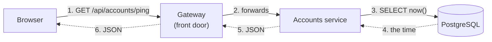

**Reading the diagram:** solid arrows are the question travelling right; dotted arrows are the answer travelling back. The browser only ever talks to the gateway. The gateway never touches the database. The database never talks to the browser. Each box has exactly one neighbour on each side.

The "useful" thing the page shows is the current time according to the database. It is silly, and it proves that all four boxes are connected.

### Why does it matter?

Because the hard, boring problems all show up in week 1 instead of week 20:

- Can the pieces find each other's addresses?
- Where do passwords live so they never reach GitHub?
- What does the user see when one piece is down?
- Can a robot (continuous integration) build and test everything without you?

If these are solved while the system is tiny, every later week is "add one feature to something that already works". If they are postponed, every later week is "add one feature and also fight the plumbing".

> 🧠 **Pause and think**
> Before reading on: your page shows "database time: 10:00:00". Name every separate program that had to be running for that to appear. (Answer in section 11.)

### This week's deliverables

1. A Git repository with an agreed folder layout.
2. **Gateway**: the single front door (built with YARP).
3. **Accounts service**: one `ping` endpoint and two health endpoints.
4. **PostgreSQL** in a container.
5. **Web app** (React + TypeScript) showing the ping result or a friendly error.
6. **Magpie.Defaults**: logging, error format and health checks written once and shared.
7. **Docker Compose** file: one command starts everything.
8. **Continuous integration**: every push is built and tested automatically.

---

## 2. Concepts first

Every idea used in the code is explained here in plain words. Skim what you know; do not skip what you don't.

### 2.1 Client, server, request, response

A **server** is a program that waits to be asked things. A **client** is a program that asks. A **request** is the question; a **response** is the answer. Your browser is a client. Our Accounts service is a server. Notice that the Accounts service is *also* a client, because it asks PostgreSQL a question. "Client" and "server" are roles, not kinds of machine.

Every response carries a three-digit **status code**. You need four families this week:

| Code | Plain meaning | Our example |
|---|---|---|
| 200 | "Here you go" | Ping worked |
| 404 | "I have nothing at that address" | Mistyped URL |
| 500 | "I broke. My fault" | A bug in our code |
| 502 / 503 | "I'm fine, but something I depend on isn't" | Service or database is down |

The difference between 500 and 503 matters a lot, and we will come back to it.

### 2.2 The gateway (reverse proxy)

Think of a large office building. Visitors do not wander the corridors looking for the right desk. They go to **reception**, say what they need, and reception sends them to the right department. Reception also checks badges and turns away troublemakers.

A **gateway** is reception for a software system. Every request from outside arrives at the gateway. The gateway looks at the address (the "path", such as `/api/accounts/ping`) and forwards the request to the right service.

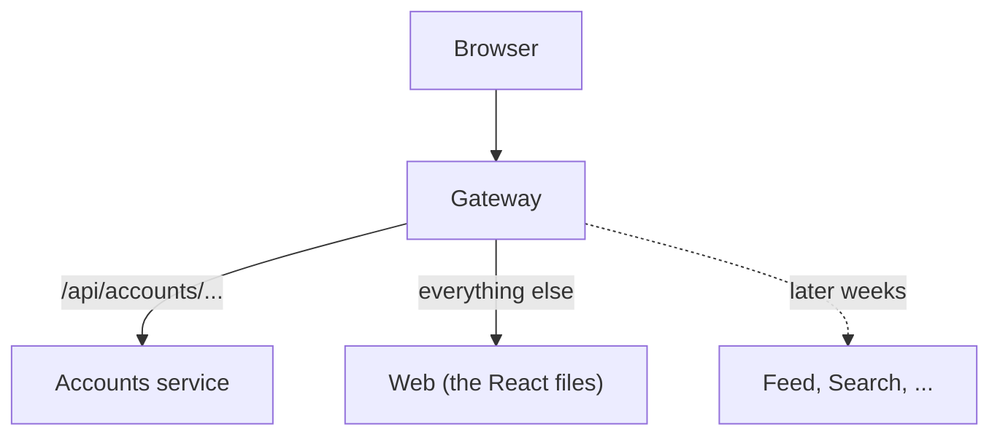

**Reading the diagram:** one way in. The gateway has a small routing table: paths starting with `/api/accounts/` go to Accounts; everything else goes to the web server that hands out the React files. Later weeks add one line per new service.

Why bother with only one service?

- **One address for the browser.** The website and the API come from the same address. In Week 2 this is what lets login cookies work safely.
- **Services stay private.** From Week 17 only the gateway is reachable from outside.
- **One place for shared rules** such as rate limits and security headers (Week 17).

The technical name is **reverse proxy**. Our gateway is built with **YARP** ("Yet Another Reverse Proxy"), a Microsoft library that turns an ordinary ASP.NET Core app into a proxy.

### 2.3 Service, microservices, and "one well-organised application"

A **service** here means a separate program that owns one area of the product (accounts, feed, search) and its own data.

- **One application (a "monolith")**: everything in one program. One thing to build, start, and watch.
- **Microservices**: many small programs talking over the network. Each can be scaled, deployed and broken separately.

A restaurant analogy: a monolith is one chef cooking everything. Microservices are separate stations (grill, salads, desserts) with a pass between them. Stations let you add a second grill cook on a busy night. They also mean an order can get lost *between* stations, which never happens with one chef.

We split into services **because this project exists to teach those between-station problems**. Section 3 is honest about what a real solo startup should do instead.

### 2.4 Clean Architecture: four layers, arrows pointing inward

Inside the Accounts service the code is split into four projects. Picture an onion:

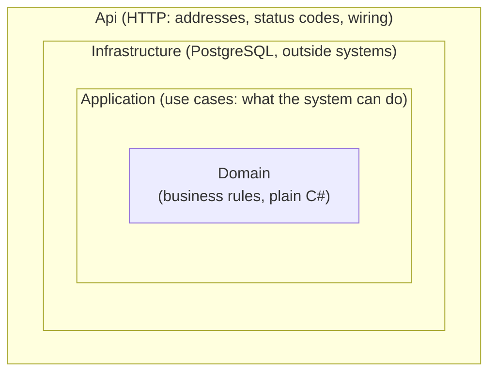

**Reading the diagram:** the most valuable and most stable code (business rules) is in the middle. The most replaceable code (which database, which web framework) is on the outside.

| Layer | Its job | May it know about... |
|---|---|---|
| **Domain** | Rules that would be true even on paper | Nothing else. No database, no web |
| **Application** | Use cases: "get a ping", later "register a reader" | Domain only |
| **Infrastructure** | The real database code, calls to outside systems | Application and Domain |
| **Api** | Turns HTTP requests into use-case calls; wires everything together | Everything |

The one rule: **dependencies point inward.** Outer layers know about inner layers. Inner layers know nothing about outer ones. The compiler enforces it, because a project can only use code from projects it *references*:

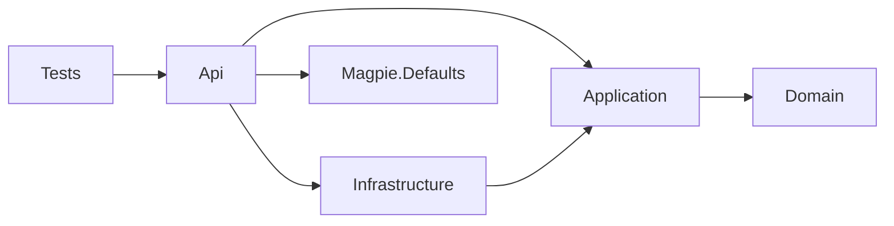

**Reading the diagram:** an arrow means "has a project reference to". Follow any arrow chain and you always end at Domain. No arrow leaves Domain.

> ❓ **No silly questions**
> **Q: The Application layer needs the database time. But it is not allowed to know about the database. How?**
> A: It declares what it needs as an **interface** (a list of method names with no code), called `IDatabaseTimeSource`. Infrastructure writes the class that actually does it. Application only ever sees the interface. This pair has a name: the interface is a **port** (a socket in the wall) and the class is an **adapter** (the plug that fits it). You can pull out the PostgreSQL plug and push in a fake one for tests without touching Application.

### 2.5 Dependency injection

If a class needs a helper, it has two choices:

1. **Make it itself**: `var db = new PostgresTimeSource(...)`. Now the class is welded to PostgreSQL forever.
2. **Ask for it**: list the helper as a constructor parameter and let someone else supply it.

Choice 2 is **dependency injection** (DI). Think of a film set: an actor does not go and buy their own props. The props department hands each actor what the scene needs. In .NET the "props department" is the built-in **container**. In `Program.cs` we tell it "when someone asks for `IDatabaseTimeSource`, hand them a `PostgresTimeSource`", and it does the rest.

You also tell the container how long each object lives:

| Lifetime | Meaning | Our example |
|---|---|---|
| **Singleton** | One for the whole program | The PostgreSQL connection pool |
| **Scoped** | One per incoming request | The ping use case |
| **Transient** | A new one every time it is asked for | Not used this week |

The single file where all this wiring happens is called the **composition root**. Ours is `Program.cs`.

### 2.6 Configuration and secrets

**Configuration** is anything that differs between places the program runs: addresses, ports, passwords. Rule: **never write it into the code.** On your laptop PostgreSQL is at `localhost`. Inside Docker it is at `postgres`. On AWS it will be something else. Same code, different configuration.

.NET reads configuration from several sources and lets later ones override earlier ones:

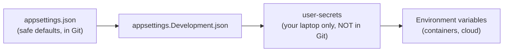

**Reading the diagram:** left is lowest priority, right wins. A value set as an environment variable beats everything else. That is how Docker Compose points the gateway at `http://accounts:8080/` without changing any file.

A **secret** is configuration that would hurt if a stranger read it (the database password). Secrets never go in Git. This week:

- Running with `dotnet run`: the password lives in **user-secrets**, a file .NET keeps outside your project folder.
- Running in Docker: the password lives in `infra/.env`, which Git is told to ignore.

### 2.7 Health checks: "alive" versus "ready"

A health check is an address that other programs call to ask "are you OK?". Nobody opens it in a browser for fun. The callers are machines: Docker, Kubernetes (Week 21), load balancers, monitoring.

There are two different questions:

| Endpoint | Question | If the answer is "no"... |
|---|---|---|
| `/health/live` (**liveness**) | "Is your process running and able to answer at all?" | Restart me |
| `/health/ready` (**readiness**) | "Can you do useful work right now?" | Stop sending me requests, but leave me running |

A shop analogy: *live* = the shopkeeper is conscious. *Ready* = the shop is open and the till works. If the card machine is broken you put up a "back soon" sign (not ready). You do not replace the shopkeeper (restart).

> ⚠️ **Watch out**
> Never let the liveness check depend on the database. If you do, a ten-second database blip makes the platform restart every copy of every service at once, and a small problem becomes an outage.

### 2.8 One error format: Problem Details

When something fails, every service answers in the same JSON shape, defined by an internet standard (RFC 9457, "Problem Details"). A real one from this week's code:

```json
{
  "type": "https://tools.ietf.org/html/rfc9110#section-15.6.4",
  "title": "A dependency is unavailable",
  "status": 503,
  "detail": "The accounts service cannot reach postgresql right now. Please try again shortly.",
  "instance": "/api/accounts/ping",
  "dependency": "postgresql",
  "traceId": "00-71cd2c08b9790058de2c400dc728d15e-7802662ee74839ad-00",
  "service": "accounts"
}
```

Why insist on one shape? Because the website then needs exactly **one** piece of error-handling code, forever, no matter how many services exist. We add two fields of our own to every error: `service` (who failed) and `traceId` (the code to search for in the logs).

### 2.9 Structured logging

A log line can be a sentence:

`Dependency postgresql is unavailable`

or a small JSON record:

`{"Timestamp":"2026-11-15T17:38:19.051Z","LogLevel":"Warning","Category":"...DependencyUnavailableExceptionHandler","Message":"Dependency postgresql is unavailable", ...}`

Sentences are nice for humans. Records are what tools can filter ("show all Warnings from accounts in the last hour"). So we use readable lines on your laptop and JSON everywhere else. That is **structured logging**.

### 2.10 Containers, images and Docker Compose

"It works on my machine" is the oldest problem in software. A **container** ships your program together with everything it needs (the right .NET runtime, the right files), sealed in a box that runs the same everywhere.

- An **image** is the sealed box on the shelf (a recipe that has been cooked and frozen).
- A **container** is that box running (the meal reheated and served). One image can become many containers.
- A **Dockerfile** is the recipe that produces an image.
- **Docker Compose** is a file listing several containers that belong together, so one command starts them all and they can find each other by name.

A **multi-stage** Dockerfile uses a big image full of build tools to compile the program, then copies only the finished result into a small image. The carpenter's workshop does not get delivered with the chair.

### 2.11 Continuous integration (CI)

A robot that, on every push to GitHub, does what a careful colleague would: gets a clean copy of the code, builds it, runs every test, and shows a green tick or a red cross. Its value is that it has **none of your laptop's lucky accidents** (a package you installed last year, a file you forgot to commit). We use **GitHub Actions**.

### 2.12 Feature-based folders in React

Two ways to organise a frontend:

- **By type:** all components in `components/`, all hooks in `hooks/`. To change one feature you open five folders.
- **By feature:** `features/system-status/` holds that feature's component, hook, API call and tests. To change it, or delete it, you touch one folder.

We use **feature folders**, plus a `shared/` folder for the few things every feature needs, such as the one function that talks to the server.

### 2.13 Side lesson: where does one service end and the next begin?

This is the first question of **domain-driven design (DDD)**. The short version for now:

- Look for areas where the **same word means different things**. To Accounts, a "reader" is an email and a password. To Feed, a "reader" is a list of interests. Different meanings suggest different services. DDD calls each such area a **bounded context**.
- Draw the line where **data can be owned by one side**. If two services must both write the same table, the line is in the wrong place.
- Draw fewer lines than you want to. A wrong boundary is expensive to move.

We start with one boundary (Accounts) and add others only when a week needs them.

---

## 3. Architecture and decisions

### 3.1 The architecture after Week 1

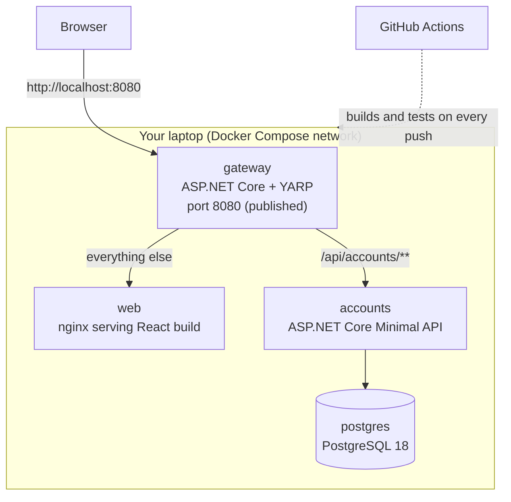

**Reading the diagram:** four containers share a private network. Only the gateway's port is opened to your browser. (For this week's experiments, Accounts and PostgreSQL also have a laptop-only shortcut port, which is removed in Week 17.) GitHub Actions rebuilds and re-tests the same thing on every push.

### 3.2 One request, step by step

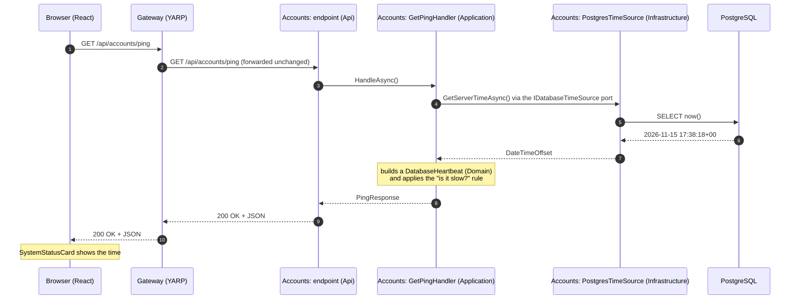

**Reading the diagram:** each column is one piece of code. Notice that the question passes through every layer on the way in (Api, Application, Infrastructure) and the answer passes back out in reverse. The Domain object is created in the middle, by the Application layer, and never leaves the service: the browser receives a `PingResponse`, a shape made for the screen.

And when the database is down:

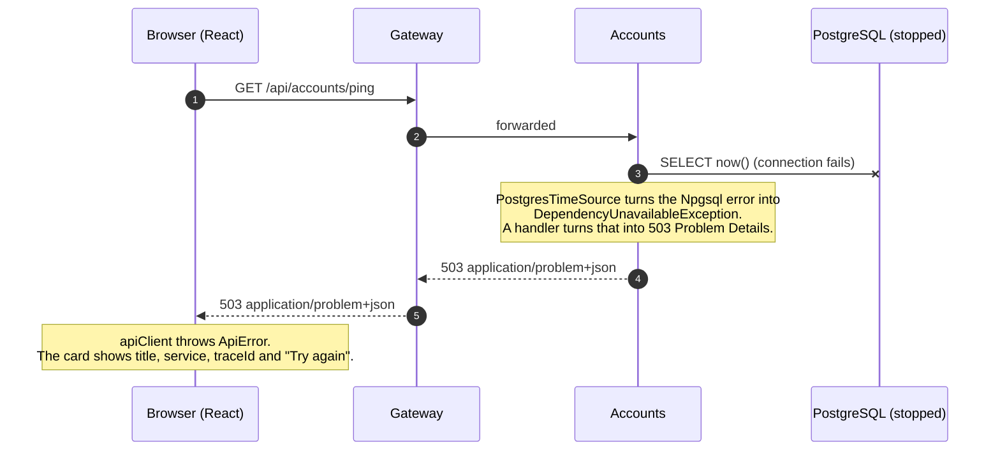

**Reading the diagram:** a failure is translated twice. First from "a database-library error" into "a dependency is unavailable" (so upper layers do not need to know which library is used). Then from that into an HTTP answer in the standard shape. The browser never sees a stack trace.

### 3.3 The decisions, and why

| # | Decision | Why this, in one line | Recorded in |
|---|---|---|---|
| 1 | Separate services behind a gateway | The project exists to practise service boundaries and partial failure | ADR-0001 |
| 2 | Start with **two** .NET processes, not eleven | A skeleton proves the connections; empty services prove nothing | ADR-0001 |
| 3 | Clean Architecture inside each service | The compiler enforces the boundaries; laptop, cloud and lean setups swap only the outer layer | ADR-0002 |
| 4 | Ping asks PostgreSQL for `now()`; no tables yet | "A value read from the database" with zero schema. Tables arrive with real data in Week 2 | This chapter |
| 5 | Plain `Npgsql`, no EF Core yet | One query does not need an object mapper. EF Core arrives in Week 2 with the first tables | This chapter |
| 6 | Route is `/api/accounts/ping`, not `/api/ping` | With eleven services, each needs its own space under `/api/`. The gateway forwards the path unchanged, so what you see in the browser is what the service sees | Guide refinement, see section 14 |
| 7 | Two health endpoints (`/health/live`, `/health/ready`) | They answer different questions and Kubernetes needs both in Week 21 | Guide refinement, see section 14 |
| 8 | Built-in logging and health checks, no extra libraries | Fewer moving parts; OpenTelemetry replaces the logging setup in Week 19 | This chapter |
| 9 | Website talks only to relative `/api/...` addresses | The browser always uses the site it came from, so no backend address is ever baked into the frontend | This chapter |
| 10 | Real database tests (Testcontainers) wait until Week 2 | This week the whole-system CI job already proves the real PostgreSQL path; Testcontainers earns its place when there are tables to test | Guide refinement, see section 14 |

### 3.4 The numbers (redo these by hand)

An architect estimates before designing. These are the design-target numbers, worked out step by step.

| Quantity | Working | Result |
|---|---|---|
| Requests per day | 1,000,000 readers × 60 requests | 60,000,000 |
| Seconds in a day | 24 × 60 × 60 | 86,400 |
| Average requests per second | 60,000,000 ÷ 86,400 | about 700 |
| Peak requests per second | 3 to 5 × average | about 2,100 to 3,500 |
| New content items per day | 5,000 sources × 20 items | 100,000 |
| Content items per year | 100,000 × 365 | 36,500,000 |
| Content storage per year | 36,500,000 × 2 KB | about 73 GB |
| Reader actions per second | 30,000,000 ÷ 86,400 | about 350 |

> 🪑 **Architect's chair**
> What do these numbers *say*? About 700 requests per second on average is well within what a few copies of **one** well-built application can serve. So scale alone does **not** force microservices here. That is an important thing to be able to say in an interview: we chose services for learning, and we can name the real-world reasons that would justify them (several teams, parts with very different scaling needs, a second programming language).

### 3.5 Repository layout

```
magpie/
├── Magpie.slnx                      the solution: one list of every .NET project
├── global.json                      pins the .NET SDK version
├── .github/workflows/ci.yml         continuous integration
├── infra/
│   ├── docker-compose.yml           the whole laptop environment
│   └── .env.example                 template for your local settings
├── docs/
│   ├── adr/                         architecture decision records
│   └── design-notes/                weekly one-page notes
└── src/
    ├── gateway/
    │   ├── Dockerfile
    │   └── Magpie.Gateway/          the front door (YARP)
    ├── services/accounts/
    │   ├── Dockerfile
    │   ├── Magpie.Accounts.Api/             HTTP + wiring
    │   ├── Magpie.Accounts.Application/     use cases
    │   ├── Magpie.Accounts.Domain/          business rules
    │   ├── Magpie.Accounts.Infrastructure/  PostgreSQL
    │   └── Magpie.Accounts.Tests/
    ├── shared/Magpie.Defaults/      logging, errors, health: written once
    └── web/                         React + TypeScript
        └── src/
            ├── app/                 the page shell
            ├── features/system-status/
            └── shared/api/          the one API client
```

`src/shared/Magpie.Contracts/` appears in the long-term plan but is **not** created yet. It holds message shapes shared between services, and there are no messages until Week 7. An empty project is clutter.

---

## 4. Implementation guide

**Conventions used in every step**

- Commands are for a Bash-style terminal (macOS, Linux, or **Git Bash / WSL on Windows**). Run them from the repository root unless a step says otherwise.
- After each step there is a **GitHub** line linking to the exact files at commit `c7468ec`.
- Each step ends with a **Check** so you know it worked before moving on.

### Step 0: Tools

| Tool | Version used | Check with | Expected |
|---|---|---|---|
| Git | any recent | `git --version` | a version number |
| .NET SDK | 10 (long-term support) | `dotnet --version` | starts with `10.0.` |
| Node.js | 26 (long-term support) | `node --version` | starts with `v26.` (22 also works for this chapter) |
| Docker Desktop (or Docker Engine + Compose) | any recent | `docker compose version` | a version number |

> ⚠️ **Watch out: .NET 11 exists**
> .NET 11 came out on 10 November 2026, but it is a short-support release. This project uses .NET 10 because it is supported until November 2028. If `dotnet --version` prints `11.`, install the .NET 10 SDK alongside it. The `global.json` file from Step 1 then makes this repository use 10 automatically.

### Step 1: Repository and solution skeleton

**What:** create the folder, start Git, and create seven empty .NET projects joined into one solution.
**Why:** agreeing on *where things go* before writing code is the cheapest architecture decision you will ever make.

```bash
mkdir magpie && cd magpie
git init -b main

# Standard ignore list for .NET, and a file that pins the SDK version
dotnet new gitignore
dotnet new globaljson --sdk-version 10.0.100 --roll-forward latestFeature

# The solution: a list of projects that belong together
dotnet new sln -n Magpie

# Shared defaults
dotnet new classlib -n Magpie.Defaults -o src/shared/Magpie.Defaults

# Accounts service: four layers plus tests
A=src/services/accounts
dotnet new classlib -n Magpie.Accounts.Domain         -o $A/Magpie.Accounts.Domain
dotnet new classlib -n Magpie.Accounts.Application    -o $A/Magpie.Accounts.Application
dotnet new classlib -n Magpie.Accounts.Infrastructure -o $A/Magpie.Accounts.Infrastructure
dotnet new web      -n Magpie.Accounts.Api            -o $A/Magpie.Accounts.Api
dotnet new xunit    -n Magpie.Accounts.Tests          -o $A/Magpie.Accounts.Tests

# Gateway
dotnet new web -n Magpie.Gateway -o src/gateway/Magpie.Gateway

# Put every project into the solution
find src -name '*.csproj' | sort | xargs dotnet sln add

# Remove the placeholder files the templates create
rm src/shared/Magpie.Defaults/Class1.cs $A/*/Class1.cs $A/Magpie.Accounts.Tests/UnitTest1.cs
```

Now the most important commands in the chapter. They **are** the architecture: each line says "this project is allowed to use that one".

```bash
dotnet add $A/Magpie.Accounts.Application    reference $A/Magpie.Accounts.Domain
dotnet add $A/Magpie.Accounts.Infrastructure reference $A/Magpie.Accounts.Application
dotnet add $A/Magpie.Accounts.Api            reference $A/Magpie.Accounts.Application $A/Magpie.Accounts.Infrastructure src/shared/Magpie.Defaults
dotnet add $A/Magpie.Accounts.Tests          reference $A/Magpie.Accounts.Api
dotnet add src/gateway/Magpie.Gateway        reference src/shared/Magpie.Defaults
```

Notice what is **missing**: Domain references nothing, and nothing lets Application reach Infrastructure. If you later type `using Npgsql;` inside the Domain project, the compiler refuses. The rule from section 2.4 is now enforced by a machine, not by good intentions.

Add three lines to the end of `.gitignore` so local settings and frontend folders stay out of Git:

```
# --- Magpie additions ---
# Local settings for Docker Compose (contains the database password)
.env
# Frontend
node_modules/
dist/
```

About two generated files:

- `Magpie.slnx` is the solution file. .NET 10 creates the newer, readable XML format (`.slnx`) by default.
- `global.json` says "use SDK 10.0.100 or any newer 10.0 release". It stops a teammate's (or CI's) different SDK from silently changing how the code builds.

**`global.json`**

```json
{
  "sdk": {
    "rollForward": "latestFeature",
    "version": "10.0.100"
  }
}
```

> **GitHub (verified at commit `c7468ec`):** [`Magpie.slnx`](https://github.com/ankitchoubey800/magpie/blob/c7468ec7b04fe393d9f7e151a08bcc906c858b02/Magpie.slnx) · [`global.json`](https://github.com/ankitchoubey800/magpie/blob/c7468ec7b04fe393d9f7e151a08bcc906c858b02/global.json) · [`.gitignore`](https://github.com/ankitchoubey800/magpie/blob/c7468ec7b04fe393d9f7e151a08bcc906c858b02/.gitignore)

**Check:** `dotnet build Magpie.slnx` ends with `Build succeeded` (the two test packages download from NuGet on first run).

### Step 2: Magpie.Defaults (things every service does the same way)

**What:** one small library that sets up logging, the error format and health endpoints.
**Why:** with eleven services planned, copying this code eleven times guarantees eleven slightly different versions. Shared *behaviour* is fine to share. (Shared *business logic* between services is not; that is how services become secretly glued together.)

Replace the project file. The `FrameworkReference` line gives a plain class library access to ASP.NET Core types without installing any package:

**`src/shared/Magpie.Defaults/Magpie.Defaults.csproj`**

```xml
<Project Sdk="Microsoft.NET.Sdk">

  <PropertyGroup>
    <TargetFramework>net10.0</TargetFramework>
    <ImplicitUsings>enable</ImplicitUsings>
    <Nullable>enable</Nullable>
  </PropertyGroup>

  <!-- Gives this class library access to ASP.NET Core types (WebApplication,
       health checks, Problem Details) without adding any NuGet package. -->
  <ItemGroup>
    <FrameworkReference Include="Microsoft.AspNetCore.App" />
  </ItemGroup>

</Project>
```

The main file. Read the comments; they explain each block:

**`src/shared/Magpie.Defaults/MagpieDefaultsExtensions.cs`**

```csharp
using System.Diagnostics;
using System.Text.Json;
using Microsoft.AspNetCore.Builder;
using Microsoft.AspNetCore.Diagnostics.HealthChecks;
using Microsoft.AspNetCore.Http;
using Microsoft.Extensions.DependencyInjection;
using Microsoft.Extensions.Diagnostics.HealthChecks;
using Microsoft.Extensions.Hosting;
using Microsoft.Extensions.Logging;

namespace Magpie.Defaults;

/// <summary>
/// The things EVERY Magpie service must do the same way: logging, error format
/// and health endpoints. A service calls three methods and gets all of it.
/// </summary>
public static class MagpieDefaultsExtensions
{
    /// <summary>Tag for checks that answer "is this process alive?".</summary>
    public const string LiveTag = "live";

    /// <summary>Tag for checks that answer "can this service do useful work right now?".</summary>
    public const string ReadyTag = "ready";

    public static WebApplicationBuilder AddMagpieDefaults(this WebApplicationBuilder builder, string serviceName)
    {
        // 1. LOGGING
        // On your laptop: short, human-friendly lines.
        // Everywhere else: one JSON object per line, which log tools can search and filter.
        builder.Logging.ClearProviders();
        if (builder.Environment.IsDevelopment())
        {
            builder.Logging.AddSimpleConsole(options =>
            {
                options.SingleLine = true;
                options.TimestampFormat = "HH:mm:ss ";
            });
        }
        else
        {
            builder.Logging.AddJsonConsole(options =>
            {
                options.IncludeScopes = true;
                options.UseUtcTimestamp = true;
                options.TimestampFormat = "yyyy-MM-ddTHH:mm:ss.fffZ";
            });
        }

        // 2. ONE ERROR FORMAT (Problem Details, RFC 9457)
        // Every error response from every service gets the same two extra fields.
        builder.Services.AddProblemDetails(options =>
        {
            options.CustomizeProblemDetails = context =>
            {
                context.ProblemDetails.Instance ??= context.HttpContext.Request.Path;
                context.ProblemDetails.Extensions["service"] = serviceName;
                context.ProblemDetails.Extensions["traceId"] =
                    Activity.Current?.Id ?? context.HttpContext.TraceIdentifier;
            };
        });

        // The safety net for any exception nobody else handled.
        // Services may register more specific handlers BEFORE calling AddMagpieDefaults.
        builder.Services.AddExceptionHandler<UnhandledExceptionHandler>();

        // 3. HEALTH CHECKS
        // "self" always passes: if the process can answer at all, it is alive.
        builder.Services.AddHealthChecks()
            .AddCheck("self", () => HealthCheckResult.Healthy(), tags: [LiveTag]);

        return builder;
    }

    /// <summary>Adds the error-handling middleware. Call this first, right after Build().</summary>
    public static WebApplication UseMagpieDefaults(this WebApplication app)
    {
        // Catches exceptions and hands them to the registered IExceptionHandler classes.
        app.UseExceptionHandler();

        // Gives a Problem Details body to error responses that have none (for example a bare 404).
        app.UseStatusCodePages();

        return app;
    }

    public static WebApplication MapMagpieHealthEndpoints(this WebApplication app)
    {
        // Liveness: only the "self" check. It must NOT depend on the database,
        // otherwise a database outage would make the platform restart healthy processes.
        app.MapHealthChecks("/health/live", new HealthCheckOptions
        {
            Predicate = check => check.Tags.Contains(LiveTag),
            ResponseWriter = WriteHealthResponse,
        });

        // Readiness: every registered check, including dependencies such as PostgreSQL.
        app.MapHealthChecks("/health/ready", new HealthCheckOptions
        {
            Predicate = _ => true,
            ResponseWriter = WriteHealthResponse,
        });

        return app;
    }

    private static readonly JsonSerializerOptions HealthJsonOptions = new(JsonSerializerDefaults.Web);

    // The built-in writer only prints the word "Healthy" or "Unhealthy".
    // This one also lists each check, so you can see WHICH dependency failed.
    // It deliberately leaves out exception messages: health endpoints are easy to reach.
    private static Task WriteHealthResponse(HttpContext context, HealthReport report)
    {
        var body = new
        {
            status = report.Status.ToString(),
            checks = report.Entries.Select(entry => new
            {
                name = entry.Key,
                status = entry.Value.Status.ToString(),
                durationMs = Math.Round(entry.Value.Duration.TotalMilliseconds, 1),
            }),
        };

        return context.Response.WriteAsJsonAsync(body, HealthJsonOptions);
    }
}
```

Three things to notice:

1. **Extension methods.** `AddMagpieDefaults(this WebApplicationBuilder builder, ...)` lets a service write `builder.AddMagpieDefaults("accounts")` as if the method had always been part of ASP.NET Core. That is all `this` in the parameter list does.
2. **Tags decide which checks run where.** `/health/live` runs only checks tagged `live`. `/health/ready` runs all of them. A service adds its database check with the `ready` tag and the liveness endpoint never sees it.
3. **The health answer lists each check but hides error messages.** Health endpoints are easy to reach, and error messages can reveal server names. Details belong in the log.

The safety net for unexpected exceptions:

**`src/shared/Magpie.Defaults/UnhandledExceptionHandler.cs`**

```csharp
using Microsoft.AspNetCore.Diagnostics;
using Microsoft.AspNetCore.Http;
using Microsoft.AspNetCore.Mvc;
using Microsoft.Extensions.Logging;

namespace Magpie.Defaults;

/// <summary>
/// Last line of defence: turns any unexpected exception into a 500 Problem Details
/// response. The full exception goes to the log; the caller only sees a safe message.
/// </summary>
internal sealed class UnhandledExceptionHandler(
    IProblemDetailsService problemDetailsService,
    ILogger<UnhandledExceptionHandler> logger) : IExceptionHandler
{
    public async ValueTask<bool> TryHandleAsync(
        HttpContext httpContext,
        Exception exception,
        CancellationToken cancellationToken)
    {
        logger.LogError(exception, "Unhandled exception for {Method} {Path}",
            httpContext.Request.Method, httpContext.Request.Path);

        httpContext.Response.StatusCode = StatusCodes.Status500InternalServerError;

        // Returning true means "handled, stop looking for other handlers".
        return await problemDetailsService.TryWriteAsync(new ProblemDetailsContext
        {
            HttpContext = httpContext,
            ProblemDetails = new ProblemDetails
            {
                Status = StatusCodes.Status500InternalServerError,
                Title = "An unexpected error occurred",
                Detail = "The error has been logged. Quote the traceId if you report it.",
            },
        });
    }
}
```

This class makes a promise to the outside world: **no matter what goes wrong, the caller gets a tidy 500 in the standard shape, and never a stack trace.** The stack trace goes to the log, where only we can read it, next to the same `traceId` the caller was given.

> **GitHub (verified at commit `c7468ec`):** [`Magpie.Defaults.csproj`](https://github.com/ankitchoubey800/magpie/blob/c7468ec7b04fe393d9f7e151a08bcc906c858b02/src/shared/Magpie.Defaults/Magpie.Defaults.csproj) · [`MagpieDefaultsExtensions.cs`](https://github.com/ankitchoubey800/magpie/blob/c7468ec7b04fe393d9f7e151a08bcc906c858b02/src/shared/Magpie.Defaults/MagpieDefaultsExtensions.cs) · [`UnhandledExceptionHandler.cs`](https://github.com/ankitchoubey800/magpie/blob/c7468ec7b04fe393d9f7e151a08bcc906c858b02/src/shared/Magpie.Defaults/UnhandledExceptionHandler.cs)

**Check:** `dotnet build src/shared/Magpie.Defaults` succeeds.

### Step 3: Domain (the innermost layer)

**What:** one tiny class that holds one tiny rule.
**Why:** Week 1 has no real business rules. This class exists to show **where rules live** and **how they are tested**, so that in Week 2 you already know where "a password must be at least N characters" goes.

**`src/services/accounts/Magpie.Accounts.Domain/DatabaseHeartbeat.cs`**

```csharp
namespace Magpie.Accounts.Domain;

/// <summary>
/// One "are you there?" answer from the database: what time the database says
/// it is, and how long the question took.
///
/// This is deliberately tiny. Week 1 has no real business rules yet, so this
/// class exists to show WHERE rules live: in the Domain project, in plain C#,
/// with no database, web or framework code anywhere near it.
/// </summary>
public sealed record DatabaseHeartbeat
{
    /// <summary>A round trip slower than this is worth a warning.</summary>
    public static readonly TimeSpan SlowThreshold = TimeSpan.FromMilliseconds(250);

    public DateTimeOffset ServerTimeUtc { get; }

    public TimeSpan RoundTrip { get; }

    /// <summary>The rule: a heartbeat is "slow" when it took longer than the threshold.</summary>
    public bool IsSlow => RoundTrip > SlowThreshold;

    private DatabaseHeartbeat(DateTimeOffset serverTimeUtc, TimeSpan roundTrip)
    {
        ServerTimeUtc = serverTimeUtc;
        RoundTrip = roundTrip;
    }

    /// <summary>
    /// The only way to make a heartbeat. Because the constructor is private,
    /// an invalid heartbeat can never exist anywhere in the program.
    /// </summary>
    public static DatabaseHeartbeat Create(DateTimeOffset serverTime, TimeSpan roundTrip)
    {
        if (roundTrip < TimeSpan.Zero)
        {
            throw new ArgumentOutOfRangeException(nameof(roundTrip), "A round trip cannot take negative time.");
        }

        return new DatabaseHeartbeat(serverTime.ToUniversalTime(), roundTrip);
    }
}
```

Look at what is *absent*: no `using` lines for a database, the web, JSON or logging. Open `Magpie.Accounts.Domain.csproj` and you will find no references at all. This class could be compiled into a phone app, a game or a command-line tool unchanged.

Two habits worth copying:

- **Private constructor + `Create` method.** There is exactly one way to make a heartbeat, and it checks the input. An invalid heartbeat cannot exist anywhere in the program, so no other code needs to re-check.
- **The rule is a property, not an `if` scattered around.** "Slow means over 250 ms" is written once, in `IsSlow`.

> ❓ **No silly questions**
> **Q: Isn't a whole project for one 40-line class over the top?**
> A: Today, yes. It is the price of a boundary the compiler can enforce. Section 9 discusses "vertical slices", an alternative with less ceremony, and when you would pick it.

> **GitHub (verified at commit `c7468ec`):** [`DatabaseHeartbeat.cs`](https://github.com/ankitchoubey800/magpie/blob/c7468ec7b04fe393d9f7e151a08bcc906c858b02/src/services/accounts/Magpie.Accounts.Domain/DatabaseHeartbeat.cs)

### Step 4: Application (use cases)

**What:** the port (interface), an error type, the response shape, and the use case itself.
**Why:** this layer answers "what can the system *do*?" in code that mentions neither HTTP nor SQL.

Create two folders inside `Magpie.Accounts.Application`: `Abstractions` and `Ping`.

The **port**. This is the socket in the wall:

**`src/services/accounts/Magpie.Accounts.Application/Abstractions/IDatabaseTimeSource.cs`**

```csharp
namespace Magpie.Accounts.Application.Abstractions;

/// <summary>
/// A "port": the Application layer says WHAT it needs ("tell me the database's
/// current time") without knowing HOW it is done. The Infrastructure project
/// supplies the real PostgreSQL version; tests supply a fake.
/// </summary>
public interface IDatabaseTimeSource
{
    /// <exception cref="DependencyUnavailableException">The database could not be reached.</exception>
    Task<DateTimeOffset> GetServerTimeAsync(CancellationToken cancellationToken);
}
```

The application's own word for "something I depend on is down":

**`src/services/accounts/Magpie.Accounts.Application/Abstractions/DependencyUnavailableException.cs`**

```csharp
namespace Magpie.Accounts.Application.Abstractions;

/// <summary>
/// Thrown when something this service depends on (a database, another service)
/// cannot be reached. Infrastructure code translates technology-specific errors
/// (for example NpgsqlException) into this one, so the layers above never need
/// to know which database library is in use.
/// </summary>
public sealed class DependencyUnavailableException(string dependency, Exception innerException)
    : Exception($"The dependency '{dependency}' is unavailable.", innerException)
{
    public string Dependency { get; } = dependency;
}
```

The shape sent to the browser:

**`src/services/accounts/Magpie.Accounts.Application/Ping/PingResponse.cs`**

```csharp
namespace Magpie.Accounts.Application.Ping;

/// <summary>
/// The shape sent to the browser. It is NOT the domain object: screens get a
/// shape made for them, so the domain can change without breaking the website.
/// </summary>
public sealed record PingResponse(string Service, DateTimeOffset DatabaseTimeUtc, double RoundTripMs, bool IsSlow);
```

The **use case**:

**`src/services/accounts/Magpie.Accounts.Application/Ping/GetPingHandler.cs`**

```csharp
using Magpie.Accounts.Application.Abstractions;
using Magpie.Accounts.Domain;

namespace Magpie.Accounts.Application.Ping;

/// <summary>
/// A "use case": one thing the system can do, written as one small class.
/// It coordinates (ask the port, build the domain object, shape the answer)
/// and contains no HTTP code and no SQL.
/// </summary>
public sealed class GetPingHandler(IDatabaseTimeSource databaseTimeSource, TimeProvider timeProvider)
{
    public const string ServiceName = "accounts";

    public async Task<PingResponse> HandleAsync(CancellationToken cancellationToken)
    {
        // TimeProvider (built into .NET) is used instead of Stopwatch so that
        // tests can control time and get the same result on every run.
        var startedAt = timeProvider.GetTimestamp();
        var serverTime = await databaseTimeSource.GetServerTimeAsync(cancellationToken);
        var roundTrip = timeProvider.GetElapsedTime(startedAt);

        var heartbeat = DatabaseHeartbeat.Create(serverTime, roundTrip);

        return new PingResponse(
            ServiceName,
            heartbeat.ServerTimeUtc,
            Math.Round(heartbeat.RoundTrip.TotalMilliseconds, 1),
            heartbeat.IsSlow);
    }
}
```

Walk through `HandleAsync` line by line:

1. Note the time.
2. Ask the port for the database's time. The handler has no idea PostgreSQL exists.
3. Work out how long that took.
4. Build the Domain object, which applies the rule.
5. Copy the result into the response shape.

> ❓ **No silly questions**
> **Q: What is `CancellationToken` and why is it everywhere?**
> A: It is a "never mind" signal. If the reader closes the tab while we are waiting for the database, ASP.NET Core flips the token and the query stops instead of running for nobody. You pass it down through every `async` call. It costs nothing and saves real work under load.
>
> **Q: Why `TimeProvider` instead of the usual `Stopwatch`?**
> A: So tests can control time. A test that says "pretend the query took exactly 12 ms" is exact and instant. A test that really waits is slow and sometimes fails for no reason.

> **GitHub (verified at commit `c7468ec`):** [`IDatabaseTimeSource.cs`](https://github.com/ankitchoubey800/magpie/blob/c7468ec7b04fe393d9f7e151a08bcc906c858b02/src/services/accounts/Magpie.Accounts.Application/Abstractions/IDatabaseTimeSource.cs) · [`DependencyUnavailableException.cs`](https://github.com/ankitchoubey800/magpie/blob/c7468ec7b04fe393d9f7e151a08bcc906c858b02/src/services/accounts/Magpie.Accounts.Application/Abstractions/DependencyUnavailableException.cs) · [`PingResponse.cs`](https://github.com/ankitchoubey800/magpie/blob/c7468ec7b04fe393d9f7e151a08bcc906c858b02/src/services/accounts/Magpie.Accounts.Application/Ping/PingResponse.cs) · [`GetPingHandler.cs`](https://github.com/ankitchoubey800/magpie/blob/c7468ec7b04fe393d9f7e151a08bcc906c858b02/src/services/accounts/Magpie.Accounts.Application/Ping/GetPingHandler.cs)

**Check:** `dotnet build src/services/accounts/Magpie.Accounts.Application` succeeds. Open its `.csproj`: the only reference is to Domain.

### Step 5: Infrastructure (the real PostgreSQL code)

**What:** the adapter that plugs into the port, a readiness check, and a method that registers both.
**Why:** this is the *only* project that knows which database we use. Swapping databases later means rewriting this project and nothing else.

Add the PostgreSQL driver:

```bash
dotnet add src/services/accounts/Magpie.Accounts.Infrastructure package Npgsql --version 10.0.3
```

> ⚠️ **Watch out: pin package versions to 10.x**
> Without `--version`, the command takes the newest package, which may now be built for .NET 11 and refuse to install on .NET 10. `10.0.3` was the newest 10.x release of Npgsql found when this chapter was written; any later `10.0.x` is fine.

Then edit the project file so it matches this (the new part is the `FrameworkReference`):

**`src/services/accounts/Magpie.Accounts.Infrastructure/Magpie.Accounts.Infrastructure.csproj`**

```xml
<Project Sdk="Microsoft.NET.Sdk">

  <ItemGroup>
    <ProjectReference Include="..\Magpie.Accounts.Application\Magpie.Accounts.Application.csproj" />
  </ItemGroup>

  <!-- Infrastructure is the outer layer, so it MAY use framework types
       (configuration, dependency injection, health checks). -->
  <ItemGroup>
    <FrameworkReference Include="Microsoft.AspNetCore.App" />
  </ItemGroup>

  <ItemGroup>
    <PackageReference Include="Npgsql" Version="10.0.3" />
  </ItemGroup>

  <PropertyGroup>
    <TargetFramework>net10.0</TargetFramework>
    <ImplicitUsings>enable</ImplicitUsings>
    <Nullable>enable</Nullable>
  </PropertyGroup>

</Project>
```

Create a `Postgres` folder. The **adapter**:

**`src/services/accounts/Magpie.Accounts.Infrastructure/Postgres/PostgresTimeSource.cs`**

```csharp
using System.Net.Sockets;
using Magpie.Accounts.Application.Abstractions;
using Npgsql;

namespace Magpie.Accounts.Infrastructure.Postgres;

/// <summary>
/// The "adapter": the real implementation of the IDatabaseTimeSource port.
/// This is the only place in the Accounts service that contains SQL.
/// </summary>
internal sealed class PostgresTimeSource(NpgsqlDataSource dataSource) : IDatabaseTimeSource
{
    public async Task<DateTimeOffset> GetServerTimeAsync(CancellationToken cancellationToken)
    {
        try
        {
            // The data source hands out a pooled connection, and the command
            // returns it to the pool when it is disposed ("await using").
            await using var command = dataSource.CreateCommand("SELECT now()");
            var result = await command.ExecuteScalarAsync(cancellationToken);

            // PostgreSQL's now() is "timestamp with time zone"; Npgsql returns it as a UTC DateTime.
            var utc = DateTime.SpecifyKind((DateTime)result!, DateTimeKind.Utc);
            return new DateTimeOffset(utc);
        }
        catch (Exception exception) when (exception is NpgsqlException or SocketException or TimeoutException)
        {
            // "Could not reach the database" arrives in a few different shapes.
            // Translate all of them into the application's own error type.
            throw new DependencyUnavailableException("postgresql", exception);
        }
    }
}
```

Points worth slowing down for:

- **`NpgsqlDataSource`** owns a **connection pool**. Opening a database connection is slow (think: dialling a phone number). A pool keeps a few lines open and lends them out. That is why the first ping in the CI run took about 170 ms and the next about 11 ms.
- **`await using`** returns the borrowed connection to the pool when the block ends, even if an error is thrown. Forgetting this is how applications "run out of connections" under load.
- **The `catch`** translates three shapes of "could not reach the database" into our one `DependencyUnavailableException`. Upper layers never import Npgsql.
- **`internal sealed class`**: `internal` means "invisible outside this project". Nobody can `new` this class from the Api project even by mistake; they must go through the port.

The readiness check:

**`src/services/accounts/Magpie.Accounts.Infrastructure/Postgres/PostgresHealthCheck.cs`**

```csharp
using Microsoft.Extensions.Diagnostics.HealthChecks;
using Npgsql;

namespace Magpie.Accounts.Infrastructure.Postgres;

/// <summary>
/// Readiness check: "can I run the cheapest possible query right now?"
/// </summary>
internal sealed class PostgresHealthCheck(NpgsqlDataSource dataSource) : IHealthCheck
{
    public async Task<HealthCheckResult> CheckHealthAsync(
        HealthCheckContext context,
        CancellationToken cancellationToken = default)
    {
        try
        {
            await using var command = dataSource.CreateCommand("SELECT 1");
            await command.ExecuteScalarAsync(cancellationToken);
            return HealthCheckResult.Healthy();
        }
        catch (Exception exception) when (exception is not OperationCanceledException)
        {
            return HealthCheckResult.Unhealthy("PostgreSQL did not answer.", exception);
        }
    }
}
```

And the registration method that the Api project will call:

**`src/services/accounts/Magpie.Accounts.Infrastructure/DependencyInjection.cs`**

```csharp
using Magpie.Accounts.Application.Abstractions;
using Magpie.Accounts.Infrastructure.Postgres;
using Microsoft.Extensions.Configuration;
using Microsoft.Extensions.DependencyInjection;
using Npgsql;

namespace Magpie.Accounts.Infrastructure;

public static class DependencyInjection
{
    /// <summary>The name of the connection string in configuration.</summary>
    public const string ConnectionStringName = "AccountsDb";

    public static IServiceCollection AddAccountsInfrastructure(
        this IServiceCollection services,
        IConfiguration configuration)
    {
        // ONE data source for the whole process (singleton). It owns the
        // connection pool, so creating it per request would defeat the pool.
        // The container disposes it when the application shuts down.
        services.AddSingleton(_ =>
        {
            var connectionString = configuration.GetConnectionString(ConnectionStringName)
                ?? throw new InvalidOperationException(
                    $"Connection string '{ConnectionStringName}' is missing. " +
                    "Set it with user-secrets (local run) or the " +
                    $"ConnectionStrings__{ConnectionStringName} environment variable (containers).");

            return NpgsqlDataSource.Create(connectionString);
        });

        // "When someone asks for the port, give them the PostgreSQL adapter."
        services.AddScoped<IDatabaseTimeSource, PostgresTimeSource>();

        // "ready" tag = included in /health/ready, NOT in /health/live.
        services.AddHealthChecks()
            .AddCheck<PostgresHealthCheck>("postgresql", tags: ["ready"]);

        return services;
    }
}
```

> 🪑 **Architect's chair**
> The connection string is read the first time the data source is needed, not at start-up. Consequence: a service started with no connection string **starts**, reports `ready = Unhealthy`, and answers ping with an error, instead of refusing to start. Failing fast at start-up is usually better, and we get it in Week 2 with the **Options pattern** (typed settings validated at start-up). It is on the list in section 14 so it is not forgotten.

> **GitHub (verified at commit `c7468ec`):** [`Magpie.Accounts.Infrastructure.csproj`](https://github.com/ankitchoubey800/magpie/blob/c7468ec7b04fe393d9f7e151a08bcc906c858b02/src/services/accounts/Magpie.Accounts.Infrastructure/Magpie.Accounts.Infrastructure.csproj) · [`PostgresTimeSource.cs`](https://github.com/ankitchoubey800/magpie/blob/c7468ec7b04fe393d9f7e151a08bcc906c858b02/src/services/accounts/Magpie.Accounts.Infrastructure/Postgres/PostgresTimeSource.cs) · [`PostgresHealthCheck.cs`](https://github.com/ankitchoubey800/magpie/blob/c7468ec7b04fe393d9f7e151a08bcc906c858b02/src/services/accounts/Magpie.Accounts.Infrastructure/Postgres/PostgresHealthCheck.cs) · [`DependencyInjection.cs`](https://github.com/ankitchoubey800/magpie/blob/c7468ec7b04fe393d9f7e151a08bcc906c858b02/src/services/accounts/Magpie.Accounts.Infrastructure/DependencyInjection.cs)

**Check:** `dotnet build src/services/accounts/Magpie.Accounts.Infrastructure` succeeds.

### Step 6: Api (HTTP and the composition root)

**What:** the endpoint, one specific error handler, and `Program.cs`, which wires the whole service together.
**Why:** this layer is the translator between "the web" and "our use cases". It should be thin enough to read in one minute.

Create folders `Endpoints` and `ErrorHandling` inside `Magpie.Accounts.Api`.

The endpoint:

**`src/services/accounts/Magpie.Accounts.Api/Endpoints/PingEndpoints.cs`**

```csharp
using Magpie.Accounts.Application.Ping;

namespace Magpie.Accounts.Api.Endpoints;

public static class PingEndpoints
{
    public static IEndpointRouteBuilder MapPingEndpoints(this IEndpointRouteBuilder app)
    {
        // The endpoint is deliberately thin: receive the request, call ONE use
        // case, return its result. ASP.NET Core supplies both parameters:
        // the handler from the container, the token from the request.
        app.MapGet("/api/accounts/ping", async (GetPingHandler handler, CancellationToken cancellationToken) =>
            TypedResults.Ok(await handler.HandleAsync(cancellationToken)));

        return app;
    }
}
```

That is the entire web layer for this feature: three lines. If an endpoint ever grows an `if` about business rules, the rule is in the wrong layer.

The handler that turns "dependency down" into a **503**:

**`src/services/accounts/Magpie.Accounts.Api/ErrorHandling/DependencyUnavailableExceptionHandler.cs`**

```csharp
using Magpie.Accounts.Application.Abstractions;
using Microsoft.AspNetCore.Diagnostics;
using Microsoft.AspNetCore.Mvc;

namespace Magpie.Accounts.Api.ErrorHandling;

/// <summary>
/// "Our database is down" is not a bug in this service, so it must not look
/// like one. It becomes 503 Service Unavailable (try again later) instead of
/// 500 Internal Server Error (we broke something).
/// </summary>
internal sealed class DependencyUnavailableExceptionHandler(
    IProblemDetailsService problemDetailsService,
    ILogger<DependencyUnavailableExceptionHandler> logger) : IExceptionHandler
{
    public async ValueTask<bool> TryHandleAsync(
        HttpContext httpContext,
        Exception exception,
        CancellationToken cancellationToken)
    {
        if (exception is not DependencyUnavailableException unavailable)
        {
            // Not ours: let the next handler (the catch-everything one) deal with it.
            return false;
        }

        logger.LogWarning(exception, "Dependency {Dependency} is unavailable", unavailable.Dependency);

        httpContext.Response.StatusCode = StatusCodes.Status503ServiceUnavailable;

        return await problemDetailsService.TryWriteAsync(new ProblemDetailsContext
        {
            HttpContext = httpContext,
            ProblemDetails = new ProblemDetails
            {
                Status = StatusCodes.Status503ServiceUnavailable,
                Title = "A dependency is unavailable",
                Detail = $"The accounts service cannot reach {unavailable.Dependency} right now. Please try again shortly.",
                Extensions = { ["dependency"] = unavailable.Dependency },
            },
        });
    }
}
```

Why not just let it be a 500? Because the two codes tell the people (and machines) watching very different things. **500** = "there is a bug in Accounts, wake up the Accounts developer". **503** = "Accounts is fine; look at what it depends on, and it is safe to retry in a moment". Mislabel them and your alerts point at the wrong team.

Now replace `Program.cs`:

**`src/services/accounts/Magpie.Accounts.Api/Program.cs`**

```csharp
using Magpie.Accounts.Api.Endpoints;
using Magpie.Accounts.Api.ErrorHandling;
using Magpie.Accounts.Application.Ping;
using Magpie.Accounts.Infrastructure;
using Magpie.Defaults;

// This file is the "composition root": the one place where the pieces of the
// Accounts service are wired together. Nothing else in the service uses "new"
// to create a service or knows which implementation it receives.

var builder = WebApplication.CreateBuilder(args);

// --- 1. Register services (what exists) ------------------------------------

// Specific error handlers go BEFORE the defaults: handlers run in the order
// they are registered, and the defaults add the catch-everything handler.
builder.Services.AddExceptionHandler<DependencyUnavailableExceptionHandler>();

// Logging, Problem Details and health checks, the same in every Magpie service.
builder.AddMagpieDefaults(GetPingHandler.ServiceName);

// Infrastructure: PostgreSQL adapter and its readiness check.
builder.Services.AddAccountsInfrastructure(builder.Configuration);

// Application: use cases. TimeProvider.System is the real clock.
builder.Services.AddSingleton(TimeProvider.System);
builder.Services.AddScoped<GetPingHandler>();

var app = builder.Build();

// --- 2. Build the request pipeline (what happens to each request) ----------

app.UseMagpieDefaults();

app.MapMagpieHealthEndpoints();
app.MapPingEndpoints();

app.Run();
```

`Program.cs` always has the same two halves:

1. **Before `builder.Build()`**: describe what exists (register services in the container).
2. **After it**: describe what happens to each request (the **pipeline**: a chain of steps every request passes through, plus the endpoints at the end).

Set the local port. Replace `Properties/launchSettings.json`:

**`src/services/accounts/Magpie.Accounts.Api/Properties/launchSettings.json`**

```json
{
  "$schema": "https://json.schemastore.org/launchsettings.json",
  "profiles": {
    "http": {
      "commandName": "Project",
      "dotnetRunMessages": true,
      "launchBrowser": false,
      "applicationUrl": "http://localhost:5101",
      "environmentVariables": {
        "ASPNETCORE_ENVIRONMENT": "Development"
      }
    }
  }
}
```

Finally, switch on user-secrets for this project (it adds a `UserSecretsId` line to the `.csproj`; the id is just a folder name, not a secret):

```bash
dotnet user-secrets init --project src/services/accounts/Magpie.Accounts.Api
```

> **GitHub (verified at commit `c7468ec`):** [`Program.cs`](https://github.com/ankitchoubey800/magpie/blob/c7468ec7b04fe393d9f7e151a08bcc906c858b02/src/services/accounts/Magpie.Accounts.Api/Program.cs) · [`PingEndpoints.cs`](https://github.com/ankitchoubey800/magpie/blob/c7468ec7b04fe393d9f7e151a08bcc906c858b02/src/services/accounts/Magpie.Accounts.Api/Endpoints/PingEndpoints.cs) · [`DependencyUnavailableExceptionHandler.cs`](https://github.com/ankitchoubey800/magpie/blob/c7468ec7b04fe393d9f7e151a08bcc906c858b02/src/services/accounts/Magpie.Accounts.Api/ErrorHandling/DependencyUnavailableExceptionHandler.cs) · [`launchSettings.json`](https://github.com/ankitchoubey800/magpie/blob/c7468ec7b04fe393d9f7e151a08bcc906c858b02/src/services/accounts/Magpie.Accounts.Api/Properties/launchSettings.json) · [`Magpie.Accounts.Api.csproj`](https://github.com/ankitchoubey800/magpie/blob/c7468ec7b04fe393d9f7e151a08bcc906c858b02/src/services/accounts/Magpie.Accounts.Api/Magpie.Accounts.Api.csproj)

**Check:** `dotnet build src/services/accounts/Magpie.Accounts.Api` succeeds.

### Step 7: Tests for the Accounts service

**What:** eleven tests at three levels.
**Why:** each level catches a different kind of mistake, and the layering from section 2.4 is what makes the cheap levels possible.

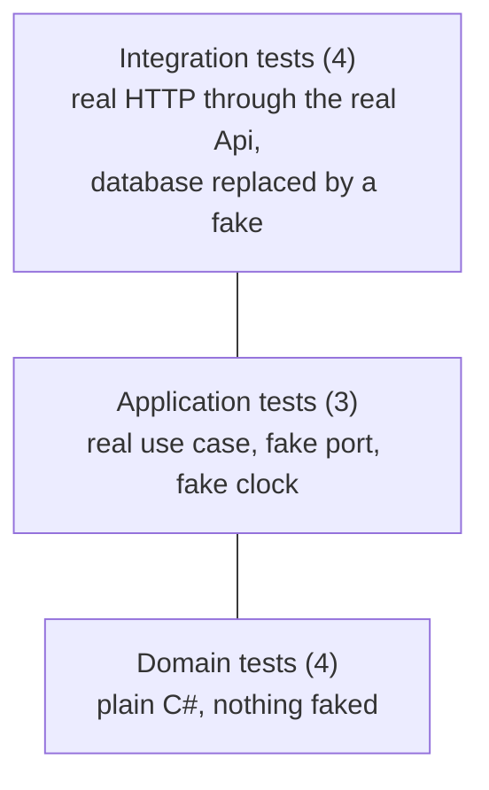

**Reading the diagram:** the bottom level is the fastest and needs nothing. Each level up exercises more of the real system and is a little slower. Most tests should live low; a few should live high.

Add the package that can start the real API in memory, pinned to 10.x:

```bash
dotnet add src/services/accounts/Magpie.Accounts.Tests package Microsoft.AspNetCore.Mvc.Testing --version "10.0.*"
```

Create a `Fakes` folder in the test project. A clock that only moves when told to:

**`src/services/accounts/Magpie.Accounts.Tests/Fakes/ManualTimeProvider.cs`**

```csharp
namespace Magpie.Accounts.Tests.Fakes;

/// <summary>
/// A clock that only moves when a test tells it to. This makes timing tests
/// exact and instant instead of slow and flaky.
/// </summary>
public sealed class ManualTimeProvider : TimeProvider
{
    private long _ticks;

    // One "timestamp unit" is one tick (100 nanoseconds), so the maths stays simple.
    public override long TimestampFrequency => TimeSpan.TicksPerSecond;

    public override long GetTimestamp() => _ticks;

    public void Advance(TimeSpan amount) => _ticks += amount.Ticks;
}
```

A stand-in for PostgreSQL. Because Application only knows the *port*, swapping in this fake needs no special tools:

**`src/services/accounts/Magpie.Accounts.Tests/Fakes/FakeDatabaseTimeSource.cs`**

```csharp
using Magpie.Accounts.Application.Abstractions;

namespace Magpie.Accounts.Tests.Fakes;

/// <summary>
/// Stands in for PostgreSQL. Tests decide what "the database" answers,
/// how long it takes, and whether it is down.
/// </summary>
public sealed class FakeDatabaseTimeSource : IDatabaseTimeSource
{
    public DateTimeOffset ServerTime { get; set; } = new(2026, 11, 15, 10, 0, 0, TimeSpan.Zero);

    public bool IsDown { get; set; }

    /// <summary>Optional: called during the "query" so a test can move the clock.</summary>
    public Action? OnQuery { get; set; }

    public Task<DateTimeOffset> GetServerTimeAsync(CancellationToken cancellationToken)
    {
        if (IsDown)
        {
            throw new DependencyUnavailableException("postgresql", new TimeoutException("simulated outage"));
        }

        OnQuery?.Invoke();
        return Task.FromResult(ServerTime);
    }
}
```

Level 1, Domain:

**`src/services/accounts/Magpie.Accounts.Tests/DatabaseHeartbeatTests.cs`**

```csharp
using Magpie.Accounts.Domain;

namespace Magpie.Accounts.Tests;

// Domain tests: no database, no web server, no fakes. They run in milliseconds.
public class DatabaseHeartbeatTests
{
    private static readonly DateTimeOffset Noon = new(2026, 11, 15, 12, 0, 0, TimeSpan.Zero);

    [Fact]
    public void A_fast_round_trip_is_not_slow()
    {
        var heartbeat = DatabaseHeartbeat.Create(Noon, TimeSpan.FromMilliseconds(5));

        Assert.False(heartbeat.IsSlow);
    }

    [Fact]
    public void A_round_trip_over_the_threshold_is_slow()
    {
        var heartbeat = DatabaseHeartbeat.Create(Noon, DatabaseHeartbeat.SlowThreshold + TimeSpan.FromMilliseconds(1));

        Assert.True(heartbeat.IsSlow);
    }

    [Fact]
    public void Server_time_is_always_stored_as_utc()
    {
        var indiaTime = new DateTimeOffset(2026, 11, 15, 17, 30, 0, TimeSpan.FromHours(5.5));

        var heartbeat = DatabaseHeartbeat.Create(indiaTime, TimeSpan.Zero);

        Assert.Equal(TimeSpan.Zero, heartbeat.ServerTimeUtc.Offset);
        Assert.Equal(Noon, heartbeat.ServerTimeUtc);
    }

    [Fact]
    public void A_negative_round_trip_is_rejected()
    {
        Assert.Throws<ArgumentOutOfRangeException>(
            () => DatabaseHeartbeat.Create(Noon, TimeSpan.FromMilliseconds(-1)));
    }
}
```

Level 2, Application:

**`src/services/accounts/Magpie.Accounts.Tests/GetPingHandlerTests.cs`**

```csharp
using Magpie.Accounts.Application.Abstractions;
using Magpie.Accounts.Application.Ping;
using Magpie.Accounts.Tests.Fakes;

namespace Magpie.Accounts.Tests;

// Application tests: the use case runs for real, the database is a fake.
public class GetPingHandlerTests
{
    [Fact]
    public async Task Returns_the_database_time_and_the_measured_round_trip()
    {
        var clock = new ManualTimeProvider();
        var database = new FakeDatabaseTimeSource
        {
            // Pretend the query took exactly 12 milliseconds.
            OnQuery = () => clock.Advance(TimeSpan.FromMilliseconds(12)),
        };
        var handler = new GetPingHandler(database, clock);

        var response = await handler.HandleAsync(CancellationToken.None);

        Assert.Equal("accounts", response.Service);
        Assert.Equal(database.ServerTime, response.DatabaseTimeUtc);
        Assert.Equal(12, response.RoundTripMs);
        Assert.False(response.IsSlow);
    }

    [Fact]
    public async Task Flags_a_slow_database()
    {
        var clock = new ManualTimeProvider();
        var database = new FakeDatabaseTimeSource
        {
            OnQuery = () => clock.Advance(TimeSpan.FromMilliseconds(900)),
        };
        var handler = new GetPingHandler(database, clock);

        var response = await handler.HandleAsync(CancellationToken.None);

        Assert.True(response.IsSlow);
    }

    [Fact]
    public async Task Lets_the_dependency_error_travel_upwards()
    {
        var handler = new GetPingHandler(new FakeDatabaseTimeSource { IsDown = true }, new ManualTimeProvider());

        await Assert.ThrowsAsync<DependencyUnavailableException>(
            () => handler.HandleAsync(CancellationToken.None));
    }
}
```

Level 3 needs a factory that boots the real `Program.cs` and replaces only the port:

**`src/services/accounts/Magpie.Accounts.Tests/AccountsApiFactory.cs`**

```csharp
using Magpie.Accounts.Application.Abstractions;
using Magpie.Accounts.Tests.Fakes;
using Microsoft.AspNetCore.Hosting;
using Microsoft.AspNetCore.Mvc.Testing;
using Microsoft.AspNetCore.TestHost;
using Microsoft.Extensions.DependencyInjection;
using Microsoft.Extensions.DependencyInjection.Extensions;

namespace Magpie.Accounts.Tests;

/// <summary>
/// Starts the REAL Accounts API in memory (real Program.cs, real routing, real
/// error handling) and swaps only the database port for a fake.
/// </summary>
public sealed class AccountsApiFactory : WebApplicationFactory<Program>
{
    public FakeDatabaseTimeSource Database { get; } = new();

    protected override void ConfigureWebHost(IWebHostBuilder builder)
    {
        builder.ConfigureTestServices(services =>
        {
            services.RemoveAll<IDatabaseTimeSource>();
            services.AddSingleton<IDatabaseTimeSource>(Database);
        });
    }
}
```

**`src/services/accounts/Magpie.Accounts.Tests/PingEndpointTests.cs`**

```csharp
using System.Net;
using System.Net.Http.Json;
using System.Text.Json;
using Magpie.Accounts.Application.Ping;

namespace Magpie.Accounts.Tests;

// Integration tests: a real HTTP request travels through the whole Accounts API.
// A new factory per test keeps tests independent of each other.
public class PingEndpointTests
{
    [Fact]
    public async Task Ping_returns_200_with_the_database_time()
    {
        await using var factory = new AccountsApiFactory();
        using var client = factory.CreateClient();

        var response = await client.GetAsync("/api/accounts/ping");

        Assert.Equal(HttpStatusCode.OK, response.StatusCode);
        var body = await response.Content.ReadFromJsonAsync<PingResponse>();
        Assert.NotNull(body);
        Assert.Equal("accounts", body.Service);
        Assert.Equal(factory.Database.ServerTime, body.DatabaseTimeUtc);
    }

    [Fact]
    public async Task Ping_returns_503_problem_details_when_the_database_is_down()
    {
        await using var factory = new AccountsApiFactory();
        factory.Database.IsDown = true;
        using var client = factory.CreateClient();

        var response = await client.GetAsync("/api/accounts/ping");

        Assert.Equal(HttpStatusCode.ServiceUnavailable, response.StatusCode);
        Assert.Equal("application/problem+json", response.Content.Headers.ContentType?.MediaType);

        var problem = await response.Content.ReadFromJsonAsync<JsonElement>();
        Assert.Equal("A dependency is unavailable", problem.GetProperty("title").GetString());
        Assert.Equal("accounts", problem.GetProperty("service").GetString());
        Assert.Equal("postgresql", problem.GetProperty("dependency").GetString());
        Assert.False(string.IsNullOrWhiteSpace(problem.GetProperty("traceId").GetString()));
    }

    [Fact]
    public async Task Liveness_stays_healthy_even_when_the_database_is_down()
    {
        await using var factory = new AccountsApiFactory();
        factory.Database.IsDown = true;
        using var client = factory.CreateClient();

        var response = await client.GetAsync("/health/live");

        Assert.Equal(HttpStatusCode.OK, response.StatusCode);
    }

    [Fact]
    public async Task An_unknown_address_returns_404_problem_details()
    {
        await using var factory = new AccountsApiFactory();
        using var client = factory.CreateClient();

        var response = await client.GetAsync("/api/accounts/does-not-exist");

        Assert.Equal(HttpStatusCode.NotFound, response.StatusCode);
        Assert.Equal("application/problem+json", response.Content.Headers.ContentType?.MediaType);
    }
}
```

Every test follows the same three-part rhythm, separated by blank lines: **arrange** (set the scene), **act** (do the one thing), **assert** (check the result).

> ❓ **No silly questions**
> **Q: These tests never touch a real PostgreSQL. Isn't that cheating?**
> A: They test everything *except* the 20 lines of SQL plumbing, and they run in about a second. The real database path is proven by the whole-system job in Step 11, which starts a real PostgreSQL 18. From Week 2, when there are real tables, tests will start a throwaway PostgreSQL per test run using a library called Testcontainers.
>
> **Q: Older tutorials add `public partial class Program { }` to make `WebApplicationFactory<Program>` work. Where is it?**
> A: Not needed since .NET 10. The framework now generates it for you.

Run them:

```bash
dotnet test Magpie.slnx
```

Result from GitHub Actions for this commit:

```
Passed!  - Failed:     0, Passed:    11, Skipped:     0, Total:    11, Duration: 1 s - Magpie.Accounts.Tests.dll (net10.0)
```

> **GitHub (verified at commit `c7468ec`):** [`Magpie.Accounts.Tests.csproj`](https://github.com/ankitchoubey800/magpie/blob/c7468ec7b04fe393d9f7e151a08bcc906c858b02/src/services/accounts/Magpie.Accounts.Tests/Magpie.Accounts.Tests.csproj) · [`ManualTimeProvider.cs`](https://github.com/ankitchoubey800/magpie/blob/c7468ec7b04fe393d9f7e151a08bcc906c858b02/src/services/accounts/Magpie.Accounts.Tests/Fakes/ManualTimeProvider.cs) · [`FakeDatabaseTimeSource.cs`](https://github.com/ankitchoubey800/magpie/blob/c7468ec7b04fe393d9f7e151a08bcc906c858b02/src/services/accounts/Magpie.Accounts.Tests/Fakes/FakeDatabaseTimeSource.cs) · [`DatabaseHeartbeatTests.cs`](https://github.com/ankitchoubey800/magpie/blob/c7468ec7b04fe393d9f7e151a08bcc906c858b02/src/services/accounts/Magpie.Accounts.Tests/DatabaseHeartbeatTests.cs) · [`GetPingHandlerTests.cs`](https://github.com/ankitchoubey800/magpie/blob/c7468ec7b04fe393d9f7e151a08bcc906c858b02/src/services/accounts/Magpie.Accounts.Tests/GetPingHandlerTests.cs) · [`AccountsApiFactory.cs`](https://github.com/ankitchoubey800/magpie/blob/c7468ec7b04fe393d9f7e151a08bcc906c858b02/src/services/accounts/Magpie.Accounts.Tests/AccountsApiFactory.cs) · [`PingEndpointTests.cs`](https://github.com/ankitchoubey800/magpie/blob/c7468ec7b04fe393d9f7e151a08bcc906c858b02/src/services/accounts/Magpie.Accounts.Tests/PingEndpointTests.cs)

**Check:** 11 passed on your machine. Paste the real output into your notes; that is closing item 2.

### Step 8: The gateway

**What:** an ASP.NET Core app whose only job is to forward requests according to a routing table.
**Why:** see section 2.2. Also note what the gateway does **not** contain: any business logic.

```bash
dotnet add src/gateway/Magpie.Gateway package Yarp.ReverseProxy --version 2.3.0
```

Replace `Program.cs`. It is twelve lines of real code:

**`src/gateway/Magpie.Gateway/Program.cs`**

```csharp
using Magpie.Defaults;

// The gateway is the single front door. It contains NO business logic:
// it reads a routing table from configuration and forwards requests.

var builder = WebApplication.CreateBuilder(args);

builder.AddMagpieDefaults("gateway");

// YARP ("Yet Another Reverse Proxy") reads its routes and destinations from
// the "ReverseProxy" section of appsettings.json (or environment variables).
builder.Services.AddReverseProxy()
    .LoadFromConfig(builder.Configuration.GetSection("ReverseProxy"));

var app = builder.Build();

app.UseMagpieDefaults();

// The gateway's own health endpoints are matched before the proxy routes.
app.MapMagpieHealthEndpoints();

app.MapReverseProxy();

app.Run();
```

The routing table lives in configuration, so it can change per environment without recompiling. Replace `appsettings.json`:

**`src/gateway/Magpie.Gateway/appsettings.json`**

```json
{
  "Logging": {
    "LogLevel": {
      "Default": "Information",
      "Microsoft.AspNetCore": "Warning"
    }
  },
  "AllowedHosts": "*",
  "ReverseProxy": {
    "Routes": {
      "accounts-api": {
        "ClusterId": "accounts",
        "Match": {
          "Path": "/api/accounts/{**catch-all}"
        }
      },
      "web": {
        "ClusterId": "web",
        "Order": 1000,
        "Match": {
          "Path": "/{**catch-all}"
        }
      }
    },
    "Clusters": {
      "accounts": {
        "Destinations": {
          "primary": {
            "Address": "http://localhost:5101/"
          }
        }
      },
      "web": {
        "Destinations": {
          "primary": {
            "Address": "http://localhost:5173/"
          }
        }
      }
    }
  }
}
```

Reading the `ReverseProxy` section:

- A **route** says "requests that look like *this*..." and names a cluster.
- A **cluster** says "...go to one of *these* addresses". (A cluster can list several copies of a service; YARP spreads requests across them. We have one copy for now.)
- `{**catch-all}` means "and anything after this".
- The `web` route matches everything. `"Order": 1000` makes it the **last** choice, so the more specific `/api/accounts/` route wins when both match.
- The addresses here (`localhost:5101`, `localhost:5173`) are the laptop defaults. Docker Compose overrides them with environment variables in Step 10.

Set the local port. Replace `Properties/launchSettings.json`:

**`src/gateway/Magpie.Gateway/Properties/launchSettings.json`**

```json
{
  "$schema": "https://json.schemastore.org/launchsettings.json",
  "profiles": {
    "http": {
      "commandName": "Project",
      "dotnetRunMessages": true,
      "launchBrowser": false,
      "applicationUrl": "http://localhost:5100",
      "environmentVariables": {
        "ASPNETCORE_ENVIRONMENT": "Development"
      }
    }
  }
}
```

> **GitHub (verified at commit `c7468ec`):** [`Program.cs`](https://github.com/ankitchoubey800/magpie/blob/c7468ec7b04fe393d9f7e151a08bcc906c858b02/src/gateway/Magpie.Gateway/Program.cs) · [`appsettings.json`](https://github.com/ankitchoubey800/magpie/blob/c7468ec7b04fe393d9f7e151a08bcc906c858b02/src/gateway/Magpie.Gateway/appsettings.json) · [`launchSettings.json`](https://github.com/ankitchoubey800/magpie/blob/c7468ec7b04fe393d9f7e151a08bcc906c858b02/src/gateway/Magpie.Gateway/Properties/launchSettings.json) · [`Magpie.Gateway.csproj`](https://github.com/ankitchoubey800/magpie/blob/c7468ec7b04fe393d9f7e151a08bcc906c858b02/src/gateway/Magpie.Gateway/Magpie.Gateway.csproj)

**Check:** `dotnet build Magpie.slnx` succeeds with all seven projects.

### Step 9: The web app

**What:** a React + TypeScript page that calls ping and shows the result, a loading message, or a friendly error.
**Why:** it completes the skeleton's last bone, and it sets two habits for every later screen: all server calls go through **one** client, and every screen handles **loading, success and error**.

Scaffold with the official Vite template and add the test tools:

```bash
cd src
npm create vite@latest web -- --template react-ts
cd web
npm install
npm install -D vitest jsdom @testing-library/react @testing-library/jest-dom @testing-library/user-event
npm pkg set name="magpie-web" scripts.test="vitest run" scripts.test:watch="vitest"

# Remove the template's demo content and make our folders
rm -rf src/App.tsx src/App.css src/assets public/icons.svg README.md
mkdir -p src/app src/shared/api src/features/system-status src/test
```

Also change `<title>web</title>` to `<title>Magpie</title>` in `index.html`.

> ❓ **No silly questions**
> **Q: What are Vite, Vitest, jsdom and Testing Library?**
> A: **Vite** runs the site on your laptop with instant reloads and builds the final files. **Vitest** runs tests. **jsdom** is a pretend browser so tests can run without opening a real one. **Testing Library** lets a test find things the way a user would ("the button called *Try again*") instead of by internal names.

Configuration. Replace `vite.config.ts`:

**`src/web/vite.config.ts`**

```ts
import react from '@vitejs/plugin-react'
import { defineConfig } from 'vitest/config'

// Where the gateway listens when you run it with `dotnet run` on your laptop.
// Override with:  GATEWAY_URL=http://localhost:8080 npm run dev
const gatewayUrl = process.env.GATEWAY_URL ?? 'http://localhost:5100'

// https://vite.dev/config/
export default defineConfig({
  plugins: [react()],
  server: {
    port: 5173,
    // In development the browser loads the page from Vite (port 5173).
    // Anything starting with /api is forwarded to the gateway, so the React
    // code can always use relative addresses like "/api/accounts/ping".
    proxy: {
      '/api': { target: gatewayUrl, changeOrigin: true },
    },
  },
  test: {
    environment: 'jsdom',
    setupFiles: ['./src/test/setup.ts'],
  },
})
```

The `proxy` block is the development-time trick that makes relative addresses work: the page comes from Vite on port 5173, and Vite quietly passes anything starting with `/api` to the gateway.

The one API client. **This is the only file in the whole web app that is allowed to call `fetch()`:**

**`src/web/src/shared/api/apiClient.ts`**

```ts
// The ONLY place in the web app that calls fetch().
// Every request goes to a relative "/api/..." address, so the browser always
// talks to the site it was loaded from (the gateway). No backend address is
// ever written into the React code.

/** The standard error shape (RFC 9457 "Problem Details") every Magpie service returns. */
export interface ProblemDetails {
  type?: string
  title?: string
  status?: number
  detail?: string
  instance?: string
  /** Added by Magpie.Defaults: which service produced the error. */
  service?: string
  /** Added by Magpie.Defaults: the id to search for in the logs. */
  traceId?: string
}

/** One error type for every failed call, so screens handle failures the same way. */
export class ApiError extends Error {
  readonly status: number
  readonly problem: ProblemDetails

  constructor(status: number, problem: ProblemDetails) {
    super(problem.title ?? `Request failed with status ${status}`)
    this.name = 'ApiError'
    this.status = status
    this.problem = problem
  }
}

const API_BASE = '/api'

export async function apiGet<T>(path: string, signal?: AbortSignal): Promise<T> {
  let response: Response
  try {
    response = await fetch(`${API_BASE}${path}`, {
      headers: { Accept: 'application/json' },
      signal,
    })
  } catch (error) {
    // The caller cancelled the request on purpose: let that pass through untouched.
    if (error instanceof DOMException && error.name === 'AbortError') {
      throw error
    }
    // fetch() itself failed: no network, or nothing is listening at the address.
    throw new ApiError(0, {
      title: 'Cannot reach Magpie',
      detail: 'Check that the gateway is running, then try again.',
    })
  }

  if (!response.ok) {
    throw new ApiError(response.status, await readProblem(response))
  }

  return (await response.json()) as T
}

// A failed response SHOULD carry Problem Details, but we never assume it does
// (a proxy in between may answer with an empty body or an HTML page).
async function readProblem(response: Response): Promise<ProblemDetails> {
  const contentType = response.headers.get('content-type') ?? ''
  if (contentType.includes('application/problem+json')) {
    try {
      return (await response.json()) as ProblemDetails
    } catch {
      // Body was not valid JSON after all: fall through to the generic message.
    }
  }
  return {
    status: response.status,
    title: 'Something went wrong',
    detail: `The server answered with status ${response.status}.`,
  }
}
```

Three failure cases are handled, and each ends as the same `ApiError`:

1. The server answered with Problem Details → pass it along.
2. The server answered with something else (an empty 502, an HTML error page) → make a sensible generic message.
3. No answer at all → status `0`, "Cannot reach Magpie".

Screens never need to know which of the three happened.

Now the feature folder. The API call for this feature:

**`src/web/src/features/system-status/api.ts`**

```ts
import { apiGet } from '../../shared/api/apiClient.ts'

/** Mirrors the PingResponse record in Magpie.Accounts.Application. */
export interface PingResponse {
  service: string
  databaseTimeUtc: string
  roundTripMs: number
  isSlow: boolean
}

export function fetchPing(signal?: AbortSignal): Promise<PingResponse> {
  return apiGet<PingResponse>('/accounts/ping', signal)
}
```

A **custom hook**: a function that packages "fetch this and track its state" so the component stays simple:

**`src/web/src/features/system-status/useSystemStatus.ts`**

```ts
import { useCallback, useEffect, useState } from 'react'
import { ApiError } from '../../shared/api/apiClient.ts'
import { fetchPing, type PingResponse } from './api.ts'

// A "discriminated union": the screen is in exactly one of these three states.
// TypeScript will not let us read `data` unless status is 'ok'.
export type SystemStatus =
  | { status: 'loading' }
  | { status: 'ok'; data: PingResponse }
  | { status: 'error'; error: ApiError }

export function useSystemStatus(): { state: SystemStatus; reload: () => void } {
  const [state, setState] = useState<SystemStatus>({ status: 'loading' })
  // Changing this number re-runs the effect below. That is all "reload" does.
  const [attempt, setAttempt] = useState(0)

  useEffect(() => {
    // If the component disappears (or reload is pressed) while a request is
    // still travelling, we cancel it so a late answer cannot overwrite a newer one.
    const controller = new AbortController()

    fetchPing(controller.signal)
      .then((data) => setState({ status: 'ok', data }))
      .catch((error: unknown) => {
        if (controller.signal.aborted) {
          return
        }
        const apiError =
          error instanceof ApiError
            ? error
            : new ApiError(0, { title: 'Unexpected error', detail: String(error) })
        setState({ status: 'error', error: apiError })
      })

    return () => controller.abort()
  }, [attempt])

  const reload = useCallback(() => {
    setState({ status: 'loading' })
    setAttempt((current) => current + 1)
  }, [])

  return { state, reload }
}
```

The idea to take away is the `SystemStatus` type. The screen is in exactly **one** of three states, and TypeScript will not compile code that reads `data` while the state is `loading`. Whole categories of "undefined is not an object" bugs become impossible.

The component:

**`src/web/src/features/system-status/SystemStatusCard.tsx`**

```tsx
import { useSystemStatus } from './useSystemStatus.ts'

export function SystemStatusCard() {
  const { state, reload } = useSystemStatus()

  if (state.status === 'loading') {
    return (
      <section className="card" aria-busy="true">
        <p>Asking the database what time it is…</p>
      </section>
    )
  }

  if (state.status === 'error') {
    const { problem, status } = state.error
    return (
      <section className="card card--error" role="alert">
        <h2>{problem.title ?? 'Something went wrong'}</h2>
        {problem.detail && <p>{problem.detail}</p>}
        <p className="muted">
          Status {status}
          {problem.service && ` · service: ${problem.service}`}
          {problem.traceId && ` · trace: ${problem.traceId}`}
        </p>
        <button type="button" onClick={reload}>
          Try again
        </button>
      </section>
    )
  }

  const { data } = state
  return (
    <section className="card">
      <h2>All connected</h2>
      <dl>
        <dt>Answered by</dt>
        <dd>{data.service}</dd>
        <dt>Database time (UTC)</dt>
        <dd>{data.databaseTimeUtc}</dd>
        <dt>Database round trip</dt>
        <dd>
          {data.roundTripMs} ms{data.isSlow && ' (slow)'}
        </dd>
      </dl>
      <button type="button" onClick={reload}>
        Ask again
      </button>
    </section>
  )
}
```

The page shell, and the entry file that points at it:

**`src/web/src/app/App.tsx`**

```tsx
import { SystemStatusCard } from '../features/system-status/SystemStatusCard.tsx'

// App is the "shell": it arranges features on the page and owns no business
// logic of its own. Each feature lives in its own folder under src/features.
export default function App() {
  return (
    <main>
      <h1>Magpie</h1>
      <p>Week 1 skeleton: one request from this page to PostgreSQL and back.</p>
      <SystemStatusCard />
    </main>
  )
}
```

**`src/web/src/main.tsx`**

```tsx
import { StrictMode } from 'react'
import { createRoot } from 'react-dom/client'
import './index.css'
import App from './app/App.tsx'

createRoot(document.getElementById('root')!).render(
  <StrictMode>
    <App />
  </StrictMode>,
)
```

Minimal styling. Replace `src/index.css`:

**`src/web/src/index.css`**

```css
:root {
  font-family: system-ui, -apple-system, 'Segoe UI', Roboto, sans-serif;
  line-height: 1.5;
  color: #1f2933;
  background: #f5f7fa;
}

body {
  margin: 0;
}

main {
  max-width: 40rem;
  margin: 3rem auto;
  padding: 0 1rem;
}

.card {
  background: #ffffff;
  border: 1px solid #d9e2ec;
  border-radius: 0.5rem;
  padding: 1.25rem 1.5rem;
}

.card--error {
  border-color: #e12d39;
}

.card dl {
  display: grid;
  grid-template-columns: max-content 1fr;
  gap: 0.25rem 1rem;
  margin: 0 0 1rem;
}

.card dt {
  font-weight: 600;
}

.card dd {
  margin: 0;
}

.muted {
  color: #627d98;
  font-size: 0.875rem;
}
```

Tests. First the shared setup file:

**`src/web/src/test/setup.ts`**

```ts
import '@testing-library/jest-dom/vitest'
import { cleanup } from '@testing-library/react'
import { afterEach, vi } from 'vitest'

// After every test: remove rendered components and undo any fake fetch().
afterEach(() => {
  cleanup()
  vi.unstubAllGlobals()
})
```

Tests for the API client:

**`src/web/src/shared/api/apiClient.test.ts`**

```ts
import { describe, expect, it, vi } from 'vitest'
import { ApiError, apiGet } from './apiClient.ts'

function jsonResponse(body: unknown, status: number, contentType: string): Response {
  return new Response(JSON.stringify(body), { status, headers: { 'content-type': contentType } })
}

describe('apiGet', () => {
  it('calls the gateway under /api and returns the parsed body', async () => {
    const fetchMock = vi.fn().mockResolvedValue(jsonResponse({ hello: 'magpie' }, 200, 'application/json'))
    vi.stubGlobal('fetch', fetchMock)

    const result = await apiGet<{ hello: string }>('/accounts/ping')

    expect(result).toEqual({ hello: 'magpie' })
    expect(fetchMock.mock.calls[0][0]).toBe('/api/accounts/ping')
  })

  it('turns a Problem Details answer into an ApiError that carries it', async () => {
    const problem = { title: 'A dependency is unavailable', status: 503, service: 'accounts', traceId: 'abc' }
    vi.stubGlobal('fetch', vi.fn().mockResolvedValue(jsonResponse(problem, 503, 'application/problem+json')))

    const error = await apiGet('/accounts/ping').catch((e: unknown) => e)

    expect(error).toBeInstanceOf(ApiError)
    expect((error as ApiError).status).toBe(503)
    expect((error as ApiError).problem).toEqual(problem)
  })

  it('still produces a readable ApiError when the failure is not Problem Details', async () => {
    vi.stubGlobal('fetch', vi.fn().mockResolvedValue(new Response('', { status: 502 })))

    const error = (await apiGet('/accounts/ping').catch((e: unknown) => e)) as ApiError

    expect(error).toBeInstanceOf(ApiError)
    expect(error.status).toBe(502)
    expect(error.problem.title).toBe('Something went wrong')
  })

  it('reports status 0 when the network call itself fails', async () => {
    vi.stubGlobal('fetch', vi.fn().mockRejectedValue(new TypeError('Failed to fetch')))

    const error = (await apiGet('/accounts/ping').catch((e: unknown) => e)) as ApiError

    expect(error.status).toBe(0)
    expect(error.problem.title).toBe('Cannot reach Magpie')
  })
})
```

Tests for the feature, written from the user's point of view:

**`src/web/src/features/system-status/SystemStatusCard.test.tsx`**

```tsx
import { render, screen } from '@testing-library/react'
import userEvent from '@testing-library/user-event'
import { describe, expect, it, vi } from 'vitest'
import { SystemStatusCard } from './SystemStatusCard.tsx'

const ping = {
  service: 'accounts',
  databaseTimeUtc: '2026-11-15T10:00:00+00:00',
  roundTripMs: 3,
  isSlow: false,
}

function okResponse(): Response {
  return new Response(JSON.stringify(ping), { status: 200, headers: { 'content-type': 'application/json' } })
}

function unavailableResponse(): Response {
  const problem = {
    title: 'A dependency is unavailable',
    detail: 'The accounts service cannot reach postgresql right now.',
    status: 503,
    service: 'accounts',
    traceId: 'trace-123',
  }
  return new Response(JSON.stringify(problem), {
    status: 503,
    headers: { 'content-type': 'application/problem+json' },
  })
}

describe('SystemStatusCard', () => {
  it('shows the value read from the database', async () => {
    vi.stubGlobal('fetch', vi.fn().mockResolvedValue(okResponse()))

    render(<SystemStatusCard />)

    expect(screen.getByText(/asking the database/i)).toBeInTheDocument()
    expect(await screen.findByText('2026-11-15T10:00:00+00:00')).toBeInTheDocument()
    expect(screen.getByText('accounts')).toBeInTheDocument()
  })

  it('shows the Problem Details title, service and trace id when the call fails', async () => {
    vi.stubGlobal('fetch', vi.fn().mockResolvedValue(unavailableResponse()))

    render(<SystemStatusCard />)

    const alert = await screen.findByRole('alert')
    expect(alert).toHaveTextContent('A dependency is unavailable')
    expect(alert).toHaveTextContent('service: accounts')
    expect(alert).toHaveTextContent('trace: trace-123')
  })

  it('recovers when "Try again" is pressed and the service is back', async () => {
    const fetchMock = vi.fn().mockResolvedValueOnce(unavailableResponse()).mockResolvedValueOnce(okResponse())
    vi.stubGlobal('fetch', fetchMock)

    render(<SystemStatusCard />)
    await userEvent.click(await screen.findByRole('button', { name: /try again/i }))

    expect(await screen.findByText('All connected')).toBeInTheDocument()
    expect(fetchMock).toHaveBeenCalledTimes(2)
  })
})
```

Run the three checks:

```bash
npm run lint
npm test
npm run build
```

Real output (author's workspace; GitHub Actions matched):

```
Found 0 warnings and 0 errors.

 Test Files  2 passed (2)
      Tests  7 passed (7)

✓ built in 148ms
```

> **GitHub (verified at commit `c7468ec`):** [`package.json`](https://github.com/ankitchoubey800/magpie/blob/c7468ec7b04fe393d9f7e151a08bcc906c858b02/src/web/package.json) · [`vite.config.ts`](https://github.com/ankitchoubey800/magpie/blob/c7468ec7b04fe393d9f7e151a08bcc906c858b02/src/web/vite.config.ts) · [`main.tsx`](https://github.com/ankitchoubey800/magpie/blob/c7468ec7b04fe393d9f7e151a08bcc906c858b02/src/web/src/main.tsx) · [`App.tsx`](https://github.com/ankitchoubey800/magpie/blob/c7468ec7b04fe393d9f7e151a08bcc906c858b02/src/web/src/app/App.tsx) · [`apiClient.ts`](https://github.com/ankitchoubey800/magpie/blob/c7468ec7b04fe393d9f7e151a08bcc906c858b02/src/web/src/shared/api/apiClient.ts) · [`apiClient.test.ts`](https://github.com/ankitchoubey800/magpie/blob/c7468ec7b04fe393d9f7e151a08bcc906c858b02/src/web/src/shared/api/apiClient.test.ts) · [`api.ts`](https://github.com/ankitchoubey800/magpie/blob/c7468ec7b04fe393d9f7e151a08bcc906c858b02/src/web/src/features/system-status/api.ts) · [`useSystemStatus.ts`](https://github.com/ankitchoubey800/magpie/blob/c7468ec7b04fe393d9f7e151a08bcc906c858b02/src/web/src/features/system-status/useSystemStatus.ts) · [`SystemStatusCard.tsx`](https://github.com/ankitchoubey800/magpie/blob/c7468ec7b04fe393d9f7e151a08bcc906c858b02/src/web/src/features/system-status/SystemStatusCard.tsx) · [`SystemStatusCard.test.tsx`](https://github.com/ankitchoubey800/magpie/blob/c7468ec7b04fe393d9f7e151a08bcc906c858b02/src/web/src/features/system-status/SystemStatusCard.test.tsx) · [`setup.ts`](https://github.com/ankitchoubey800/magpie/blob/c7468ec7b04fe393d9f7e151a08bcc906c858b02/src/web/src/test/setup.ts) · [`index.css`](https://github.com/ankitchoubey800/magpie/blob/c7468ec7b04fe393d9f7e151a08bcc906c858b02/src/web/src/index.css)

#### Optional: development mode (fast reloads while you edit)

You do not need this to finish the week; Step 10 runs everything in Docker. Use this mode when you are actively changing code. **Honesty note:** this exact sequence has not been run end to end by the author. The Vite proxy was checked against a stand-in API and returned the ping JSON; the user-secrets + real PostgreSQL part is "expected".

```bash
# Terminal 1 (repository root): database only, in Docker (needs infra/.env from Step 10)
docker compose -f infra/docker-compose.yml up -d postgres

# One-time: store the connection string outside the repository (use YOUR password from infra/.env)
dotnet user-secrets set "ConnectionStrings:AccountsDb" \
  "Host=localhost;Port=5432;Database=magpie_accounts;Username=magpie;Password=YOUR_PASSWORD;Timeout=5;Command Timeout=5" \
  --project src/services/accounts/Magpie.Accounts.Api

dotnet run --project src/services/accounts/Magpie.Accounts.Api    # listens on http://localhost:5101

# Terminal 2
dotnet run --project src/gateway/Magpie.Gateway                    # listens on http://localhost:5100

# Terminal 3
cd src/web && npm run dev                                          # open http://localhost:5173
```

### Step 10: Containers and "one command starts everything"

**What:** three Dockerfiles and one Compose file.
**Why:** the week's headline promise. Also, the image built here is the same kind of image that will run on AWS in Week 21.

First, keep junk and secrets out of Docker's reach. Create `.dockerignore` in the repository root:

**`.dockerignore`**

```text
# Keep build output, dependencies and secrets out of Docker's build context.
**/bin/
**/obj/
**/node_modules/
**/dist/
**/.env
.git/
docs/
```

The Accounts service image. Create `src/services/accounts/Dockerfile`:

**`src/services/accounts/Dockerfile`**

```dockerfile
# Build from the REPOSITORY ROOT so the shared projects are visible:
#   docker build -f src/services/accounts/Dockerfile .

# ---- Stage 1: build (large image with the full SDK; thrown away afterwards) ----
FROM mcr.microsoft.com/dotnet/sdk:10.0 AS build
WORKDIR /src

# Copy ONLY the project files first and restore packages. Docker caches this
# layer, so packages are downloaded again only when a .csproj changes.
COPY global.json ./
COPY src/shared/Magpie.Defaults/Magpie.Defaults.csproj src/shared/Magpie.Defaults/
COPY src/services/accounts/Magpie.Accounts.Domain/Magpie.Accounts.Domain.csproj src/services/accounts/Magpie.Accounts.Domain/
COPY src/services/accounts/Magpie.Accounts.Application/Magpie.Accounts.Application.csproj src/services/accounts/Magpie.Accounts.Application/
COPY src/services/accounts/Magpie.Accounts.Infrastructure/Magpie.Accounts.Infrastructure.csproj src/services/accounts/Magpie.Accounts.Infrastructure/
COPY src/services/accounts/Magpie.Accounts.Api/Magpie.Accounts.Api.csproj src/services/accounts/Magpie.Accounts.Api/
RUN dotnet restore src/services/accounts/Magpie.Accounts.Api/Magpie.Accounts.Api.csproj

# Now copy the source code and publish a Release build.
COPY src/shared/ src/shared/
COPY src/services/accounts/ src/services/accounts/
RUN dotnet publish src/services/accounts/Magpie.Accounts.Api/Magpie.Accounts.Api.csproj \
    --configuration Release --no-restore --output /app/publish

# ---- Stage 2: run (small image with only the ASP.NET Core runtime) ----
FROM mcr.microsoft.com/dotnet/aspnet:10.0 AS final
WORKDIR /app
COPY --from=build /app/publish .

# Do not run as root. APP_UID is a non-root user built into Microsoft's images.
USER $APP_UID

# .NET container images listen on port 8080 by default.
EXPOSE 8080
ENTRYPOINT ["dotnet", "Magpie.Accounts.Api.dll"]
```

Why copy the `.csproj` files *before* the rest of the code? Docker builds in **layers** and re-uses a layer if its inputs have not changed. Project files change rarely; source code changes constantly. With this order, the slow "download packages" layer is re-used on almost every build, and only the fast "compile" layer re-runs.

The gateway image follows the same pattern. Create `src/gateway/Dockerfile`:

**`src/gateway/Dockerfile`**

```dockerfile
# Build from the REPOSITORY ROOT:
#   docker build -f src/gateway/Dockerfile .

FROM mcr.microsoft.com/dotnet/sdk:10.0 AS build
WORKDIR /src

COPY global.json ./
COPY src/shared/Magpie.Defaults/Magpie.Defaults.csproj src/shared/Magpie.Defaults/
COPY src/gateway/Magpie.Gateway/Magpie.Gateway.csproj src/gateway/Magpie.Gateway/
RUN dotnet restore src/gateway/Magpie.Gateway/Magpie.Gateway.csproj

COPY src/shared/ src/shared/
COPY src/gateway/ src/gateway/
RUN dotnet publish src/gateway/Magpie.Gateway/Magpie.Gateway.csproj \
    --configuration Release --no-restore --output /app/publish

FROM mcr.microsoft.com/dotnet/aspnet:10.0 AS final
WORKDIR /app
COPY --from=build /app/publish .
USER $APP_UID
EXPOSE 8080
ENTRYPOINT ["dotnet", "Magpie.Gateway.dll"]
```

The web image builds with Node.js and serves with nginx, a small, fast web server. Create `src/web/Dockerfile`:

**`src/web/Dockerfile`**

```dockerfile
# Build from src/web:
#   docker build -t magpie-web src/web

# ---- Stage 1: build the static files with Node.js ----
FROM node:26-alpine AS build
WORKDIR /app

# Same caching trick as the .NET images: dependencies first, source second.
COPY package.json package-lock.json ./
RUN npm ci

COPY . .
RUN npm run build

# ---- Stage 2: serve the static files with nginx (no Node.js in the final image) ----
FROM nginx:stable-alpine AS final
COPY nginx.conf /etc/nginx/conf.d/default.conf
COPY --from=build /app/dist /usr/share/nginx/html
EXPOSE 8080
```

Its nginx configuration, `src/web/nginx.conf`:

**`src/web/nginx.conf`**

```nginx
server {
    listen 8080;
    root /usr/share/nginx/html;
    index index.html;

    # Single-page app rule: if the address is not a real file, serve index.html
    # and let React decide what to show. (Matters from week 2, when pages get their own addresses.)
    location / {
        try_files $uri $uri/ /index.html;
    }

    # Vite puts a fingerprint in every file name under /assets, so these files
    # never change and browsers may keep them for a long time.
    location /assets/ {
        expires 1y;
        add_header Cache-Control "public, immutable";
    }
}
```

And `src/web/.dockerignore`:

**`src/web/.dockerignore`**

```text
node_modules
dist
```

Local settings. Create the *template*, `infra/.env.example`, which **is** committed:

**`infra/.env.example`**

```bash
# Copy this file to ".env" (same folder) and change the password.
#   cp infra/.env.example infra/.env
# ".env" is listed in .gitignore, so your real values never reach GitHub.
POSTGRES_DB=magpie_accounts
POSTGRES_USER=magpie
POSTGRES_PASSWORD=change-me-laptop-only
```

Then make your real one, which is **not** committed (Step 1 put `.env` in `.gitignore`):

```bash
cp infra/.env.example infra/.env
# now edit infra/.env and change the password
```

The Compose file, `infra/docker-compose.yml`:

**`infra/docker-compose.yml`**

```yaml
# The whole laptop environment.
#   Start:  docker compose -f infra/docker-compose.yml up --build
#   Stop:   docker compose -f infra/docker-compose.yml down
#   Open:   http://localhost:8080
# Values written as ${NAME} come from infra/.env (see infra/.env.example).

name: magpie

services:
  postgres:
    image: postgres:18
    environment:
      POSTGRES_DB: ${POSTGRES_DB}
      POSTGRES_USER: ${POSTGRES_USER}
      POSTGRES_PASSWORD: ${POSTGRES_PASSWORD}
    volumes:
      # PostgreSQL 18 images keep data under /var/lib/postgresql
      # (older guides say /var/lib/postgresql/data; that path is wrong for 18).
      - postgres-data:/var/lib/postgresql
    ports:
      # Reachable from your laptop only (127.0.0.1), for tools such as psql.
      - "127.0.0.1:5432:5432"
    healthcheck:
      test: ["CMD-SHELL", "pg_isready -U $${POSTGRES_USER} -d $${POSTGRES_DB}"]
      interval: 5s
      timeout: 3s
      retries: 10

  accounts:
    build:
      context: ..
      dockerfile: src/services/accounts/Dockerfile
    environment:
      # Two underscores stand for ":" in .NET configuration names,
      # so this sets ConnectionStrings:AccountsDb.
      ConnectionStrings__AccountsDb: "Host=postgres;Port=5432;Database=${POSTGRES_DB};Username=${POSTGRES_USER};Password=${POSTGRES_PASSWORD};Timeout=5;Command Timeout=5"
    depends_on:
      postgres:
        condition: service_healthy
    ports:
      # Laptop-only shortcut so you can call the service's health endpoints
      # directly during experiments. Removed in week 17, when the gateway
      # becomes the only way in.
      - "127.0.0.1:5101:8080"

  web:
    build:
      context: ../src/web

  gateway:
    build:
      context: ..
      dockerfile: src/gateway/Dockerfile
    environment:
      # Inside Docker, containers find each other by service name.
      ReverseProxy__Clusters__accounts__Destinations__primary__Address: "http://accounts:8080/"
      ReverseProxy__Clusters__web__Destinations__primary__Address: "http://web:8080/"
    depends_on:
      - accounts
      - web
    ports:
      # The ONE address a browser uses.
      - "8080:8080"

volumes:
  postgres-data:
```

Things that trip people up, all visible in that file:

- **Service names are addresses.** Inside the Compose network, the Accounts container reaches the database at host name `postgres`, and the gateway reaches Accounts at `http://accounts:8080/`. `localhost` inside a container means *that container itself*.
- **`depends_on` with `service_healthy`** makes Accounts wait until PostgreSQL passes its own health check (`pg_isready`). Without it, Accounts would start first and its first requests would fail.
- **Double underscore.** `ConnectionStrings__AccountsDb` is how you write the configuration name `ConnectionStrings:AccountsDb` as an environment variable.
- **PostgreSQL 18 changed its data folder.** Images from version 18 on keep data under `/var/lib/postgresql`, not `/var/lib/postgresql/data` as nearly every older tutorial says. Use the old path and the container fails to start.
- **`Timeout=5`** in the connection string means "give up connecting after 5 seconds". Without a limit, a dead database makes every request hang, which is worse than failing.

Start everything:

```bash
docker compose -f infra/docker-compose.yml up --build
```

The first run downloads base images and takes a few minutes. Then:

| Open or run | You should see |
|---|---|
| http://localhost:8080 | The Magpie page with "All connected" and a database time |
| `curl http://localhost:8080/api/accounts/ping` | JSON like the first block below |
| `curl http://localhost:5101/health/ready` | JSON like the second block below |

Real output from the GitHub Actions run:

```json
{"service":"accounts","databaseTimeUtc":"2026-11-15T17:38:18.656262+00:00","roundTripMs":169.8,"isSlow":false}
```

```json
{"status":"Healthy","checks":[{"name":"self","status":"Healthy","durationMs":1},{"name":"postgresql","status":"Healthy","durationMs":6.3}]}
```

Stop everything with `Ctrl+C`, then `docker compose -f infra/docker-compose.yml down`. Add `--volumes` to also delete the database's data.

> **GitHub (verified at commit `c7468ec`):** [`.dockerignore`](https://github.com/ankitchoubey800/magpie/blob/c7468ec7b04fe393d9f7e151a08bcc906c858b02/.dockerignore) · [`Dockerfile`](https://github.com/ankitchoubey800/magpie/blob/c7468ec7b04fe393d9f7e151a08bcc906c858b02/src/services/accounts/Dockerfile) · [`Dockerfile`](https://github.com/ankitchoubey800/magpie/blob/c7468ec7b04fe393d9f7e151a08bcc906c858b02/src/gateway/Dockerfile) · [`Dockerfile`](https://github.com/ankitchoubey800/magpie/blob/c7468ec7b04fe393d9f7e151a08bcc906c858b02/src/web/Dockerfile) · [`nginx.conf`](https://github.com/ankitchoubey800/magpie/blob/c7468ec7b04fe393d9f7e151a08bcc906c858b02/src/web/nginx.conf) · [`.dockerignore`](https://github.com/ankitchoubey800/magpie/blob/c7468ec7b04fe393d9f7e151a08bcc906c858b02/src/web/.dockerignore) · [`.env.example`](https://github.com/ankitchoubey800/magpie/blob/c7468ec7b04fe393d9f7e151a08bcc906c858b02/infra/.env.example) · [`docker-compose.yml`](https://github.com/ankitchoubey800/magpie/blob/c7468ec7b04fe393d9f7e151a08bcc906c858b02/infra/docker-compose.yml)

**Check:** the browser at http://localhost:8080 shows a database time, and pressing "Ask again" changes it.

### Step 11: Continuous integration

**What:** a GitHub Actions workflow with three jobs that run in parallel on every push.
**Why:** from today, "it works" means "the robot agrees", not "it worked for me once".

Create `.github/workflows/ci.yml`:

**`.github/workflows/ci.yml`**

```yaml
# Runs on every push and pull request: build everything, run every test.
name: CI

on:
  push:
    branches: [main]
  pull_request:

jobs:
  backend:
    name: .NET build and test
    runs-on: ubuntu-latest
    steps:
      - uses: actions/checkout@v5
      - uses: actions/setup-dotnet@v5
        with:
          global-json-file: global.json
      - run: dotnet restore Magpie.slnx
      - run: dotnet build Magpie.slnx --configuration Release --no-restore
      - run: dotnet test Magpie.slnx --configuration Release --no-build

  web:
    name: Web lint, test and build
    runs-on: ubuntu-latest
    defaults:
      run:
        working-directory: src/web
    steps:
      - uses: actions/checkout@v5
      - uses: actions/setup-node@v5
        with:
          node-version: 26
          cache: npm
          cache-dependency-path: src/web/package-lock.json
      - run: npm ci
      - run: npm run lint
      - run: npm test
      - run: npm run build

  smoke:
    name: Whole system in Docker Compose
    runs-on: ubuntu-latest
    env:
      COMPOSE_FILE: infra/docker-compose.yml
    steps:
      - uses: actions/checkout@v5
      - name: Create the local settings file
        run: cp infra/.env.example infra/.env
      - name: Start everything
        run: docker compose up --build --detach --wait
      - name: One request travels gateway -> accounts -> PostgreSQL
        run: |
          curl --fail --silent --show-error --retry 15 --retry-delay 2 --retry-all-errors \
            http://localhost:8080/api/accounts/ping
      - name: The gateway serves the website
        run: curl --fail --silent --show-error http://localhost:8080/ | grep --quiet '<div id="root">'
      - name: Accounts reports ready
        run: curl --fail --silent --show-error http://localhost:5101/health/ready
      - name: Break it - stop PostgreSQL
        run: |
          show() { echo "--- $1"; curl --silent --max-time 20 --write-out '\nHTTP %{http_code} %{content_type}\n' "$1" || true; }
          docker compose stop postgres
          show http://localhost:8080/api/accounts/ping
          show http://localhost:5101/health/live
          show http://localhost:5101/health/ready
          show http://localhost:8080/health/ready
          test "$(curl --silent --max-time 20 --output /dev/null --write-out '%{http_code}' http://localhost:8080/api/accounts/ping)" = "503"
          test "$(curl --silent --max-time 20 --output /dev/null --write-out '%{http_code}' http://localhost:5101/health/live)" = "200"
          test "$(curl --silent --max-time 20 --output /dev/null --write-out '%{http_code}' http://localhost:5101/health/ready)" = "503"
      - name: Recover - start PostgreSQL again
        run: |
          docker compose start postgres
          curl --fail --silent --show-error --retry 15 --retry-delay 2 --retry-all-errors \
            http://localhost:8080/api/accounts/ping
      - name: Break it - stop the Accounts service
        run: |
          docker compose stop accounts
          echo "--- ping through the gateway while accounts is stopped"
          curl --silent --max-time 20 --write-out '\nHTTP %{http_code} %{content_type}\n' http://localhost:8080/api/accounts/ping || true
          test "$(curl --silent --max-time 20 --output /dev/null --write-out '%{http_code}' http://localhost:8080/)" = "200"
      - name: Show container logs
        if: always()
        run: docker compose logs --no-color --tail 40
      - name: Stop everything
        if: always()
        run: docker compose down --volumes
```

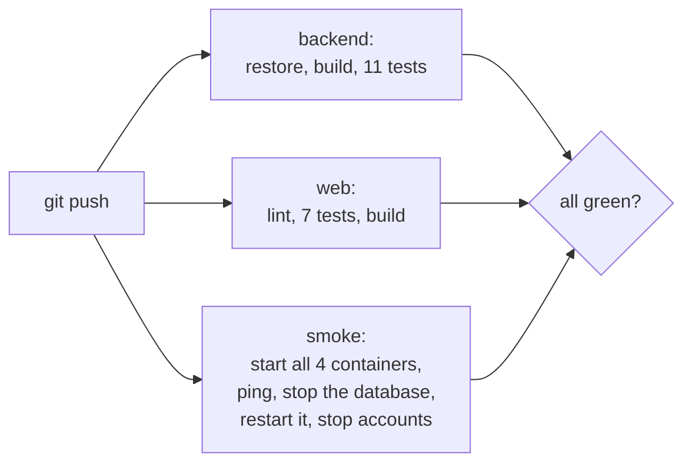

**Reading the diagram:** three independent jobs. The first two check each half on its own. The third, **smoke**, starts the real system exactly as you do on your laptop and pokes it, including breaking it on purpose. It is the automated version of section 6.

Note `cp infra/.env.example infra/.env` in the smoke job: CI uses the example password. That is fine, because that database lives for 45 seconds on a throwaway machine.

> **GitHub (verified at commit `c7468ec`):** [`ci.yml`](https://github.com/ankitchoubey800/magpie/blob/c7468ec7b04fe393d9f7e151a08bcc906c858b02/.github/workflows/ci.yml)

**Check:** push, open the repository's **Actions** tab, and wait for three green ticks.

### Step 12: Write the decisions down, commit, push

**What:** a README, an ADR template, two ADRs and the week's design note.
**Why:** in six months you will not remember *why* the code looks like this. An **architecture decision record** (ADR) is half a page that captures the context, the options, the choice and its consequences, at the moment you still remember them.

The template every future decision uses:

**`docs/adr/0000-template.md`**

```markdown
# ADR-NNNN: Short title of the decision

- **Status:** Proposed | Accepted | Superseded by ADR-NNNN
- **Date:** YYYY-MM-DD

## Context

What situation forces a decision? Include the numbers and constraints that matter.

## Options considered

1. Option A: one or two sentences, with its main advantage and main cost.
2. Option B: the same.

## Decision

What we chose, in one or two sentences.

## Consequences

What becomes easier, what becomes harder, and what would make us revisit this.
```

The two decisions made this week are written up in `docs/adr/0001-separate-services-behind-a-gateway.md` and `docs/adr/0002-clean-architecture-inside-each-service.md`, and the design note draft is in `docs/design-notes/week-01-services-or-one-application.md`. They are short; read them in the repository rather than here.

```bash
git add -A
git commit -m "Week 1: project skeleton"
git remote add origin https://github.com/<your-account>/magpie.git
git push -u origin main
```

Do **not** create the `week-01-done` tag yet. The week is done only when all five closing items in section 12 exist.

> **GitHub (verified at commit `c7468ec`):** [`README.md`](https://github.com/ankitchoubey800/magpie/blob/c7468ec7b04fe393d9f7e151a08bcc906c858b02/README.md) · [`0000-template.md`](https://github.com/ankitchoubey800/magpie/blob/c7468ec7b04fe393d9f7e151a08bcc906c858b02/docs/adr/0000-template.md) · [`0001-separate-services-behind-a-gateway.md`](https://github.com/ankitchoubey800/magpie/blob/c7468ec7b04fe393d9f7e151a08bcc906c858b02/docs/adr/0001-separate-services-behind-a-gateway.md) · [`0002-clean-architecture-inside-each-service.md`](https://github.com/ankitchoubey800/magpie/blob/c7468ec7b04fe393d9f7e151a08bcc906c858b02/docs/adr/0002-clean-architecture-inside-each-service.md) · [`week-01-services-or-one-application.md`](https://github.com/ankitchoubey800/magpie/blob/c7468ec7b04fe393d9f7e151a08bcc906c858b02/docs/design-notes/week-01-services-or-one-application.md)

---

## 5. How the pieces fit together (code-flow recap)

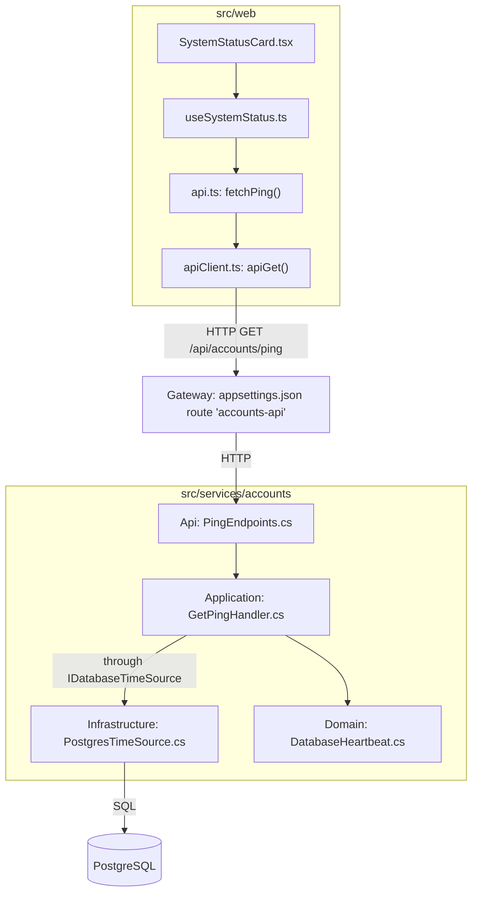

**Reading the diagram:** this is the same journey as section 3.2, but with **file names**. When something breaks, this picture tells you which file to open. Read it once with the code open and trace a request with your finger.

---

## 6. Break it on purpose

Working software teaches you less than broken software. This is closing item 3: do it yourself and **write down what you see**. For comparison, the outputs below are real, from the GitHub Actions run of the same experiment.

**Experiment A: stop the database while everything runs.**

```bash
docker compose -f infra/docker-compose.yml stop postgres
curl -i http://localhost:8080/api/accounts/ping
curl -i http://localhost:5101/health/live
curl -i http://localhost:5101/health/ready
curl -i http://localhost:8080/health/ready
```

> ✏️ **Pencil time**
> Before running it, predict each of the four answers: status code, and healthy or unhealthy. Then compare.

| Call | Observed in CI |
|---|---|
| Ping through the gateway | `HTTP 503 application/problem+json`, title "A dependency is unavailable", `"service":"accounts"`, `"dependency":"postgresql"` |
| Accounts liveness | `HTTP 200`, `{"status":"Healthy","checks":[{"name":"self","status":"Healthy",...}]}` |
| Accounts readiness | `HTTP 503`, `{"status":"Unhealthy","checks":[{"name":"self","status":"Healthy",...},{"name":"postgresql","status":"Unhealthy",...}]}` |
| Gateway readiness | `HTTP 200`, Healthy |

What this tells you:

- Accounts stayed **alive** but became **not ready**. Exactly the shopkeeper-and-broken-till situation.
- The **gateway said it was ready** although the only thing behind it could not work. Is that right? It is a real design question; see the Architect's perspective below.
- In the browser (expected; check it yourself): the card turns into an error with the title, `service: accounts`, a trace id, and a "Try again" button. Copy the trace id and find it in `docker compose logs accounts`.

**Experiment B: bring it back.**

```bash
docker compose -f infra/docker-compose.yml start postgres
```

Observed in CI: the first retry still got 503, and the next succeeded with a round trip of 11.1 ms. Nobody restarted Accounts. The connection pool noticed and reconnected by itself. **Recovery without human action** is a property you should expect from every dependency you add.

**Experiment C: stop the service instead of the database.**

```bash
docker compose -f infra/docker-compose.yml stop accounts
curl -i http://localhost:8080/api/accounts/ping
curl -i http://localhost:8080/
```

Observed in CI:

```json
{"type":"https://tools.ietf.org/html/rfc9110#section-15.6.3","title":"Bad Gateway","status":502,"instance":"/api/accounts/ping","traceId":"00-169aea94aa3443f41ffeb6740135f475-0946797fc64711a7-00","service":"gateway"}
```

and the website itself still returned `200`. Look at `"service":"gateway"`: the error format told you **which box** produced the error. A 503 from `accounts` means "Accounts is up, its database is not". A 502 from `gateway` means "the gateway could not reach Accounts at all". Same screen for the user; very different first move for you.

---

## 7. Production considerations

What is already in place, and what is deliberately not, so you never mistake a laptop skeleton for a finished system.

| Area | In place this week | Deliberately later |
|---|---|---|
| **Security** | No secrets in Git (`.env` ignored, user-secrets locally). Containers run as a non-root user. Errors never leak stack traces. Ping exposes only a time, not a database version | HTTPS (Week 20-21). Rate limits and security headers (Week 17). Per-service database users, threat model (Week 18). **The ping endpoint is open to anyone**: fine for a skeleton, review before any public deployment |
| **Reliability** | Connect and command timeouts of 5 s. Automatic reconnection (proven in Experiment B). Liveness separated from readiness. Accounts waits for a healthy database at start-up | Retries, circuit breakers (Week 17). Backups, failover (Week 22) |
| **Error handling** | One format everywhere, including errors generated by the gateway itself. 503 kept distinct from 500 | A catalogue of error `type` addresses as real business errors appear (Week 2 on) |
| **Logging** | Readable locally, JSON in containers. Every error response carries a `traceId` that appears in the logs | One trace followed across services, dashboards, alerts (Week 19) |
| **Testing** | Three levels on the backend, user-level tests on the frontend, whole-system job in CI | Tests against a real database per test run (Week 2). Browser end-to-end tests (Week 3). Load tests (Week 23) |
| **Performance** | Connection pooling. Layer-cached Docker builds. Long-lived caching of fingerprinted web files in nginx | Everything else. **Do not optimise a skeleton** |
| **Scalability** | Services keep no data in memory between requests, so a second copy could be started | Actually running several copies (Week 17, 21) |
| **Maintainability** | Compiler-enforced layers, feature folders, ADRs, pinned SDK and package versions | Stricter build rules (treat warnings as errors), optional |

---

## 8. Architect's perspective

How would an experienced architect look at what we just built? Not "is the code pretty" but "what can hurt us, and when".

**Risks worth naming now**

| Risk | How likely / how bad | What we do about it |
|---|---|---|
| The split into services costs more hours than it teaches | Likely / medium | Only two processes for now. Formal review at checkpoint 1 (after Week 6), recorded in ADR-0001 |
| The gateway is a single point of failure: if it dies, everything is unreachable | Certain by design / high in production | Accepted on a laptop. In the cloud it runs as several copies behind a load balancer (Week 21). It stays logic-free so it has few reasons to fail |
| Layers become ceremony: four projects touched for every tiny feature | Likely / low | Accepted as the price of enforced boundaries. Compared against vertical slices in Week 4 |
| `Magpie.Defaults` grows into a dumping ground that couples all services | Possible / high | Rule: it may contain *how we run* (logging, health, error format), never *what the product does* |
| Readiness that includes the database can remove **all** copies from service during a database outage | Possible / medium | Correct for Accounts, which can do nothing without its database. For later services that can serve from cache, the check will be different. Decide per service, never copy blindly |

**A question with no single right answer: should the gateway's readiness reflect the services behind it?**

In Experiment A the gateway reported "ready" while Accounts could not work.

- *If the gateway said "not ready"*, a load balancer would stop sending it traffic. But the website itself was still being served fine, and with eleven services one broken service would take the whole site offline.
- *So we keep the gateway's readiness about the gateway only.* Each request to a broken service gets a clear error; everything else keeps working. This idea, a failure staying inside the smallest possible area, is called limiting the **blast radius**, and you will meet it every week from now on.

**What a reviewer would check first**

1. Does `Domain` reference anything? (Open the `.csproj`. It should be empty of references.)
2. Is any address or password written in code? (Search for `localhost` in `.cs` and `.ts` files. It appears only in configuration and comments.)
3. What does a user see when each box is down? (Section 6 answers it with evidence.)
4. Can a new developer run it with one command and no tribal knowledge? (The README says how.)

---

## 9. Alternatives and trade-offs

| Decision | We chose | Alternative | When the alternative is the better choice |
|---|---|---|---|
| Overall shape | Services behind a gateway | **Modular monolith**: one program, strict internal modules | A small team launching a real product. It is cheaper and simpler, and we build exactly this in Week 24 |
| Code inside a service | Clean Architecture (4 projects) | **Vertical slices**: one folder per feature holding its endpoint, logic and data access | Small services with simple rules, or teams that find the layers slow them down |
| Gateway | YARP (a library inside our own .NET app) | **nginx / Envoy / Traefik** (ready-made proxies); **a cloud gateway** (AWS API Gateway) | When you want zero custom code at the edge, or the team is not a .NET team. YARP wins here because its rules are plain C# we can test and extend in Week 17 |
| Local orchestration | Docker Compose, written by hand | **.NET Aspire**: describes the same environment in C# and adds a dashboard | Teams that are all-.NET and want that dashboard. We use Compose because the same idea carries over to any language and to Kubernetes, and the plan includes a Python service |
| API style | Minimal APIs | **Controllers** (classes with attributes) | Large existing codebases that already use them. For new services, Minimal APIs have less ceremony |
| Database access | Raw `Npgsql` for one query | **EF Core** (maps tables to classes); **Dapper** (thin helper over SQL) | EF Core as soon as there are real tables and changes to them: Week 2 |
| Logging | Built-in console logging | **Serilog** and similar libraries | When you need features the built-in logger lacks. Week 19's OpenTelemetry work covers our needs |
| Frontend build | Vite, plain React | **Next.js** (server-rendered React) | Public pages that must rank in search engines. Magpie is an app behind a login |
| Server data in React | A small hand-written hook | **TanStack Query** | As soon as there are several calls with caching and refetching: Week 4 |
| Repository | One repository for everything | One repository per service | Many teams with separate release cycles. For one developer, one repository means one commit can change both sides of a contract |

**Essential or optional?**

| Essential from day one | Optional enhancements (skip without guilt) |
|---|---|
| Configuration outside code; secrets outside Git | Central package version management (one file listing every NuGet version) |
| One error format | Treating compiler warnings as errors |
| Health endpoints | Code coverage reports |
| Timeouts on every outside call | A Makefile or script for the long `docker compose` command |
| Tests that run in CI | Pre-commit hooks |

---

## 10. Common mistakes and troubleshooting

### Mistakes beginners make this week

1. **Creating all eleven services now.** Empty services prove nothing and multiply the plumbing. Two is enough.
2. **Letting Domain reference database code "just this once".** The first exception makes the second one easy. The compiler is your friend here: do not add the reference.
3. **Hard-coding addresses.** `http://localhost:5101` typed into C# or TypeScript works on your laptop and nowhere else.
4. **Committing `.env`.** Run `git status` before your first commit and confirm `infra/.env` is not listed.
5. **Making liveness check the database.** See section 2.7.
6. **Calling `fetch()` directly from components.** Then error handling is copied everywhere and differs everywhere.
7. **Only testing the happy path.** Half of this week's tests are about failure, on purpose.

### When something goes wrong

A method that works for any of these: **follow the request from the outside in, and find the first box that gives a wrong answer.** Browser → gateway (`:8080`) → Accounts (`:5101`) → PostgreSQL.

| Symptom | Likely cause | Fix |
|---|---|---|
| `postgres` container exits immediately; log mentions `/var/lib/postgresql/data` | Volume mounted at the pre-18 path | Mount at `/var/lib/postgresql`, as in our Compose file |
| `NU1202` or "package is not compatible with net10.0" | A package version built for .NET 11 was installed | Re-add it with `--version "10.0.*"` |
| `dotnet --version` prints 11 and builds behave oddly | No .NET 10 SDK installed | Install SDK 10; `global.json` selects it |
| Ping returns **502** from `"service":"gateway"` | Gateway cannot reach Accounts | Is the `accounts` container running? Is the cluster address right for where you run (`localhost:5101` locally, `accounts:8080` in Compose)? |
| Ping returns **503** from `"service":"accounts"` | Accounts cannot reach PostgreSQL | Is `postgres` healthy? Does the password in the connection string match `infra/.env`? |
| Ping returns **500** mentioning nothing useful; log says "Connection string 'AccountsDb' is missing" | No configuration for the database | Local run: set user-secrets (Step 9). Compose: check `infra/.env` exists |
| Password changed in `.env` but login still fails | PostgreSQL only reads the password when it first creates its data | `docker compose -f infra/docker-compose.yml down --volumes`, then `up` again (this deletes local data) |
| `port is already allocated` | Something else uses 8080, 5101 or 5432 | Stop the other program, or change the left-hand number in the Compose `ports` line |
| Browser page loads but shows "Cannot reach Magpie" in development mode | The gateway is not running on 5100 | Start it (Step 9, Terminal 2) |
| Log line `Cannot load library libgssapi_krb5.so.2` in the `accounts` container | The database driver looked for an optional sign-in library that the small runtime image does not include | Harmless: we use password sign-in. Seen in our own CI logs. Ignore it |
| Warnings about `DataProtection-Keys` in container logs | ASP.NET Core noting that some keys are not stored permanently | Harmless this week; nothing uses them yet. Dealt with in Week 2 when login cookies need them |
| A change to C# code is not reflected in Docker | The image was not rebuilt | Add `--build` to `docker compose up` |
| Tests pass locally but fail in CI | A file was not committed, or you depend on something installed only on your laptop | Read the first error in the Actions log; run `git status` |

Useful commands while debugging:

```bash
docker compose -f infra/docker-compose.yml ps                 # what is running, and is it healthy?
docker compose -f infra/docker-compose.yml logs accounts      # what did Accounts say?
docker compose -f infra/docker-compose.yml logs -f gateway    # follow the gateway live
```

---

## 11. Knowledge check

### Pause-and-think answer (from section 1)

Five programs: the browser, the gateway, the web server that delivered the React files (nginx), the Accounts service, and PostgreSQL. Six if you count Docker itself.

### Concept questions

1. In one sentence each: what is the job of the Domain, Application, Infrastructure and Api layers?
2. What does "dependencies point inward" mean, and what stops you from breaking the rule?
3. What is the difference between liveness and readiness? Give one check that belongs in each.
4. Why do we return 503 instead of 500 when the database is down?
5. Where does the database password live when you run with `dotnet run`? With Docker Compose? Why is it in neither `appsettings.json` nor the code?
6. Why does the React app call `/api/accounts/ping` and not `http://localhost:5100/api/accounts/ping`?
7. The data source is a singleton but the ping handler is scoped. Why the difference?

### Practical exercises

1. **Add a field.** Add `environment` (for example "Development" or "Production") to the ping response and show it on the card. Count how many files you touched and in which layers. Did Domain change? Should it have?
2. **Break a rule and watch the compiler stop you.** In `DatabaseHeartbeat.cs`, type `using Npgsql;`. Read the error. Undo it.
3. **Write a failing test first.** Change `SlowThreshold` to 100 ms. Before running anything, predict which tests fail. Run them. Were you right? Restore it.
4. **Add a second route.** Make the gateway also answer `/api/accounts/health/ready` by forwarding to the service's `/health/ready`. (Hint: YARP routes can have "Transforms" that rewrite the path. Look them up in the YARP documentation.) Then decide: is exposing health through the public gateway a good idea?
5. **Read a log.** Trigger a 503, copy the `traceId` from the browser, and find the matching line in `docker compose logs accounts`.

### Interview-style questions with model answers

Write your own answers first, without notes. These are a comparison, not a script; an interviewer wants *your* reasoning.

**Q1. When would you choose one application over microservices?**
Almost always at the start. One application is cheaper to run, simpler to deploy and debug, and has no network between its parts. I would split when there is a concrete pressure: several teams getting in each other's way, one part needing to scale very differently, a part needing another language, or a part that must be able to fail without taking the rest down. In this project we split early on purpose, to learn, and we wrote that down in ADR-0001. Our numbers (about 700 requests a second on average) do not force it.

**Q2. What does "dependencies point inward" protect you from?**
From the most valuable code (business rules) being tangled up with the most replaceable code (database, framework). Concretely: I can test rules without a database; I can replace PostgreSQL with something else by rewriting one project; and a framework upgrade cannot break business logic that does not reference the framework. It is enforced by project references, so it is the compiler's job, not a code reviewer's.

**Q3. What is a health check for, and who calls it?**
Machines call it, not people: container platforms, load balancers and monitoring. Liveness says "restart me if this fails". Readiness says "stop sending me traffic if this fails". Mixing them up is dangerous: if liveness depends on the database, a short database problem restarts every instance.

**Q4. Why have a gateway when there is only one service?**
Because the browser gets one address for site and API, which is what makes cookie-based login safe and simple next week; services can stay private; and shared rules such as rate limiting have one home. Adding it later would mean changing every address the frontend uses.

**Q5. Your service returned an error to a user. How do you find out what happened?**
The error response carries a `traceId` and the name of the `service` that produced it. I search that service's logs for the id and find the full exception. If the service field says `gateway` with a 502, the service was unreachable; if it says `accounts` with a 503, the service was up and its dependency was down.

**Q6. What is dependency injection and why use it?**
A class lists what it needs in its constructor instead of creating it. Something else, the container, supplies it. The benefits are that implementations can be swapped (a fake database in tests) and that object lifetimes are managed in one place.

**Q7. What happens to requests while the database restarts?**
They get a fast, clear 503 (we set a 5-second timeout so they do not hang), the service reports "not ready", and when the database returns the connection pool reconnects by itself. We ran that experiment and kept the output.

### Self-marking

For each concept question, mark yourself: **solid** (explained it without looking), **shaky** (needed a peek), **gap** (could not). Anything not "solid" goes in your Week 1 notes to revisit before Week 2.

---

## 12. Completion checklist

**Built**

- [ ] Repository created with the layout from section 3.5
- [ ] `dotnet build Magpie.slnx` succeeds
- [ ] `dotnet test Magpie.slnx` shows 11 passed **on your machine**
- [ ] `npm run lint`, `npm test` (7 passed) and `npm run build` succeed in `src/web`
- [ ] `docker compose -f infra/docker-compose.yml up --build` starts four containers
- [ ] http://localhost:8080 shows a time read from PostgreSQL
- [ ] `infra/.env` exists locally and is **not** in Git
- [ ] The CI workflow is green on GitHub

**Understood (you can explain each without notes)**

- [ ] What a walking skeleton is and why we start with one
- [ ] The four layers and the direction of the arrows
- [ ] Port and adapter, using `IDatabaseTimeSource` and `PostgresTimeSource`
- [ ] Liveness versus readiness
- [ ] Why 502, 503 and 500 are different messages
- [ ] Where configuration and secrets live in each way of running
- [ ] Why the browser only ever talks to the gateway

**The five closing items (the week is not done without all five)**

- [ ] 1. **Design note** reviewed and edited by you, with the numbers redone by hand (`docs/design-notes/week-01-services-or-one-application.md` is a draft to start from)
- [ ] 2. **Working code with passing tests on your machine**, real output saved
- [ ] 3. **Break-it experiment** (section 6) done by you, observations written down
- [ ] 4. **Explain-back**: 150 to 300 words in your own words, saved in `docs/explain-back/week-01.md`
- [ ] 5. **Interview questions** answered without notes and marked

**Non-technical**

- [ ] AWS account created, multi-factor sign-in on, monthly budget alarm set (for example 10 US dollars), even though nothing is deployed
- [ ] A fixed weekly slot for the 6 to 10 hours
- [ ] Public or private repository decided (currently public)

When every box is ticked: `git tag week-01-done && git push --tags`.

---

## 13. Cumulative architecture overview (version 1, after Week 1)

This section is carried forward and updated in every chapter.

### System map

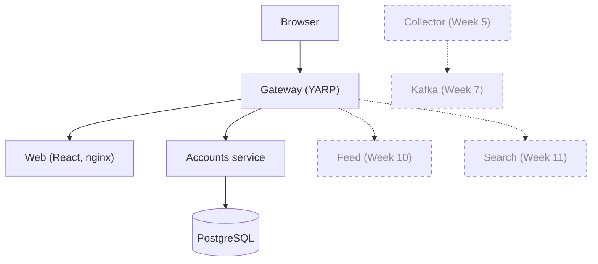

**Reading the diagram:** solid boxes exist and run today. Dashed boxes are a small sample of what is planned, shown only so you can see where the skeleton will grow.

### What exists

| Component | Technology | Responsibility today | Added |
|---|---|---|---|
| Gateway | ASP.NET Core 10 + YARP 2.3 | Single entry point; routes `/api/accounts/**` to Accounts and everything else to Web | Week 1 |
| Accounts service | ASP.NET Core 10 Minimal API, Clean Architecture | `GET /api/accounts/ping`; health endpoints | Week 1 |
| Web | React 19, TypeScript, Vite; nginx in the container | Shows system status | Week 1 |
| PostgreSQL | Version 18 | Answers `SELECT now()`; no tables yet | Week 1 |
| Magpie.Defaults | .NET class library | Logging, Problem Details, health endpoints | Week 1 |
| CI | GitHub Actions | Build, tests, whole-system smoke test | Week 1 |

### Conventions that every later chapter must follow

| Topic | Convention |
|---|---|
| Public API addresses | `/api/<service>/...`, forwarded by the gateway without rewriting |
| Health | `/health/live` (process only) and `/health/ready` (process + dependencies) on every service |
| Errors | RFC 9457 Problem Details, always with `service` and `traceId` |
| Dependency failures | Infrastructure throws `DependencyUnavailableException`; Api maps it to 503 |
| Layers | `Domain` ← `Application` ← `Infrastructure`, with `Api` as composition root |
| Naming | Projects `Magpie.<Service>.<Layer>`; folders `src/services/<service>/` |
| Configuration | Defaults in `appsettings.json`; secrets in user-secrets (local) or environment variables (containers) |
| Ports | Local run: gateway 5100, accounts 5101, web 5173. Compose: gateway 8080 published |
| Frontend | Feature folders; all server calls through `shared/api/apiClient.ts`; relative `/api` addresses only |
| Decisions | One ADR per significant decision in `docs/adr/` |

### Decision log

| ADR | Decision | Week |
|---|---|---|
| 0001 | Separate services behind one gateway (for learning; honest about the alternative) | 1 |
| 0002 | Clean Architecture layers inside each .NET service | 1 |

---

## 14. Before we start Week 2

### Things only you can do

1. Clone the repository and complete the checklist in section 12 **on your own machine**. Paste the real `dotnet test` output and your break-it observations into the chat.
2. Write the explain-back and answer the interview questions.
3. Create the AWS account with multi-factor sign-in and a budget alarm.
4. If anything in this chapter does not match what your machine does, say so. The compiler and your terminal overrule the book.

### Differences from the weekly guide (to record in the progress log)

| What the guide said | What we built | Why |
|---|---|---|
| Accounts has "one `/health` and one `/api/ping` endpoint" | `/health/live`, `/health/ready`, and `/api/accounts/ping` | Two health questions need two endpoints (and Week 21 needs both). Each service needs its own space under `/api/` |
| Peak load "about 1,500 to 3,500 per second" | About 2,100 to 3,500 | 3 to 5 times the average of about 700; the lower figure in the guide was closer to 2 times |
| Tests use xUnit and Testcontainers | xUnit only this week | No tables to test yet; the CI smoke job proves the real database path. Testcontainers starts in Week 2 |
| Repository layout lists `Magpie.Contracts` | Not created | Nothing to put in it until Week 7 |

### Carried into Week 2 (login and signup, part 1)

| Item | Why it matters next week |
|---|---|
| **EF Core and migrations** arrive | The first real tables (users) need them. `PostgresTimeSource` stays as it is |
| **Options pattern with validation at start-up** | Replaces the "connection string read on first use" compromise from Step 5 |
| **Testcontainers** | Integration tests against a real, throwaway PostgreSQL |
| **Mailpit** container added to Compose | Catches confirmation emails on the laptop |
| **Data-protection keys** must be stored somewhere stable | Login cookies are encrypted with them; today's harmless warning becomes a real requirement |
| **Decide the fate of the ping endpoint** | Keep it as an internal diagnostic or remove it once real endpoints exist |
| **HTTPS on the laptop** | `Secure` cookies need it; we will choose how in the Week 2 design note |

### Sources checked while writing this chapter

- PostgreSQL 18 container data path: Docker Official Image documentation for `postgres` (https://hub.docker.com/_/postgres)
- YARP package version 2.3.0: https://www.nuget.org/packages/Yarp.ReverseProxy
- Npgsql 10.0.x package versions: https://www.nuget.org/packages/Npgsql.DependencyInjection (same version line as `Npgsql`)
- "`public partial class Program` no longer needed": https://learn.microsoft.com/en-us/aspnet/core/diagnostics/asp0027
- Vite, React, TypeScript, Vitest versions: taken from what the official template installed (see `src/web/package.json` in the repository)
- Everything else about behaviour: the CI run linked at the top of this chapter
