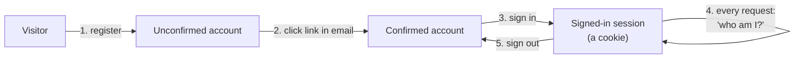
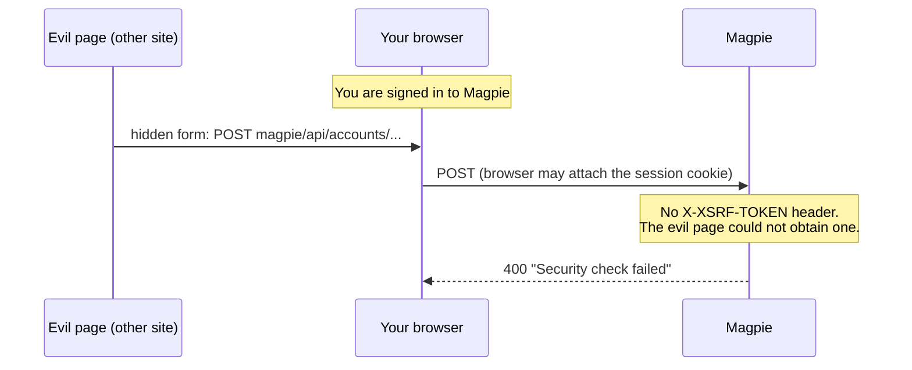
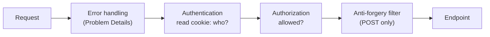
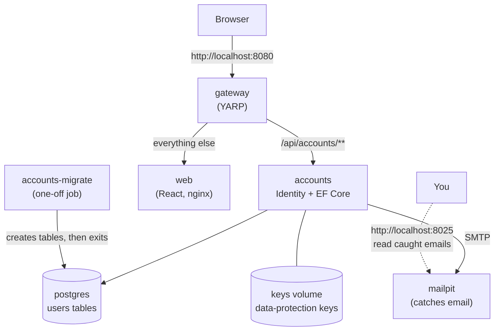
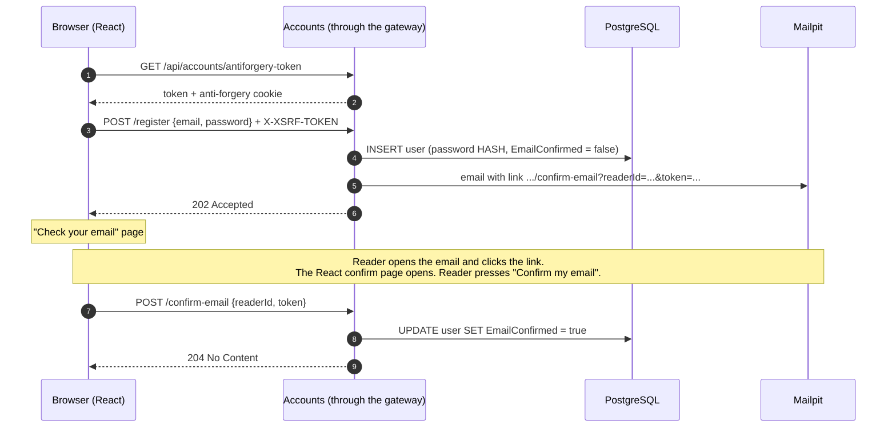
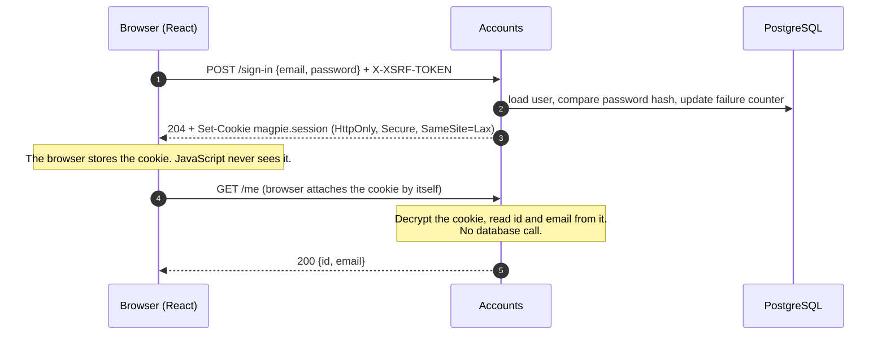
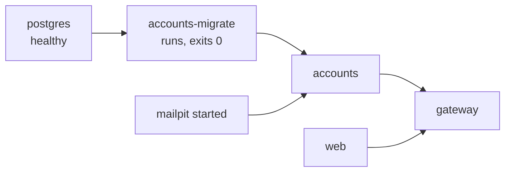
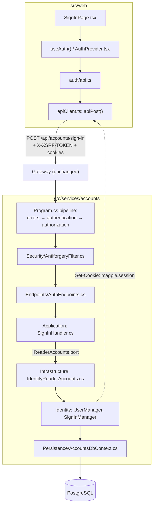
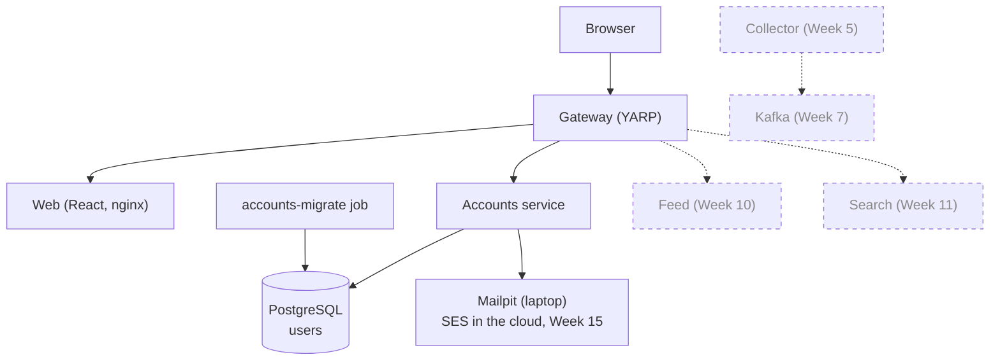

# Building Magpie: A Guided Journey from Empty Folder to Production-Grade System

## Chapter 2 (Week 2): Who Goes There? Sign-up, Email Confirmation and Sign-in

> **What you will have at the end of this chapter:** a visitor can create an account, receive a confirmation email, confirm it, sign in, be recognised on every later request, and sign out. No password is ever stored, no login secret is ever readable by JavaScript, and the system never tells a stranger whether an email address has an account.

| | |
|---|---|
| **Week** | 2 of 26 |
| **Plan step** | Step 2, Login and signup (part 1 of 2) |
| **Time budget** | About 8 hours |
| **You need** | Chapter 1 finished and running |
| **Repository** | https://github.com/ankitchoubey800/magpie |
| **Code for this chapter** | Commit `9ddb6a1` on branch `week-02` (pull request #1). Every link in this chapter points at that exact commit |

---

### How this chapter was checked (read this first)

| What | Where it was run | Result |
|---|---|---|
| Website: lint, 20 tests, production build | Author's workspace (Node 22) and GitHub Actions (Node 26) | Passed |
| .NET: build of all projects, 43 tests (30 unit, 13 against a real PostgreSQL 18 started by Testcontainers) | GitHub Actions | `Passed! - Failed: 0, Passed: 43, Skipped: 0, Total: 43` |
| The first database migration, created with `dotnet ef migrations add` | GitHub Actions; the generated files were then committed | Created and applied |
| Whole system in Docker Compose: register → email caught by Mailpit → confirm → sign in → who-am-I → sign out, all through the gateway | GitHub Actions (`infra/smoke/auth_flow.py`) | Passed; output quoted in Step 11 |
| A signed-in session survives a restart of the Accounts container | GitHub Actions | Passed |
| Break-it experiment (copied cookie after sign-out) | Author's workspace and GitHub Actions | Result quoted in section 6 |
| Week 1 experiments (stop PostgreSQL, stop Accounts) still behave the same | GitHub Actions | Passed |
| **Not yet checked:** the pages in a real browser, including the cookie flags in browser tools | | You do this (Step 11) |
| **Not yet run:** anything on your own laptop | | You do this. It is closing item 2 |

The full evidence is public: https://github.com/ankitchoubey800/magpie/actions/runs/43748252693

Three bugs were found by running the code rather than by reading it. They are described where they happened (Steps 5 and 10), because how they were found is as useful as the fix.

---

## 1. The big picture

### What are we building this week?

Last week's skeleton lets anybody in. This week we put a door on it.

Think of a members-only library:

1. You fill in a form at the desk (**register**).
2. The library posts a letter to the address you gave. Only someone who really lives there can open it (**confirm email**).
3. Next visit you show ID at the desk (**sign in**) and get a **wristband**.
4. For the rest of the day, staff glance at the wristband instead of asking for ID again (**session**).
5. When you leave, you cut the wristband off (**sign out**).



**Reading the diagram:** an account moves left to right exactly once (visitor → unconfirmed → confirmed). After that, a reader loops between "confirmed" and "signed in" for as long as they use Magpie.

### Why does it matter?

Almost every later feature begins with "for *this* reader": their interests, their feed, their saved items, their plan. If the system cannot say reliably who is asking, none of that can be built. And login is the one place where a mistake does not just annoy people, it hurts them. So this chapter is as much about what could go wrong as about making it work.

> 🧠 **Pause and think**
> A sign-in form answers "No account with that email" for one address and "Wrong password" for another. That seems helpful. What has a stranger just learned, and why might that matter for, say, a clinic's patient portal? (Answer in section 11.)

### This week's deliverables

1. Six new addresses on the Accounts service: register, resend confirmation, confirm email, sign in, sign out, "who am I".
2. A real `users` table, created by a **migration**.
3. A **session cookie** with three safety flags, plus **anti-forgery** protection.
4. Confirmation emails, caught on the laptop by **Mailpit**.
5. Settings that are **checked when the service starts**.
6. React pages: sign up, check your email, confirm email, sign in, and a home page only signed-in readers can open.
7. Tests against a **real PostgreSQL** that is started and thrown away automatically.

---

## 2. Concepts first

### 2.1 Authentication and authorization

Two words that sound alike and mean different things:

- **Authentication** = *who are you?* (Showing ID at the desk.)
- **Authorization** = *what are you allowed to do?* (Members may borrow books; only staff may enter the back office.)

This week is almost entirely authentication. The only authorization rule is the simplest possible one: "you must be signed in to ask who you are".

### 2.2 Passwords: why we never store them

If we stored passwords as typed, anyone who stole a copy of the database could sign in as everyone, here and on every other site where people reused the password.

Instead we store a **hash**: the password put through a one-way grinder. Meat goes in, mince comes out, and you cannot turn mince back into meat. At sign-in we grind what the reader typed and compare mince with mince.

Three details make this safe in practice:

- **Salt.** A random value mixed in per account, so two readers with the same password get different hashes, and an attacker cannot use a pre-computed list.
- **Slowness on purpose.** A good password hash takes a noticeable fraction of a second. One sign-in does not notice. An attacker trying a billion guesses does.
- **Never write your own.** The details are subtle and mistakes are invisible until the breach. We use ASP.NET Core Identity's hasher.

### 2.3 Sessions and cookies

The web is forgetful: every request arrives with no memory of the previous one. A **session** is how the server remembers "this browser signed in a minute ago".

A **cookie** is a small labelled value the server asks the browser to keep and send back with every later request to the same site. Our session cookie is the wristband. It is encrypted by the server, so the browser carries it without being able to read or alter it.

Three flags on the cookie do most of the security work:

| Flag | Plain meaning | Attack it blocks |
|---|---|---|
| `HttpOnly` | JavaScript on the page cannot read this cookie | A malicious script stealing the session |
| `Secure` | Only send this over an encrypted (HTTPS) connection | Someone on the same Wi-Fi reading it in transit |
| `SameSite=Lax` | Do not send this on requests *started by other websites*, except when the reader simply clicks a link to us | Another site quietly making requests as you |

> ❓ **No silly questions**
> **Q: Our laptop site is `http://localhost`, not HTTPS. Will a `Secure` cookie work?**
> A: Chrome, Edge and Firefox treat `localhost` as a trustworthy address and accept `Secure` cookies there. Safari does not. Use one of the first three on the laptop. Real HTTPS arrives with the cloud weeks (20 and 21).

### 2.4 Cookies or tokens?

The other common design is a **token** (often a "JWT"): the server hands the browser's JavaScript a signed string, the JavaScript keeps it (usually in `localStorage`) and attaches it to each request.

| | Token in browser storage | Cookie set by the server (ours) |
|---|---|---|
| Can a script on the page read it? | Yes | No |
| Who attaches it to requests? | Our code | The browser |
| Biggest risk | A malicious script copies it and uses it from anywhere | Another site tricks the browser into sending a request (section 2.6) |
| Good for mobile apps and outside API clients | Yes | No |

Our only client is our own website, served from the same address as the API. In that situation the cookie's weakness does not apply and its risk has a mechanical defence. The full comparison is this week's design note (`docs/design-notes/week-02-cookies-or-tokens.md`) and ADR-0003.

### 2.5 "Backend for frontend": why the gateway now matters

A browser only sends a cookie back to **the site that set it**. Last week we made the website and the API share one address through the gateway. This week that decision pays off: because the React app calls `/api/...` on its own address, the browser attaches the session cookie by itself. No login secret ever passes through our JavaScript.

This arrangement, where the browser talks only to its own backend and that backend holds the session, is called **backend for frontend (BFF)**.

### 2.6 Forged requests (CSRF) and the anti-forgery token

"The browser attaches the cookie automatically" has a dark side. Suppose you are signed in to Magpie and, in another tab, open a malicious page. That page contains a hidden form that submits to `magpie.example/api/accounts/delete-everything`. Your browser sends the request, **and attaches your cookie**, because it always does. The server sees a perfectly valid signed-in request. This is **cross-site request forgery (CSRF)**.

A bank analogy: a signature on a cheque proves it is your chequebook. It does not prove you wrote the amount.

Two defences, used together:

1. **`SameSite=Lax`** already stops the browser attaching the cookie to most cross-site requests.
2. An **anti-forgery token**: before changing anything, our page asks the server for a one-off secret and sends it back in a request header (`X-XSRF-TOKEN`). A page on another site cannot read our server's answers and cannot set that header, so its forged request arrives without the token and is refused.



**Reading the diagram:** the forged request does reach Magpie. What saves us is that it cannot carry the token, because only a page loaded from our own address can ask for it.

### 2.7 Proving an email address, and the keys behind it

Typing an address proves nothing. Receiving mail at it does. So we send a link containing a **confirmation token**: a tamper-proof slip that says "account X, issued at time T", sealed by the server. Only our server can create or check one, and it expires after 24 hours.

Both the session cookie and these tokens are sealed with secret keys managed by ASP.NET Core's **data protection** system. Two consequences that surprise people in production:

- If the keys are lost (for example a container restarts with a fresh disk), **every reader is signed out and every emailed link stops working**. Keys must live somewhere durable.
- If there are several copies of the service, they must **share** the keys, or a cookie written by copy A is gibberish to copy B.

### 2.8 Not revealing who has an account

If the sign-up form answers "that email is already registered", anyone can type in addresses and learn who uses the service. This is **account enumeration**. Our rule: **the screen says the same thing either way** ("check your email"), and the truth is delivered privately to the inbox of the address's owner. Likewise sign-in has **one** failure message, whatever the reason.

### 2.9 Slowing down password guessing

After five wrong passwords in a row, the account refuses all sign-ins for five minutes, even with the right password. This is **lockout**. It is a blunt tool (an attacker can lock a victim out on purpose), which is why Week 3 adds **rate limiting** by network address in front of it.

### 2.10 ASP.NET Core Identity: the parts we use

**Identity** is the framework's membership system. We use three of its parts:

| Part | Its job |
|---|---|
| `UserManager` | Create accounts, hash and check passwords, issue and check tokens, count failed attempts |
| `SignInManager` | Decide whether a sign-in may proceed and write or remove the session cookie |
| A **store** | Save and load accounts. Ours is the EF Core store on PostgreSQL |

### 2.11 EF Core, DbContext and migrations

**EF Core** (Entity Framework Core) lets C# work with table rows as ordinary objects. Three words:

- An **entity** is a class whose objects become rows (`ApplicationUser` → the `users` table).
- A **DbContext** is one short work session with the database: it loads objects, tracks what you change, and writes the changes back together.
- A **migration** is a small, numbered recipe: "to get from the previous database shape to this one, create these tables". Migrations are committed to Git, so the database shape has a history just like the code.

Think of migrations as the building's renovation log. Nobody knocks down a wall on a whim; each change is a dated entry that every copy of the building can replay.

> ⚠️ **Watch out**
> Migrations are applied by a **separate, one-off step**, never automatically when the service starts. With several copies starting at once, they would all try to change the tables at the same moment.

### 2.12 The Options pattern

Last week, a missing connection string was only discovered on the first request. The **Options pattern** fixes that class of problem: settings are read into a small typed class, checked against rules (`[Required]`, `[Range]`), and the check runs **when the service starts**. A bad setting stops the service immediately with a readable message.

Here is the real message from starting the service without a connection string:

```
Microsoft.Extensions.Options.OptionsValidationException: DataAnnotation validation failed for
'PostgresOptions' members: 'AccountsDb' with the error: 'Connection string 'AccountsDb' is missing.
Set it with user-secrets (local run) or the ConnectionStrings__AccountsDb environment variable (containers).'.
```

A service that refuses to start is annoying for one minute. A service that starts and fails strangely at 3 a.m. is annoying for much longer.

### 2.13 The request pipeline (middleware)

Every request passes through a chain of steps before it reaches an endpoint, like airport checks: passport, then security, then the gate. Each step is a **middleware**. Order matters: you cannot check a boarding pass before you know who the passenger is.



**Reading the diagram:** error handling is first so that it wraps everything after it. Authentication must come before authorization. The anti-forgery check is attached to our endpoint group, so it runs last, just before our own code.

### 2.14 React: context, router and protected routes

- A **router** shows different pages for different addresses without reloading the site (`/sign-in`, `/sign-up`, `/`).
- A **context** is a value that any component can read without it being handed down through every level by hand. Ours holds one fact: who is signed in.
- A **protected route** sends signed-out visitors to the sign-in page.

> ⚠️ **Watch out**
> A protected route is a **courtesy**, not a lock. Anyone can change JavaScript in their own browser. The lock is the server answering 401 without a valid cookie.

### 2.15 Testcontainers

A fake database cannot tell you whether your real tables, column types and SQL work. **Testcontainers** starts a real PostgreSQL in Docker just before the tests, hands the tests its address, and deletes it afterwards. The tests are slower (seconds, not milliseconds) and far more trustworthy.

### 2.16 Side lesson: OAuth and OpenID Connect in outline

Next week adds "Continue with Google". The idea, in a hotel analogy:

- **OAuth** is a valet key: you let an app do a limited thing on your behalf without giving it your password.
- **OpenID Connect (OIDC)** adds an ID card on top: the provider tells the app *who you are*.

The flow we will use: (1) our site sends you to Google; (2) you sign in **at Google**, so we never see that password; (3) Google sends your browser back to us with a short-lived **code**; (4) our *server* swaps the code for an **ID token** directly with Google; (5) we read your email from it and start **our own** cookie session. Google proves who you are; the wristband is still ours.

---

## 3. Architecture and decisions

### 3.1 The architecture after Week 2



**Reading the diagram:** two new boxes and one new job. **Mailpit** stands in for a real mail service. **accounts-migrate** is the same program as Accounts, started with `--migrate`; it updates the tables and exits before Accounts starts. The **keys volume** keeps the data-protection keys across restarts.

### 3.2 Register and confirm



**Reading the diagram:** steps 1 and 2 are the anti-forgery handshake that precedes every change. Step 6 answers `202 Accepted`, which means "received; the next step happens somewhere else". The link opens a **page** on our site (not an API address), and that page makes the real `POST`.

### 3.3 Sign in, then an ordinary request



**Reading the diagram:** the password travels exactly once, in step 1. From step 4 on, the cookie is the proof. `/me` is answered from the cookie alone, which is why it is fast.

### 3.4 Decisions

| # | Decision | Why | Recorded in |
|---|---|---|---|
| 1 | Cookie session, not a token in browser storage | Scripts cannot read it; our only client is our own same-address website | ADR-0003 |
| 2 | ASP.NET Core Identity for accounts and password hashing | Never write your own; it is maintained by people whose job this is | Guide |
| 3 | Identity sits behind our own port, `IReaderAccounts` | Use cases stay free of framework types and testable with a 60-line fake | This chapter |
| 4 | The email link opens a React page with a button; the page makes a `POST` | A link (`GET`) must never change data; some mail programs open every link to scan it | This chapter |
| 5 | Same answer whether or not an email is registered; one sign-in failure message | Account enumeration | Guide |
| 6 | Added a **resend confirmation** address (not in the guide) | Without it, a reader whose email never arrived is stuck forever | Guide refinement, section 14 |
| 7 | Links in emails are built from a **configured** site address | The incoming request's host name can be forged; we must not email it to readers | This chapter |
| 8 | Password rule: at least 10 characters, no forced symbols | Length defeats guessing far better than "must contain !" | This chapter |
| 9 | Migrations run as a one-off `--migrate` job | Safe with several copies; schema changes are a deliberate act | Guide (week 4), adopted early |
| 10 | Data-protection keys in a folder on a Docker volume | Simplest durable store for one laptop. Changes for the cloud | Carried forward, section 14 |
| 11 | Built-in `SmtpClient` for the laptop mail adapter | Zero extra packages for something used only with Mailpit; Amazon SES replaces it in Week 15 | This chapter |
| 12 | Keep HTTP on the laptop | Browsers accept `Secure` cookies on `localhost`; certificates on a laptop are friction with no lesson. HTTPS arrives in Weeks 20-21 | Carried forward, section 14 |
| 13 | The ping endpoint stays | CI and the break-it experiments use it | Closes a Week 1 open item |

### 3.5 What is stored

```mermaid
erDiagram
    users ||--o{ user_tokens : has
    users ||--o{ user_logins : has
    users ||--o{ user_claims : has
    users {
        uuid Id PK
        string Email
        string NormalizedEmail "upper-cased, unique lookups"
        bool EmailConfirmed
        string PasswordHash "never the password"
        string SecurityStamp "changes when credentials change"
        int AccessFailedCount
        timestamptz LockoutEnd
        timestamptz CreatedAtUtc "ours"
    }
```



**Reading the diagram:** one main table, `users`, and three helpers that Identity defines. Only `users` is used this week; `user_logins` will hold "this account is linked to Google" in Week 3. The only column we added ourselves is `CreatedAtUtc`.

### 3.6 Files changed from Week 1

So that nothing is a surprise, here is every Week 1 file this chapter modifies:

| File | Change |
|---|---|
| `Magpie.Defaults/UnhandledExceptionHandler.cs` | Unreadable requests become 400 instead of 500 |
| `Accounts.Infrastructure/DependencyInjection.cs` | Rewritten: options, EF Core, Identity, email. `AddAccountsInfrastructure()` no longer takes a parameter |
| `Accounts.Infrastructure/*.csproj` | `Npgsql` package replaced by the EF Core provider (which brings Npgsql with it) |
| `Accounts.Api/Program.cs`, `appsettings.json`, `.csproj` | New registrations, pipeline steps, settings, one tool package |
| `Accounts.Tests/*` | Tests moved into `Unit/` and `Integration/`; the factory now starts a real PostgreSQL |
| `src/web/src/shared/api/apiClient.ts`, `main.tsx`, `app/App.tsx`, `index.css`, `test/setup.ts` | `apiPost`, router, sign-in state |
| `src/services/accounts/Dockerfile`, `infra/docker-compose.yml`, `.github/workflows/ci.yml` | Keys folder, Mailpit, migration job, journey checks |

Nothing in the gateway changes. Every new address begins with `/api/accounts/`, which it already forwards.

---

## 4. Implementation guide

Same conventions as Chapter 1: Bash-style commands from the repository root, a **GitHub** line after every step, a **Check**, and now a short **Q&A** after every step.

### Step 0: Before you start

1. Chapter 1 runs on your machine (`docker compose ... up` shows the status page).
2. Docker is running. From this week the .NET tests need it.
3. Install the EF Core command-line tool, pinned to the 10.x line:

```bash
dotnet tool install --global dotnet-ef --version "10.0.*"
dotnet ef --version        # expect a line starting with 10.0
```

4. Store a local connection string outside the repository (this was optional in Chapter 1 and is needed now; use the password from your `infra/.env`):

```bash
dotnet user-secrets set "ConnectionStrings:AccountsDb" \
  "Host=localhost;Port=5432;Database=magpie_accounts;Username=magpie;Password=YOUR_PASSWORD;Timeout=5;Command Timeout=5" \
  --project src/services/accounts/Magpie.Accounts.Api
```

5. Work on a branch: `git switch -c week-02`.

> ❓ **Q&A**
> **Q: Why a branch?** Last week there was nothing to break. Now `main` works, and a branch lets you keep it working until the new code is proven. You then open a **pull request**, CI runs on it, and you merge when it is green.

### Step 1: Domain, an email address you can trust

**What:** a small **value object**, `EmailAddress`.
**Why:** a plain `string` could be anything. Once a value is an `EmailAddress`, every piece of code that receives it knows the basic checks have already been done.

**`src/services/accounts/Magpie.Accounts.Domain/EmailAddress.cs`**

```csharp
namespace Magpie.Accounts.Domain;

/// <summary>
/// An email address that has passed our basic checks. Code that receives an
/// EmailAddress never has to wonder "has anyone validated this string?".
///
/// The checks are deliberately light. The only real proof that an address
/// works is that its owner clicks the link we send to it.
/// </summary>
public sealed record EmailAddress
{
    /// <summary>The longest address the email standards allow.</summary>
    public const int MaxLength = 254;

    public string Value { get; }

    private EmailAddress(string value) => Value = value;

    public static bool TryCreate(string? input, out EmailAddress? email)
    {
        email = null;

        var value = input?.Trim();
        if (string.IsNullOrEmpty(value) || value.Length > MaxLength)
        {
            return false;
        }

        // Exactly one "@", with something on both sides, a dot in the part
        // after it, and no spaces anywhere.
        var at = value.IndexOf('@');
        var hasOneAt = at > 0 && at == value.LastIndexOf('@') && at < value.Length - 1;
        if (!hasOneAt || value.Any(char.IsWhiteSpace))
        {
            return false;
        }

        var domain = value[(at + 1)..];
        if (!domain.Contains('.') || domain.StartsWith('.') || domain.EndsWith('.'))
        {
            return false;
        }

        email = new EmailAddress(value);
        return true;
    }

    public override string ToString() => Value;
}
```

Notice the shape `TryCreate(input, out email)`: it returns `true` or `false` instead of throwing. A badly typed email is an everyday event, not an exceptional one, and everyday events should not use exceptions.

> **GitHub (verified at commit `9ddb6a1`):** [`EmailAddress.cs`](https://github.com/ankitchoubey800/magpie/blob/9ddb6a13951723881db197af9af36d48d1e8085f/src/services/accounts/Magpie.Accounts.Domain/EmailAddress.cs)

**Check:** `dotnet build src/services/accounts/Magpie.Accounts.Domain` succeeds.

> ❓ **Q&A**
> **Q: Why are the checks so light? There are whole standards about valid email addresses.**
> A: Because the only real proof is delivery. A perfectly formatted address can still belong to nobody. We reject obvious typos here and let the confirmation email do the proving.
> **Q: Where is the `User` class? Isn't a user the most "domain" thing there is?**
> A: Identity already defines the stored user, and duplicating it would be ceremony. Our Domain holds only rules that are truly ours. It will grow in Week 4, when interests arrive.

### Step 2: Application, the ports and use cases

**What:** three ports (accounts, email, link building) and four use cases.
**Why:** this is the part of the system that says, in plain C#, what "registering" *means*, including the enumeration rule, with no framework in sight.

Create folders `Registration` and `SignIn` in `Magpie.Accounts.Application` (`Abstractions` exists from Week 1).

The accounts port. Read the comments on `SignInAsync`: the return type itself enforces a security rule.

**`src/services/accounts/Magpie.Accounts.Application/Abstractions/IReaderAccounts.cs`**

```csharp
using Magpie.Accounts.Domain;

namespace Magpie.Accounts.Application.Abstractions;

/// <summary>
/// The port for everything that touches stored accounts and sign-in sessions.
/// The use cases say WHAT they need; Infrastructure implements it with
/// ASP.NET Core Identity. No use case ever sees a password hash.
/// </summary>
public interface IReaderAccounts
{
    /// <summary>Creates an unconfirmed account, or explains why it could not.</summary>
    Task<CreateAccountResult> CreateAsync(EmailAddress email, string password, CancellationToken cancellationToken);

    /// <summary>
    /// Returns a fresh confirmation token if an account with this email exists
    /// and is still unconfirmed; otherwise null.
    /// </summary>
    Task<PendingConfirmation?> GetPendingConfirmationAsync(EmailAddress email, CancellationToken cancellationToken);

    /// <summary>True when the token was valid and the email is now confirmed.</summary>
    Task<bool> ConfirmEmailAsync(string readerId, string token, CancellationToken cancellationToken);

    /// <summary>
    /// Checks the password and, if everything is in order, starts a session.
    /// Returns only true or false ON PURPOSE: the caller must not be able to
    /// tell "wrong password" from "no such account" from "locked out".
    /// </summary>
    Task<bool> SignInAsync(EmailAddress email, string password, CancellationToken cancellationToken);

    Task SignOutAsync(CancellationToken cancellationToken);
}

/// <summary>What a reader needs in order to confirm their email address.</summary>
public sealed record PendingConfirmation(string ReaderId, string Token);

public enum CreateAccountStatus
{
    Created,
    AlreadyExists,
    Rejected,
}

public sealed record CreateAccountResult(
    CreateAccountStatus Status,
    PendingConfirmation? Confirmation,
    IReadOnlyList<string> Errors)
{
    public static CreateAccountResult Created(PendingConfirmation confirmation) =>
        new(CreateAccountStatus.Created, confirmation, []);

    public static CreateAccountResult AlreadyExists() =>
        new(CreateAccountStatus.AlreadyExists, null, []);

    public static CreateAccountResult Rejected(IReadOnlyList<string> errors) =>
        new(CreateAccountStatus.Rejected, null, errors);
}
```

The email port:

**`src/services/accounts/Magpie.Accounts.Application/Abstractions/IEmailSender.cs`**

```csharp
namespace Magpie.Accounts.Application.Abstractions;

/// <summary>
/// The port for sending email. On the laptop the adapter talks to Mailpit;
/// in the cloud (week 15) it will talk to Amazon SES. Use cases never know.
/// </summary>
public interface IEmailSender
{
    /// <exception cref="DependencyUnavailableException">The mail server could not be reached.</exception>
    Task SendAsync(EmailMessage message, CancellationToken cancellationToken);
}

public sealed record EmailMessage(string To, string Subject, string TextBody);
```

The link builder:

**`src/services/accounts/Magpie.Accounts.Application/Abstractions/AccountLinks.cs`**

```csharp
namespace Magpie.Accounts.Application.Abstractions;

/// <summary>
/// Builds the links we put in emails. The site address comes from OUR
/// configuration, never from the incoming request: an attacker can put any
/// host name they like in a request, and we must not email it to our readers.
/// </summary>
public sealed class AccountLinks(Uri publicBaseUrl)
{
    public Uri ConfirmEmail(PendingConfirmation confirmation)
    {
        var query =
            $"readerId={Uri.EscapeDataString(confirmation.ReaderId)}&token={Uri.EscapeDataString(confirmation.Token)}";

        return new Uri(publicBaseUrl, $"/confirm-email?{query}");
    }

    public Uri SignIn() => new(publicBaseUrl, "/sign-in");
}
```

The words of the emails, in one place:

**`src/services/accounts/Magpie.Accounts.Application/Registration/AccountEmails.cs`**

```csharp
using Magpie.Accounts.Application.Abstractions;
using Magpie.Accounts.Domain;

namespace Magpie.Accounts.Application.Registration;

/// <summary>The exact words of the emails this service sends. One place to edit them.</summary>
public static class AccountEmails
{
    public static EmailMessage ConfirmYourEmail(EmailAddress to, Uri confirmLink) => new(
        to.Value,
        "Confirm your email for Magpie",
        $"""
         Welcome to Magpie.

         Open this link to confirm your email address:
         {confirmLink}

         The link works for 24 hours. If you did not create a Magpie account, ignore this email and nothing will happen.
         """);

    public static EmailMessage AlreadyRegistered(EmailAddress to, Uri signInLink) => new(
        to.Value,
        "You already have a Magpie account",
        $"""
         Someone (probably you) tried to create a Magpie account with this email address, but one already exists.

         You can sign in here:
         {signInLink}

         If this was not you, there is nothing you need to do. Your account has not been changed.
         """);
}
```

The registration use case. This is the most important file of the week:

**`src/services/accounts/Magpie.Accounts.Application/Registration/RegisterReaderHandler.cs`**

```csharp
using Magpie.Accounts.Application.Abstractions;
using Magpie.Accounts.Domain;

namespace Magpie.Accounts.Application.Registration;

/// <summary>What the caller is allowed to learn about a registration attempt.</summary>
public sealed record RegisterOutcome(bool Accepted, IReadOnlyList<string> Errors)
{
    public static readonly RegisterOutcome CheckYourEmail = new(true, []);

    public static RegisterOutcome Invalid(params IReadOnlyList<string> errors) => new(false, errors);
}

/// <summary>
/// Use case: a visitor asks for an account.
///
/// The important design rule: the answer NEVER reveals whether the email was
/// already registered. In both cases the caller hears "check your email", and
/// the difference is explained privately, in the inbox of the address's owner.
/// </summary>
public sealed class RegisterReaderHandler(IReaderAccounts accounts, IEmailSender emailSender, AccountLinks links)
{
    public async Task<RegisterOutcome> HandleAsync(string? email, string? password, CancellationToken cancellationToken)
    {
        if (!EmailAddress.TryCreate(email, out var address))
        {
            return RegisterOutcome.Invalid("Enter a valid email address.");
        }

        if (string.IsNullOrEmpty(password))
        {
            return RegisterOutcome.Invalid("Enter a password.");
        }

        var result = await accounts.CreateAsync(address!, password, cancellationToken);

        switch (result.Status)
        {
            case CreateAccountStatus.Rejected:
                // Password rules failed. Safe to say so: it reveals nothing about other people.
                return RegisterOutcome.Invalid(result.Errors);

            case CreateAccountStatus.Created:
                await SendConfirmationAsync(address!, result.Confirmation!, cancellationToken);
                break;

            case CreateAccountStatus.AlreadyExists:
                var pending = await accounts.GetPendingConfirmationAsync(address!, cancellationToken);
                if (pending is not null)
                {
                    // Registered earlier but never confirmed: simply send the link again.
                    await SendConfirmationAsync(address!, pending, cancellationToken);
                }
                else
                {
                    await emailSender.SendAsync(
                        AccountEmails.AlreadyRegistered(address!, links.SignIn()), cancellationToken);
                }

                break;
        }

        return RegisterOutcome.CheckYourEmail;
    }

    private Task SendConfirmationAsync(EmailAddress to, PendingConfirmation confirmation, CancellationToken cancellationToken) =>
        emailSender.SendAsync(AccountEmails.ConfirmYourEmail(to, links.ConfirmEmail(confirmation)), cancellationToken);
}
```

Trace the three cases with your finger:

| The email is... | What is stored | What is emailed | What the caller hears |
|---|---|---|---|
| New | A new unconfirmed account | Confirmation link | "Check your email" |
| Registered, not yet confirmed | Nothing new | Confirmation link again | "Check your email" |
| Registered and confirmed | Nothing new | "You already have an account" | "Check your email" |

Three different situations, one identical answer to the caller.

The remaining use cases are small:

**`src/services/accounts/Magpie.Accounts.Application/Registration/ResendConfirmationHandler.cs`**

```csharp
using Magpie.Accounts.Application.Abstractions;
using Magpie.Accounts.Domain;

namespace Magpie.Accounts.Application.Registration;

/// <summary>
/// Use case: "I did not get the email, send it again."
/// It returns nothing, on purpose: whether or not an email was sent would
/// reveal whether the address has an account.
/// </summary>
public sealed class ResendConfirmationHandler(IReaderAccounts accounts, IEmailSender emailSender, AccountLinks links)
{
    public async Task HandleAsync(string? email, CancellationToken cancellationToken)
    {
        if (!EmailAddress.TryCreate(email, out var address))
        {
            return;
        }

        var pending = await accounts.GetPendingConfirmationAsync(address!, cancellationToken);
        if (pending is null)
        {
            // No such account, or already confirmed. Say nothing, send nothing.
            return;
        }

        await emailSender.SendAsync(
            AccountEmails.ConfirmYourEmail(address!, links.ConfirmEmail(pending)), cancellationToken);
    }
}
```

**`src/services/accounts/Magpie.Accounts.Application/Registration/ConfirmEmailHandler.cs`**

```csharp
using Magpie.Accounts.Application.Abstractions;

namespace Magpie.Accounts.Application.Registration;

/// <summary>Use case: the reader clicked the link in the confirmation email.</summary>
public sealed class ConfirmEmailHandler(IReaderAccounts accounts)
{
    public Task<bool> HandleAsync(string? readerId, string? token, CancellationToken cancellationToken)
    {
        if (string.IsNullOrWhiteSpace(readerId) || string.IsNullOrWhiteSpace(token))
        {
            return Task.FromResult(false);
        }

        return accounts.ConfirmEmailAsync(readerId, token, cancellationToken);
    }
}
```

**`src/services/accounts/Magpie.Accounts.Application/SignIn/SignInHandler.cs`**

```csharp
using Magpie.Accounts.Application.Abstractions;
using Magpie.Accounts.Domain;

namespace Magpie.Accounts.Application.SignIn;

/// <summary>
/// Use case: sign in with email and password.
/// One answer for every kind of failure, so an attacker learns nothing from it.
/// </summary>
public sealed class SignInHandler(IReaderAccounts accounts)
{
    public async Task<bool> HandleAsync(string? email, string? password, CancellationToken cancellationToken)
    {
        if (!EmailAddress.TryCreate(email, out var address) || string.IsNullOrEmpty(password))
        {
            return false;
        }

        return await accounts.SignInAsync(address!, password, cancellationToken);
    }
}
```

> **GitHub (verified at commit `9ddb6a1`):** [`IReaderAccounts.cs`](https://github.com/ankitchoubey800/magpie/blob/9ddb6a13951723881db197af9af36d48d1e8085f/src/services/accounts/Magpie.Accounts.Application/Abstractions/IReaderAccounts.cs) · [`IEmailSender.cs`](https://github.com/ankitchoubey800/magpie/blob/9ddb6a13951723881db197af9af36d48d1e8085f/src/services/accounts/Magpie.Accounts.Application/Abstractions/IEmailSender.cs) · [`AccountLinks.cs`](https://github.com/ankitchoubey800/magpie/blob/9ddb6a13951723881db197af9af36d48d1e8085f/src/services/accounts/Magpie.Accounts.Application/Abstractions/AccountLinks.cs) · [`AccountEmails.cs`](https://github.com/ankitchoubey800/magpie/blob/9ddb6a13951723881db197af9af36d48d1e8085f/src/services/accounts/Magpie.Accounts.Application/Registration/AccountEmails.cs) · [`RegisterReaderHandler.cs`](https://github.com/ankitchoubey800/magpie/blob/9ddb6a13951723881db197af9af36d48d1e8085f/src/services/accounts/Magpie.Accounts.Application/Registration/RegisterReaderHandler.cs) · [`ResendConfirmationHandler.cs`](https://github.com/ankitchoubey800/magpie/blob/9ddb6a13951723881db197af9af36d48d1e8085f/src/services/accounts/Magpie.Accounts.Application/Registration/ResendConfirmationHandler.cs) · [`ConfirmEmailHandler.cs`](https://github.com/ankitchoubey800/magpie/blob/9ddb6a13951723881db197af9af36d48d1e8085f/src/services/accounts/Magpie.Accounts.Application/Registration/ConfirmEmailHandler.cs) · [`SignInHandler.cs`](https://github.com/ankitchoubey800/magpie/blob/9ddb6a13951723881db197af9af36d48d1e8085f/src/services/accounts/Magpie.Accounts.Application/SignIn/SignInHandler.cs)

**Check:** `dotnet build src/services/accounts/Magpie.Accounts.Application` succeeds, and its `.csproj` still references only Domain.

> ❓ **Q&A**
> **Q: If the weak-password error is shown to the caller, doesn't that leak something?**
> A: No. It says something about the password the caller just typed, and nothing about anyone else. (Identity checks the password rules *before* it looks for a duplicate, so the answer is the same whether or not the email exists.)
> **Q: What happens if the mail server is down during registration?**
> A: The account is created, sending fails, and the caller gets a 503 "try again shortly". Trying again lands in the "registered, not yet confirmed" row above and simply sends the link. This was run for real: mail server stopped → `503 ... "dependency":"email"`; mail server started, same request repeated → `202`.
> **Q: Why is there no `SignOutHandler`?**
> A: It would contain one line that forwards to the port. A class that decides nothing is ceremony, so the endpoint calls the port directly. Patterns are tools, not rituals.

### Step 3: Infrastructure, the database side

**What:** the user entity, the DbContext, and the registration code for EF Core.
**Why:** this is where "an account" becomes rows in PostgreSQL.

Swap the packages. The EF Core provider brings the Npgsql driver with it at a matching version, so the direct reference from Week 1 goes away:

```bash
I=src/services/accounts/Magpie.Accounts.Infrastructure
dotnet remove $I package Npgsql
dotnet add $I package Npgsql.EntityFrameworkCore.PostgreSQL --version "10.0.*"
dotnet add $I package Microsoft.AspNetCore.Identity.EntityFrameworkCore --version "10.0.*"
```

The project file should now read:

**`src/services/accounts/Magpie.Accounts.Infrastructure/Magpie.Accounts.Infrastructure.csproj`**

```xml
<Project Sdk="Microsoft.NET.Sdk">

  <ItemGroup>
    <ProjectReference Include="..\Magpie.Accounts.Application\Magpie.Accounts.Application.csproj" />
  </ItemGroup>

  <!-- Infrastructure is the outer layer, so it MAY use framework types
       (configuration, dependency injection, health checks, Identity). -->
  <ItemGroup>
    <FrameworkReference Include="Microsoft.AspNetCore.App" />
  </ItemGroup>

  <!-- The PostgreSQL driver (Npgsql) now arrives through the EF Core provider,
       which guarantees the two versions match. -->
  <ItemGroup>
    <PackageReference Include="Microsoft.AspNetCore.Identity.EntityFrameworkCore" Version="10.0.*" />
    <PackageReference Include="Npgsql.EntityFrameworkCore.PostgreSQL" Version="10.0.*" />
  </ItemGroup>

  <PropertyGroup>
    <TargetFramework>net10.0</TargetFramework>
    <ImplicitUsings>enable</ImplicitUsings>
    <Nullable>enable</Nullable>
  </PropertyGroup>

</Project>
```

Create folders `Identity`, `Persistence` and `Email`. The entity:

**`src/services/accounts/Magpie.Accounts.Infrastructure/Identity/ApplicationUser.cs`**

```csharp
using Microsoft.AspNetCore.Identity;

namespace Magpie.Accounts.Infrastructure.Identity;

/// <summary>
/// One row in the users table. IdentityUser already defines the columns that
/// sign-in needs (email, password hash, lockout counters and so on); we add
/// only what is ours. Guid means the id is a random 128-bit value, so ids
/// cannot be guessed or counted the way 1, 2, 3 can.
/// </summary>
public sealed class ApplicationUser : IdentityUser<Guid>
{
    public DateTimeOffset CreatedAtUtc { get; set; }
}
```

The DbContext:

**`src/services/accounts/Magpie.Accounts.Infrastructure/Persistence/AccountsDbContext.cs`**

```csharp
using Magpie.Accounts.Infrastructure.Identity;
using Microsoft.AspNetCore.Identity.EntityFrameworkCore;
using Microsoft.EntityFrameworkCore;

namespace Magpie.Accounts.Infrastructure.Persistence;

/// <summary>
/// EF Core's view of the Accounts database. A DbContext is one short "work
/// session" with the database: it tracks the objects you load and writes your
/// changes back in one go.
///
/// IdentityUserContext brings the table definitions for users (and their
/// tokens, claims and outside logins) without the roles tables, which we do
/// not use.
/// </summary>
public sealed class AccountsDbContext(DbContextOptions<AccountsDbContext> options)
    : IdentityUserContext<ApplicationUser, Guid>(options)
{
    protected override void OnModelCreating(ModelBuilder builder)
    {
        base.OnModelCreating(builder);

        // Friendlier table names than the "AspNetUsers" defaults.
        builder.Entity<ApplicationUser>().ToTable("users");
        builder.Entity<Microsoft.AspNetCore.Identity.IdentityUserClaim<Guid>>().ToTable("user_claims");
        builder.Entity<Microsoft.AspNetCore.Identity.IdentityUserLogin<Guid>>().ToTable("user_logins");
        builder.Entity<Microsoft.AspNetCore.Identity.IdentityUserToken<Guid>>().ToTable("user_tokens");
    }
}
```

Everything that mentions EF Core is gathered in one file:

**`src/services/accounts/Magpie.Accounts.Infrastructure/Persistence/PersistenceRegistration.cs`**

```csharp
using Magpie.Accounts.Infrastructure.Identity;
using Microsoft.AspNetCore.Identity;
using Microsoft.EntityFrameworkCore;
using Microsoft.Extensions.DependencyInjection;
using Npgsql;

namespace Magpie.Accounts.Infrastructure.Persistence;

/// <summary>Everything that knows about EF Core lives in this folder.</summary>
public static class PersistenceRegistration
{
    internal static IServiceCollection AddAccountsDbContext(this IServiceCollection services)
    {
        // EF Core borrows connections from the SAME pool as the week 1 ping code.
        services.AddDbContext<AccountsDbContext>((serviceProvider, options) =>
            options.UseNpgsql(serviceProvider.GetRequiredService<NpgsqlDataSource>()));

        return services;
    }

    internal static IdentityBuilder AddAccountsStores(this IdentityBuilder identity) =>
        identity.AddEntityFrameworkStores<AccountsDbContext>();

    /// <summary>
    /// Brings the database schema up to date. Called ONLY by the separate
    /// "--migrate" run (see Program.cs), never during normal start-up.
    /// </summary>
    public static async Task MigrateAccountsDatabaseAsync(this IServiceProvider services, CancellationToken cancellationToken = default)
    {
        await using var scope = services.CreateAsyncScope();
        var database = scope.ServiceProvider.GetRequiredService<AccountsDbContext>();
        await database.Database.MigrateAsync(cancellationToken);
    }
}
```

> **GitHub (verified at commit `9ddb6a1`):** [`Magpie.Accounts.Infrastructure.csproj`](https://github.com/ankitchoubey800/magpie/blob/9ddb6a13951723881db197af9af36d48d1e8085f/src/services/accounts/Magpie.Accounts.Infrastructure/Magpie.Accounts.Infrastructure.csproj) · [`ApplicationUser.cs`](https://github.com/ankitchoubey800/magpie/blob/9ddb6a13951723881db197af9af36d48d1e8085f/src/services/accounts/Magpie.Accounts.Infrastructure/Identity/ApplicationUser.cs) · [`AccountsDbContext.cs`](https://github.com/ankitchoubey800/magpie/blob/9ddb6a13951723881db197af9af36d48d1e8085f/src/services/accounts/Magpie.Accounts.Infrastructure/Persistence/AccountsDbContext.cs) · [`PersistenceRegistration.cs`](https://github.com/ankitchoubey800/magpie/blob/9ddb6a13951723881db197af9af36d48d1e8085f/src/services/accounts/Magpie.Accounts.Infrastructure/Persistence/PersistenceRegistration.cs)

**Check:** the project will not build until Step 4 adds the files it refers to. That is expected.

> ❓ **Q&A**
> **Q: Why does EF Core reuse the Week 1 `NpgsqlDataSource`?**
> A: One connection pool for the whole service. Two pools would mean twice the open connections to PostgreSQL for no benefit.
> **Q: Why a random `Guid` id instead of 1, 2, 3?**
> A: Counting ids leak how many readers you have and invite "what if I ask for reader 42?". The code uses the *version 7* kind of Guid, which starts with a timestamp, so new rows are still added at the end of the index and the database stays fast.

### Step 4: Infrastructure, Identity, email and wiring

**What:** the adapter behind `IReaderAccounts`, the mail adapter, two settings classes and the registration method.
**Why:** this is where our ports meet the real framework.

The Identity adapter:

**`src/services/accounts/Magpie.Accounts.Infrastructure/Identity/IdentityReaderAccounts.cs`**

```csharp
using System.Text;
using Magpie.Accounts.Application.Abstractions;
using Magpie.Accounts.Domain;
using Microsoft.AspNetCore.Identity;
using Microsoft.AspNetCore.WebUtilities;

namespace Magpie.Accounts.Infrastructure.Identity;

/// <summary>
/// The adapter behind the IReaderAccounts port, built on ASP.NET Core Identity.
/// UserManager stores and checks accounts; SignInManager writes the session cookie.
/// </summary>
internal sealed class IdentityReaderAccounts(
    UserManager<ApplicationUser> users,
    SignInManager<ApplicationUser> signIn,
    TimeProvider timeProvider) : IReaderAccounts
{
    public async Task<CreateAccountResult> CreateAsync(
        EmailAddress email, string password, CancellationToken cancellationToken)
    {
        var user = new ApplicationUser
        {
            Id = Guid.CreateVersion7(),
            UserName = email.Value,
            Email = email.Value,
            CreatedAtUtc = timeProvider.GetUtcNow(),
        };

        // CreateAsync hashes the password. The plain password is never stored and never logged.
        var result = await users.CreateAsync(user, password);
        if (result.Succeeded)
        {
            return CreateAccountResult.Created(await CreateConfirmationAsync(user));
        }

        var isDuplicate = result.Errors.Any(error =>
            error.Code is nameof(IdentityErrorDescriber.DuplicateEmail) or nameof(IdentityErrorDescriber.DuplicateUserName));

        return isDuplicate
            ? CreateAccountResult.AlreadyExists()
            : CreateAccountResult.Rejected(result.Errors.Select(error => error.Description).ToList());
    }

    public async Task<PendingConfirmation?> GetPendingConfirmationAsync(
        EmailAddress email, CancellationToken cancellationToken)
    {
        var user = await users.FindByEmailAsync(email.Value);
        if (user is null || user.EmailConfirmed)
        {
            return null;
        }

        return await CreateConfirmationAsync(user);
    }

    public async Task<bool> ConfirmEmailAsync(string readerId, string token, CancellationToken cancellationToken)
    {
        var user = await users.FindByIdAsync(readerId);
        if (user is null)
        {
            return false;
        }

        string rawToken;
        try
        {
            rawToken = Encoding.UTF8.GetString(WebEncoders.Base64UrlDecode(token));
        }
        catch (FormatException)
        {
            // Someone edited the link. Treat it like any other invalid token.
            return false;
        }

        var result = await users.ConfirmEmailAsync(user, rawToken);
        return result.Succeeded;
    }

    public async Task<bool> SignInAsync(EmailAddress email, string password, CancellationToken cancellationToken)
    {
        // isPersistent: the cookie survives closing the browser, until it expires.
        // lockoutOnFailure: a wrong password counts towards a temporary lockout.
        var result = await signIn.PasswordSignInAsync(
            email.Value, password, isPersistent: true, lockoutOnFailure: true);

        return result.Succeeded;
    }

    public Task SignOutAsync(CancellationToken cancellationToken) => signIn.SignOutAsync();

    private async Task<PendingConfirmation> CreateConfirmationAsync(ApplicationUser user)
    {
        // The raw token contains characters such as "+" and "/" that get mangled
        // inside a web address, so we re-encode it in a link-safe alphabet.
        var rawToken = await users.GenerateEmailConfirmationTokenAsync(user);
        var linkSafeToken = WebEncoders.Base64UrlEncode(Encoding.UTF8.GetBytes(rawToken));

        return new PendingConfirmation(user.Id.ToString(), linkSafeToken);
    }
}
```

Two things to notice. `SignInAsync` returns `result.Succeeded` and throws away *why* it failed: the adapter is physically unable to leak the reason upward. And the token is re-encoded before it goes into a link, because the raw one contains `+` and `/`, which web addresses mangle.

Settings for the database (replacing last week's "read on first use"):

**`src/services/accounts/Magpie.Accounts.Infrastructure/Postgres/PostgresOptions.cs`**

```csharp
using System.ComponentModel.DataAnnotations;

namespace Magpie.Accounts.Infrastructure.Postgres;

/// <summary>Typed settings for the database, filled from "ConnectionStrings" in configuration.</summary>
public sealed class PostgresOptions
{
    public const string SectionName = "ConnectionStrings";

    [Required(ErrorMessage =
        "Connection string 'AccountsDb' is missing. Set it with user-secrets (local run) " +
        "or the ConnectionStrings__AccountsDb environment variable (containers).")]
    public string? AccountsDb { get; set; }
}
```

Settings and adapter for email:

**`src/services/accounts/Magpie.Accounts.Infrastructure/Email/EmailOptions.cs`**

```csharp
using System.ComponentModel.DataAnnotations;

namespace Magpie.Accounts.Infrastructure.Email;

/// <summary>Typed settings for outgoing email, filled from the "Email" section.</summary>
public sealed class EmailOptions
{
    public const string SectionName = "Email";

    [Required]
    public string Host { get; set; } = "";

    [Range(1, 65535)]
    public int Port { get; set; } = 1025;

    [Required, EmailAddress]
    public string FromAddress { get; set; } = "";

    [Required]
    public string FromName { get; set; } = "Magpie";
}
```

**`src/services/accounts/Magpie.Accounts.Infrastructure/Email/SmtpEmailSender.cs`**

```csharp
using System.Net.Mail;
using System.Net.Sockets;
using Magpie.Accounts.Application.Abstractions;
using Microsoft.Extensions.Logging;
using Microsoft.Extensions.Options;

namespace Magpie.Accounts.Infrastructure.Email;

/// <summary>
/// The laptop adapter for IEmailSender: hands the message to an SMTP server
/// (Mailpit). No sign-in and no encryption, which is right for a mail catcher
/// on your own machine and wrong for anything else. The cloud adapter
/// (Amazon SES) replaces this class in week 15.
/// </summary>
internal sealed class SmtpEmailSender(IOptions<EmailOptions> options, ILogger<SmtpEmailSender> logger) : IEmailSender
{
    public async Task SendAsync(EmailMessage message, CancellationToken cancellationToken)
    {
        var settings = options.Value;

        using var mail = new MailMessage
        {
            From = new MailAddress(settings.FromAddress, settings.FromName),
            Subject = message.Subject,
            Body = message.TextBody,
            IsBodyHtml = false,
        };
        mail.To.Add(message.To);

        try
        {
            using var client = new SmtpClient(settings.Host, settings.Port) { Timeout = 5000 };
            await client.SendMailAsync(mail, cancellationToken);
        }
        catch (Exception exception) when (exception is SmtpException or SocketException or TimeoutException)
        {
            throw new DependencyUnavailableException("email", exception);
        }

        // Log THAT an email went out and its subject. Never the address or the
        // body: the body contains a link that signs someone up.
        logger.LogInformation("Sent email with subject {Subject}", message.Subject);
    }
}
```

Look at what the log line does **not** contain: the address or the body. The body holds a link that confirms an account. Logs are read by more people, and kept for longer, than you expect.

Replace `DependencyInjection.cs`:

**`src/services/accounts/Magpie.Accounts.Infrastructure/DependencyInjection.cs`**

```csharp
using Magpie.Accounts.Application.Abstractions;
using Magpie.Accounts.Infrastructure.Email;
using Magpie.Accounts.Infrastructure.Identity;
using Magpie.Accounts.Infrastructure.Persistence;
using Magpie.Accounts.Infrastructure.Postgres;
using Microsoft.AspNetCore.Identity;
using Microsoft.Extensions.DependencyInjection;
using Microsoft.Extensions.Options;
using Npgsql;

namespace Magpie.Accounts.Infrastructure;

public static class DependencyInjection
{
    public static IServiceCollection AddAccountsInfrastructure(this IServiceCollection services)
    {
        // --- Settings: read from configuration, checked when the service starts ---
        services.AddOptions<PostgresOptions>()
            .BindConfiguration(PostgresOptions.SectionName)
            .ValidateDataAnnotations()
            .ValidateOnStart();

        services.AddOptions<EmailOptions>()
            .BindConfiguration(EmailOptions.SectionName)
            .ValidateDataAnnotations()
            .ValidateOnStart();

        // --- PostgreSQL: one connection pool for the whole process ---
        services.AddSingleton(serviceProvider =>
            NpgsqlDataSource.Create(serviceProvider.GetRequiredService<IOptions<PostgresOptions>>().Value.AccountsDb!));

        services.AddScoped<IDatabaseTimeSource, PostgresTimeSource>();
        services.AddHealthChecks()
            .AddCheck<PostgresHealthCheck>("postgresql", tags: ["ready"]);

        services.AddAccountsDbContext();

        // --- Accounts: ASP.NET Core Identity ---
        services.AddIdentityCore<ApplicationUser>(options =>
            {
                // Password rules: length matters far more than forcing symbols.
                options.Password.RequiredLength = 10;
                options.Password.RequiredUniqueChars = 4;
                options.Password.RequireDigit = false;
                options.Password.RequireLowercase = false;
                options.Password.RequireUppercase = false;
                options.Password.RequireNonAlphanumeric = false;

                options.User.RequireUniqueEmail = true;

                // No signing in until the email address is proven to be yours.
                options.SignIn.RequireConfirmedEmail = true;

                // Five wrong passwords in a row: wait five minutes.
                options.Lockout.AllowedForNewUsers = true;
                options.Lockout.MaxFailedAccessAttempts = 5;
                options.Lockout.DefaultLockoutTimeSpan = TimeSpan.FromMinutes(5);
            })
            .AddSignInManager()
            .AddDefaultTokenProviders()
            .AddAccountsStores();

        services.AddScoped<IReaderAccounts, IdentityReaderAccounts>();

        // --- Email ---
        services.AddScoped<IEmailSender, SmtpEmailSender>();

        return services;
    }
}
```

`PostgresTimeSource.cs` and `PostgresHealthCheck.cs` from Week 1 are unchanged.

> **GitHub (verified at commit `9ddb6a1`):** [`IdentityReaderAccounts.cs`](https://github.com/ankitchoubey800/magpie/blob/9ddb6a13951723881db197af9af36d48d1e8085f/src/services/accounts/Magpie.Accounts.Infrastructure/Identity/IdentityReaderAccounts.cs) · [`PostgresOptions.cs`](https://github.com/ankitchoubey800/magpie/blob/9ddb6a13951723881db197af9af36d48d1e8085f/src/services/accounts/Magpie.Accounts.Infrastructure/Postgres/PostgresOptions.cs) · [`EmailOptions.cs`](https://github.com/ankitchoubey800/magpie/blob/9ddb6a13951723881db197af9af36d48d1e8085f/src/services/accounts/Magpie.Accounts.Infrastructure/Email/EmailOptions.cs) · [`SmtpEmailSender.cs`](https://github.com/ankitchoubey800/magpie/blob/9ddb6a13951723881db197af9af36d48d1e8085f/src/services/accounts/Magpie.Accounts.Infrastructure/Email/SmtpEmailSender.cs) · [`DependencyInjection.cs`](https://github.com/ankitchoubey800/magpie/blob/9ddb6a13951723881db197af9af36d48d1e8085f/src/services/accounts/Magpie.Accounts.Infrastructure/DependencyInjection.cs)

**Check:** `dotnet build src/services/accounts/Magpie.Accounts.Infrastructure` succeeds.

> ❓ **Q&A**
> **Q: What do `.BindConfiguration(...).ValidateDataAnnotations().ValidateOnStart()` do, one by one?**
> A: *Bind*: copy the named configuration section into the class. *Validate*: apply the `[Required]`/`[Range]` rules. *OnStart*: do it when the service starts, not when the setting is first used.
> **Q: Microsoft's own documentation says `SmtpClient` is not recommended for new work. Why use it?**
> A: True, because it lacks modern sign-in methods that real mail providers need. Mailpit needs none of them, this adapter never leaves the laptop, and it costs zero packages. The port means swapping it is a one-class change. If you would rather start with the MailKit library, that is a reasonable alternative (section 9).

### Step 5: Api, cookie, anti-forgery and keys

**What:** one settings class, one setup method for everything security-related, and the anti-forgery filter.
**Why:** these are HTTP-facing policies, so they belong in the Api layer.

Create folders `Options` and `Security` in `Magpie.Accounts.Api`.

**`src/services/accounts/Magpie.Accounts.Api/Options/AccountsOptions.cs`**

```csharp
using System.ComponentModel.DataAnnotations;

namespace Magpie.Accounts.Api.Options;

/// <summary>
/// Typed settings for the Accounts service, filled from the "Accounts" section
/// of configuration and checked when the service starts. A wrong or missing
/// value stops the service immediately with a clear message, instead of
/// causing a strange failure on some request an hour later.
/// </summary>
public sealed class AccountsOptions
{
    public const string SectionName = "Accounts";

    /// <summary>The address readers type into their browser. Used for links in emails.</summary>
    [Required, Url]
    public string PublicBaseUrl { get; set; } = "";

    /// <summary>How long a reader stays signed in without visiting.</summary>
    [Range(1, 90)]
    public int SessionLifetimeDays { get; set; } = 14;

    /// <summary>
    /// Folder where the keys that protect cookies and tokens are kept.
    /// Empty = keep them in the default per-user location (fine for "dotnet run").
    /// In a container this MUST point at a volume, or every restart signs everyone out.
    /// </summary>
    public string? DataProtectionKeysPath { get; set; }
}
```

**`src/services/accounts/Magpie.Accounts.Api/Security/SecuritySetup.cs`**

```csharp
using Magpie.Accounts.Api.Options;
using Magpie.Accounts.Application.Abstractions;
using Microsoft.AspNetCore.Authentication.Cookies;
using Microsoft.AspNetCore.DataProtection;
using Microsoft.AspNetCore.DataProtection.KeyManagement;
using Microsoft.AspNetCore.DataProtection.Repositories;
using Microsoft.AspNetCore.Identity;
using Microsoft.Extensions.Logging.Abstractions;
using Microsoft.Extensions.Options;

namespace Magpie.Accounts.Api.Security;

public static class SecuritySetup
{
    public const string SessionCookieName = "magpie.session";
    public const string AntiforgeryCookieName = "magpie.xsrf";
    public const string AntiforgeryHeaderName = "X-XSRF-TOKEN";

    public static WebApplicationBuilder AddAccountsSecurity(this WebApplicationBuilder builder)
    {
        var services = builder.Services;

        // --- Settings (Options pattern) ---
        services.AddOptions<AccountsOptions>()
            .BindConfiguration(AccountsOptions.SectionName)
            .ValidateDataAnnotations()
            .ValidateOnStart();

        services.AddSingleton(serviceProvider => new AccountLinks(
            new Uri(serviceProvider.GetRequiredService<IOptions<AccountsOptions>>().Value.PublicBaseUrl)));

        // --- Who are you? (authentication with a session cookie) ---
        services.AddAuthentication(IdentityConstants.ApplicationScheme)
            .AddIdentityCookies();

        services.AddOptions<CookieAuthenticationOptions>(IdentityConstants.ApplicationScheme)
            .Configure<IOptions<AccountsOptions>>((cookie, accounts) =>
            {
                cookie.Cookie.Name = SessionCookieName;

                // The three safety flags:
                cookie.Cookie.HttpOnly = true;                           // scripts cannot read it
                cookie.Cookie.SecurePolicy = CookieSecurePolicy.Always;  // only sent over HTTPS (browsers also allow localhost)
                cookie.Cookie.SameSite = SameSiteMode.Lax;               // not sent on requests started by other sites, except plain link clicks

                cookie.ExpireTimeSpan = TimeSpan.FromDays(accounts.Value.SessionLifetimeDays);
                cookie.SlidingExpiration = true; // visiting regularly keeps you signed in

                // By default cookie sign-in REDIRECTS to a login page. That suits
                // server-rendered sites. An API must answer with a status code
                // and let the React app decide what to show.
                cookie.Events.OnRedirectToLogin = context =>
                {
                    context.Response.StatusCode = StatusCodes.Status401Unauthorized;
                    return Task.CompletedTask;
                };
                cookie.Events.OnRedirectToAccessDenied = context =>
                {
                    context.Response.StatusCode = StatusCodes.Status403Forbidden;
                    return Task.CompletedTask;
                };
            });

        // --- What may you do? (authorization) ---
        services.AddAuthorization();

        // --- Was this request really started by OUR website? (anti-forgery) ---
        services.AddAntiforgery(options =>
        {
            options.HeaderName = AntiforgeryHeaderName;
            options.Cookie.Name = AntiforgeryCookieName;
            options.Cookie.HttpOnly = true;
            options.Cookie.SameSite = SameSiteMode.Strict;

            // "Secure when the request is HTTPS". Unlike the session cookie this
            // cannot be Always: the anti-forgery system refuses to work at all
            // on a plain-HTTP request when it is, and on the laptop the gateway
            // talks to this service over HTTP. (Revisited when HTTPS arrives in
            // the cloud weeks; see the chapter's "carried forward" list.)
            options.Cookie.SecurePolicy = CookieSecurePolicy.SameAsRequest;
        });

        // --- The keys that encrypt cookies and sign tokens (data protection) ---
        // The application name must be identical in every copy of this service,
        // so that a cookie written by one copy can be read by another.
        services.AddDataProtection().SetApplicationName("magpie-accounts");

        services.AddOptions<KeyManagementOptions>()
            .Configure<IOptions<AccountsOptions>>((keys, accounts) =>
            {
                var folder = accounts.Value.DataProtectionKeysPath;
                if (!string.IsNullOrWhiteSpace(folder))
                {
                    keys.XmlRepository = new FileSystemXmlRepository(
                        new DirectoryInfo(folder), NullLoggerFactory.Instance);
                }
            });

        return builder;
    }
}
```

Read the cookie block slowly; it is the centre of this chapter. The two `Events` lines deserve a word: by default, cookie sign-in answers "not signed in" by **redirecting** to a login page, which suits old server-rendered sites. An API must answer with a status code (401) and let the React app decide what to show.

The filter:

**`src/services/accounts/Magpie.Accounts.Api/Security/AntiforgeryFilter.cs`**

```csharp
using Microsoft.AspNetCore.Antiforgery;

namespace Magpie.Accounts.Api.Security;

/// <summary>
/// Runs before every endpoint in the group. For requests that change something
/// (POST, PUT, DELETE) it demands a valid anti-forgery token in the
/// X-XSRF-TOKEN header. Read-only requests (GET) pass straight through.
/// </summary>
internal sealed class AntiforgeryFilter(IAntiforgery antiforgery) : IEndpointFilter
{
    public const string ProblemCode = "antiforgery";

    public async ValueTask<object?> InvokeAsync(EndpointFilterInvocationContext context, EndpointFilterDelegate next)
    {
        // Reading is always allowed. Only requests that CHANGE something need the token.
        var method = context.HttpContext.Request.Method;
        if (HttpMethods.IsGet(method) || HttpMethods.IsHead(method) || HttpMethods.IsOptions(method))
        {
            return await next(context);
        }

        try
        {
            await antiforgery.ValidateRequestAsync(context.HttpContext);
        }
        catch (AntiforgeryValidationException)
        {
            // The "code" lets the web app recognise this exact problem,
            // fetch a fresh token and try once more.
            return TypedResults.Problem(
                statusCode: StatusCodes.Status400BadRequest,
                title: "Security check failed",
                detail: "The request did not carry a valid anti-forgery token. Reload the page and try again.",
                extensions: new Dictionary<string, object?> { ["code"] = ProblemCode });
        }

        return await next(context);
    }
}
```

> 🔎 **Two bugs that running the code found here**
>
> 1. The first version set the anti-forgery cookie to `Secure: Always`, like the session cookie. Every request then failed with a 500, and the log said: *"The antiforgery system has the configuration value AntiforgeryOptions.Cookie.SecurePolicy = Always, but the current request is not an SSL request."* The anti-forgery system refuses to run at all over plain HTTP in that mode, and on the laptop the gateway talks to Accounts over HTTP. Hence `SameAsRequest`, with a note to revisit when HTTPS arrives.
> 2. The first version of the filter validated **every** request. Even the `GET` that *fetches* the token was refused for not having a token. The framework's validation method does not skip read-only requests by itself, so the filter does.
>
> Neither is visible by reading the code. Both took one run to find. That is why "run it and paste the output" is a closing item every week.

> **GitHub (verified at commit `9ddb6a1`):** [`AccountsOptions.cs`](https://github.com/ankitchoubey800/magpie/blob/9ddb6a13951723881db197af9af36d48d1e8085f/src/services/accounts/Magpie.Accounts.Api/Options/AccountsOptions.cs) · [`SecuritySetup.cs`](https://github.com/ankitchoubey800/magpie/blob/9ddb6a13951723881db197af9af36d48d1e8085f/src/services/accounts/Magpie.Accounts.Api/Security/SecuritySetup.cs) · [`AntiforgeryFilter.cs`](https://github.com/ankitchoubey800/magpie/blob/9ddb6a13951723881db197af9af36d48d1e8085f/src/services/accounts/Magpie.Accounts.Api/Security/AntiforgeryFilter.cs)

> ❓ **Q&A**
> **Q: The anti-forgery cookie is `HttpOnly`. How does JavaScript send the token then?**
> A: There are two halves. The *cookie* half stays hidden. The *request* half is returned in the body of `GET /antiforgery-token`, and our JavaScript puts it in a header. The server checks that the two halves match.
> **Q: Why does the token stop working after sign-in?**
> A: A token is tied to who was signed in when it was issued. After sign-in you are a different "who", so the client fetches a new one. Observed for real: a sign-out sent with the pre-sign-in token got `400 "Security check failed"`; with a fresh token, `204`.

### Step 6: Api, endpoints, composition root and settings

The JSON shapes:

**`src/services/accounts/Magpie.Accounts.Api/Endpoints/AuthContracts.cs`**

```csharp
namespace Magpie.Accounts.Api.Endpoints;

// The JSON shapes the browser sends and receives. They live in the Api layer
// because they describe HTTP messages, not business concepts.
// Every request property is nullable: we never trust that the caller sent it.

public sealed record RegisterRequest(string? Email, string? Password);

public sealed record ResendConfirmationRequest(string? Email);

public sealed record ConfirmEmailRequest(string? ReaderId, string? Token);

public sealed record SignInRequest(string? Email, string? Password);

public sealed record AntiforgeryTokenResponse(string Token);

public sealed record CurrentReaderResponse(string Id, string Email);
```

The endpoints:

**`src/services/accounts/Magpie.Accounts.Api/Endpoints/AuthEndpoints.cs`**

```csharp
using System.Security.Claims;
using Magpie.Accounts.Api.Security;
using Magpie.Accounts.Application.Abstractions;
using Magpie.Accounts.Application.Registration;
using Magpie.Accounts.Application.SignIn;
using Microsoft.AspNetCore.Antiforgery;

namespace Magpie.Accounts.Api.Endpoints;

public static class AuthEndpoints
{
    public static IEndpointRouteBuilder MapAuthEndpoints(this IEndpointRouteBuilder app)
    {
        // A group shares a prefix and a filter: every endpoint below starts
        // with /api/accounts and is protected by the anti-forgery check.
        var group = app.MapGroup("/api/accounts").AddEndpointFilter<AntiforgeryFilter>();

        // The web app calls this before its first POST. It sets the anti-forgery
        // cookie and returns the matching token for the X-XSRF-TOKEN header.
        group.MapGet("/antiforgery-token", (IAntiforgery antiforgery, HttpContext httpContext) =>
        {
            var tokens = antiforgery.GetAndStoreTokens(httpContext);
            return TypedResults.Ok(new AntiforgeryTokenResponse(tokens.RequestToken!));
        });

        group.MapPost("/register", async (
            RegisterRequest request, RegisterReaderHandler handler, CancellationToken cancellationToken) =>
        {
            var outcome = await handler.HandleAsync(request.Email, request.Password, cancellationToken);

            // 202 Accepted = "we took your request; the next step happens elsewhere (your inbox)".
            return outcome.Accepted
                ? Results.Accepted()
                : Results.ValidationProblem(
                    new Dictionary<string, string[]> { ["registration"] = [.. outcome.Errors] });
        });

        group.MapPost("/resend-confirmation", async (
            ResendConfirmationRequest request, ResendConfirmationHandler handler, CancellationToken cancellationToken) =>
        {
            await handler.HandleAsync(request.Email, cancellationToken);
            return Results.Accepted();
        });

        group.MapPost("/confirm-email", async (
            ConfirmEmailRequest request, ConfirmEmailHandler handler, CancellationToken cancellationToken) =>
        {
            var confirmed = await handler.HandleAsync(request.ReaderId, request.Token, cancellationToken);

            return confirmed
                ? Results.NoContent()
                : Results.Problem(
                    statusCode: StatusCodes.Status400BadRequest,
                    title: "This confirmation link does not work",
                    detail: "It may have expired or been copied incompletely. Ask for a new one.");
        });

        group.MapPost("/sign-in", async (
            SignInRequest request, SignInHandler handler, CancellationToken cancellationToken) =>
        {
            var signedIn = await handler.HandleAsync(request.Email, request.Password, cancellationToken);

            // ONE message for every failure. Do not "improve" it by adding detail.
            return signedIn
                ? Results.NoContent()
                : Results.Problem(
                    statusCode: StatusCodes.Status401Unauthorized,
                    title: "Sign-in failed",
                    detail: "Check your email and password. If you have just registered, confirm your email first. " +
                            "After several failed attempts you must wait a few minutes.");
        });

        // No use-case class here: there is nothing to decide, only a cookie to remove.
        group.MapPost("/sign-out", async (IReaderAccounts accounts, CancellationToken cancellationToken) =>
        {
            await accounts.SignOutAsync(cancellationToken);
            return Results.NoContent();
        });

        // "Who am I?" The answer is read from the cookie that came with the
        // request; the database is not touched. RequireAuthorization means:
        // no valid cookie, no entry (401).
        group.MapGet("/me", (ClaimsPrincipal user) => TypedResults.Ok(new CurrentReaderResponse(
                user.FindFirstValue(ClaimTypes.NameIdentifier)!,
                user.FindFirstValue(ClaimTypes.Email)!)))
            .RequireAuthorization();

        return app;
    }
}
```

| Address | Success | Failure |
|---|---|---|
| `GET /api/accounts/antiforgery-token` | 200 `{token}` | |
| `POST /api/accounts/register` | 202 | 400 with validation messages |
| `POST /api/accounts/resend-confirmation` | 202, always | |
| `POST /api/accounts/confirm-email` | 204 | 400 "link does not work" |
| `POST /api/accounts/sign-in` | 204 + session cookie | 401 "Sign-in failed" |
| `POST /api/accounts/sign-out` | 204 | |
| `GET /api/accounts/me` | 200 `{id, email}` | 401 |

Replace `Program.cs`:

**`src/services/accounts/Magpie.Accounts.Api/Program.cs`**

```csharp
using Magpie.Accounts.Api.Endpoints;
using Magpie.Accounts.Api.ErrorHandling;
using Magpie.Accounts.Api.Security;
using Magpie.Accounts.Application.Ping;
using Magpie.Accounts.Application.Registration;
using Magpie.Accounts.Application.SignIn;
using Magpie.Accounts.Infrastructure;
using Magpie.Accounts.Infrastructure.Persistence;
using Magpie.Defaults;

// This file is the "composition root": the one place where the pieces of the
// Accounts service are wired together. Nothing else in the service uses "new"
// to create a service or knows which implementation it receives.

var builder = WebApplication.CreateBuilder(args);

// --- 1. Register services (what exists) ------------------------------------

// Specific error handlers go BEFORE the defaults: handlers run in the order
// they are registered, and the defaults add the catch-everything handler.
builder.Services.AddExceptionHandler<DependencyUnavailableExceptionHandler>();

// Logging, Problem Details and health checks, the same in every Magpie service.
builder.AddMagpieDefaults(GetPingHandler.ServiceName);

// Infrastructure: PostgreSQL, EF Core, Identity, email.
builder.Services.AddAccountsInfrastructure();

// Cookie sign-in, anti-forgery and the keys that protect them.
builder.AddAccountsSecurity();

// Application: use cases. TimeProvider.System is the real clock.
builder.Services.AddSingleton(TimeProvider.System);
builder.Services.AddScoped<GetPingHandler>();
builder.Services.AddScoped<RegisterReaderHandler>();
builder.Services.AddScoped<ResendConfirmationHandler>();
builder.Services.AddScoped<ConfirmEmailHandler>();
builder.Services.AddScoped<SignInHandler>();

var app = builder.Build();

// --- 2. One-off jobs ---------------------------------------------------------

// "dotnet Magpie.Accounts.Api.dll --migrate" updates the database tables and
// exits. It never runs as part of normal start-up: with several copies of the
// service starting at once, they would all try to change the tables together.
if (args.Contains("--migrate"))
{
    await app.Services.MigrateAccountsDatabaseAsync();
    return;
}

// --- 3. Build the request pipeline (what happens to each request) ----------
// Order matters: each line wraps everything below it.

app.UseMagpieDefaults();   // errors become Problem Details
app.UseAuthentication();   // read the session cookie: who is this?
app.UseAuthorization();    // is that person allowed to call this endpoint?

app.MapMagpieHealthEndpoints();
app.MapPingEndpoints();
app.MapAuthEndpoints();

app.Run();
```

Replace `appsettings.json` (non-secret defaults for running with `dotnet run`):

**`src/services/accounts/Magpie.Accounts.Api/appsettings.json`**

```json
{
  "Logging": {
    "LogLevel": {
      "Default": "Information",
      "Microsoft.AspNetCore": "Warning"
    }
  },
  "AllowedHosts": "*",
  "Accounts": {
    "PublicBaseUrl": "http://localhost:5173",
    "SessionLifetimeDays": 14,
    "DataProtectionKeysPath": ""
  },
  "Email": {
    "Host": "localhost",
    "Port": 1025,
    "FromAddress": "no-reply@magpie.localhost",
    "FromName": "Magpie"
  }
}
```

Add the package the `dotnet ef` tool needs:

```bash
dotnet add src/services/accounts/Magpie.Accounts.Api package Microsoft.EntityFrameworkCore.Design --version "10.0.*"
```

One small change to last week's shared library. A request whose body cannot be read (broken JSON) is the caller's mistake and must be a 400, not a 500. Replace `UnhandledExceptionHandler.cs` in `Magpie.Defaults`:

**`src/shared/Magpie.Defaults/UnhandledExceptionHandler.cs`**

```csharp
using Microsoft.AspNetCore.Diagnostics;
using Microsoft.AspNetCore.Http;
using Microsoft.AspNetCore.Mvc;
using Microsoft.Extensions.Logging;

namespace Magpie.Defaults;

/// <summary>
/// Last line of defence: turns any exception nobody else handled into a Problem
/// Details response (500, or 400 when the request itself could not be read). The full exception goes to the log; the caller only sees a safe message.
/// </summary>
internal sealed class UnhandledExceptionHandler(
    IProblemDetailsService problemDetailsService,
    ILogger<UnhandledExceptionHandler> logger) : IExceptionHandler
{
    public async ValueTask<bool> TryHandleAsync(
        HttpContext httpContext,
        Exception exception,
        CancellationToken cancellationToken)
    {
        // A request we could not even read (broken JSON, for example) is the
        // caller's mistake, not ours: answer 400 and do not log it as an error.
        if (exception is BadHttpRequestException badRequest)
        {
            httpContext.Response.StatusCode = badRequest.StatusCode;
            return await problemDetailsService.TryWriteAsync(new ProblemDetailsContext
            {
                HttpContext = httpContext,
                ProblemDetails = new ProblemDetails
                {
                    Status = badRequest.StatusCode,
                    Title = "The request could not be read",
                    Detail = "Check that the request body is valid JSON with the expected fields.",
                },
            });
        }

        logger.LogError(exception, "Unhandled exception for {Method} {Path}",
            httpContext.Request.Method, httpContext.Request.Path);

        httpContext.Response.StatusCode = StatusCodes.Status500InternalServerError;

        // Returning true means "handled, stop looking for other handlers".
        return await problemDetailsService.TryWriteAsync(new ProblemDetailsContext
        {
            HttpContext = httpContext,
            ProblemDetails = new ProblemDetails
            {
                Status = StatusCodes.Status500InternalServerError,
                Title = "An unexpected error occurred",
                Detail = "The error has been logged. Quote the traceId if you report it.",
            },
        });
    }
}
```

> **GitHub (verified at commit `9ddb6a1`):** [`AuthContracts.cs`](https://github.com/ankitchoubey800/magpie/blob/9ddb6a13951723881db197af9af36d48d1e8085f/src/services/accounts/Magpie.Accounts.Api/Endpoints/AuthContracts.cs) · [`AuthEndpoints.cs`](https://github.com/ankitchoubey800/magpie/blob/9ddb6a13951723881db197af9af36d48d1e8085f/src/services/accounts/Magpie.Accounts.Api/Endpoints/AuthEndpoints.cs) · [`Program.cs`](https://github.com/ankitchoubey800/magpie/blob/9ddb6a13951723881db197af9af36d48d1e8085f/src/services/accounts/Magpie.Accounts.Api/Program.cs) · [`appsettings.json`](https://github.com/ankitchoubey800/magpie/blob/9ddb6a13951723881db197af9af36d48d1e8085f/src/services/accounts/Magpie.Accounts.Api/appsettings.json) · [`Magpie.Accounts.Api.csproj`](https://github.com/ankitchoubey800/magpie/blob/9ddb6a13951723881db197af9af36d48d1e8085f/src/services/accounts/Magpie.Accounts.Api/Magpie.Accounts.Api.csproj) · [`UnhandledExceptionHandler.cs`](https://github.com/ankitchoubey800/magpie/blob/9ddb6a13951723881db197af9af36d48d1e8085f/src/shared/Magpie.Defaults/UnhandledExceptionHandler.cs)

**Check:** `dotnet build Magpie.slnx` succeeds. (The test project will fail to build until Step 8 updates it; build the Api project alone if you want a green result now.)

> ❓ **Q&A**
> **Q: Why 202 for register but 204 for sign-in?**
> A: `204 No Content` means "done, nothing more to say". `202 Accepted` means "received, but not finished": the reader still has to click a link.
> **Q: The sign-in failure message mentions three possible reasons. Isn't that vague?**
> A: Deliberately. It lists every reason without saying which one applies. Real responses from a run: wrong password, unknown email, and unconfirmed email all returned the identical 401 body.
> **Q: `/me` reads the email from the cookie. What if the reader's email changes?**
> A: The cookie would be stale until it is refreshed. We have no "change email" feature yet; when we do, it must re-issue the cookie. Noted for later.

### Step 7: Create the first migration

**What:** ask EF Core to compare the DbContext with "no database at all" and write the recipe that creates the tables.
**Why:** from now on the database shape is code, reviewed and versioned like everything else.

```bash
dotnet ef migrations add InitialIdentity \
  --project src/services/accounts/Magpie.Accounts.Infrastructure \
  --startup-project src/services/accounts/Magpie.Accounts.Api \
  --output-dir Persistence/Migrations
```

Expected last line (this is what the GitHub runner printed): `Done. To undo this action, use 'ef migrations remove'`

Three files appear in `Persistence/Migrations`:

| File | What it is |
|---|---|
| `<timestamp>_InitialIdentity.cs` | The recipe: `Up` creates tables, `Down` removes them |
| `<timestamp>_InitialIdentity.Designer.cs` | A snapshot EF Core keeps for itself |
| `AccountsDbContextModelSnapshot.cs` | "The shape after all migrations", used to compute the next one |

Open the first and read `Up`. It begins like this in the repository:

```csharp
migrationBuilder.CreateTable(
    name: "users",
    columns: table => new
    {
        Id = table.Column<Guid>(type: "uuid", nullable: false),
        CreatedAtUtc = table.Column<DateTimeOffset>(type: "timestamp with time zone", nullable: false),
        ...
        PasswordHash = table.Column<string>(type: "text", nullable: true),
```

**Always read a migration before committing it.** It is generated, but you are responsible for it. Commit all three files. (Your timestamp will differ from the repository's; that is fine if you are building from scratch.)

> **GitHub (verified at commit `9ddb6a1`):** [`20261115183224_InitialIdentity.cs`](https://github.com/ankitchoubey800/magpie/blob/9ddb6a13951723881db197af9af36d48d1e8085f/src/services/accounts/Magpie.Accounts.Infrastructure/Persistence/Migrations/20261115183224_InitialIdentity.cs) · [`AccountsDbContextModelSnapshot.cs`](https://github.com/ankitchoubey800/magpie/blob/9ddb6a13951723881db197af9af36d48d1e8085f/src/services/accounts/Magpie.Accounts.Infrastructure/Persistence/Migrations/AccountsDbContextModelSnapshot.cs)

**Check:** the three files exist and `dotnet build Magpie.slnx` (Api and below) still succeeds.

> ❓ **Q&A**
> **Q: The command needs two projects. Why?**
> A: `--project` is where the migration files go (Infrastructure, next to the DbContext). `--startup-project` is the program EF Core starts to learn how the DbContext is configured (Api, the composition root).
> **Q: I got "Connection string 'AccountsDb' is missing".**
> A: The tool starts your program far enough to build the DbContext, which needs the setting, although it never connects. Do item 4 of Step 0.
> **Q: When does the migration actually run?**
> A: Not now. Creating a recipe and cooking it are separate acts. It is applied by `--migrate` (Step 10) and by the tests (Step 8).

### Step 8: Tests

**What:** 43 tests. 30 run with no outside help; 13 run against a real PostgreSQL.
**Why:** the fast ones pin down our rules; the real-database ones prove the pieces actually fit.

```bash
T=src/services/accounts/Magpie.Accounts.Tests
dotnet add $T package Testcontainers.PostgreSql
mkdir -p $T/Unit $T/Integration
git mv $T/DatabaseHeartbeatTests.cs $T/GetPingHandlerTests.cs $T/Unit/
git rm $T/PingEndpointTests.cs $T/AccountsApiFactory.cs      # rewritten below
```

In the two moved files, change the first namespace line to `namespace Magpie.Accounts.Tests.Unit;`.

Two new fakes in `Fakes/`:

**`src/services/accounts/Magpie.Accounts.Tests/Fakes/FakeReaderAccounts.cs`**

```csharp
using Magpie.Accounts.Application.Abstractions;
using Magpie.Accounts.Domain;

namespace Magpie.Accounts.Tests.Fakes;

/// <summary>
/// An in-memory stand-in for the IReaderAccounts port. It keeps accounts in a
/// dictionary so use-case tests need no database and no Identity.
/// </summary>
public sealed class FakeReaderAccounts : IReaderAccounts
{
    private sealed record Account(string Id, string Password, bool Confirmed);

    private readonly Dictionary<string, Account> _byEmail = new(StringComparer.OrdinalIgnoreCase);

    /// <summary>Passwords shorter than this are rejected, like a real password rule.</summary>
    public int MinimumPasswordLength { get; set; } = 10;

    public bool Exists(string email) => _byEmail.ContainsKey(email);

    public void MarkConfirmed(string email) => _byEmail[email] = _byEmail[email] with { Confirmed = true };

    public Task<CreateAccountResult> CreateAsync(EmailAddress email, string password, CancellationToken cancellationToken)
    {
        if (password.Length < MinimumPasswordLength)
        {
            return Task.FromResult(CreateAccountResult.Rejected(["Password is too short."]));
        }

        if (_byEmail.ContainsKey(email.Value))
        {
            return Task.FromResult(CreateAccountResult.AlreadyExists());
        }

        var account = new Account(Guid.NewGuid().ToString(), password, Confirmed: false);
        _byEmail[email.Value] = account;
        return Task.FromResult(CreateAccountResult.Created(new PendingConfirmation(account.Id, "token-for-" + account.Id)));
    }

    public Task<PendingConfirmation?> GetPendingConfirmationAsync(EmailAddress email, CancellationToken cancellationToken)
    {
        PendingConfirmation? pending =
            _byEmail.TryGetValue(email.Value, out var account) && !account.Confirmed
                ? new PendingConfirmation(account.Id, "token-for-" + account.Id)
                : null;

        return Task.FromResult(pending);
    }

    public Task<bool> ConfirmEmailAsync(string readerId, string token, CancellationToken cancellationToken)
    {
        var entry = _byEmail.FirstOrDefault(pair => pair.Value.Id == readerId);
        if (entry.Value is null || token != "token-for-" + readerId)
        {
            return Task.FromResult(false);
        }

        _byEmail[entry.Key] = entry.Value with { Confirmed = true };
        return Task.FromResult(true);
    }

    public Task<bool> SignInAsync(EmailAddress email, string password, CancellationToken cancellationToken) =>
        Task.FromResult(_byEmail.TryGetValue(email.Value, out var account) && account.Confirmed && account.Password == password);

    public Task SignOutAsync(CancellationToken cancellationToken) => Task.CompletedTask;
}
```

**`src/services/accounts/Magpie.Accounts.Tests/Fakes/CapturingEmailSender.cs`**

```csharp
using System.Collections.Concurrent;
using Magpie.Accounts.Application.Abstractions;

namespace Magpie.Accounts.Tests.Fakes;

/// <summary>
/// Stands in for the mail server. Instead of sending, it keeps every message
/// so a test can read it, exactly as you would read your inbox.
/// </summary>
public sealed class CapturingEmailSender : IEmailSender
{
    private readonly ConcurrentQueue<EmailMessage> _sent = new();

    public IReadOnlyList<EmailMessage> Sent => [.. _sent];

    public IReadOnlyList<EmailMessage> SentTo(string email) =>
        [.. _sent.Where(message => string.Equals(message.To, email, StringComparison.OrdinalIgnoreCase))];

    public Task SendAsync(EmailMessage message, CancellationToken cancellationToken)
    {
        _sent.Enqueue(message);
        return Task.CompletedTask;
    }
}
```

Unit tests for the value object. `[Theory]` runs one test body once per `[InlineData]` line:

**`src/services/accounts/Magpie.Accounts.Tests/Unit/EmailAddressTests.cs`**

```csharp
using Magpie.Accounts.Domain;

namespace Magpie.Accounts.Tests.Unit;

public class EmailAddressTests
{
    // [Theory] runs the same test once per [InlineData] line.
    [Theory]
    [InlineData("asha@example.com")]
    [InlineData("first.last+tag@mail.example.co.in")]
    [InlineData("  padded@example.com  ")]
    public void Accepts_reasonable_addresses(string input)
    {
        var accepted = EmailAddress.TryCreate(input, out var email);

        Assert.True(accepted);
        Assert.Equal(input.Trim(), email!.Value);
    }

    [Theory]
    [InlineData(null)]
    [InlineData("")]
    [InlineData("   ")]
    [InlineData("no-at-sign.example.com")]
    [InlineData("two@@example.com")]
    [InlineData("a@b@example.com")]
    [InlineData("@example.com")]
    [InlineData("asha@")]
    [InlineData("asha@localhost")]
    [InlineData("asha@.com")]
    [InlineData("asha@example.")]
    [InlineData("asha smith@example.com")]
    public void Rejects_addresses_that_cannot_work(string? input)
    {
        var accepted = EmailAddress.TryCreate(input, out var email);

        Assert.False(accepted);
        Assert.Null(email);
    }

    [Fact]
    public void Rejects_an_address_longer_than_the_standard_allows()
    {
        var tooLong = new string('a', EmailAddress.MaxLength) + "@example.com";

        Assert.False(EmailAddress.TryCreate(tooLong, out _));
    }
}
```

Unit tests for the registration rules. The second test is the enumeration rule, written down as something a machine checks forever:

**`src/services/accounts/Magpie.Accounts.Tests/Unit/RegisterReaderHandlerTests.cs`**

```csharp
using Magpie.Accounts.Application.Abstractions;
using Magpie.Accounts.Application.Registration;
using Magpie.Accounts.Tests.Fakes;

namespace Magpie.Accounts.Tests.Unit;

public class RegisterReaderHandlerTests
{
    private const string GoodPassword = "correct horse battery";

    private readonly FakeReaderAccounts _accounts = new();
    private readonly CapturingEmailSender _emails = new();
    private readonly RegisterReaderHandler _handler;

    public RegisterReaderHandlerTests()
    {
        _handler = new RegisterReaderHandler(_accounts, _emails, new AccountLinks(new Uri("https://magpie.test")));
    }

    [Fact]
    public async Task A_new_reader_gets_an_account_and_a_confirmation_link()
    {
        var outcome = await _handler.HandleAsync("asha@example.com", GoodPassword, CancellationToken.None);

        Assert.True(outcome.Accepted);
        Assert.True(_accounts.Exists("asha@example.com"));
        var email = Assert.Single(_emails.Sent);
        Assert.Equal("asha@example.com", email.To);
        Assert.Contains("https://magpie.test/confirm-email?readerId=", email.TextBody);
    }

    [Fact]
    public async Task Registering_an_existing_confirmed_email_looks_identical_to_the_caller()
    {
        await _handler.HandleAsync("asha@example.com", GoodPassword, CancellationToken.None);
        _accounts.MarkConfirmed("asha@example.com");

        var outcome = await _handler.HandleAsync("asha@example.com", "a different password", CancellationToken.None);

        // Same answer as for a brand-new address...
        Assert.Equal(RegisterOutcome.CheckYourEmail, outcome);
        // ...and the truth goes only to the inbox of the address's owner.
        Assert.Equal(2, _emails.Sent.Count);
        Assert.Contains("already", _emails.Sent[1].Subject);
        Assert.DoesNotContain("confirm-email", _emails.Sent[1].TextBody);
    }

    [Fact]
    public async Task Registering_again_before_confirming_sends_the_link_again()
    {
        await _handler.HandleAsync("asha@example.com", GoodPassword, CancellationToken.None);

        var outcome = await _handler.HandleAsync("asha@example.com", GoodPassword, CancellationToken.None);

        Assert.True(outcome.Accepted);
        Assert.Equal(2, _emails.Sent.Count);
        Assert.All(_emails.Sent, email => Assert.Contains("confirm-email", email.TextBody));
    }

    [Fact]
    public async Task A_rejected_password_is_reported_and_no_email_is_sent()
    {
        var outcome = await _handler.HandleAsync("asha@example.com", "short", CancellationToken.None);

        Assert.False(outcome.Accepted);
        Assert.NotEmpty(outcome.Errors);
        Assert.False(_accounts.Exists("asha@example.com"));
        Assert.Empty(_emails.Sent);
    }

    [Theory]
    [InlineData("not-an-email", GoodPassword)]
    [InlineData("asha@example.com", "")]
    [InlineData(null, null)]
    public async Task Missing_or_malformed_input_is_rejected_before_anything_is_stored(string? email, string? password)
    {
        var outcome = await _handler.HandleAsync(email, password, CancellationToken.None);

        Assert.False(outcome.Accepted);
        Assert.Empty(_emails.Sent);
    }
}
```

Now the integration side. The factory starts PostgreSQL, applies the migration, and boots the real API:

**`src/services/accounts/Magpie.Accounts.Tests/Integration/AccountsApiFactory.cs`**

```csharp
using Magpie.Accounts.Application.Abstractions;
using Magpie.Accounts.Infrastructure.Persistence;
using Magpie.Accounts.Tests.Fakes;
using Microsoft.AspNetCore.Hosting;
using Microsoft.AspNetCore.Mvc.Testing;
using Microsoft.AspNetCore.TestHost;
using Microsoft.Extensions.Configuration;
using Microsoft.Extensions.DependencyInjection;
using Microsoft.Extensions.DependencyInjection.Extensions;
using Testcontainers.PostgreSql;

namespace Magpie.Accounts.Tests.Integration;

/// <summary>
/// Starts the REAL Accounts API in memory against a REAL PostgreSQL that lives
/// in a throwaway Docker container (Testcontainers starts it before the tests
/// and deletes it afterwards). Only the mail server is replaced by a fake.
/// </summary>
public sealed class AccountsApiFactory : WebApplicationFactory<Program>, IAsyncLifetime
{
    private readonly PostgreSqlContainer _postgres = new PostgreSqlBuilder("postgres:18").Build();

    public CapturingEmailSender Emails { get; } = new();

    protected override void ConfigureWebHost(IWebHostBuilder builder)
    {
        // Settings for this test run. They are added on top of appsettings.json.
        builder.ConfigureAppConfiguration((_, configuration) =>
            configuration.AddInMemoryCollection(new Dictionary<string, string?>
            {
                ["ConnectionStrings:AccountsDb"] = _postgres.GetConnectionString(),
                ["Accounts:PublicBaseUrl"] = "https://magpie.test",
            }));

        builder.ConfigureTestServices(services =>
        {
            services.RemoveAll<IEmailSender>();
            services.AddSingleton<IEmailSender>(Emails);
        });
    }

    /// <summary>
    /// A client that behaves like a browser on an HTTPS site: it keeps cookies
    /// between calls. The https address matters, because a cookie marked
    /// Secure is never sent back over plain http.
    /// </summary>
    public HttpClient CreateBrowserLikeClient() =>
        CreateClient(new WebApplicationFactoryClientOptions { BaseAddress = new Uri("https://localhost") });

    // xUnit calls this once, before the first test that uses the factory.
    public async Task InitializeAsync()
    {
        await _postgres.StartAsync();
        await Services.MigrateAccountsDatabaseAsync();
    }

    // "new" because WebApplicationFactory already has a DisposeAsync of its own.
    public new async Task DisposeAsync()
    {
        await _postgres.DisposeAsync();
        await base.DisposeAsync();
    }
}

/// <summary>
/// Tells xUnit: every test class marked [Collection("accounts-api")] shares ONE
/// factory, so the database container is started once for the whole run.
/// </summary>
[CollectionDefinition(Name)]
public sealed class AccountsApiCollection : ICollectionFixture<AccountsApiFactory>
{
    public const string Name = "accounts-api";
}
```

A helper that behaves like our React client:

**`src/services/accounts/Magpie.Accounts.Tests/Integration/ApiSession.cs`**

```csharp
using System.Net.Http.Json;
using System.Text.Json;
using System.Text.RegularExpressions;
using Magpie.Accounts.Tests.Fakes;

namespace Magpie.Accounts.Tests.Integration;

/// <summary>
/// One pretend browser session. It does what the React API client does:
/// fetch an anti-forgery token, then send it with every POST.
/// </summary>
public sealed partial class ApiSession(HttpClient client)
{
    private string? _antiforgeryToken;

    public HttpClient Client => client;

    public async Task<HttpResponseMessage> PostAsync(string path, object? body = null)
    {
        _antiforgeryToken ??= await FetchAntiforgeryTokenAsync();

        using var request = new HttpRequestMessage(HttpMethod.Post, path) { Content = JsonContent.Create(body ?? new { }) };
        request.Headers.Add("X-XSRF-TOKEN", _antiforgeryToken);
        return await client.SendAsync(request);
    }

    /// <summary>Call after sign-in or sign-out: the token is tied to who is signed in.</summary>
    public void ForgetAntiforgeryToken() => _antiforgeryToken = null;

    private async Task<string> FetchAntiforgeryTokenAsync()
    {
        var response = await client.GetFromJsonAsync<JsonElement>("/api/accounts/antiforgery-token");
        return response.GetProperty("token").GetString()!;
    }

    /// <summary>Registers, reads the confirmation email, confirms. Returns nothing: the reader can now sign in.</summary>
    public async Task RegisterAndConfirmAsync(CapturingEmailSender emails, string email, string password)
    {
        (await PostAsync("/api/accounts/register", new { email, password })).EnsureSuccessStatusCode();

        var (readerId, token) = ReadConfirmationLink(emails.SentTo(email)[^1].TextBody);
        (await PostAsync("/api/accounts/confirm-email", new { readerId, token })).EnsureSuccessStatusCode();
    }

    public static (string ReaderId, string Token) ReadConfirmationLink(string emailBody)
    {
        var match = ConfirmationLink().Match(emailBody);
        if (!match.Success)
        {
            throw new InvalidOperationException("No confirmation link found in: " + emailBody);
        }

        return (Uri.UnescapeDataString(match.Groups["id"].Value), Uri.UnescapeDataString(match.Groups["token"].Value));
    }

    [GeneratedRegex(@"/confirm-email\?readerId=(?<id>[^&\s]+)&token=(?<token>\S+)")]
    private static partial Regex ConfirmationLink();
}
```

The sign-up and sign-in tests: one happy path and the failure cases.

**`src/services/accounts/Magpie.Accounts.Tests/Integration/AuthFlowTests.cs`**

```csharp
using System.Net;
using System.Net.Http.Json;
using System.Text.Json;

namespace Magpie.Accounts.Tests.Integration;

// Real HTTP requests, real Identity, real PostgreSQL. Each test uses its own
// random email address, so tests can share one database without colliding.
[Collection(AccountsApiCollection.Name)]
public class AuthFlowTests(AccountsApiFactory factory)
{
    private const string Password = "correct horse battery";

    private static string NewEmail() => $"reader-{Guid.NewGuid():N}@example.com";

    private ApiSession NewSession() => new(factory.CreateBrowserLikeClient());

    [Fact]
    public async Task Happy_path_register_confirm_sign_in_who_am_i_sign_out()
    {
        var email = NewEmail();
        var session = NewSession();

        // Register: accepted, and exactly one email arrives.
        var register = await session.PostAsync("/api/accounts/register", new { email, password = Password });
        Assert.Equal(HttpStatusCode.Accepted, register.StatusCode);
        var message = Assert.Single(factory.Emails.SentTo(email));

        // Confirm with the link from the email.
        var (readerId, token) = ApiSession.ReadConfirmationLink(message.TextBody);
        var confirm = await session.PostAsync("/api/accounts/confirm-email", new { readerId, token });
        Assert.Equal(HttpStatusCode.NoContent, confirm.StatusCode);

        // Sign in: a session cookie with all three safety flags.
        var signIn = await session.PostAsync("/api/accounts/sign-in", new { email, password = Password });
        Assert.Equal(HttpStatusCode.NoContent, signIn.StatusCode);
        var cookie = Assert.Single(signIn.Headers.GetValues("Set-Cookie"), value => value.StartsWith("magpie.session="));
        Assert.Contains("httponly", cookie, StringComparison.OrdinalIgnoreCase);
        Assert.Contains("secure", cookie, StringComparison.OrdinalIgnoreCase);
        Assert.Contains("samesite=lax", cookie, StringComparison.OrdinalIgnoreCase);
        session.ForgetAntiforgeryToken();

        // Who am I?
        var me = await session.Client.GetFromJsonAsync<JsonElement>("/api/accounts/me");
        Assert.Equal(email, me.GetProperty("email").GetString());
        Assert.Equal(readerId, me.GetProperty("id").GetString());

        // Sign out, and the same browser is anonymous again.
        var signOut = await session.PostAsync("/api/accounts/sign-out");
        Assert.Equal(HttpStatusCode.NoContent, signOut.StatusCode);
        var meAfter = await session.Client.GetAsync("/api/accounts/me");
        Assert.Equal(HttpStatusCode.Unauthorized, meAfter.StatusCode);
    }

    [Fact]
    public async Task Failure_wrong_password_is_rejected_with_the_generic_message()
    {
        var email = NewEmail();
        var session = NewSession();
        await session.RegisterAndConfirmAsync(factory.Emails, email, Password);

        var response = await session.PostAsync("/api/accounts/sign-in", new { email, password = "not the password" });

        Assert.Equal(HttpStatusCode.Unauthorized, response.StatusCode);
        var problem = await response.Content.ReadFromJsonAsync<JsonElement>();
        Assert.Equal("Sign-in failed", problem.GetProperty("title").GetString());
    }

    [Fact]
    public async Task Failure_unknown_email_gets_exactly_the_same_answer_as_a_wrong_password()
    {
        var email = NewEmail();
        var session = NewSession();
        await session.RegisterAndConfirmAsync(factory.Emails, email, Password);

        var wrongPassword = await session.PostAsync("/api/accounts/sign-in", new { email, password = "not the password" });
        var unknownEmail = await session.PostAsync("/api/accounts/sign-in", new { email = NewEmail(), password = Password });

        Assert.Equal(wrongPassword.StatusCode, unknownEmail.StatusCode);
        var first = await wrongPassword.Content.ReadFromJsonAsync<JsonElement>();
        var second = await unknownEmail.Content.ReadFromJsonAsync<JsonElement>();
        Assert.Equal(first.GetProperty("title").GetString(), second.GetProperty("title").GetString());
        Assert.Equal(first.GetProperty("detail").GetString(), second.GetProperty("detail").GetString());
    }

    [Fact]
    public async Task Failure_cannot_sign_in_before_confirming_the_email()
    {
        var email = NewEmail();
        var session = NewSession();
        await session.PostAsync("/api/accounts/register", new { email, password = Password });

        var response = await session.PostAsync("/api/accounts/sign-in", new { email, password = Password });

        Assert.Equal(HttpStatusCode.Unauthorized, response.StatusCode);
    }

    [Fact]
    public async Task Failure_a_post_without_the_antiforgery_token_is_refused()
    {
        using var client = factory.CreateBrowserLikeClient();

        var response = await client.PostAsJsonAsync("/api/accounts/sign-in", new { email = NewEmail(), password = Password });

        Assert.Equal(HttpStatusCode.BadRequest, response.StatusCode);
        var problem = await response.Content.ReadFromJsonAsync<JsonElement>();
        Assert.Equal("antiforgery", problem.GetProperty("code").GetString());
    }

    [Fact]
    public async Task Registering_a_taken_email_answers_the_same_and_does_not_change_the_account()
    {
        var email = NewEmail();
        var session = NewSession();
        await session.RegisterAndConfirmAsync(factory.Emails, email, Password);

        var second = await session.PostAsync("/api/accounts/register", new { email, password = "attacker chosen password" });

        Assert.Equal(HttpStatusCode.Accepted, second.StatusCode);
        Assert.Contains("already", factory.Emails.SentTo(email)[^1].Subject);
        // The original password still works; the attacker's does not.
        Assert.Equal(HttpStatusCode.Unauthorized,
            (await session.PostAsync("/api/accounts/sign-in", new { email, password = "attacker chosen password" })).StatusCode);
        Assert.Equal(HttpStatusCode.NoContent,
            (await session.PostAsync("/api/accounts/sign-in", new { email, password = Password })).StatusCode);
    }

    [Fact]
    public async Task A_weak_password_is_refused_with_a_validation_message()
    {
        var response = await NewSession().PostAsync("/api/accounts/register", new { email = NewEmail(), password = "short" });

        Assert.Equal(HttpStatusCode.BadRequest, response.StatusCode);
        var problem = await response.Content.ReadFromJsonAsync<JsonElement>();
        Assert.True(problem.GetProperty("errors").GetProperty("registration").GetArrayLength() > 0);
    }

    [Fact]
    public async Task Who_am_i_without_a_cookie_is_401()
    {
        using var client = factory.CreateBrowserLikeClient();

        var response = await client.GetAsync("/api/accounts/me");

        Assert.Equal(HttpStatusCode.Unauthorized, response.StatusCode);
        Assert.Equal("application/problem+json", response.Content.Headers.ContentType?.MediaType);
    }
}
```

Last week's ping tests, now against the real database:

**`src/services/accounts/Magpie.Accounts.Tests/Integration/PingEndpointTests.cs`**

```csharp
using System.Net;
using System.Net.Http.Json;
using System.Text.Json;
using Magpie.Accounts.Application.Abstractions;
using Magpie.Accounts.Application.Ping;
using Magpie.Accounts.Tests.Fakes;
using Microsoft.AspNetCore.TestHost;
using Microsoft.Extensions.DependencyInjection;
using Microsoft.Extensions.DependencyInjection.Extensions;

namespace Magpie.Accounts.Tests.Integration;

// The week 1 tests, now running against the real PostgreSQL container.
[Collection(AccountsApiCollection.Name)]
public class PingEndpointTests(AccountsApiFactory factory)
{
    [Fact]
    public async Task Ping_returns_200_with_a_time_read_from_the_real_database()
    {
        using var client = factory.CreateClient();
        var before = DateTimeOffset.UtcNow.AddMinutes(-1);

        var response = await client.GetAsync("/api/accounts/ping");

        Assert.Equal(HttpStatusCode.OK, response.StatusCode);
        var body = await response.Content.ReadFromJsonAsync<PingResponse>();
        Assert.NotNull(body);
        Assert.Equal("accounts", body.Service);
        Assert.InRange(body.DatabaseTimeUtc, before, DateTimeOffset.UtcNow.AddMinutes(1));
    }

    [Fact]
    public async Task Readiness_is_healthy_when_the_database_is_up()
    {
        using var client = factory.CreateClient();

        var response = await client.GetAsync("/health/ready");

        Assert.Equal(HttpStatusCode.OK, response.StatusCode);
    }

    [Fact]
    public async Task Ping_returns_503_problem_details_when_the_database_is_down()
    {
        // A variation of the shared factory in which the database port is "down".
        using var client = factory
            .WithWebHostBuilder(builder => builder.ConfigureTestServices(services =>
            {
                services.RemoveAll<IDatabaseTimeSource>();
                services.AddSingleton<IDatabaseTimeSource>(new FakeDatabaseTimeSource { IsDown = true });
            }))
            .CreateClient();

        var response = await client.GetAsync("/api/accounts/ping");

        Assert.Equal(HttpStatusCode.ServiceUnavailable, response.StatusCode);
        Assert.Equal("application/problem+json", response.Content.Headers.ContentType?.MediaType);

        var problem = await response.Content.ReadFromJsonAsync<JsonElement>();
        Assert.Equal("A dependency is unavailable", problem.GetProperty("title").GetString());
        Assert.Equal("accounts", problem.GetProperty("service").GetString());
        Assert.Equal("postgresql", problem.GetProperty("dependency").GetString());
    }

    [Fact]
    public async Task Liveness_is_healthy()
    {
        using var client = factory.CreateClient();

        var response = await client.GetAsync("/health/live");

        Assert.Equal(HttpStatusCode.OK, response.StatusCode);
    }

    [Fact]
    public async Task An_unknown_address_returns_404_problem_details()
    {
        using var client = factory.CreateClient();

        var response = await client.GetAsync("/api/accounts/does-not-exist");

        Assert.Equal(HttpStatusCode.NotFound, response.StatusCode);
        Assert.Equal("application/problem+json", response.Content.Headers.ContentType?.MediaType);
    }
}
```

Run (Docker must be running):

```bash
dotnet test Magpie.slnx
```

Result on GitHub Actions for this commit:

```
Passed!  - Failed:     0, Passed:    43, Skipped:     0, Total:    43, Duration: 17 s - Magpie.Accounts.Tests.dll (net10.0)
```

> **GitHub (verified at commit `9ddb6a1`):** [`Magpie.Accounts.Tests.csproj`](https://github.com/ankitchoubey800/magpie/blob/9ddb6a13951723881db197af9af36d48d1e8085f/src/services/accounts/Magpie.Accounts.Tests/Magpie.Accounts.Tests.csproj) · [`FakeReaderAccounts.cs`](https://github.com/ankitchoubey800/magpie/blob/9ddb6a13951723881db197af9af36d48d1e8085f/src/services/accounts/Magpie.Accounts.Tests/Fakes/FakeReaderAccounts.cs) · [`CapturingEmailSender.cs`](https://github.com/ankitchoubey800/magpie/blob/9ddb6a13951723881db197af9af36d48d1e8085f/src/services/accounts/Magpie.Accounts.Tests/Fakes/CapturingEmailSender.cs) · [`EmailAddressTests.cs`](https://github.com/ankitchoubey800/magpie/blob/9ddb6a13951723881db197af9af36d48d1e8085f/src/services/accounts/Magpie.Accounts.Tests/Unit/EmailAddressTests.cs) · [`RegisterReaderHandlerTests.cs`](https://github.com/ankitchoubey800/magpie/blob/9ddb6a13951723881db197af9af36d48d1e8085f/src/services/accounts/Magpie.Accounts.Tests/Unit/RegisterReaderHandlerTests.cs) · [`AccountsApiFactory.cs`](https://github.com/ankitchoubey800/magpie/blob/9ddb6a13951723881db197af9af36d48d1e8085f/src/services/accounts/Magpie.Accounts.Tests/Integration/AccountsApiFactory.cs) · [`ApiSession.cs`](https://github.com/ankitchoubey800/magpie/blob/9ddb6a13951723881db197af9af36d48d1e8085f/src/services/accounts/Magpie.Accounts.Tests/Integration/ApiSession.cs) · [`AuthFlowTests.cs`](https://github.com/ankitchoubey800/magpie/blob/9ddb6a13951723881db197af9af36d48d1e8085f/src/services/accounts/Magpie.Accounts.Tests/Integration/AuthFlowTests.cs) · [`PingEndpointTests.cs`](https://github.com/ankitchoubey800/magpie/blob/9ddb6a13951723881db197af9af36d48d1e8085f/src/services/accounts/Magpie.Accounts.Tests/Integration/PingEndpointTests.cs)

**Check:** 43 passed on your machine. Save the output.

> ❓ **Q&A**
> **Q: Why does the test client use `https://localhost` when nothing is really encrypted?**
> A: The in-memory test server does not care, but the cookie rules do: a client will not send a `Secure` cookie back to an `http` address. With `http`, sign-in would "succeed" and the very next request would be anonymous. This is one of the most confusing test failures in ASP.NET Core, and now you know its cause.
> **Q: Each test invents a random email. Why not clean the database between tests?**
> A: Cleaning is slow and easy to get wrong. Tests that cannot collide do not need it. One container, one schema, many independent tests.
> **Q: The first test run was slow.**
> A: Docker downloaded the `postgres:18` image. Later runs start in a few seconds.

### Step 9: The web app

**What:** an API client that can change things, one place that knows who is signed in, four pages, and routes.
**Why:** to see the security design from the browser's side. Notice throughout what the JavaScript **never** holds: a password after submit, or any login secret at all.

```bash
cd src/web
npm install react-router
mkdir -p src/features/auth src/features/home
```

Replace the API client. New: `apiPost`, the anti-forgery handling, and `toApiError`:

**`src/web/src/shared/api/apiClient.ts`**

```ts
// The ONLY place in the web app that calls fetch().
// Every request goes to a relative "/api/..." address, so the browser always
// talks to the site it was loaded from (the gateway). No backend address is
// ever written into the React code.
//
// Because the address is same-site, the browser attaches the session cookie
// to every call by itself. This file never sees, stores or sends a password
// or login token: that is the whole point of cookie sign-in.

/** The standard error shape (RFC 9457 "Problem Details") every Magpie service returns. */
export interface ProblemDetails {
  type?: string
  title?: string
  status?: number
  detail?: string
  instance?: string
  /** Added by Magpie.Defaults: which service produced the error. */
  service?: string
  /** Added by Magpie.Defaults: the id to search for in the logs. */
  traceId?: string
  /** A short machine-readable reason, when the server provides one. */
  code?: string
  /** Validation messages, grouped by field or topic. */
  errors?: Record<string, string[]>
}

/** One error type for every failed call, so screens handle failures the same way. */
export class ApiError extends Error {
  readonly status: number
  readonly problem: ProblemDetails

  constructor(status: number, problem: ProblemDetails) {
    super(problem.title ?? `Request failed with status ${status}`)
    this.name = 'ApiError'
    this.status = status
    this.problem = problem
  }
}

/** Turns whatever was thrown into an ApiError, so screens only ever handle one type. */
export function toApiError(error: unknown): ApiError {
  return error instanceof ApiError ? error : new ApiError(0, { title: 'Unexpected error', detail: String(error) })
}

const API_BASE = '/api'
const ANTIFORGERY_HEADER = 'X-XSRF-TOKEN'
const ANTIFORGERY_PROBLEM_CODE = 'antiforgery'

// ---------------------------------------------------------------------------
// Reading
// ---------------------------------------------------------------------------

export function apiGet<T>(path: string, signal?: AbortSignal): Promise<T> {
  return request<T>('GET', path, undefined, signal)
}

// ---------------------------------------------------------------------------
// Changing things (needs the anti-forgery token)
// ---------------------------------------------------------------------------

// The token is kept in memory only. It is not a secret that signs anyone in;
// it only proves "this request was made by a page from our own site".
let antiforgeryToken: string | null = null

/**
 * Forget the token. Call this whenever the signed-in reader changes
 * (sign-in, sign-out), because a token is tied to who was signed in when it
 * was issued.
 */
export function resetAntiforgeryToken(): void {
  antiforgeryToken = null
}

async function getAntiforgeryToken(): Promise<string> {
  if (antiforgeryToken === null) {
    const response = await apiGet<{ token: string }>('/accounts/antiforgery-token')
    antiforgeryToken = response.token
  }
  return antiforgeryToken
}

export async function apiPost<T = void>(path: string, body?: unknown): Promise<T> {
  try {
    return await request<T>('POST', path, body, undefined, await getAntiforgeryToken())
  } catch (error) {
    // The token can go stale (for example, the reader signed in from another
    // tab). When the server says so, fetch a fresh one and try exactly once more.
    if (error instanceof ApiError && error.problem.code === ANTIFORGERY_PROBLEM_CODE) {
      resetAntiforgeryToken()
      return await request<T>('POST', path, body, undefined, await getAntiforgeryToken())
    }
    throw error
  }
}

// ---------------------------------------------------------------------------
// Shared plumbing
// ---------------------------------------------------------------------------

async function request<T>(
  method: 'GET' | 'POST',
  path: string,
  body?: unknown,
  signal?: AbortSignal,
  antiforgery?: string,
): Promise<T> {
  const headers: Record<string, string> = { Accept: 'application/json' }
  if (body !== undefined) {
    headers['Content-Type'] = 'application/json'
  }
  if (antiforgery !== undefined) {
    headers[ANTIFORGERY_HEADER] = antiforgery
  }

  let response: Response
  try {
    response = await fetch(`${API_BASE}${path}`, {
      method,
      headers,
      body: body === undefined ? undefined : JSON.stringify(body),
      signal,
    })
  } catch (error) {
    // The caller cancelled the request on purpose: let that pass through untouched.
    if (error instanceof DOMException && error.name === 'AbortError') {
      throw error
    }
    // fetch() itself failed: no network, or nothing is listening at the address.
    throw new ApiError(0, {
      title: 'Cannot reach Magpie',
      detail: 'Check that the gateway is running, then try again.',
    })
  }

  if (!response.ok) {
    throw new ApiError(response.status, await readProblem(response))
  }

  // 202 Accepted and 204 No Content carry no body: there is nothing to parse.
  const text = await response.text()
  return (text === '' ? undefined : JSON.parse(text)) as T
}

// A failed response SHOULD carry Problem Details, but we never assume it does
// (a proxy in between may answer with an empty body or an HTML page).
async function readProblem(response: Response): Promise<ProblemDetails> {
  const contentType = response.headers.get('content-type') ?? ''
  if (contentType.includes('application/problem+json')) {
    try {
      return (await response.json()) as ProblemDetails
    } catch {
      // Body was not valid JSON after all: fall through to the generic message.
    }
  }
  return {
    status: response.status,
    title: 'Something went wrong',
    detail: `The server answered with status ${response.status}.`,
  }
}
```

The feature's API calls:

**`src/web/src/features/auth/api.ts`**

```ts
import { ApiError, apiGet, apiPost } from '../../shared/api/apiClient.ts'

/** Mirrors CurrentReaderResponse in Magpie.Accounts.Api. */
export interface Reader {
  id: string
  email: string
}

export function register(email: string, password: string): Promise<void> {
  return apiPost('/accounts/register', { email, password })
}

export function resendConfirmation(email: string): Promise<void> {
  return apiPost('/accounts/resend-confirmation', { email })
}

export function confirmEmail(readerId: string, token: string): Promise<void> {
  return apiPost('/accounts/confirm-email', { readerId, token })
}

export function signIn(email: string, password: string): Promise<void> {
  return apiPost('/accounts/sign-in', { email, password })
}

export function signOut(): Promise<void> {
  return apiPost('/accounts/sign-out')
}

/** "Who am I?" Returns null when nobody is signed in (the server answers 401). */
export async function fetchCurrentReader(signal?: AbortSignal): Promise<Reader | null> {
  try {
    return await apiGet<Reader>('/accounts/me', signal)
  } catch (error) {
    if (error instanceof ApiError && error.status === 401) {
      return null
    }
    throw error
  }
}
```

The sign-in state lives in a context, split over three small files (one type, one provider, one hook):

**`src/web/src/features/auth/AuthContext.ts`**

```ts
import { createContext } from 'react'
import type { Reader } from './api.ts'

// The whole app can be in exactly one of these three states.
export type AuthState =
  | { status: 'loading' } // we have not heard back from "who am I?" yet
  | { status: 'signedOut' }
  | { status: 'signedIn'; reader: Reader }

export interface AuthContextValue {
  state: AuthState
  signIn: (email: string, password: string) => Promise<void>
  signOut: () => Promise<void>
}

// A context is a value that any component below the provider can read
// without it being passed down by hand through every level in between.
export const AuthContext = createContext<AuthContextValue | null>(null)
```

**`src/web/src/features/auth/AuthProvider.tsx`**

```tsx
import { useCallback, useEffect, useMemo, useState, type ReactNode } from 'react'
import { resetAntiforgeryToken } from '../../shared/api/apiClient.ts'
import * as authApi from './api.ts'
import { AuthContext, type AuthContextValue, type AuthState } from './AuthContext.ts'

/**
 * The ONE place that knows who is signed in. It never stores a password or a
 * token. It simply asks the server "who am I?"; the browser attaches the
 * session cookie to that question by itself.
 */
export function AuthProvider({ children }: { children: ReactNode }) {
  const [state, setState] = useState<AuthState>({ status: 'loading' })

  // On first load: is there already a valid session cookie?
  useEffect(() => {
    const controller = new AbortController()

    authApi
      .fetchCurrentReader(controller.signal)
      .then((reader) => setState(reader ? { status: 'signedIn', reader } : { status: 'signedOut' }))
      .catch(() => {
        if (!controller.signal.aborted) {
          // The server could not be reached. Treat the visitor as signed out;
          // the sign-in page will show the real error if they try.
          setState({ status: 'signedOut' })
        }
      })

    return () => controller.abort()
  }, [])

  const signIn = useCallback(async (email: string, password: string) => {
    await authApi.signIn(email, password)
    // The signed-in reader changed, so the old anti-forgery token is no longer valid.
    resetAntiforgeryToken()
    const reader = await authApi.fetchCurrentReader()
    setState(reader ? { status: 'signedIn', reader } : { status: 'signedOut' })
  }, [])

  const signOut = useCallback(async () => {
    await authApi.signOut()
    resetAntiforgeryToken()
    setState({ status: 'signedOut' })
  }, [])

  const value = useMemo<AuthContextValue>(() => ({ state, signIn, signOut }), [state, signIn, signOut])

  return <AuthContext value={value}>{children}</AuthContext>
}
```

**`src/web/src/features/auth/useAuth.ts`**

```ts
import { useContext } from 'react'
import { AuthContext, type AuthContextValue } from './AuthContext.ts'

export function useAuth(): AuthContextValue {
  const value = useContext(AuthContext)
  if (value === null) {
    throw new Error('useAuth must be used inside <AuthProvider>.')
  }
  return value
}
```

The protected route:

**`src/web/src/features/auth/ProtectedRoute.tsx`**

```tsx
import { Navigate, Outlet, useLocation } from 'react-router'
import { useAuth } from './useAuth.ts'

/**
 * Wraps pages that need a signed-in reader. This is a convenience for honest
 * visitors, NOT security: anyone can edit JavaScript in their own browser.
 * The real lock is on the server, which answers 401 without a valid cookie.
 */
export function ProtectedRoute() {
  const { state } = useAuth()
  const location = useLocation()

  if (state.status === 'loading') {
    // Without this, a signed-in reader who refreshes the page would be
    // bounced to the sign-in page for a split second.
    return <p aria-busy="true">Checking your session…</p>
  }

  if (state.status === 'signedOut') {
    // Remember where they were heading, so sign-in can send them back there.
    return <Navigate to="/sign-in" replace state={{ from: location.pathname }} />
  }

  return <Outlet />
}
```

One component that shows any error the same way on every form:

**`src/web/src/features/auth/ErrorNotice.tsx`**

```tsx
import type { ApiError } from '../../shared/api/apiClient.ts'

/** Shows any ApiError the same way on every form. */
export function ErrorNotice({ error }: { error: ApiError | null }) {
  if (error === null) {
    return null
  }

  const { problem } = error
  const messages = Object.values(problem.errors ?? {}).flat()

  return (
    <div className="notice notice--error" role="alert">
      <strong>{problem.title ?? 'Something went wrong'}</strong>
      {messages.length > 0 ? (
        <ul>
          {messages.map((message) => (
            <li key={message}>{message}</li>
          ))}
        </ul>
      ) : (
        problem.detail && <p>{problem.detail}</p>
      )}
    </div>
  )
}
```

The four pages:

**`src/web/src/features/auth/SignUpPage.tsx`**

```tsx
import { useState, type FormEvent } from 'react'
import { Link, useNavigate } from 'react-router'
import { toApiError, type ApiError } from '../../shared/api/apiClient.ts'
import { register } from './api.ts'
import { ErrorNotice } from './ErrorNotice.tsx'

export function SignUpPage() {
  const navigate = useNavigate()
  const [email, setEmail] = useState('')
  const [password, setPassword] = useState('')
  const [submitting, setSubmitting] = useState(false)
  const [error, setError] = useState<ApiError | null>(null)

  async function handleSubmit(event: FormEvent) {
    event.preventDefault() // stop the browser's own full-page form submit
    setSubmitting(true)
    setError(null)
    try {
      await register(email, password)
      // The email travels in router state, not in the address bar.
      navigate('/check-email', { state: { email } })
    } catch (caught) {
      setError(toApiError(caught))
    } finally {
      setSubmitting(false)
    }
  }

  return (
    <section className="card">
      <h2>Create your account</h2>
      <form onSubmit={handleSubmit}>
        <label>
          Email
          <input
            type="email"
            autoComplete="email"
            required
            value={email}
            onChange={(event) => setEmail(event.target.value)}
          />
        </label>
        <label>
          Password
          <input
            type="password"
            autoComplete="new-password"
            required
            minLength={10}
            value={password}
            onChange={(event) => setPassword(event.target.value)}
          />
        </label>
        <p className="muted">At least 10 characters. A few random words work well.</p>
        <ErrorNotice error={error} />
        <button type="submit" disabled={submitting}>
          {submitting ? 'Creating…' : 'Create account'}
        </button>
      </form>
      <p>
        Already have an account? <Link to="/sign-in">Sign in</Link>
      </p>
    </section>
  )
}
```

**`src/web/src/features/auth/CheckEmailPage.tsx`**

```tsx
import { useState } from 'react'
import { Link, useLocation } from 'react-router'
import { toApiError, type ApiError } from '../../shared/api/apiClient.ts'
import { resendConfirmation } from './api.ts'
import { ErrorNotice } from './ErrorNotice.tsx'

export function CheckEmailPage() {
  const location = useLocation()
  const email = (location.state as { email?: string } | null)?.email
  const [resent, setResent] = useState(false)
  const [error, setError] = useState<ApiError | null>(null)

  async function handleResend() {
    if (!email) {
      return
    }
    setError(null)
    try {
      await resendConfirmation(email)
      setResent(true)
    } catch (caught) {
      setError(toApiError(caught))
    }
  }

  return (
    <section className="card">
      <h2>Check your email</h2>
      <p>
        If {email ? <strong>{email}</strong> : 'that address'} can be used for a new account, we have sent it a
        link. Open the link to finish signing up.
      </p>
      <p className="muted">The link works for 24 hours. Look in your spam folder too.</p>
      <ErrorNotice error={error} />
      {resent && <p role="status">Sent again.</p>}
      {email && (
        <button type="button" onClick={handleResend}>
          Send the email again
        </button>
      )}
      <p>
        <Link to="/sign-in">Go to sign in</Link>
      </p>
    </section>
  )
}
```

**`src/web/src/features/auth/ConfirmEmailPage.tsx`**

```tsx
import { useState } from 'react'
import { Link, useSearchParams } from 'react-router'
import { toApiError, type ApiError } from '../../shared/api/apiClient.ts'
import { confirmEmail } from './api.ts'
import { ErrorNotice } from './ErrorNotice.tsx'

/**
 * The page the email link opens. The reader presses a button to confirm.
 * We do not confirm automatically on page load: some email programs open
 * every link in a message to scan it, and that must not count as "the owner
 * clicked".
 */
export function ConfirmEmailPage() {
  const [searchParams] = useSearchParams()
  const readerId = searchParams.get('readerId')
  const token = searchParams.get('token')

  const [status, setStatus] = useState<'idle' | 'working' | 'done'>('idle')
  const [error, setError] = useState<ApiError | null>(null)

  if (!readerId || !token) {
    return (
      <section className="card">
        <h2>This link is incomplete</h2>
        <p>Open the link from your email again, or copy the whole address.</p>
      </section>
    )
  }

  async function handleConfirm() {
    setStatus('working')
    setError(null)
    try {
      await confirmEmail(readerId!, token!)
      setStatus('done')
    } catch (caught) {
      setError(toApiError(caught))
      setStatus('idle')
    }
  }

  if (status === 'done') {
    return (
      <section className="card">
        <h2>Email confirmed</h2>
        <p>
          You can now <Link to="/sign-in">sign in</Link>.
        </p>
      </section>
    )
  }

  return (
    <section className="card">
      <h2>Confirm your email</h2>
      <ErrorNotice error={error} />
      <button type="button" onClick={handleConfirm} disabled={status === 'working'}>
        {status === 'working' ? 'Confirming…' : 'Confirm my email'}
      </button>
    </section>
  )
}
```

**`src/web/src/features/auth/SignInPage.tsx`**

```tsx
import { useState, type FormEvent } from 'react'
import { Link, Navigate, useLocation, useNavigate } from 'react-router'
import { toApiError, type ApiError } from '../../shared/api/apiClient.ts'
import { ErrorNotice } from './ErrorNotice.tsx'
import { useAuth } from './useAuth.ts'

export function SignInPage() {
  const { state, signIn } = useAuth()
  const navigate = useNavigate()
  const location = useLocation()
  // Where ProtectedRoute said the reader was heading; the home page otherwise.
  const destination = (location.state as { from?: string } | null)?.from ?? '/'

  const [email, setEmail] = useState('')
  const [password, setPassword] = useState('')
  const [submitting, setSubmitting] = useState(false)
  const [error, setError] = useState<ApiError | null>(null)

  if (state.status === 'signedIn') {
    return <Navigate to={destination} replace />
  }

  async function handleSubmit(event: FormEvent) {
    event.preventDefault()
    setSubmitting(true)
    setError(null)
    try {
      await signIn(email, password)
      navigate(destination, { replace: true })
    } catch (caught) {
      setError(toApiError(caught))
      setSubmitting(false)
    }
  }

  return (
    <section className="card">
      <h2>Sign in</h2>
      <form onSubmit={handleSubmit}>
        <label>
          Email
          <input
            type="email"
            autoComplete="email"
            required
            value={email}
            onChange={(event) => setEmail(event.target.value)}
          />
        </label>
        <label>
          Password
          <input
            type="password"
            autoComplete="current-password"
            required
            value={password}
            onChange={(event) => setPassword(event.target.value)}
          />
        </label>
        <ErrorNotice error={error} />
        <button type="submit" disabled={submitting}>
          {submitting ? 'Signing in…' : 'Sign in'}
        </button>
      </form>
      <p>
        New here? <Link to="/sign-up">Create an account</Link>
      </p>
    </section>
  )
}
```

The first page behind the login:

**`src/web/src/features/home/HomePage.tsx`**

```tsx
import { useAuth } from '../auth/useAuth.ts'
import { SystemStatusCard } from '../system-status/SystemStatusCard.tsx'

/** The first page behind the login. The feed moves in here in week 10. */
export function HomePage() {
  const { state, signOut } = useAuth()

  // ProtectedRoute guarantees a signed-in reader; this check satisfies TypeScript.
  if (state.status !== 'signedIn') {
    return null
  }

  return (
    <>
      <section className="card">
        <h2>Welcome</h2>
        <p>
          Signed in as <strong>{state.reader.email}</strong>
        </p>
        <button type="button" onClick={() => void signOut()}>
          Sign out
        </button>
      </section>
      <SystemStatusCard />
    </>
  )
}
```

Routes, and the entry file that provides the router and the sign-in state to everything:

**`src/web/src/app/App.tsx`**

```tsx
import { Navigate, Route, Routes } from 'react-router'
import { CheckEmailPage } from '../features/auth/CheckEmailPage.tsx'
import { ConfirmEmailPage } from '../features/auth/ConfirmEmailPage.tsx'
import { ProtectedRoute } from '../features/auth/ProtectedRoute.tsx'
import { SignInPage } from '../features/auth/SignInPage.tsx'
import { SignUpPage } from '../features/auth/SignUpPage.tsx'
import { HomePage } from '../features/home/HomePage.tsx'

// App is the "shell": it maps addresses to pages and owns no business logic.
export default function App() {
  return (
    <main>
      <h1>Magpie</h1>
      <Routes>
        {/* Open to everyone */}
        <Route path="/sign-up" element={<SignUpPage />} />
        <Route path="/check-email" element={<CheckEmailPage />} />
        <Route path="/confirm-email" element={<ConfirmEmailPage />} />
        <Route path="/sign-in" element={<SignInPage />} />

        {/* Signed-in readers only */}
        <Route element={<ProtectedRoute />}>
          <Route path="/" element={<HomePage />} />
        </Route>

        {/* Anything else: go home (which sends signed-out visitors to sign-in) */}
        <Route path="*" element={<Navigate to="/" replace />} />
      </Routes>
    </main>
  )
}
```

**`src/web/src/main.tsx`**

```tsx
import { StrictMode } from 'react'
import { createRoot } from 'react-dom/client'
import { BrowserRouter } from 'react-router'
import './index.css'
import App from './app/App.tsx'
import { AuthProvider } from './features/auth/AuthProvider.tsx'

createRoot(document.getElementById('root')!).render(
  <StrictMode>
    <BrowserRouter>
      <AuthProvider>
        <App />
      </AuthProvider>
    </BrowserRouter>
  </StrictMode>,
)
```

Append the form styles to `src/index.css` (the whole file is linked below).

Tests. A tiny pretend backend so each test reads like a story:

**`src/web/src/test/fakeServer.ts`**

```ts
import { vi } from 'vitest'

// A tiny pretend backend for tests. You describe what each address should
// answer; anything you did not describe fails loudly, so a test can never
// pass by accident because of a call you did not expect.

type Reply = { status: number; body?: unknown; problem?: boolean }
type Handler = Reply | ((body: unknown) => Reply)

export interface FakeServer {
  /** Every call made, in order, for assertions. */
  calls: { method: string; path: string; body: unknown; headers: Record<string, string> }[]
  on(method: 'GET' | 'POST', path: string, handler: Handler): FakeServer
}

export function startFakeServer(): FakeServer {
  const routes = new Map<string, Handler>()
  const server: FakeServer = {
    calls: [],
    on(method, path, handler) {
      routes.set(`${method} ${path}`, handler)
      return server
    },
  }

  // Sensible defaults that almost every test needs.
  server.on('GET', '/api/accounts/antiforgery-token', { status: 200, body: { token: 'test-token' } })

  vi.stubGlobal(
    'fetch',
    vi.fn(async (input: string, init?: RequestInit) => {
      const method = init?.method ?? 'GET'
      const body = typeof init?.body === 'string' ? JSON.parse(init.body) : undefined
      server.calls.push({ method, path: input, body, headers: (init?.headers ?? {}) as Record<string, string> })

      const handler = routes.get(`${method} ${input}`)
      if (!handler) {
        throw new Error(`fakeServer: no reply set up for ${method} ${input}`)
      }
      const reply = typeof handler === 'function' ? handler(body) : handler
      const isError = reply.status >= 400
      return new Response(reply.body === undefined ? null : JSON.stringify(reply.body), {
        status: reply.status,
        headers: { 'content-type': isError ? 'application/problem+json' : 'application/json' },
      })
    }),
  )

  return server
}
```

**`src/web/src/test/setup.ts`**

```ts
import '@testing-library/jest-dom/vitest'
import { cleanup } from '@testing-library/react'
import { afterEach, vi } from 'vitest'
import { resetAntiforgeryToken } from '../shared/api/apiClient.ts'

// After every test: remove rendered components, undo any fake fetch(),
// and forget the cached anti-forgery token so tests cannot affect each other.
afterEach(() => {
  cleanup()
  vi.unstubAllGlobals()
  resetAntiforgeryToken()
})
```

**`src/web/src/shared/api/apiClient.test.ts`**

```ts
import { describe, expect, it, vi } from 'vitest'
import { startFakeServer } from '../../test/fakeServer.ts'
import { ApiError, apiGet, apiPost } from './apiClient.ts'

describe('apiGet', () => {
  it('calls the gateway under /api and returns the parsed body', async () => {
    const server = startFakeServer().on('GET', '/api/accounts/ping', { status: 200, body: { hello: 'magpie' } })

    const result = await apiGet<{ hello: string }>('/accounts/ping')

    expect(result).toEqual({ hello: 'magpie' })
    expect(server.calls[0].path).toBe('/api/accounts/ping')
  })

  it('turns a Problem Details answer into an ApiError that carries it', async () => {
    const problem = { title: 'A dependency is unavailable', status: 503, service: 'accounts', traceId: 'abc' }
    startFakeServer().on('GET', '/api/accounts/ping', { status: 503, body: problem })

    const error = await apiGet('/accounts/ping').catch((e: unknown) => e)

    expect(error).toBeInstanceOf(ApiError)
    expect((error as ApiError).status).toBe(503)
    expect((error as ApiError).problem).toEqual(problem)
  })

  it('still produces a readable ApiError when the failure is not Problem Details', async () => {
    vi.stubGlobal('fetch', vi.fn().mockResolvedValue(new Response('', { status: 502 })))

    const error = (await apiGet('/accounts/ping').catch((e: unknown) => e)) as ApiError

    expect(error).toBeInstanceOf(ApiError)
    expect(error.status).toBe(502)
    expect(error.problem.title).toBe('Something went wrong')
  })

  it('reports status 0 when the network call itself fails', async () => {
    vi.stubGlobal('fetch', vi.fn().mockRejectedValue(new TypeError('Failed to fetch')))

    const error = (await apiGet('/accounts/ping').catch((e: unknown) => e)) as ApiError

    expect(error.status).toBe(0)
    expect(error.problem.title).toBe('Cannot reach Magpie')
  })
})

describe('apiPost', () => {
  it('fetches an anti-forgery token first and sends it in the X-XSRF-TOKEN header', async () => {
    const server = startFakeServer().on('POST', '/api/accounts/sign-out', { status: 204 })

    await apiPost('/accounts/sign-out')

    expect(server.calls.map((call) => `${call.method} ${call.path}`)).toEqual([
      'GET /api/accounts/antiforgery-token',
      'POST /api/accounts/sign-out',
    ])
    expect(server.calls[1].headers['X-XSRF-TOKEN']).toBe('test-token')
  })

  it('reuses the token for the next request instead of fetching it again', async () => {
    const server = startFakeServer().on('POST', '/api/accounts/sign-out', { status: 204 })

    await apiPost('/accounts/sign-out')
    await apiPost('/accounts/sign-out')

    expect(server.calls.filter((call) => call.path.endsWith('/antiforgery-token'))).toHaveLength(1)
  })

  it('gets a fresh token and retries once when the server says the token is stale', async () => {
    let attempts = 0
    const server = startFakeServer().on('POST', '/api/accounts/sign-out', () => {
      attempts += 1
      return attempts === 1
        ? { status: 400, body: { title: 'Security check failed', code: 'antiforgery' } }
        : { status: 204 }
    })

    await apiPost('/accounts/sign-out')

    expect(attempts).toBe(2)
    expect(server.calls.filter((call) => call.path.endsWith('/antiforgery-token'))).toHaveLength(2)
  })

  it('does not retry other errors', async () => {
    let attempts = 0
    startFakeServer().on('POST', '/api/accounts/sign-in', () => {
      attempts += 1
      return { status: 401, body: { title: 'Sign-in failed' } }
    })

    const error = (await apiPost('/accounts/sign-in', {}).catch((e: unknown) => e)) as ApiError

    expect(error.status).toBe(401)
    expect(attempts).toBe(1)
  })
})
```

**`src/web/src/features/auth/auth.test.tsx`**

```tsx
import { render, screen } from '@testing-library/react'
import userEvent from '@testing-library/user-event'
import { MemoryRouter } from 'react-router'
import { describe, expect, it } from 'vitest'
import App from '../../app/App.tsx'
import { startFakeServer, type FakeServer } from '../../test/fakeServer.ts'
import { AuthProvider } from './AuthProvider.tsx'

const asha = { id: 'reader-1', email: 'asha@example.com' }
const ping = { service: 'accounts', databaseTimeUtc: '2026-11-15T10:00:00+00:00', roundTripMs: 3, isSlow: false }

/** Renders the whole app at a given address, exactly as main.tsx does but with a test router. */
function renderAppAt(address: string) {
  render(
    <MemoryRouter initialEntries={[address]}>
      <AuthProvider>
        <App />
      </AuthProvider>
    </MemoryRouter>,
  )
}

function signedOutServer(): FakeServer {
  return startFakeServer().on('GET', '/api/accounts/me', { status: 401, body: { title: 'Unauthorized' } })
}

describe('protected routes', () => {
  it('sends a signed-out visitor from the home page to sign-in', async () => {
    signedOutServer()

    renderAppAt('/')

    expect(await screen.findByRole('heading', { name: 'Sign in' })).toBeInTheDocument()
  })

  it('shows the home page to a reader who already has a session', async () => {
    startFakeServer()
      .on('GET', '/api/accounts/me', { status: 200, body: asha })
      .on('GET', '/api/accounts/ping', { status: 200, body: ping })

    renderAppAt('/')

    expect(await screen.findByText('asha@example.com')).toBeInTheDocument()
  })
})

describe('sign in', () => {
  it('signs in, then shows the home page with the reader email', async () => {
    let signedIn = false
    const server = startFakeServer()
      .on('GET', '/api/accounts/me', () =>
        signedIn ? { status: 200, body: asha } : { status: 401, body: { title: 'Unauthorized' } },
      )
      .on('POST', '/api/accounts/sign-in', () => {
        signedIn = true
        return { status: 204 }
      })
      .on('GET', '/api/accounts/ping', { status: 200, body: ping })

    renderAppAt('/sign-in')
    await userEvent.type(await screen.findByLabelText('Email'), 'asha@example.com')
    await userEvent.type(screen.getByLabelText('Password'), 'correct horse battery')
    await userEvent.click(screen.getByRole('button', { name: 'Sign in' }))

    expect(await screen.findByText('Signed in as', { exact: false })).toBeInTheDocument()
    const signInCall = server.calls.find((call) => call.path === '/api/accounts/sign-in')
    expect(signInCall?.body).toEqual({ email: 'asha@example.com', password: 'correct horse battery' })
  })

  it('shows the server message and stays on the page when sign-in fails', async () => {
    signedOutServer().on('POST', '/api/accounts/sign-in', {
      status: 401,
      body: { title: 'Sign-in failed', detail: 'Check your email and password.' },
    })

    renderAppAt('/sign-in')
    await userEvent.type(await screen.findByLabelText('Email'), 'asha@example.com')
    await userEvent.type(screen.getByLabelText('Password'), 'wrong password!')
    await userEvent.click(screen.getByRole('button', { name: 'Sign in' }))

    expect(await screen.findByRole('alert')).toHaveTextContent('Sign-in failed')
    expect(screen.getByRole('heading', { name: 'Sign in' })).toBeInTheDocument()
  })
})

describe('sign up', () => {
  it('moves to "check your email" after a successful registration', async () => {
    signedOutServer().on('POST', '/api/accounts/register', { status: 202 })

    renderAppAt('/sign-up')
    await userEvent.type(await screen.findByLabelText('Email'), 'asha@example.com')
    await userEvent.type(screen.getByLabelText('Password'), 'correct horse battery')
    await userEvent.click(screen.getByRole('button', { name: 'Create account' }))

    expect(await screen.findByRole('heading', { name: 'Check your email' })).toBeInTheDocument()
    expect(screen.getByText('asha@example.com')).toBeInTheDocument()
  })

  it('lists the validation messages the server sends back', async () => {
    signedOutServer().on('POST', '/api/accounts/register', {
      status: 400,
      body: {
        title: 'One or more validation errors occurred.',
        errors: { registration: ['Passwords must be at least 10 characters.'] },
      },
    })

    renderAppAt('/sign-up')
    await userEvent.type(await screen.findByLabelText('Email'), 'asha@example.com')
    await userEvent.type(screen.getByLabelText('Password'), 'tencharsok')
    await userEvent.click(screen.getByRole('button', { name: 'Create account' }))

    expect(await screen.findByRole('alert')).toHaveTextContent('Passwords must be at least 10 characters.')
  })
})

describe('confirm email', () => {
  it('sends the reader id and token from the link, then offers sign-in', async () => {
    const server = signedOutServer().on('POST', '/api/accounts/confirm-email', { status: 204 })

    renderAppAt('/confirm-email?readerId=reader-1&token=abc123')
    await userEvent.click(await screen.findByRole('button', { name: 'Confirm my email' }))

    expect(await screen.findByRole('heading', { name: 'Email confirmed' })).toBeInTheDocument()
    const call = server.calls.find((entry) => entry.path === '/api/accounts/confirm-email')
    expect(call?.body).toEqual({ readerId: 'reader-1', token: 'abc123' })
  })

  it('explains when the link is missing its parts', async () => {
    signedOutServer()

    renderAppAt('/confirm-email')

    expect(await screen.findByRole('heading', { name: 'This link is incomplete' })).toBeInTheDocument()
  })
})

describe('sign out', () => {
  it('returns to the sign-in page', async () => {
    startFakeServer()
      .on('GET', '/api/accounts/me', { status: 200, body: asha })
      .on('GET', '/api/accounts/ping', { status: 200, body: ping })
      .on('POST', '/api/accounts/sign-out', { status: 204 })

    renderAppAt('/')
    await userEvent.click(await screen.findByRole('button', { name: 'Sign out' }))

    expect(await screen.findByRole('heading', { name: 'Sign in' })).toBeInTheDocument()
  })
})
```

`SystemStatusCard.test.tsx` from Week 1 is unchanged.

```bash
npm run lint && npm test && npm run build
```

Real output:

```
 Test Files  3 passed (3)
      Tests  20 passed (20)
✓ built in 165ms
```

> **GitHub (verified at commit `9ddb6a1`):** [`package.json`](https://github.com/ankitchoubey800/magpie/blob/9ddb6a13951723881db197af9af36d48d1e8085f/src/web/package.json) · [`apiClient.ts`](https://github.com/ankitchoubey800/magpie/blob/9ddb6a13951723881db197af9af36d48d1e8085f/src/web/src/shared/api/apiClient.ts) · [`api.ts`](https://github.com/ankitchoubey800/magpie/blob/9ddb6a13951723881db197af9af36d48d1e8085f/src/web/src/features/auth/api.ts) · [`AuthContext.ts`](https://github.com/ankitchoubey800/magpie/blob/9ddb6a13951723881db197af9af36d48d1e8085f/src/web/src/features/auth/AuthContext.ts) · [`AuthProvider.tsx`](https://github.com/ankitchoubey800/magpie/blob/9ddb6a13951723881db197af9af36d48d1e8085f/src/web/src/features/auth/AuthProvider.tsx) · [`useAuth.ts`](https://github.com/ankitchoubey800/magpie/blob/9ddb6a13951723881db197af9af36d48d1e8085f/src/web/src/features/auth/useAuth.ts) · [`ProtectedRoute.tsx`](https://github.com/ankitchoubey800/magpie/blob/9ddb6a13951723881db197af9af36d48d1e8085f/src/web/src/features/auth/ProtectedRoute.tsx) · [`ErrorNotice.tsx`](https://github.com/ankitchoubey800/magpie/blob/9ddb6a13951723881db197af9af36d48d1e8085f/src/web/src/features/auth/ErrorNotice.tsx) · [`SignUpPage.tsx`](https://github.com/ankitchoubey800/magpie/blob/9ddb6a13951723881db197af9af36d48d1e8085f/src/web/src/features/auth/SignUpPage.tsx) · [`CheckEmailPage.tsx`](https://github.com/ankitchoubey800/magpie/blob/9ddb6a13951723881db197af9af36d48d1e8085f/src/web/src/features/auth/CheckEmailPage.tsx) · [`ConfirmEmailPage.tsx`](https://github.com/ankitchoubey800/magpie/blob/9ddb6a13951723881db197af9af36d48d1e8085f/src/web/src/features/auth/ConfirmEmailPage.tsx) · [`SignInPage.tsx`](https://github.com/ankitchoubey800/magpie/blob/9ddb6a13951723881db197af9af36d48d1e8085f/src/web/src/features/auth/SignInPage.tsx) · [`HomePage.tsx`](https://github.com/ankitchoubey800/magpie/blob/9ddb6a13951723881db197af9af36d48d1e8085f/src/web/src/features/home/HomePage.tsx) · [`App.tsx`](https://github.com/ankitchoubey800/magpie/blob/9ddb6a13951723881db197af9af36d48d1e8085f/src/web/src/app/App.tsx) · [`main.tsx`](https://github.com/ankitchoubey800/magpie/blob/9ddb6a13951723881db197af9af36d48d1e8085f/src/web/src/main.tsx) · [`index.css`](https://github.com/ankitchoubey800/magpie/blob/9ddb6a13951723881db197af9af36d48d1e8085f/src/web/src/index.css) · [`fakeServer.ts`](https://github.com/ankitchoubey800/magpie/blob/9ddb6a13951723881db197af9af36d48d1e8085f/src/web/src/test/fakeServer.ts) · [`setup.ts`](https://github.com/ankitchoubey800/magpie/blob/9ddb6a13951723881db197af9af36d48d1e8085f/src/web/src/test/setup.ts) · [`apiClient.test.ts`](https://github.com/ankitchoubey800/magpie/blob/9ddb6a13951723881db197af9af36d48d1e8085f/src/web/src/shared/api/apiClient.test.ts) · [`auth.test.tsx`](https://github.com/ankitchoubey800/magpie/blob/9ddb6a13951723881db197af9af36d48d1e8085f/src/web/src/features/auth/auth.test.tsx)

> ❓ **Q&A**
> **Q: Where is the code that attaches the cookie to requests?**
> A: There is none, and that is the design. The browser does it because the address is our own site.
> **Q: Why does `ProtectedRoute` have a "loading" state?**
> A: On a page refresh, React starts before the answer to "who am I?" arrives. Without the loading state, a signed-in reader would be bounced to the sign-in page for a split second on every refresh.
> **Q: Why three files for the context?**
> A: The development tool that hot-reloads React components works best when a file exports only components. The linter warned about exactly this while the chapter was being written, so the type, the provider and the hook live apart.
> **Q: Why do the tests render the whole `App`?**
> A: Sign-in is about how pages hand over to each other. Testing one page alone would miss the redirect, which is the behaviour that matters.

### Step 10: Containers and CI

**What:** a keys folder in the image, two new Compose services, and a script that walks the whole journey.
**Why:** "one command starts everything" must still be true, now including tables and email.

In `src/services/accounts/Dockerfile`, add the keys folder just before the `USER` line (the whole file is linked below):

```dockerfile
RUN mkdir /keys && chown $APP_UID /keys
```

The folder must belong to the non-root user *before* we switch to that user, or the service could not write its keys into the volume.

Replace `infra/docker-compose.yml`:

**`infra/docker-compose.yml`**

```yaml
# The whole laptop environment.
#   Start:  docker compose -f infra/docker-compose.yml up --build
#   Stop:   docker compose -f infra/docker-compose.yml down
#   Open:   http://localhost:8080      (the website)
#           http://localhost:8025      (Mailpit: every email the system "sends")
# Values written as ${NAME} come from infra/.env (see infra/.env.example).

name: magpie

services:
  postgres:
    image: postgres:18
    environment:
      POSTGRES_DB: ${POSTGRES_DB}
      POSTGRES_USER: ${POSTGRES_USER}
      POSTGRES_PASSWORD: ${POSTGRES_PASSWORD}
    volumes:
      # PostgreSQL 18 images keep data under /var/lib/postgresql
      # (older guides say /var/lib/postgresql/data; that path is wrong for 18).
      - postgres-data:/var/lib/postgresql
    ports:
      # Reachable from your laptop only (127.0.0.1), for tools such as psql.
      - "127.0.0.1:5432:5432"
    healthcheck:
      test: ["CMD-SHELL", "pg_isready -U $${POSTGRES_USER} -d $${POSTGRES_DB}"]
      interval: 5s
      timeout: 3s
      retries: 10

  # Catches every email instead of delivering it. Nothing leaves your laptop.
  mailpit:
    image: axllent/mailpit
    ports:
      - "127.0.0.1:8025:8025"   # inbox in your browser
      - "127.0.0.1:1025:1025"   # SMTP, for when you run Accounts with "dotnet run"

  # One-off job: bring the database tables up to date, then exit.
  # It uses the same image as the Accounts service, started with "--migrate".
  accounts-migrate:
    image: magpie-accounts
    build:
      context: ..
      dockerfile: src/services/accounts/Dockerfile
    command: ["--migrate"]
    environment:
      ConnectionStrings__AccountsDb: "Host=postgres;Port=5432;Database=${POSTGRES_DB};Username=${POSTGRES_USER};Password=${POSTGRES_PASSWORD};Timeout=5;Command Timeout=30"
    depends_on:
      postgres:
        condition: service_healthy
    restart: "no"

  accounts:
    image: magpie-accounts
    build:
      context: ..
      dockerfile: src/services/accounts/Dockerfile
    environment:
      # Two underscores stand for ":" in .NET configuration names,
      # so this sets ConnectionStrings:AccountsDb.
      ConnectionStrings__AccountsDb: "Host=postgres;Port=5432;Database=${POSTGRES_DB};Username=${POSTGRES_USER};Password=${POSTGRES_PASSWORD};Timeout=5;Command Timeout=5"
      # The address readers type in their browser. Used for links in emails.
      Accounts__PublicBaseUrl: "http://localhost:8080"
      Accounts__DataProtectionKeysPath: "/keys"
      Email__Host: "mailpit"
      Email__Port: "1025"
    volumes:
      # Without this volume every restart would create new keys,
      # and every reader would be signed out.
      - accounts-keys:/keys
    depends_on:
      postgres:
        condition: service_healthy
      accounts-migrate:
        # Start only after the tables exist.
        condition: service_completed_successfully
      mailpit:
        condition: service_started
    ports:
      # Laptop-only shortcut so you can call the service's health endpoints
      # directly during experiments. Removed in week 17, when the gateway
      # becomes the only way in.
      - "127.0.0.1:5101:8080"

  web:
    build:
      context: ../src/web

  gateway:
    build:
      context: ..
      dockerfile: src/gateway/Dockerfile
    environment:
      # Inside Docker, containers find each other by service name.
      ReverseProxy__Clusters__accounts__Destinations__primary__Address: "http://accounts:8080/"
      ReverseProxy__Clusters__web__Destinations__primary__Address: "http://web:8080/"
    depends_on:
      - accounts
      - web
    ports:
      # The ONE address a browser uses.
      - "8080:8080"

volumes:
  postgres-data:
  accounts-keys:
```

Follow the start-up order the file creates:



**Reading the diagram:** each arrow is a `depends_on`. Accounts will not start until the tables exist, which is exactly what `service_completed_successfully` means.

A script that plays the part of a browser from start to finish. Create `infra/smoke/auth_flow.py`:

**`infra/smoke/auth_flow.py`**

```text
"""Walks the whole sign-up and sign-in journey against a running Magpie,
the way a browser would, and fails loudly if any step misbehaves.

    python3 infra/smoke/auth_flow.py            # uses http://localhost:8080 and Mailpit on :8025

It needs nothing but Python 3. It keeps cookies by hand so that you can see
exactly what a browser does for you.
"""
import json
import re
import sys
import time
import urllib.error
import urllib.parse
import urllib.request

SITE = sys.argv[1] if len(sys.argv) > 1 else "http://localhost:8080"
MAILPIT = sys.argv[2] if len(sys.argv) > 2 else "http://localhost:8025"
EMAIL = f"smoke-{int(time.time())}@example.com"
PASSWORD = "correct horse battery"


class Browser:
    """A very small pretend browser: remembers cookies, sends the anti-forgery header."""

    def __init__(self):
        self.cookies = {}
        self.token = None
        self.last_set_cookie = []

    def call(self, method, path, body=None):
        if method == "POST" and self.token is None:
            # Fetch the token FIRST: this call also stores the anti-forgery cookie,
            # which must travel with the POST below.
            self.token = self.call("GET", "/api/accounts/antiforgery-token")[1]["token"]
        headers = {"Accept": "application/json"}
        if self.cookies:
            headers["Cookie"] = "; ".join(f"{name}={value}" for name, value in self.cookies.items())
        data = None
        if method == "POST":
            headers["X-XSRF-TOKEN"] = self.token
            headers["Content-Type"] = "application/json"
            data = json.dumps(body or {}).encode()
        request = urllib.request.Request(SITE + path, data=data, headers=headers, method=method)
        try:
            response = urllib.request.urlopen(request, timeout=20)
        except urllib.error.HTTPError as error:
            response = error
        self.last_set_cookie = response.headers.get_all("Set-Cookie") or []
        for line in self.last_set_cookie:
            name, value = line.split(";")[0].split("=", 1)
            if value:
                self.cookies[name] = value
            else:
                self.cookies.pop(name, None)
        text = response.read().decode()
        return response.status, (json.loads(text) if text else None)


def expect(label, actual, wanted):
    ok = actual == wanted
    print(f"{'ok  ' if ok else 'FAIL'} {label}: {actual}")
    if not ok:
        sys.exit(f"expected {wanted}")


def confirmation_link_from_mailpit():
    for _ in range(20):
        inbox = json.load(urllib.request.urlopen(f"{MAILPIT}/api/v1/search?query=" + urllib.parse.quote(f"to:{EMAIL}")))
        if inbox["messages"]:
            message_id = inbox["messages"][0]["ID"]
            text = json.load(urllib.request.urlopen(f"{MAILPIT}/api/v1/message/{message_id}"))["Text"]
            match = re.search(r"(http\S+)/confirm-email\?readerId=([^&\s]+)&token=(\S+)", text)
            return match.group(1), urllib.parse.unquote(match.group(2)), urllib.parse.unquote(match.group(3))
        time.sleep(0.5)
    sys.exit("no confirmation email arrived in Mailpit")


browser = Browser()
expect("who-am-I before signing in", browser.call("GET", "/api/accounts/me")[0], 401)
expect("register", browser.call("POST", "/api/accounts/register", {"email": EMAIL, "password": PASSWORD})[0], 202)
expect("sign in before confirming", browser.call("POST", "/api/accounts/sign-in", {"email": EMAIL, "password": PASSWORD})[0], 401)

link_site, reader_id, token = confirmation_link_from_mailpit()
expect("link in the email points at the public address", link_site, SITE)
expect("confirm email", browser.call("POST", "/api/accounts/confirm-email", {"readerId": reader_id, "token": token})[0], 204)
expect("sign in with a wrong password", browser.call("POST", "/api/accounts/sign-in", {"email": EMAIL, "password": "wrong"})[0], 401)
expect("sign in", browser.call("POST", "/api/accounts/sign-in", {"email": EMAIL, "password": PASSWORD})[0], 204)

session_cookie = next(line for line in browser.last_set_cookie if line.startswith("magpie.session="))
flags = sorted(part.strip().lower() for part in session_cookie.split(";")[1:] if not part.strip().lower().startswith("expires"))
expect("session cookie flags", flags, ["httponly", "path=/", "samesite=lax", "secure"])
browser.token = None  # the signed-in reader changed, so fetch a fresh anti-forgery token

status, me = browser.call("GET", "/api/accounts/me")
expect("who-am-I after signing in", (status, me["email"]), (200, EMAIL))

if "--keep-session" in sys.argv:
    # Used by CI to check that a session survives a restart of the Accounts service.
    print("SESSION_COOKIE=" + browser.cookies["magpie.session"])
    sys.exit(0)

copied_cookie = browser.cookies["magpie.session"]
expect("sign out", browser.call("POST", "/api/accounts/sign-out")[0], 204)
expect("who-am-I after signing out", browser.call("GET", "/api/accounts/me")[0], 401)

thief = Browser()
thief.cookies["magpie.session"] = copied_cookie
print("note who-am-I with a COPIED cookie after sign-out:", thief.call("GET", "/api/accounts/me")[0],
      "(200 here is the week 2 break-it finding, see the chapter)")
print("All steps passed.")
```

> 🔎 **A third bug, in the test script this time**
> The first version of this script built the request headers, *then* fetched the anti-forgery token. Fetching the token is also what stores the anti-forgery cookie, so the first `POST` went out without that cookie and was refused with 400. The fix was one reordering. The lesson: a failing check is sometimes a bug in the check.

In `.github/workflows/ci.yml` the smoke job gains three checks (the whole file is linked below): who-am-I without a session is 401; the full journey script passes; and a session survives `docker compose restart accounts`, which proves the keys volume works.

> **GitHub (verified at commit `9ddb6a1`):** [`Dockerfile`](https://github.com/ankitchoubey800/magpie/blob/9ddb6a13951723881db197af9af36d48d1e8085f/src/services/accounts/Dockerfile) · [`docker-compose.yml`](https://github.com/ankitchoubey800/magpie/blob/9ddb6a13951723881db197af9af36d48d1e8085f/infra/docker-compose.yml) · [`auth_flow.py`](https://github.com/ankitchoubey800/magpie/blob/9ddb6a13951723881db197af9af36d48d1e8085f/infra/smoke/auth_flow.py) · [`ci.yml`](https://github.com/ankitchoubey800/magpie/blob/9ddb6a13951723881db197af9af36d48d1e8085f/.github/workflows/ci.yml)

> ❓ **Q&A**
> **Q: `accounts` and `accounts-migrate` both have a `build` section. Is the image built twice?**
> A: Both name the same image (`magpie-accounts`) and the same recipe, so Docker's cache makes the second build instant.
> **Q: The migration log shows an "Error ... Failed executing DbCommand ... `__EFMigrationsHistory`". Did it fail?**
> A: No. On a brand-new database EF Core first asks "which migrations have run?", and the table that records them does not exist yet. It logs that, creates the table, and carries on. You will see it once per new database. The next line in our CI log was `Applying migration '20261115183224_InitialIdentity'.`
> **Q: Why can CI not use `docker compose up --wait` any more?**
> A: `--wait` expects every container to keep running, and the migration job exits on purpose. The retry loop in the next CI step does the waiting instead.

### Step 11: Run it and walk through it

```bash
docker compose -f infra/docker-compose.yml up --build
```

Then, in **Chrome, Edge or Firefox**:

| # | Do this | You should see (expected; check and note it) |
|---|---|---|
| 1 | Open http://localhost:8080 | Redirected to **Sign in** |
| 2 | "Create an account", enter an email and a 10+ character password | **Check your email** |
| 3 | Open http://localhost:8025 | One email, "Confirm your email for Magpie" |
| 4 | Click the link in it | **Confirm your email** page; press the button → "Email confirmed" |
| 5 | Sign in | **Welcome**, "Signed in as ...", and the Week 1 status card |
| 6 | Browser tools → Application (Chrome) or Storage (Firefox) → Cookies → `http://localhost:8080` | `magpie.session` with **HttpOnly ✓, Secure ✓, SameSite Lax** |
| 7 | In the browser console type `document.cookie` | The session cookie is **not** in the output |
| 8 | Refresh the page | Still signed in |
| 9 | Sign out | Back to **Sign in** |

Step 6 is a "done when" item for the week. Step 7 is `HttpOnly` made visible.

Or let the script do the same journey:

```bash
python3 infra/smoke/auth_flow.py
```

Real output from GitHub Actions:

```
ok   who-am-I before signing in: 401
ok   register: 202
ok   sign in before confirming: 401
ok   link in the email points at the public address: http://localhost:8080
ok   confirm email: 204
ok   sign in with a wrong password: 401
ok   sign in: 204
ok   session cookie flags: ['httponly', 'path=/', 'samesite=lax', 'secure']
ok   who-am-I after signing in: (200, 'smoke-1794768191@example.com')
ok   sign out: 204
ok   who-am-I after signing out: 401
note who-am-I with a COPIED cookie after sign-out: 200 (200 here is the week 2 break-it finding, see the chapter)
All steps passed.
```

Look at the tables you created:

```bash
docker compose -f infra/docker-compose.yml exec postgres psql -U magpie -d magpie_accounts -c '\dt'
docker compose -f infra/docker-compose.yml exec postgres psql -U magpie -d magpie_accounts \
  -c 'SELECT "Email", "EmailConfirmed", left("PasswordHash", 12) AS hash_starts FROM users;'
```

Expected: five tables (`users`, `user_claims`, `user_logins`, `user_tokens`, `__EFMigrationsHistory`), and a row with your email and the first characters of a hash that looks nothing like your password.

> ❓ **Q&A**
> **Q: Why the double quotes around `"Email"` in the SQL?**
> A: PostgreSQL lower-cases unquoted names, and EF Core created the columns with capital letters. Quotes keep the capitals.
> **Q: The link in my email goes to `localhost:5173`, not `8080`.**
> A: You are running Accounts with `dotnet run`, where `PublicBaseUrl` defaults to the Vite address. In Compose it is overridden to `8080`.

### Step 12: Write it down, push, open a pull request

This week's decision is recorded in `docs/adr/0003-cookie-sessions-not-browser-tokens.md`, and the design note draft is `docs/design-notes/week-02-cookies-or-tokens.md`.

```bash
git add -A
git commit -m "Week 2: sign-up, email confirmation and cookie sign-in"
git push -u origin week-02
```

Open a pull request from `week-02` into `main` on GitHub and wait for three green ticks. When you merge, choose **"Create a merge commit"** (not "Squash"), so the commit this chapter links to stays part of the history.

> **GitHub (verified at commit `9ddb6a1`):** [`0003-cookie-sessions-not-browser-tokens.md`](https://github.com/ankitchoubey800/magpie/blob/9ddb6a13951723881db197af9af36d48d1e8085f/docs/adr/0003-cookie-sessions-not-browser-tokens.md) · [`week-02-cookies-or-tokens.md`](https://github.com/ankitchoubey800/magpie/blob/9ddb6a13951723881db197af9af36d48d1e8085f/docs/design-notes/week-02-cookies-or-tokens.md) · [`README.md`](https://github.com/ankitchoubey800/magpie/blob/9ddb6a13951723881db197af9af36d48d1e8085f/README.md)

> ❓ **Q&A**
> **Q: What is a pull request for when I work alone?**
> A: It is a checkpoint with a robot reviewer. CI runs before the change reaches `main`, and the page becomes a permanent record of what changed and why.

---

## 5. How the pieces fit together



**Reading the diagram:** the same journey as section 3.3, with file names. The dotted arrow is the cookie travelling back. Compare it with the Week 1 picture: the shape (page → hook → api → client → gateway → endpoint → use case → port → adapter → database) is identical. Only the names changed. That sameness is what an architecture buys you.

---

## 6. Break it on purpose

### Experiment A (the week's official one): copy the wristband

1. Sign in using Chrome.
2. Browser tools → Application → Cookies → copy the **value** of `magpie.session`.
3. Open a different browser (or a different Chrome profile), go to http://localhost:8080, and in its browser tools add a cookie named `magpie.session` with that value, path `/`. Refresh.
4. In the **first** browser, sign out.
5. Refresh the **second** browser.

> ✏️ **Pencil time**
> Predict before you try: after step 5, is the second browser still signed in?

Observed (in the author's run and again in CI):

```
note who-am-I with a COPIED cookie after sign-out: 200
```

**Yes, the copy still works.** Why: the cookie is self-contained. It *is* the proof; the server keeps no list of "currently valid wristbands". Signing out only tells one browser to throw its copy away.

Is that acceptable? Decide for yourself and write it in the design note. Things to weigh:

- To get a copy, an attacker needs access to the browser's cookie store, which `HttpOnly` and `Secure` make hard without controlling the machine.
- The copy dies at the cookie's expiry (14 days without use).
- **What would fix it:** every cookie carries the account's **security stamp**. If the server changes the stamp, all existing cookies for that account stop being accepted the next time they are re-checked (Identity re-checks periodically, every 30 minutes by default). Week 3 uses exactly this so that a password reset signs out every device. Stricter still is keeping sessions in a server-side store so each one can be cancelled instantly, at the cost of a lookup on every request.

### Experiment B: guess the password

Enter a wrong password six times, then the right one. Observed in the author's run: the right password is **still refused** with the same generic 401. Wait five minutes and it works. Then ask: could someone use this to lock *you* out on purpose? (Yes. That is why Week 3 adds rate limits.)

### Experiment C: lose the keys

```bash
docker compose -f infra/docker-compose.yml restart accounts     # still signed in afterwards (CI: HTTP 200)
docker compose -f infra/docker-compose.yml down
docker volume rm magpie_accounts-keys
docker compose -f infra/docker-compose.yml up -d
```

Expected after the second part: you are signed out, and any confirmation link sent before now says "This confirmation link does not work". You have just seen why key storage is a production concern.

### Experiment D: forge a request

```bash
curl -i -X POST http://localhost:8080/api/accounts/sign-out
```

Observed in the author's run for a `POST` with no token:

```json
{"title":"Security check failed","status":400,"detail":"The request did not carry a valid anti-forgery token. Reload the page and try again.","code":"antiforgery","service":"accounts", ...}
```

---

## 7. Production considerations

| Area | In place this week | Deliberately later |
|---|---|---|
| **Security** | Hashed passwords; `HttpOnly`/`Secure`/`SameSite` session cookie; anti-forgery on every change; no account enumeration; lockout; email links built from configuration; secrets and email bodies kept out of logs | Rate limiting, password reset, Google sign-in (Week 3). HTTPS and forwarded headers (Weeks 20-21). Threat model, per-service database user (Week 18) |
| **Known gap: timing** | | Sign-in for an unknown email returns faster than for a known one, because no hash is computed. A patient attacker could measure that. Rate limiting (Week 3) makes it impractical; note it in your threat model |
| **Reliability** | Settings validated at start-up; mail outage gives a clean 503 and a safe retry; migration as a separate job; keys survive restarts | Email sent through a queue instead of inside the request (Week 15) |
| **Data** | Schema under version control | Backups (Week 22). Deleting an account (Week 18) |
| **Scalability** | The session lives in the cookie, so any copy of Accounts can serve any request | **Sharing data-protection keys between copies**; today they are in one container's volume |
| **Logging** | Dependency failures logged as warnings with the trace id | Sign-in success and failure counts as metrics, and alerts on spikes (Week 19) |
| **Testing** | Unit, real-database integration, component tests, whole-journey script in CI | Browser end-to-end tests with Playwright (Week 3) |
| **Privacy** | We store: email, password hash, sign-in counters, creation time. Nothing else | The written privacy promise (this week's non-technical task) becomes a policy in Week 18 |

---

## 8. Architect's perspective

**Risks worth naming now**

| Risk | How likely / how bad | What we do about it |
|---|---|---|
| Losing the data-protection keys signs out every reader and voids every emailed link | Certain eventually, if ignored / high | Volume on the laptop, proven by a restart test in CI. A shared, backed-up store before the cloud weeks |
| Running two copies of Accounts with separate keys: sign-in works "sometimes" | Certain when we scale / high, and very confusing | Same fix; flagged so Week 17 and 21 do not rediscover it the hard way |
| Sending email inside the request ties sign-up to the mail provider's health and speed | Likely at scale / medium | Accepted for now; the retry path is safe. A queue in Week 15 |
| The service believes it is on HTTP because the gateway speaks HTTP to it | Certain in the cloud / medium | Today harmless. When HTTPS arrives, the gateway must pass on "the original request was HTTPS" (forwarded headers) and the anti-forgery cookie then becomes `Secure` |
| Identity brings features we have not configured (two-factor, external logins) | Low / low | We registered only what we use. On sign-out it clears two extra cookies it manages; that is expected |
| Building login ourselves at all | Medium / high | It is the right choice for *learning*. Week 3's design note compares it honestly with a managed service |

**The question an interviewer will ask: "How do you sign a user out of all devices?"**

With self-contained cookies you cannot delete what you do not hold. You invalidate instead: change the account's security stamp, and every existing cookie fails its next re-check. The trade-off is the re-check interval: shorter means faster revocation and more database reads. If "instantly" is a hard requirement, sessions move to a server-side store. Being able to explain both, and when each is appropriate, is the answer.

**What a reviewer would check first**

1. Is there any path where the server's answer differs between "known email" and "unknown email"? (Two tests pin this down.)
2. Does any `GET` change data? (No.)
3. Can any secret reach a log or the repository? (Search for `Password` in logging calls: none.)
4. What happens on restart? (Proven: session survives.)
5. Can it start with bad settings? (No; shown in section 2.12.)

---

## 9. Alternatives and trade-offs

| Decision | We chose | Alternative | When the alternative is better |
|---|---|---|---|
| Session proof | Server-set cookie | Token (JWT) held by JavaScript | Mobile apps, third-party API clients, or APIs on a different address from the site |
| Who runs login | Our own service on ASP.NET Core Identity | A managed service (Amazon Cognito, Auth0) or a self-hosted identity server (Keycloak) | Most real products with a small team. Less to build and to get wrong; costs money and control. Week 3's design note |
| Identity endpoints | Our own six endpoints | `MapIdentityApi`, the framework's ready-made set | Quick prototypes. We write our own to control every response (enumeration rules, Problem Details) and to learn |
| CSRF defence | Anti-forgery token + `SameSite` | Require a custom header only (for example `X-Requested-With`) and rely on `SameSite` | Often acceptable for same-site single-page apps and simpler. Tokens are the stricter, well-trodden path |
| Email link | Opens a page; a button makes a `POST` | Link straight to a `GET` endpoint that confirms | Simpler, but breaks the "GET never changes data" rule and can be triggered by mail scanners |
| Password rule | Length 10+, no forced symbols | Complexity rules; checking against lists of breached passwords | The breached-password check is a good optional extra later |
| Lockout | 5 attempts, 5 minutes | Growing delays; challenge (CAPTCHA) after failures | High-value targets; combined with rate limits |
| Key storage | Folder on a volume | Database table; a cloud key store | As soon as there is more than one copy of the service |
| Mail library | Built-in `SmtpClient` | MailKit | If you ever point the laptop adapter at a real mail provider |
| Data access | EF Core | Dapper or plain SQL | Performance-critical read paths; we will meet one in Week 10 |
| Applying migrations | One-off `--migrate` run | At service start-up; SQL scripts applied by a pipeline | Start-up is tolerable for a single-copy hobby app. Scripts suit teams with database administrators |
| React sign-in state | Context | A state library (Zustand, Redux) | Large apps with much shared client state. One fact does not need a library |

**Essential or optional?**

| Essential | Optional enhancements |
|---|---|
| Hashed passwords from a maintained library | Breached-password check |
| The three cookie flags | The `__Host-` cookie name prefix (stricter; needs real HTTPS) |
| CSRF protection on every change | Double-submit cookie variants |
| Identical answers for known and unknown emails | Equalising response *time* as well |
| Settings validated at start-up | Friendlier snake_case column names (needs one more package) |
| Tests against a real database | Running those tests in parallel collections |

---

## 10. Common mistakes and troubleshooting

### Mistakes beginners make this week

1. **Storing a login token in `localStorage` "just for now".** "For now" is how it reaches production.
2. **Different messages for "wrong password" and "no such user".**
3. **Forgetting anti-forgery because "we use `SameSite`".** Use both.
4. **Trusting the frontend's protected route as security.**
5. **Logging the request body of the sign-in endpoint** while debugging. That is a password in your logs.
6. **Letting a `GET` link change data.**
7. **Building email links from the incoming request's host name.**
8. **Applying migrations at start-up** because it is convenient.
9. **Losing the keys on every deploy** and wondering why users complain about being signed out.

### When something goes wrong

| Symptom | Likely cause | Fix |
|---|---|---|
| Every request is a 500; log says *"...Cookie.SecurePolicy = Always, but the current request is not an SSL request"* | Anti-forgery cookie set to `Always` on an HTTP connection | Use `SameAsRequest` (Step 5) |
| `GET /antiforgery-token` returns 400 "Security check failed" | The filter validates read-only requests | Skip `GET`/`HEAD`/`OPTIONS` in the filter (Step 5) |
| Every `POST` returns 400 with `"code":"antiforgery"` | Token header missing, or the anti-forgery **cookie** was not sent with it | Fetch the token first with the same cookie jar; send `X-XSRF-TOKEN` |
| `POST` fails with the same 400 right after signing in | Token was issued before sign-in | Fetch a fresh token (our client does this automatically) |
| Sign-in returns 204 but the next request is 401 | The `Secure` cookie is not being sent: Safari on `http://localhost`, or a test client on an `http` base address | Use Chrome/Edge/Firefox; in tests use `https://localhost` |
| Service will not start: `OptionsValidationException` | A setting is missing or out of range | Read the message; it names the setting |
| `dotnet ef` says the connection string is missing | No user-secret set | Step 0, item 4 |
| `dotnet ef` says it cannot find the tool | Tool not installed, or the tools folder is not on your `PATH` | `dotnet tool install --global dotnet-ef --version "10.0.*"`; open a new terminal |
| Migration log shows an error about `__EFMigrationsHistory` | First run on an empty database | Harmless (Step 10 Q&A) |
| `relation "users" does not exist` | The migration was not applied | Check that `accounts-migrate` exited with code 0: `docker compose ... ps -a` |
| Tests fail immediately with a Docker error | Docker is not running | Start Docker; Testcontainers needs it |
| Register returns 503 with `"dependency":"email"` | Mailpit is not reachable | `docker compose ... up -d mailpit`; with `dotnet run`, port 1025 must be published (it is, in our Compose file) |
| No email in Mailpit | You registered an address that already has a confirmed account | Look for "You already have a Magpie account" instead. That is the design working |
| "This confirmation link does not work" on a fresh link | Keys changed since the link was made (container recreated without the volume), or the link was cut off when copied | Request a new link; check the `accounts-keys` volume exists |
| Signed out after every `docker compose up` | Keys path not set or volume missing | `Accounts__DataProtectionKeysPath=/keys` and the `accounts-keys:/keys` volume |
| The right password is refused | Locked out after five failures | Wait five minutes |
| Page keeps bouncing to sign-in although you just signed in | `/me` is failing; open the Network tab and read its response | Usually the cookie rule two rows up |

Debugging method for login problems: open the browser's **Network** tab and look at three things in order. (1) Did the sign-in response carry `Set-Cookie`? (2) Did the *next* request carry `Cookie`? (3) What did the server answer? The first "no" is your bug.

---

## 11. Knowledge check

### Pause-and-think answer (from section 1)

The stranger learned which email addresses have accounts. For most sites that helps attackers aim password guesses and phishing. For a clinic, a debt service or a dating site, the mere fact of having an account is private information.

### Concept questions

1. What is the difference between authentication and authorization?
2. What do `HttpOnly`, `Secure` and `SameSite=Lax` each prevent?
3. Why can a malicious website make your browser send a request to Magpie, and why does that request fail?
4. Why does registering an already-registered email answer "check your email"?
5. What are data-protection keys used for, and what happens if they are lost?
6. Why are migrations applied by a separate job?
7. What does `ValidateOnStart` buy us?
8. Why is the protected route in React not a security measure?

### Practical exercises

1. **Change the rule, watch the tests.** Set `RequiredLength` to 12. Which tests fail and why? Fix the tests, not the rule.
2. **Add a column.** Add `LastSignInAtUtc` to `ApplicationUser`, set it on successful sign-in, create a second migration, and read it before committing.
3. **Prove the enumeration rule by hand.** With `curl` or the browser's Network tab, register a new address and an existing one. Compare status, body and headers.
4. **Read a cookie you cannot read.** In the console run `document.cookie`. Then find the session cookie in the browser tools. Explain the difference to a rubber duck.
5. **Break the pipeline order.** Move `app.UseAuthorization()` above `app.UseAuthentication()` and call `/me` while signed in. What happens, and why? Put it back.
6. **Shorten the session.** Set `Accounts__SessionLifetimeDays=0` in Compose and start the service. What happens, and which line of which class caused it?

### Interview-style questions with model answers

Write yours first. These are for comparison.

**Q1. Why is an `HttpOnly` cookie safer than a token in browser storage?**
Browser storage is readable by any script on the page, including one injected through a bug or a compromised package. Such a script can copy the token and use it from anywhere until it expires. An `HttpOnly` cookie cannot be read by script at all, so the worst a script can do is make requests while the page is open. The price is that cookies are attached automatically, which creates the forged-request problem, and that has a mechanical fix.

**Q2. What attack does anti-forgery protection stop?**
Cross-site request forgery: another site causes the victim's browser to send a state-changing request to our site, and the browser attaches the victim's cookie. We require a token that only a page from our own address can obtain, sent in a header a foreign page cannot set, alongside `SameSite` cookies.

**Q3. How would you force sign-out of every device for one user?**
Our cookies are self-contained, so there is nothing to delete on the server. I would change the account's security stamp; each cookie carries the old stamp and is rejected at its next validation. The lever is the validation interval: shorter is safer and costs more database reads. If immediate revocation were required I would move to server-side sessions in a shared store and accept a lookup per request.

**Q4. Walk me through what happens when a user registers.**
The page fetches an anti-forgery token, then posts email and password. The service checks the email's shape, asks Identity to create the account (which hashes the password and enforces the password rules), creates a signed, time-limited confirmation token, builds a link from our *configured* address and emails it. The response is 202 regardless of whether the email was already registered; in that case the owner gets a different email instead. Until the link is used, sign-in is refused.

**Q5. Where would you store the keys that protect cookies, and why does it matter?**
Somewhere durable and shared by all copies of the service: a database table or a managed key store, ideally encrypted at rest. If keys are lost, everyone is signed out and outstanding links die. If copies do not share keys, a cookie from one copy is unreadable by another and users see random sign-outs.

**Q6. Why not apply migrations when the application starts?**
With more than one copy starting, they race to change the schema. A failed migration also becomes a failed deployment of every copy. A separate step runs once, can be watched, and fails before any new copy takes traffic.

**Q7. Your sign-in endpoint returns the same message for every failure. Is the endpoint now safe against enumeration?**
Not entirely. Response *time* can still differ: checking a real account computes a slow hash, an unknown email does not. I would add rate limiting first, since it makes measuring impractical and is needed anyway, and consider equalising the work if the threat model demands it.

### Self-marking

Mark each concept question **solid**, **shaky** or **gap**. Anything not solid goes in your notes before Week 3.

---

## 12. Completion checklist

**Built**

- [ ] `dotnet test Magpie.slnx` shows 43 passed on your machine
- [ ] `npm test` shows 20 passed
- [ ] `docker compose ... up --build` starts everything, including `mailpit`, and `accounts-migrate` exits with code 0
- [ ] Register, confirm, sign in and sign out all work in your browser
- [ ] The session cookie shows `HttpOnly`, `Secure`, `SameSite=Lax` in browser tools
- [ ] `python3 infra/smoke/auth_flow.py` ends with "All steps passed."
- [ ] The pull request's three checks are green

**Understood**

- [ ] Why we hash, and why we do not write the hasher
- [ ] The three cookie flags and what each blocks
- [ ] CSRF and how the token defeats it
- [ ] Why answers must not reveal whether an account exists
- [ ] What data-protection keys do
- [ ] What a migration is and when it runs
- [ ] What the Options pattern checks and when

**The five closing items**

- [ ] 1. **Design note** "Cookies or tokens?" edited by you (`docs/design-notes/week-02-cookies-or-tokens.md` is a draft)
- [ ] 2. **Working code and tests on your machine**, output saved
- [ ] 3. **Break-it experiment A** done by you, with your decision on whether the result is acceptable
- [ ] 4. **Explain-back**, 150 to 300 words, in `docs/explain-back/week-02.md`
- [ ] 5. **Interview questions** answered without notes and marked

**Non-technical**

- [ ] One plain-language paragraph: what Magpie stores about a reader and why. (Start from the Privacy row in section 7.) It becomes the privacy policy in Week 18

When every box is ticked, merge the pull request (merge commit) and tag: `git tag week-02-done && git push --tags`.

---

## 13. Cumulative architecture overview (version 2, after Week 2)

### System map



**Reading the diagram:** solid boxes run today. New since version 1: the users tables, the mail catcher and the migration job.

### What exists

| Component | Responsibility today | Added | Changed |
|---|---|---|---|
| Gateway | Routes `/api/accounts/**` and the website | Week 1 | |
| Accounts service | Ping; register, confirm, sign in, sign out, who-am-I | Week 1 | Week 2 |
| Web | Sign-up, confirm and sign-in pages; protected home page | Week 1 | Week 2 |
| PostgreSQL | `users` and Identity helper tables | Week 1 | Week 2 |
| Mailpit | Catches all outgoing email on the laptop | Week 2 | |
| accounts-migrate | Applies migrations, then exits | Week 2 | |
| Magpie.Defaults | Logging, Problem Details, health; unreadable requests are 400 | Week 1 | Week 2 |
| CI | Build, tests, whole-system checks including the full sign-up journey | Week 1 | Week 2 |

### Conventions (additions this week in **bold**)

| Topic | Convention |
|---|---|
| Public API addresses | `/api/<service>/...`, forwarded unchanged |
| Health | `/health/live` and `/health/ready` on every service |
| Errors | Problem Details with `service` and `traceId`; **optional `code` for errors the client must recognise; validation messages under `errors`** |
| Dependency failures | `DependencyUnavailableException` → 503 |
| Layers | `Domain` ← `Application` ← `Infrastructure`; `Api` is the composition root |
| **Sign-in** | **Cookie `magpie.session`: `HttpOnly`, `Secure`, `SameSite=Lax`. No login secret in JavaScript, ever** |
| **Changing data** | **Only `POST`/`PUT`/`DELETE`, always with `X-XSRF-TOKEN`. A `GET` never changes anything** |
| **Privacy of existence** | **Responses never reveal whether an account exists** |
| **Settings** | **Typed options classes, validated at start-up. Nothing in `Program.cs` reads configuration values directly** |
| **Database changes** | **EF Core migrations, committed to Git, applied only by the `--migrate` job** |
| **Email** | **Through `IEmailSender`; links built from `Accounts:PublicBaseUrl`** |
| **Tests** | **`Unit/` (no outside help) and `Integration/` (real PostgreSQL through Testcontainers)** |
| Frontend | Feature folders; all calls through `apiClient.ts`; **sign-in state only in `AuthProvider`** |
| **Git** | **One branch and one pull request per week; merge with a merge commit** |

### Decision log

| ADR | Decision | Week |
|---|---|---|
| 0001 | Separate services behind one gateway | 1 |
| 0002 | Clean Architecture layers inside each .NET service | 1 |
| 0003 | Cookie sessions for the browser, not tokens in browser storage | 2 |

---

## 14. Before we start Week 3

### Things only you can do

1. Pull the `week-02` branch, run everything on your machine, and walk through Step 11 in a browser. That browser walk-through is the one thing nobody has done yet.
2. Do break-it experiment A and write your verdict into the design note.
3. Write the explain-back, answer the interview questions, write the privacy paragraph.
4. Merge pull request #1 with a merge commit once you are satisfied.
5. Still open from Week 1: its five closing items, the AWS account with multi-factor sign-in and a budget alarm, and the `week-01-done` tag.

### Differences from the weekly guide (to record in the progress log)

| What the guide said | What we built | Why |
|---|---|---|
| Endpoints: register, confirm email, sign in, sign out, who-am-I | The same, plus **resend confirmation** and an **anti-forgery token** address | A reader whose email never arrived must not be stuck; the web app needs a way to obtain the token |
| Cookie marked `Secure` | Session cookie: `Secure` always. Anti-forgery cookie: `Secure` only when the request is HTTPS | The anti-forgery system refuses to run over HTTP otherwise (found by running it) |
| Email confirmation link | Opens a React page; the page `POST`s | A link must not change data |
| (not stated) | Migrations applied by a one-off `--migrate` job | Adopts the Week 4 rule now |
| (not stated) | Data-protection keys on a Docker volume | Closes a Week 1 open item |

### Carried into Week 3 (login and signup, part 2)

| Item | Why it matters |
|---|---|
| **Rate limiting** on register, sign-in, resend | Lockout alone can be abused; resend can be used to flood an inbox |
| **Password reset**, ending all sessions afterwards | Uses the security stamp from break-it experiment A |
| **Google sign-in** and safe account linking | The side lesson in section 2.16 becomes code |
| **Playwright** end-to-end tests | The browser walk-through becomes automatic |
| **Decide:** shorten the security-stamp re-check interval? | Follows from your verdict on experiment A |

### Carried further ahead

| Item | When |
|---|---|
| Forwarded headers so services know the original request was HTTPS; anti-forgery cookie becomes `Secure`; consider the `__Host-` cookie prefix | Weeks 17, 20-21 |
| Shared, backed-up store for data-protection keys | Before more than one copy of Accounts runs (Week 17/21) |
| Email through a queue; Amazon SES adapter | Week 15 |
| Sign-in metrics and alerts | Week 19 |
| Equalise sign-in response time (if the threat model asks for it) | Week 18 |

### Sources checked while writing this chapter

- Testcontainers PostgreSQL module, current constructor form `new PostgreSqlBuilder("postgres:16")`: https://testcontainers.com/modules/postgresql/
- Package versions actually resolved on the GitHub runner: Microsoft.AspNetCore.Identity.EntityFrameworkCore 10.0.15, Npgsql.EntityFrameworkCore.PostgreSQL 10.0.3 (bringing Npgsql 10.0.3)
- Everything about behaviour: the runs linked at the top of this chapter, and the author's local runs quoted in the text
