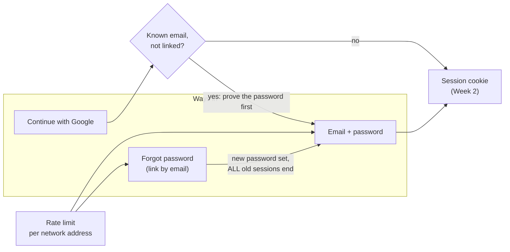
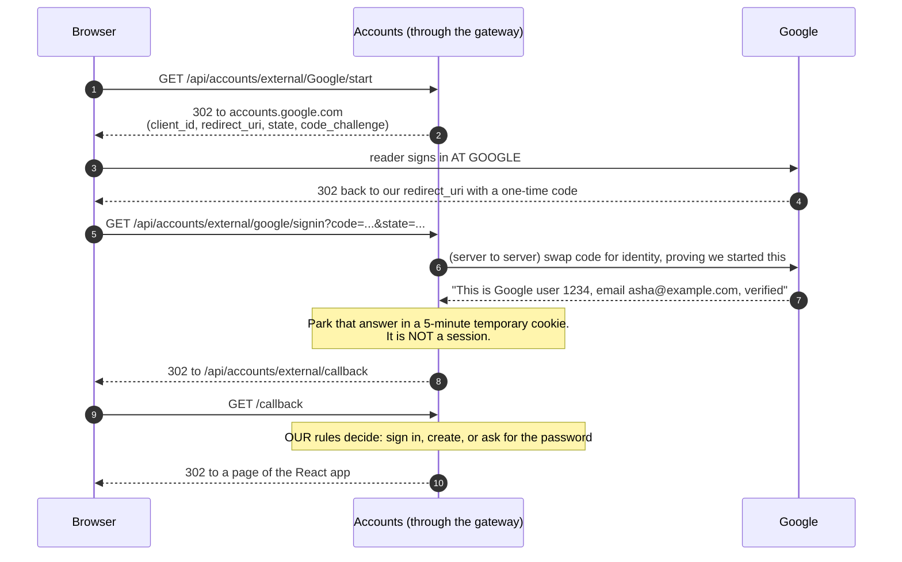
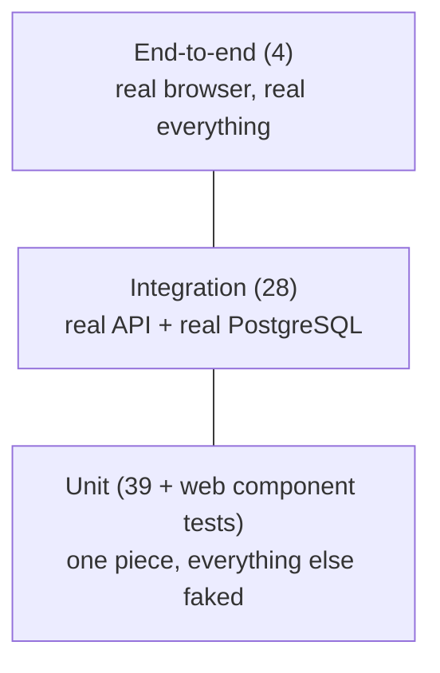
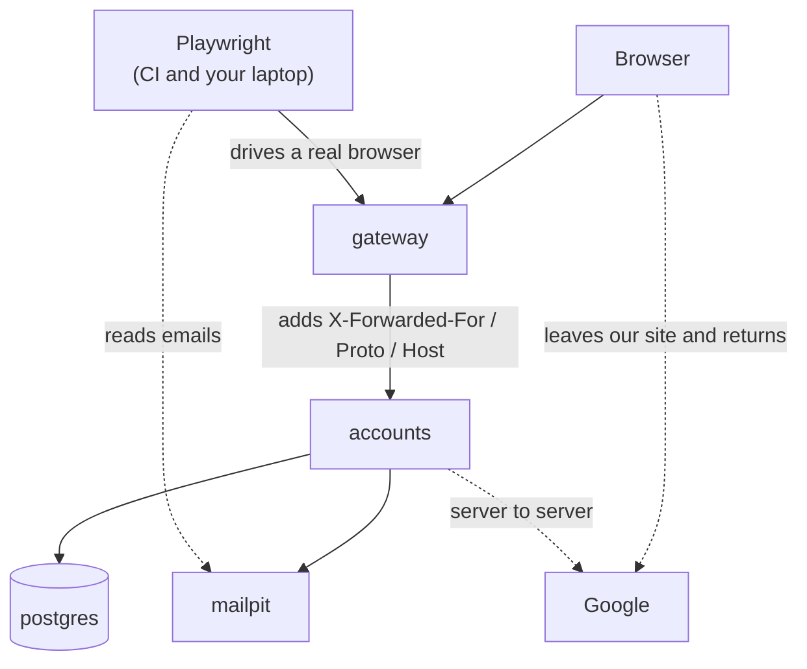
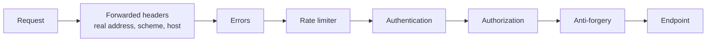
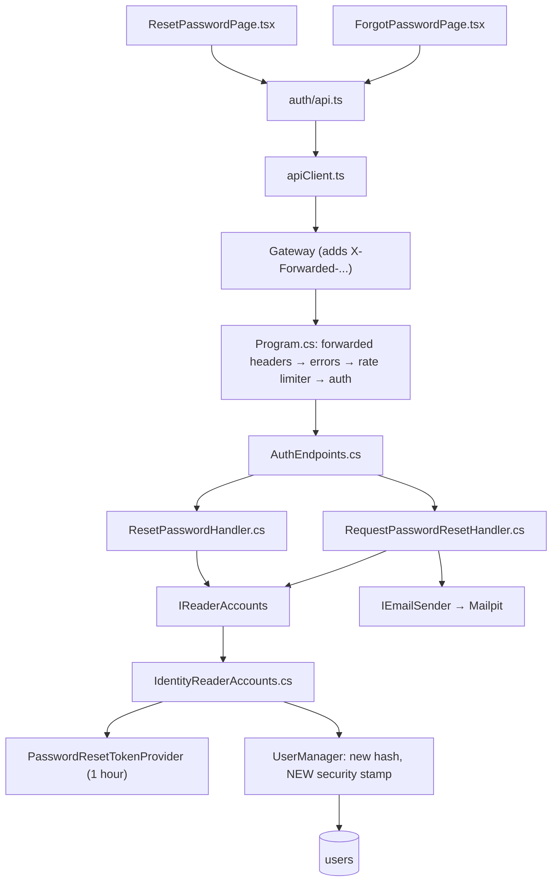
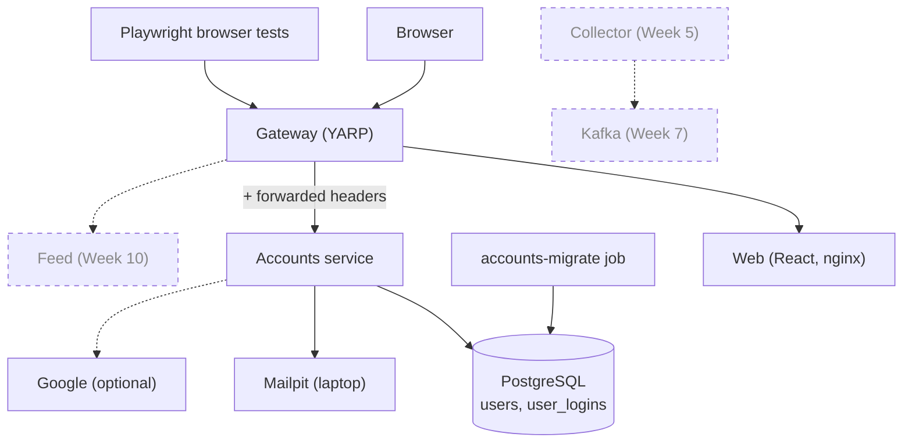

# Building Magpie: A Guided Journey from Empty Folder to Production-Grade System

## Chapter 3 (Week 3): Locking the Door Properly. Password Reset, Google Sign-in and Rate Limits

> **What you will have at the end of this chapter:** a reader who forgets their password can get back in safely; a reader can press "Continue with Google"; an attacker guessing passwords is slowed to a crawl; and a real browser, driven by a robot, proves all the journeys work on every push.

| | |
|---|---|
| **Week** | 3 of 26 |
| **Plan step** | Step 2, Login and signup (part 2 of 2) |
| **Time budget** | About 8 hours |
| **You need** | Chapter 2 finished and running |
| **Repository** | https://github.com/ankitchoubey800/magpie |
| **Code for this chapter** | Commit `81736f8` on branch `week-03` (pull request #2, stacked on `week-02`). Every link in this chapter points at that exact commit |

---

### How this chapter was checked (read this first)

| What | Where it was run | Result |
|---|---|---|
| .NET: 67 tests (39 unit, 28 against a real PostgreSQL) | GitHub Actions | `Passed! - Failed: 0, Passed: 67, Skipped: 0, Total: 67` |
| Website: lint, 29 tests, build | Author's workspace and GitHub Actions | Passed |
| **Browser tests: 4 journeys in real Chromium** against the Docker Compose system, including the cookie flags as the browser reports them | GitHub Actions (Playwright) | `4 passed (7.5s)`, after fixing a flaky test (Step 9) |
| Password reset end to end, including "old sessions end" | Integration tests and browser test | Passed |
| Rate limit and lockout under fast guessing | GitHub Actions (`infra/smoke/guess_passwords.py`) | Real output in section 6 |
| "Continue with Google" **up to the moment the browser leaves for Google**: the redirect carries our correct public address | GitHub Actions | Real output in Step 8 |
| The account-linking rules after Google answers | Integration tests with a stand-in for Google | Passed (8 tests) |
| **Not verified by anyone:** the round trip through the **real** Google. It needs a Google client id and secret that only you can create | | You do this (Step 8). Everything on our side of that round trip is tested |
| **Not yet run:** anything on your own laptop | | You do this. It is closing item 2 |

The full evidence is public: https://github.com/ankitchoubey800/magpie/actions/runs/43808692288

One item from Chapter 2's "nobody has done this yet" list is now closed: the pages have been opened in a real browser, and the session cookie's `HttpOnly`, `Secure` and `SameSite=Lax` flags were read back from Chromium itself.

---

## 1. The big picture

### What are we building this week?

Last week we fitted a door and a lock. This week is everything a locksmith would tell you that you forgot:

1. **A spare-key procedure.** People forget passwords. The way back in must not become the way in for a burglar.
2. **A second entrance.** "Continue with Google" lets a reader in without creating yet another password. The danger is two entrances leading to the same room by accident.
3. **A slow lock.** Someone trying every key on the ring should get eight tries a minute, not eight thousand.
4. **A night watchman.** A robot that walks every journey in a real browser, every time the code changes.



**Reading the diagram:** three ways in, one kind of session at the end. Two of the ways pass through a rate limit. The diamond is this week's most important rule: Google may not open an *existing* account until its owner has proven the password once.

### Why does it matter?

Attackers rarely break the front door. They use the side paths: the reset form, the "sign in with" button, the endpoint nobody thought to slow down. An architect is judged less by the happy path than by these edges.

> 🧠 **Pause and think**
> You own `asha@example.com` at Magpie, with a password. Tomorrow a new sign-in provider is added, and it happens to let anyone register *any* email address without checking it. If Magpie links accounts whenever emails match, what can a stranger do? (Answer in section 11.)

### This week's deliverables

1. Forgot-password and reset-password, by a short-lived, single-use emailed link.
2. A reset ends every existing session.
3. "Continue with Google", switched on only when configured, with safe account linking.
4. Rate limiting on every sign-up, sign-in and reset address.
5. The service learns the reader's real network address from the gateway.
6. Playwright browser tests in CI.

---

## 2. Concepts first

### 2.1 Password reset: a spare key by post

The reset link is the confirmation link's dangerous cousin. A confirmation link only proves an address; a reset link **hands over the account**. So it gets stricter rules:

| Rule | Why |
|---|---|
| Lives for **1 hour** (confirmation: 24 hours) | Old emails sit in inboxes for years |
| Works **once** | A link in browser history or a forwarded email must be dead |
| Using it **ends every session** | If the reset is because someone else got in, they must be thrown out |
| The form says the same thing for known and unknown emails | The enumeration rule from Week 2 |
| Only sent to **confirmed** accounts | An unconfirmed address has not proven it is reachable |

### 2.2 The security stamp: one switch that does two jobs

Every account has a **security stamp**: a random value that changes whenever the account's credentials change. Two things are built from it:

- The reset **token** is sealed together with the stamp. After a successful reset the stamp changes, so the same token no longer matches. That is how "works once" happens without us storing used tokens anywhere.
- Every session **cookie** carries the stamp it was issued with. The server re-checks cookies against the account from time to time. After the stamp changes, old cookies fail the check. That is "ends every session".

This is the fix for last week's break-it finding (a copied cookie outliving sign-out). The re-check interval is a dial:

| Re-check every... | Stolen cookie works for at most... | Cost |
|---|---|---|
| 30 minutes (framework default) | 30 minutes after a reset | Almost nothing |
| **5 minutes (our setting)** | 5 minutes | One small database read per reader every 5 minutes |
| Every request | 0 | A database read on every request |

### 2.3 OAuth and OpenID Connect, now for real

Last chapter's side lesson becomes code. When a reader presses "Continue with Google":



**Reading the diagram:** Google's password never touches us (step 3 happens on Google's site). The browser only ever carries a one-time **code**; the real identity is fetched by our server directly (steps 6 and 7). Steps 1 to 8 are handled by a Microsoft library. Step 10 is ours, and it is where the security decision lives.

Words you will meet:

- **Client id / client secret**: our application's username and password *at Google*.
- **Redirect URI**: the exact address Google may send the browser back to. Registered at Google in advance, so a stolen code cannot be delivered elsewhere.
- **State**: a random value we send and expect back, proving the return trip belongs to a journey *we* started. It is the anti-forgery token of this flow.
- **Code challenge (PKCE)**: a second proof, so a code intercepted on the way back is useless to anyone else. You can see `code_challenge` in our real redirect in Step 8.

### 2.4 The account-linking trap

Three situations when Google says "this is `asha@example.com`":

| We have... | We do... |
|---|---|
| This exact Google identity, already linked | Sign in |
| Nobody with that email | Create an account (no password; email counts as confirmed because Google verified it) and sign in |
| **An account with that email, not linked** | **Neither.** Ask for the existing password once, then link |

The third row is the trap. Linking automatically "because the emails match" makes every account only as safe as the sloppiest provider you ever add. Proof of ownership first; then link. This is ADR-0004.

### 2.5 Rate limiting

A **rate limit** caps how many requests one caller may make in a period. Ours: 10 per minute per network address, on the sensitive addresses only.

A nightclub analogy for the common methods:

| Method | How it works | Feel |
|---|---|---|
| **Fixed window** (ours) | "10 people per minute", counter resets on the minute | Simple; allows a burst at the boundary (10 at 0:59, 10 at 1:00) |
| Sliding window | The same, but measured over the *last 60 seconds* | Smoother, a little more bookkeeping |
| Token bucket | A bucket refills at a steady rate; each request takes a token | Allows short bursts, enforces a long-run average |

Fixed window is the easiest to reason about and enough for sign-in. Week 17 compares them properly at the gateway.

**Rate limit and lockout are different tools:**

| | Lockout (Week 2) | Rate limit (this week) |
|---|---|---|
| Counts by | Account | Caller's network address |
| Stops | Many guesses at **one** account | Many guesses from **one** place, across any accounts |
| Weakness | Attacker can lock a victim out on purpose | Attacker with many addresses spreads out |
| Answer | 401 (indistinguishable, on purpose) | 429 with `Retry-After` |

Each covers the other's weakness. You want both.

### 2.6 "Who is really calling?" Forwarded headers

Here is a subtle problem. Every request reaches Accounts **from the gateway**. So from Accounts' point of view, every reader has the same address: the gateway's. A rate limit per address would then be one shared limit for the whole world.

The gateway knows the truth, and passes it on in three headers:

| Header | Carries |
|---|---|
| `X-Forwarded-For` | The reader's real network address |
| `X-Forwarded-Proto` | Whether the reader used `http` or `https` |
| `X-Forwarded-Host` | The address the reader typed (`localhost:8080`) |

Accounts must be told to believe them. Like a letter forwarded by a hotel reception: you trust the "originally from" note because you trust the reception.

> ⚠️ **Watch out**
> Only believe these headers from something you control. A service that can be reached directly from the internet and trusts `X-Forwarded-For` lets any caller *type* their own address and dodge every limit. This is why Week 17 closes the direct port.

The third header fixes a second problem: without it, Accounts would tell Google to send people back to `http://accounts:8080/...`, an address that only exists inside Docker.

### 2.7 Open redirects

Our start address accepts `returnUrl`, so the reader lands where they were heading. If we redirected to *any* value, an attacker could send people a genuine Magpie link that, after a genuine sign-in, drops them on a fake look-alike site asking them to "sign in again". This is an **open redirect**. The rule: only ever redirect to a path on our own site.

### 2.8 End-to-end tests

So far our tests poke at parts. An **end-to-end (E2E)** test drives the whole system through a real browser, exactly as a person would: click, type, read the email, click the link.



**Reading the diagram:** the same pyramid as Chapter 1, with a new top. End-to-end tests are the slowest and the most fragile, so there are few of them, and each covers a whole journey. They catch what nothing else can: the pieces working individually but not together.

We use **Playwright**, which controls a real Chromium.

---

## 3. Architecture and decisions

### 3.1 What changes



**Reading the diagram:** no new containers. Two new relationships: Accounts now talks to Google (only when configured), and a test robot drives the system from outside, reading Mailpit like a person reading an inbox.

### 3.2 The pipeline now



**Reading the diagram:** two new stations. Forwarded headers must be **first**, because everything after it (the rate limiter's "who is this?", Google's "where do I send them back?") depends on the corrected values. The rate limiter sits before authentication: a refused request should cost us as little work as possible.

### 3.3 Decisions

| # | Decision | Why | Recorded in |
|---|---|---|---|
| 1 | Reset tokens from their own token maker with a 1-hour life | A reset link is far more dangerous than a confirmation link | This chapter |
| 2 | Session re-check every 5 minutes (was the 30-minute default) | Your Week 2 break-it finding; bounded cost | This chapter; `Accounts:SessionRecheckMinutes` |
| 3 | A successful reset also lifts lockout | The reader has just proven they own the mailbox | This chapter |
| 4 | Never link an outside identity by email alone | See 2.4 | ADR-0004 |
| 5 | Google is registered only if a client id and secret are configured | The laptop and CI must work with no Google account; the button simply does not appear | This chapter |
| 6 | Outside sign-in sits behind a port, `IExternalSignIn` | The linking rules are testable with a stand-in for Google | This chapter |
| 7 | Rate limit inside Accounts now; the gateway takes over the general case in Week 17 | The guide's order; the service knows which of its addresses are sensitive | Guide |
| 8 | Services trust the gateway's forwarded headers | Needed for both the rate limit and Google's return address | Closes a Week 2 carried item |
| 9 | Playwright tests run against Docker Compose, not a special test build | Tests what readers will actually get | This chapter |

### 3.4 Files changed from earlier weeks

| File | Change |
|---|---|
| `Magpie.Defaults/MagpieDefaultsExtensions.cs` | New `TrustGatewayForwardedHeaders()` |
| `Application/Abstractions/IReaderAccounts.cs`, `AccountLinks.cs`, `Registration/AccountEmails.cs` | Reset methods, reset link, reset email |
| `Infrastructure/Identity/IdentityReaderAccounts.cs`, `DependencyInjection.cs` | Reset implementation; token maker; new adapter registered |
| `Api/Options/AccountsOptions.cs`, `Security/SecuritySetup.cs`, `Endpoints/AuthEndpoints.cs`, `AuthContracts.cs`, `Program.cs`, `appsettings.json`, `.csproj` | Two settings, Google, rate limiting, two endpoints, two pipeline steps |
| `Tests/Fakes/FakeReaderAccounts.cs`, `Integration/AccountsApiFactory.cs`, `ApiSession.cs` | New port methods; test settings; stand-in Google; reset-link reader |
| `web`: `features/auth/api.ts`, `SignInPage.tsx`, `app/App.tsx`, `index.css`, `test/fakeServer.ts`, `vite.config.ts` | New calls, Google button, routes |
| `infra/docker-compose.yml`, `.env.example`, `smoke/auth_flow.py`, `.github/workflows/ci.yml` | New settings; shared pretend browser; browser tests and experiments in CI |

---

## 4. Implementation guide

Start a branch from last week's: `git switch week-02 && git switch -c week-03`.

### Step 1: Teach services who is really calling

**What:** one method in the shared library, called by services that sit behind the gateway.
**Why:** see 2.6. Without it, this week's rate limit and Google redirect are both wrong.

Replace `MagpieDefaultsExtensions.cs`. The new part is `TrustGatewayForwardedHeaders`:

**`src/shared/Magpie.Defaults/MagpieDefaultsExtensions.cs`**

```csharp
using System.Diagnostics;
using System.Text.Json;
using Microsoft.AspNetCore.Builder;
using Microsoft.AspNetCore.Diagnostics.HealthChecks;
using Microsoft.AspNetCore.Http;
using Microsoft.AspNetCore.HttpOverrides;
using Microsoft.Extensions.DependencyInjection;
using Microsoft.Extensions.Diagnostics.HealthChecks;
using Microsoft.Extensions.Hosting;
using Microsoft.Extensions.Logging;

namespace Magpie.Defaults;

/// <summary>
/// The things EVERY Magpie service must do the same way: logging, error format
/// and health endpoints. A service calls three methods and gets all of it.
/// </summary>
public static class MagpieDefaultsExtensions
{
    /// <summary>Tag for checks that answer "is this process alive?".</summary>
    public const string LiveTag = "live";

    /// <summary>Tag for checks that answer "can this service do useful work right now?".</summary>
    public const string ReadyTag = "ready";

    public static WebApplicationBuilder AddMagpieDefaults(this WebApplicationBuilder builder, string serviceName)
    {
        // 1. LOGGING
        // On your laptop: short, human-friendly lines.
        // Everywhere else: one JSON object per line, which log tools can search and filter.
        builder.Logging.ClearProviders();
        if (builder.Environment.IsDevelopment())
        {
            builder.Logging.AddSimpleConsole(options =>
            {
                options.SingleLine = true;
                options.TimestampFormat = "HH:mm:ss ";
            });
        }
        else
        {
            builder.Logging.AddJsonConsole(options =>
            {
                options.IncludeScopes = true;
                options.UseUtcTimestamp = true;
                options.TimestampFormat = "yyyy-MM-ddTHH:mm:ss.fffZ";
            });
        }

        // 2. ONE ERROR FORMAT (Problem Details, RFC 9457)
        // Every error response from every service gets the same two extra fields.
        builder.Services.AddProblemDetails(options =>
        {
            options.CustomizeProblemDetails = context =>
            {
                context.ProblemDetails.Instance ??= context.HttpContext.Request.Path;
                context.ProblemDetails.Extensions["service"] = serviceName;
                context.ProblemDetails.Extensions["traceId"] =
                    Activity.Current?.Id ?? context.HttpContext.TraceIdentifier;
            };
        });

        // The safety net for any exception nobody else handled.
        // Services may register more specific handlers BEFORE calling AddMagpieDefaults.
        builder.Services.AddExceptionHandler<UnhandledExceptionHandler>();

        // 3. HEALTH CHECKS
        // "self" always passes: if the process can answer at all, it is alive.
        builder.Services.AddHealthChecks()
            .AddCheck("self", () => HealthCheckResult.Healthy(), tags: [LiveTag]);

        return builder;
    }

    /// <summary>
    /// For services that sit BEHIND the gateway. The gateway is the one that talks
    /// to the browser, so only it knows the reader's real network address and the
    /// address they typed. It passes these on in "X-Forwarded-..." headers. This
    /// tells the service to believe them.
    ///
    /// NEVER call this in the gateway itself: there the caller is the open
    /// internet, and anyone could type those headers by hand.
    /// </summary>
    public static WebApplicationBuilder TrustGatewayForwardedHeaders(this WebApplicationBuilder builder)
    {
        builder.Services.Configure<ForwardedHeadersOptions>(options =>
        {
            options.ForwardedHeaders =
                ForwardedHeaders.XForwardedFor | ForwardedHeaders.XForwardedProto | ForwardedHeaders.XForwardedHost;

            // By default only a proxy on the same machine is believed. In Docker
            // the gateway has its own address, so we accept any sender. That is
            // safe only while the service can be reached through the gateway alone.
            options.KnownIPNetworks.Clear();
            options.KnownProxies.Clear();
        });

        return builder;
    }

    /// <summary>Adds the error-handling middleware. Call this first, right after Build().</summary>
    public static WebApplication UseMagpieDefaults(this WebApplication app)
    {
        // Catches exceptions and hands them to the registered IExceptionHandler classes.
        app.UseExceptionHandler();

        // Gives a Problem Details body to error responses that have none (for example a bare 404).
        app.UseStatusCodePages();

        return app;
    }

    public static WebApplication MapMagpieHealthEndpoints(this WebApplication app)
    {
        // Liveness: only the "self" check. It must NOT depend on the database,
        // otherwise a database outage would make the platform restart healthy processes.
        app.MapHealthChecks("/health/live", new HealthCheckOptions
        {
            Predicate = check => check.Tags.Contains(LiveTag),
            ResponseWriter = WriteHealthResponse,
        });

        // Readiness: every registered check, including dependencies such as PostgreSQL.
        app.MapHealthChecks("/health/ready", new HealthCheckOptions
        {
            Predicate = _ => true,
            ResponseWriter = WriteHealthResponse,
        });

        return app;
    }

    private static readonly JsonSerializerOptions HealthJsonOptions = new(JsonSerializerDefaults.Web);

    // The built-in writer only prints the word "Healthy" or "Unhealthy".
    // This one also lists each check, so you can see WHICH dependency failed.
    // It deliberately leaves out exception messages: health endpoints are easy to reach.
    private static Task WriteHealthResponse(HttpContext context, HealthReport report)
    {
        var body = new
        {
            status = report.Status.ToString(),
            checks = report.Entries.Select(entry => new
            {
                name = entry.Key,
                status = entry.Value.Status.ToString(),
                durationMs = Math.Round(entry.Value.Duration.TotalMilliseconds, 1),
            }),
        };

        return context.Response.WriteAsJsonAsync(body, HealthJsonOptions);
    }
}
```

Verified with a small sample before it went into the project: a request carrying `X-Forwarded-For: 203.0.113.9`, `X-Forwarded-Proto: https`, `X-Forwarded-Host: magpie.example` was seen by the endpoint as coming from `203.0.113.9` over `https` at `magpie.example`.

> **GitHub (verified at commit `81736f8`):** [`MagpieDefaultsExtensions.cs`](https://github.com/ankitchoubey800/magpie/blob/81736f8fc1f466ac0878278e5da38c6820ca513c/src/shared/Magpie.Defaults/MagpieDefaultsExtensions.cs)

**Check:** `dotnet build src/shared/Magpie.Defaults` succeeds.

> ❓ **Q&A**
> **Q: Why is this not simply part of `AddMagpieDefaults`?**
> A: Because the gateway also uses the defaults, and the gateway must **not** trust these headers: its callers are the open internet. A separate, loudly named method makes the choice visible in each `Program.cs`.
> **Q: "Accept any sender" sounds dangerous.**
> A: It would be on a service reachable from outside. Ours is reachable only through the gateway (plus a laptop-only debugging port that Week 17 removes). The risk is written down in section 8.

### Step 2: Application, the reset use cases and the outside sign-in port

Extend the accounts port with two methods and their result types:

**`src/services/accounts/Magpie.Accounts.Application/Abstractions/IReaderAccounts.cs`**

```csharp
using Magpie.Accounts.Domain;

namespace Magpie.Accounts.Application.Abstractions;

/// <summary>
/// The port for everything that touches stored accounts and sign-in sessions.
/// The use cases say WHAT they need; Infrastructure implements it with
/// ASP.NET Core Identity. No use case ever sees a password hash.
/// </summary>
public interface IReaderAccounts
{
    /// <summary>Creates an unconfirmed account, or explains why it could not.</summary>
    Task<CreateAccountResult> CreateAsync(EmailAddress email, string password, CancellationToken cancellationToken);

    /// <summary>
    /// Returns a fresh confirmation token if an account with this email exists
    /// and is still unconfirmed; otherwise null.
    /// </summary>
    Task<PendingConfirmation?> GetPendingConfirmationAsync(EmailAddress email, CancellationToken cancellationToken);

    /// <summary>True when the token was valid and the email is now confirmed.</summary>
    Task<bool> ConfirmEmailAsync(string readerId, string token, CancellationToken cancellationToken);

    /// <summary>
    /// Checks the password and, if everything is in order, starts a session.
    /// Returns only true or false ON PURPOSE: the caller must not be able to
    /// tell "wrong password" from "no such account" from "locked out".
    /// </summary>
    Task<bool> SignInAsync(EmailAddress email, string password, CancellationToken cancellationToken);

    Task SignOutAsync(CancellationToken cancellationToken);

    /// <summary>
    /// Returns a fresh reset token if a CONFIRMED account with this email exists;
    /// otherwise null.
    /// </summary>
    Task<PasswordResetTicket?> CreatePasswordResetAsync(EmailAddress email, CancellationToken cancellationToken);

    /// <summary>
    /// Sets a new password if the token is valid. A successful reset also makes
    /// the token unusable and ends every existing session of that reader.
    /// </summary>
    Task<ResetPasswordResult> ResetPasswordAsync(
        string readerId, string token, string newPassword, CancellationToken cancellationToken);
}

/// <summary>What a reader needs in order to choose a new password.</summary>
public sealed record PasswordResetTicket(string ReaderId, string Token);

public enum ResetPasswordStatus
{
    Done,
    InvalidLink,
    RejectedPassword,
}

public sealed record ResetPasswordResult(ResetPasswordStatus Status, IReadOnlyList<string> Errors)
{
    public static readonly ResetPasswordResult Done = new(ResetPasswordStatus.Done, []);

    public static readonly ResetPasswordResult InvalidLink = new(ResetPasswordStatus.InvalidLink, []);

    public static ResetPasswordResult Rejected(IReadOnlyList<string> errors) =>
        new(ResetPasswordStatus.RejectedPassword, errors);
}

/// <summary>What a reader needs in order to confirm their email address.</summary>
public sealed record PendingConfirmation(string ReaderId, string Token);

public enum CreateAccountStatus
{
    Created,
    AlreadyExists,
    Rejected,
}

public sealed record CreateAccountResult(
    CreateAccountStatus Status,
    PendingConfirmation? Confirmation,
    IReadOnlyList<string> Errors)
{
    public static CreateAccountResult Created(PendingConfirmation confirmation) =>
        new(CreateAccountStatus.Created, confirmation, []);

    public static CreateAccountResult AlreadyExists() =>
        new(CreateAccountStatus.AlreadyExists, null, []);

    public static CreateAccountResult Rejected(IReadOnlyList<string> errors) =>
        new(CreateAccountStatus.Rejected, null, errors);
}
```

Add the reset link (whole file shown):

**`src/services/accounts/Magpie.Accounts.Application/Abstractions/AccountLinks.cs`**

```csharp
namespace Magpie.Accounts.Application.Abstractions;

/// <summary>
/// Builds the links we put in emails. The site address comes from OUR
/// configuration, never from the incoming request: an attacker can put any
/// host name they like in a request, and we must not email it to our readers.
/// </summary>
public sealed class AccountLinks(Uri publicBaseUrl)
{
    public Uri ConfirmEmail(PendingConfirmation confirmation)
    {
        var query =
            $"readerId={Uri.EscapeDataString(confirmation.ReaderId)}&token={Uri.EscapeDataString(confirmation.Token)}";

        return new Uri(publicBaseUrl, $"/confirm-email?{query}");
    }

    public Uri ResetPassword(PasswordResetTicket ticket)
    {
        var query =
            $"readerId={Uri.EscapeDataString(ticket.ReaderId)}&token={Uri.EscapeDataString(ticket.Token)}";

        return new Uri(publicBaseUrl, $"/reset-password?{query}");
    }

    public Uri SignIn() => new(publicBaseUrl, "/sign-in");
}
```

Add the reset email:

**`src/services/accounts/Magpie.Accounts.Application/Registration/AccountEmails.cs`**

```csharp
using Magpie.Accounts.Application.Abstractions;
using Magpie.Accounts.Domain;

namespace Magpie.Accounts.Application.Registration;

/// <summary>The exact words of the emails this service sends. One place to edit them.</summary>
public static class AccountEmails
{
    public static EmailMessage ConfirmYourEmail(EmailAddress to, Uri confirmLink) => new(
        to.Value,
        "Confirm your email for Magpie",
        $"""
         Welcome to Magpie.

         Open this link to confirm your email address:
         {confirmLink}

         The link works for 24 hours. If you did not create a Magpie account, ignore this email and nothing will happen.
         """);

    public static EmailMessage AlreadyRegistered(EmailAddress to, Uri signInLink) => new(
        to.Value,
        "You already have a Magpie account",
        $"""
         Someone (probably you) tried to create a Magpie account with this email address, but one already exists.

         You can sign in here:
         {signInLink}

         If this was not you, there is nothing you need to do. Your account has not been changed.
         """);

    public static EmailMessage ResetYourPassword(EmailAddress to, Uri resetLink) => new(
        to.Value,
        "Reset your Magpie password",
        $"""
         Someone (probably you) asked to reset the password for this Magpie account.

         Open this link to choose a new password:
         {resetLink}

         The link works for 1 hour and only once. If you did not ask for this, ignore this email. Your password has not been changed.
         """);
}
```

Create a `PasswordReset` folder with the two use cases:

**`src/services/accounts/Magpie.Accounts.Application/PasswordReset/RequestPasswordResetHandler.cs`**

```csharp
using Magpie.Accounts.Application.Abstractions;
using Magpie.Accounts.Application.Registration;
using Magpie.Accounts.Domain;

namespace Magpie.Accounts.Application.PasswordReset;

/// <summary>
/// Use case: "I forgot my password." Like registration, it never reveals
/// whether the email has an account: it returns nothing either way.
/// </summary>
public sealed class RequestPasswordResetHandler(IReaderAccounts accounts, IEmailSender emailSender, AccountLinks links)
{
    public async Task HandleAsync(string? email, CancellationToken cancellationToken)
    {
        if (!EmailAddress.TryCreate(email, out var address))
        {
            return;
        }

        var ticket = await accounts.CreatePasswordResetAsync(address!, cancellationToken);
        if (ticket is null)
        {
            // No confirmed account with this email. Say nothing, send nothing.
            return;
        }

        await emailSender.SendAsync(
            AccountEmails.ResetYourPassword(address!, links.ResetPassword(ticket)), cancellationToken);
    }
}
```

**`src/services/accounts/Magpie.Accounts.Application/PasswordReset/ResetPasswordHandler.cs`**

```csharp
using Magpie.Accounts.Application.Abstractions;

namespace Magpie.Accounts.Application.PasswordReset;

/// <summary>Use case: the reader opened the reset link and typed a new password.</summary>
public sealed class ResetPasswordHandler(IReaderAccounts accounts)
{
    public Task<ResetPasswordResult> HandleAsync(
        string? readerId, string? token, string? newPassword, CancellationToken cancellationToken)
    {
        if (string.IsNullOrWhiteSpace(readerId) || string.IsNullOrWhiteSpace(token))
        {
            return Task.FromResult(ResetPasswordResult.InvalidLink);
        }

        if (string.IsNullOrEmpty(newPassword))
        {
            return Task.FromResult(ResetPasswordResult.Rejected(["Enter a new password."]));
        }

        return accounts.ResetPasswordAsync(readerId, token, newPassword, cancellationToken);
    }
}
```

And the new port. Read the comment on each outcome: this `enum` is section 2.4 written as code.

**`src/services/accounts/Magpie.Accounts.Application/Abstractions/IExternalSignIn.cs`**

```csharp
namespace Magpie.Accounts.Application.Abstractions;

/// <summary>
/// The port for "Continue with Google" (and any later outside sign-in provider).
/// By the time these methods run, the provider has already told us who the
/// visitor is; that answer is waiting in a short-lived temporary cookie.
/// </summary>
public interface IExternalSignIn
{
    /// <summary>The claim in which the provider says "we checked that this email belongs to this person".</summary>
    public const string EmailVerifiedClaim = "email_verified";

    /// <summary>Finishes the sign-in that the provider just vouched for.</summary>
    Task<ExternalSignInOutcome> CompleteAsync(CancellationToken cancellationToken);

    /// <summary>
    /// Connects the waiting outside identity to the reader who has just proven,
    /// with their password, that the existing account is theirs.
    /// </summary>
    Task<bool> LinkPendingToReaderAsync(string readerId, CancellationToken cancellationToken);
}

public enum ExternalSignInOutcome
{
    /// <summary>This outside identity was already linked to an account. Signed in.</summary>
    SignedIn,

    /// <summary>First visit, and nobody has this email yet. Account created and signed in.</summary>
    AccountCreated,

    /// <summary>
    /// An account with this email already exists and is not linked. We do NOT
    /// sign in or link. The reader must first prove they own the existing account.
    /// </summary>
    NeedsPasswordToLink,

    /// <summary>The provider gave us nothing usable (no verified email, cancelled, expired).</summary>
    Failed,
}
```

> **GitHub (verified at commit `81736f8`):** [`IReaderAccounts.cs`](https://github.com/ankitchoubey800/magpie/blob/81736f8fc1f466ac0878278e5da38c6820ca513c/src/services/accounts/Magpie.Accounts.Application/Abstractions/IReaderAccounts.cs) · [`AccountLinks.cs`](https://github.com/ankitchoubey800/magpie/blob/81736f8fc1f466ac0878278e5da38c6820ca513c/src/services/accounts/Magpie.Accounts.Application/Abstractions/AccountLinks.cs) · [`AccountEmails.cs`](https://github.com/ankitchoubey800/magpie/blob/81736f8fc1f466ac0878278e5da38c6820ca513c/src/services/accounts/Magpie.Accounts.Application/Registration/AccountEmails.cs) · [`RequestPasswordResetHandler.cs`](https://github.com/ankitchoubey800/magpie/blob/81736f8fc1f466ac0878278e5da38c6820ca513c/src/services/accounts/Magpie.Accounts.Application/PasswordReset/RequestPasswordResetHandler.cs) · [`ResetPasswordHandler.cs`](https://github.com/ankitchoubey800/magpie/blob/81736f8fc1f466ac0878278e5da38c6820ca513c/src/services/accounts/Magpie.Accounts.Application/PasswordReset/ResetPasswordHandler.cs) · [`IExternalSignIn.cs`](https://github.com/ankitchoubey800/magpie/blob/81736f8fc1f466ac0878278e5da38c6820ca513c/src/services/accounts/Magpie.Accounts.Application/Abstractions/IExternalSignIn.cs)

**Check:** `dotnet build src/services/accounts/Magpie.Accounts.Application` succeeds; the project still references only Domain.

> ❓ **Q&A**
> **Q: `ResetPasswordHandler` checks for an empty password *before* calling the port. Why does the order matter?**
> A: A reset token is spent when it is used successfully. We never want a reader to burn their one link on a mistake we could have caught first. A test in Step 6 goes further: a *weak* password is refused and the same link still works afterwards.
> **Q: Why three result values for a reset instead of true/false?**
> A: The reader needs different help in each case: "ask for a new link" versus "choose a stronger password". Unlike sign-in, telling them apart leaks nothing about other people.

### Step 3: Infrastructure, reset tokens and the outside sign-in adapter

A token maker used only for reset links:

**`src/services/accounts/Magpie.Accounts.Infrastructure/Identity/PasswordResetTokenProvider.cs`**

```csharp
using Microsoft.AspNetCore.DataProtection;
using Microsoft.AspNetCore.Identity;
using Microsoft.Extensions.Logging;
using Microsoft.Extensions.Options;

namespace Magpie.Accounts.Infrastructure.Identity;

/// <summary>
/// A token maker used ONLY for password-reset links, so they can have a much
/// shorter life (1 hour) than email-confirmation links (24 hours). A reset
/// link is more dangerous if it leaks: it hands over the whole account.
/// </summary>
internal sealed class PasswordResetTokenProvider(
    IDataProtectionProvider dataProtectionProvider,
    IOptions<PasswordResetTokenProviderOptions> options,
    ILogger<DataProtectorTokenProvider<ApplicationUser>> logger)
    : DataProtectorTokenProvider<ApplicationUser>(dataProtectionProvider, options, logger)
{
    public const string ProviderName = "MagpiePasswordReset";
}

internal sealed class PasswordResetTokenProviderOptions : DataProtectionTokenProviderOptions
{
    public PasswordResetTokenProviderOptions()
    {
        Name = PasswordResetTokenProvider.ProviderName;
        TokenLifespan = TimeSpan.FromHours(1);
    }
}
```

The accounts adapter gains the two reset methods (whole file shown; the link-safe encoding from Week 2 is now two small helper methods):

**`src/services/accounts/Magpie.Accounts.Infrastructure/Identity/IdentityReaderAccounts.cs`**

```csharp
using System.Text;
using Magpie.Accounts.Application.Abstractions;
using Magpie.Accounts.Domain;
using Microsoft.AspNetCore.Identity;
using Microsoft.AspNetCore.WebUtilities;

namespace Magpie.Accounts.Infrastructure.Identity;

/// <summary>
/// The adapter behind the IReaderAccounts port, built on ASP.NET Core Identity.
/// UserManager stores and checks accounts; SignInManager writes the session cookie.
/// </summary>
internal sealed class IdentityReaderAccounts(
    UserManager<ApplicationUser> users,
    SignInManager<ApplicationUser> signIn,
    TimeProvider timeProvider) : IReaderAccounts
{
    public async Task<CreateAccountResult> CreateAsync(
        EmailAddress email, string password, CancellationToken cancellationToken)
    {
        var user = new ApplicationUser
        {
            Id = Guid.CreateVersion7(),
            UserName = email.Value,
            Email = email.Value,
            CreatedAtUtc = timeProvider.GetUtcNow(),
        };

        // CreateAsync hashes the password. The plain password is never stored and never logged.
        var result = await users.CreateAsync(user, password);
        if (result.Succeeded)
        {
            return CreateAccountResult.Created(await CreateConfirmationAsync(user));
        }

        var isDuplicate = result.Errors.Any(error =>
            error.Code is nameof(IdentityErrorDescriber.DuplicateEmail) or nameof(IdentityErrorDescriber.DuplicateUserName));

        return isDuplicate
            ? CreateAccountResult.AlreadyExists()
            : CreateAccountResult.Rejected(result.Errors.Select(error => error.Description).ToList());
    }

    public async Task<PendingConfirmation?> GetPendingConfirmationAsync(
        EmailAddress email, CancellationToken cancellationToken)
    {
        var user = await users.FindByEmailAsync(email.Value);
        if (user is null || user.EmailConfirmed)
        {
            return null;
        }

        return await CreateConfirmationAsync(user);
    }

    public async Task<bool> ConfirmEmailAsync(string readerId, string token, CancellationToken cancellationToken)
    {
        var user = await users.FindByIdAsync(readerId);
        if (user is null)
        {
            return false;
        }

        if (!TryFromLinkSafe(token, out var rawToken))
        {
            // Someone edited the link. Treat it like any other invalid token.
            return false;
        }

        var result = await users.ConfirmEmailAsync(user, rawToken);
        return result.Succeeded;
    }

    public async Task<bool> SignInAsync(EmailAddress email, string password, CancellationToken cancellationToken)
    {
        // isPersistent: the cookie survives closing the browser, until it expires.
        // lockoutOnFailure: a wrong password counts towards a temporary lockout.
        var result = await signIn.PasswordSignInAsync(
            email.Value, password, isPersistent: true, lockoutOnFailure: true);

        return result.Succeeded;
    }

    public Task SignOutAsync(CancellationToken cancellationToken) => signIn.SignOutAsync();

    public async Task<PasswordResetTicket?> CreatePasswordResetAsync(
        EmailAddress email, CancellationToken cancellationToken)
    {
        var user = await users.FindByEmailAsync(email.Value);
        if (user is null || !user.EmailConfirmed)
        {
            return null;
        }

        var rawToken = await users.GeneratePasswordResetTokenAsync(user);
        return new PasswordResetTicket(user.Id.ToString(), ToLinkSafe(rawToken));
    }

    public async Task<ResetPasswordResult> ResetPasswordAsync(
        string readerId, string token, string newPassword, CancellationToken cancellationToken)
    {
        var user = await users.FindByIdAsync(readerId);
        if (user is null || !TryFromLinkSafe(token, out var rawToken))
        {
            return ResetPasswordResult.InvalidLink;
        }

        // On success Identity also changes the account's "security stamp". That one
        // change does two jobs: this token can never be used again, and every
        // session cookie issued before now stops being accepted.
        var result = await users.ResetPasswordAsync(user, rawToken, newPassword);
        if (!result.Succeeded)
        {
            return result.Errors.Any(error => error.Code == nameof(IdentityErrorDescriber.InvalidToken))
                ? ResetPasswordResult.InvalidLink
                : ResetPasswordResult.Rejected(result.Errors.Select(error => error.Description).ToList());
        }

        // The reader has proven they own the mailbox, so lift any lockout caused
        // by earlier wrong guesses (their own or an attacker's).
        await users.SetLockoutEndDateAsync(user, null);
        await users.ResetAccessFailedCountAsync(user);

        return ResetPasswordResult.Done;
    }

    private async Task<PendingConfirmation> CreateConfirmationAsync(ApplicationUser user)
    {
        var rawToken = await users.GenerateEmailConfirmationTokenAsync(user);
        return new PendingConfirmation(user.Id.ToString(), ToLinkSafe(rawToken));
    }

    // A raw token contains characters such as "+" and "/" that get mangled
    // inside a web address, so we re-encode it in a link-safe alphabet.
    private static string ToLinkSafe(string rawToken) =>
        WebEncoders.Base64UrlEncode(Encoding.UTF8.GetBytes(rawToken));

    private static bool TryFromLinkSafe(string linkSafeToken, out string rawToken)
    {
        try
        {
            rawToken = Encoding.UTF8.GetString(WebEncoders.Base64UrlDecode(linkSafeToken));
            return true;
        }
        catch (FormatException)
        {
            rawToken = "";
            return false;
        }
    }
}
```

The outside sign-in adapter. Match each "Case" comment to a row of the table in 2.4:

**`src/services/accounts/Magpie.Accounts.Infrastructure/Identity/IdentityExternalSignIn.cs`**

```csharp
using System.Security.Claims;
using Magpie.Accounts.Application.Abstractions;
using Magpie.Accounts.Domain;
using Microsoft.AspNetCore.Authentication;
using Microsoft.AspNetCore.Http;
using Microsoft.AspNetCore.Identity;

namespace Magpie.Accounts.Infrastructure.Identity;

/// <summary>
/// The adapter behind IExternalSignIn. The most important rule in this file:
/// an outside identity is NEVER attached to an existing account just because
/// the email addresses match.
/// </summary>
internal sealed class IdentityExternalSignIn(
    UserManager<ApplicationUser> users,
    SignInManager<ApplicationUser> signIn,
    IHttpContextAccessor httpContextAccessor,
    TimeProvider timeProvider) : IExternalSignIn
{
    public async Task<ExternalSignInOutcome> CompleteAsync(CancellationToken cancellationToken)
    {
        // Reads the temporary cookie that the provider's sign-in left behind.
        var info = await signIn.GetExternalLoginInfoAsync();
        if (info is null)
        {
            return ExternalSignInOutcome.Failed;
        }

        // Case 1: we have seen this exact outside identity before.
        var known = await signIn.ExternalLoginSignInAsync(
            info.LoginProvider, info.ProviderKey, isPersistent: true, bypassTwoFactor: true);
        if (known.Succeeded)
        {
            await ForgetPendingAsync();
            return ExternalSignInOutcome.SignedIn;
        }

        // We only ever act on an email the provider says it has verified.
        var email = info.Principal.FindFirstValue(ClaimTypes.Email);
        var verified = info.Principal.FindFirstValue(IExternalSignIn.EmailVerifiedClaim);
        if (known.IsLockedOut
            || !EmailAddress.TryCreate(email, out var address)
            || !string.Equals(verified, "true", StringComparison.OrdinalIgnoreCase))
        {
            await ForgetPendingAsync();
            return ExternalSignInOutcome.Failed;
        }

        // Case 2: an account with this email exists but is not linked.
        // Keep the temporary cookie: the linking step needs it.
        if (await users.FindByEmailAsync(address!.Value) is not null)
        {
            return ExternalSignInOutcome.NeedsPasswordToLink;
        }

        // Case 3: a brand-new reader. No password, and the email counts as
        // confirmed because the provider has verified it.
        var user = new ApplicationUser
        {
            Id = Guid.CreateVersion7(),
            UserName = address.Value,
            Email = address.Value,
            EmailConfirmed = true,
            CreatedAtUtc = timeProvider.GetUtcNow(),
        };

        if (!(await users.CreateAsync(user)).Succeeded || !(await users.AddLoginAsync(user, info)).Succeeded)
        {
            await ForgetPendingAsync();
            return ExternalSignInOutcome.Failed;
        }

        await signIn.SignInAsync(user, isPersistent: true, info.LoginProvider);
        await ForgetPendingAsync();
        return ExternalSignInOutcome.AccountCreated;
    }

    public async Task<bool> LinkPendingToReaderAsync(string readerId, CancellationToken cancellationToken)
    {
        var info = await signIn.GetExternalLoginInfoAsync();
        var user = await users.FindByIdAsync(readerId);
        if (info is null || user is null)
        {
            return false;
        }

        // The waiting identity must be for THIS account's email, not just any.
        var email = info.Principal.FindFirstValue(ClaimTypes.Email);
        if (!string.Equals(email, user.Email, StringComparison.OrdinalIgnoreCase))
        {
            await ForgetPendingAsync();
            return false;
        }

        var result = await users.AddLoginAsync(user, info);
        await ForgetPendingAsync();
        return result.Succeeded;
    }

    private Task ForgetPendingAsync() =>
        httpContextAccessor.HttpContext!.SignOutAsync(IdentityConstants.ExternalScheme);
}
```

Register the new pieces. Replace `DependencyInjection.cs`:

**`src/services/accounts/Magpie.Accounts.Infrastructure/DependencyInjection.cs`**

```csharp
using Magpie.Accounts.Application.Abstractions;
using Magpie.Accounts.Infrastructure.Email;
using Magpie.Accounts.Infrastructure.Identity;
using Magpie.Accounts.Infrastructure.Persistence;
using Magpie.Accounts.Infrastructure.Postgres;
using Microsoft.AspNetCore.Identity;
using Microsoft.Extensions.DependencyInjection;
using Microsoft.Extensions.Options;
using Npgsql;

namespace Magpie.Accounts.Infrastructure;

public static class DependencyInjection
{
    public static IServiceCollection AddAccountsInfrastructure(this IServiceCollection services)
    {
        // --- Settings: read from configuration, checked when the service starts ---
        services.AddOptions<PostgresOptions>()
            .BindConfiguration(PostgresOptions.SectionName)
            .ValidateDataAnnotations()
            .ValidateOnStart();

        services.AddOptions<EmailOptions>()
            .BindConfiguration(EmailOptions.SectionName)
            .ValidateDataAnnotations()
            .ValidateOnStart();

        // --- PostgreSQL: one connection pool for the whole process ---
        services.AddSingleton(serviceProvider =>
            NpgsqlDataSource.Create(serviceProvider.GetRequiredService<IOptions<PostgresOptions>>().Value.AccountsDb!));

        services.AddScoped<IDatabaseTimeSource, PostgresTimeSource>();
        services.AddHealthChecks()
            .AddCheck<PostgresHealthCheck>("postgresql", tags: ["ready"]);

        services.AddAccountsDbContext();

        // --- Accounts: ASP.NET Core Identity ---
        services.AddIdentityCore<ApplicationUser>(options =>
            {
                // Password rules: length matters far more than forcing symbols.
                options.Password.RequiredLength = 10;
                options.Password.RequiredUniqueChars = 4;
                options.Password.RequireDigit = false;
                options.Password.RequireLowercase = false;
                options.Password.RequireUppercase = false;
                options.Password.RequireNonAlphanumeric = false;

                options.User.RequireUniqueEmail = true;

                // No signing in until the email address is proven to be yours.
                options.SignIn.RequireConfirmedEmail = true;

                // Five wrong passwords in a row: wait five minutes.
                options.Lockout.AllowedForNewUsers = true;
                options.Lockout.MaxFailedAccessAttempts = 5;
                options.Lockout.DefaultLockoutTimeSpan = TimeSpan.FromMinutes(5);
            })
            .AddSignInManager()
            .AddDefaultTokenProviders()
            .AddTokenProvider<PasswordResetTokenProvider>(PasswordResetTokenProvider.ProviderName)
            .AddAccountsStores();

        // Reset links use their own, shorter-lived token maker.
        services.Configure<IdentityOptions>(options =>
            options.Tokens.PasswordResetTokenProvider = PasswordResetTokenProvider.ProviderName);

        services.AddScoped<IReaderAccounts, IdentityReaderAccounts>();
        services.AddScoped<IExternalSignIn, IdentityExternalSignIn>();

        // --- Email ---
        services.AddScoped<IEmailSender, SmtpEmailSender>();

        return services;
    }
}
```

> **GitHub (verified at commit `81736f8`):** [`PasswordResetTokenProvider.cs`](https://github.com/ankitchoubey800/magpie/blob/81736f8fc1f466ac0878278e5da38c6820ca513c/src/services/accounts/Magpie.Accounts.Infrastructure/Identity/PasswordResetTokenProvider.cs) · [`IdentityReaderAccounts.cs`](https://github.com/ankitchoubey800/magpie/blob/81736f8fc1f466ac0878278e5da38c6820ca513c/src/services/accounts/Magpie.Accounts.Infrastructure/Identity/IdentityReaderAccounts.cs) · [`IdentityExternalSignIn.cs`](https://github.com/ankitchoubey800/magpie/blob/81736f8fc1f466ac0878278e5da38c6820ca513c/src/services/accounts/Magpie.Accounts.Infrastructure/Identity/IdentityExternalSignIn.cs) · [`DependencyInjection.cs`](https://github.com/ankitchoubey800/magpie/blob/81736f8fc1f466ac0878278e5da38c6820ca513c/src/services/accounts/Magpie.Accounts.Infrastructure/DependencyInjection.cs)

**Check:** `dotnet build src/services/accounts/Magpie.Accounts.Infrastructure` succeeds.

> ❓ **Q&A**
> **Q: Where is the code that makes a reset link single-use?**
> A: There is none of ours. `ResetPasswordAsync` changes the security stamp, and the token was sealed with the old stamp (2.2). A test proves it: the second use of the same link gets "This reset link does not work".
> **Q: In `LinkPendingToReaderAsync`, the reader is already signed in. Why check the email again?**
> A: Otherwise a signed-in attacker could hold a pending Google identity for *someone else's* email and attach it to their own account, or more dangerously the reverse flow in a shared browser. The check pins the waiting identity to the one account it was offered for. There is a test named for exactly this.
> **Q: An account made through Google has no password. Is that a problem?**
> A: No. Sign-in with a password simply fails for it (with the usual generic message), and "Forgot password" lets the reader add one.

### Step 4: Api, rate limiting, Google, and two new settings

Two settings (whole file shown):

**`src/services/accounts/Magpie.Accounts.Api/Options/AccountsOptions.cs`**

```csharp
using System.ComponentModel.DataAnnotations;

namespace Magpie.Accounts.Api.Options;

/// <summary>
/// Typed settings for the Accounts service, filled from the "Accounts" section
/// of configuration and checked when the service starts. A wrong or missing
/// value stops the service immediately with a clear message, instead of
/// causing a strange failure on some request an hour later.
/// </summary>
public sealed class AccountsOptions
{
    public const string SectionName = "Accounts";

    /// <summary>The address readers type into their browser. Used for links in emails.</summary>
    [Required, Url]
    public string PublicBaseUrl { get; set; } = "";

    /// <summary>How long a reader stays signed in without visiting.</summary>
    [Range(1, 90)]
    public int SessionLifetimeDays { get; set; } = 14;

    /// <summary>
    /// Folder where the keys that protect cookies and tokens are kept.
    /// Empty = keep them in the default per-user location (fine for "dotnet run").
    /// In a container this MUST point at a volume, or every restart signs everyone out.
    /// </summary>
    public string? DataProtectionKeysPath { get; set; }

    /// <summary>
    /// How many sign-up, sign-in and reset requests one network address may
    /// make per minute before it is told to slow down (429).
    /// </summary>
    [Range(1, 1_000_000)]
    public int AuthRequestsPerMinute { get; set; } = 10;

    /// <summary>
    /// How often a session cookie is re-checked against the account (minutes).
    /// 0 = on every request. This is how long a stolen or stale cookie can
    /// keep working after a password reset.
    /// </summary>
    [Range(0, 60)]
    public int SessionRecheckMinutes { get; set; } = 5;
}
```

Rate limiting:

**`src/services/accounts/Magpie.Accounts.Api/Security/AuthRateLimiting.cs`**

```csharp
using System.Threading.RateLimiting;
using Magpie.Accounts.Api.Options;
using Microsoft.AspNetCore.Mvc;
using Microsoft.AspNetCore.RateLimiting;
using Microsoft.Extensions.Options;

namespace Magpie.Accounts.Api.Security;

public static class AuthRateLimiting
{
    /// <summary>The policy name endpoints refer to with RequireRateLimiting(...).</summary>
    public const string PolicyName = "auth";

    public static IServiceCollection AddAuthRateLimiting(this IServiceCollection services)
    {
        services.AddRateLimiter(options =>
        {
            options.RejectionStatusCode = StatusCodes.Status429TooManyRequests;

            // One counter per network address ("partition"). Each address gets
            // N requests per one-minute window; the counter then starts again.
            options.AddPolicy(PolicyName, httpContext =>
            {
                var limit = httpContext.RequestServices
                    .GetRequiredService<IOptions<AccountsOptions>>().Value.AuthRequestsPerMinute;

                // Thanks to the forwarded headers, this is the reader's address,
                // not the gateway's.
                var address = httpContext.Connection.RemoteIpAddress?.ToString() ?? "unknown";

                return RateLimitPartition.GetFixedWindowLimiter(address, _ => new FixedWindowRateLimiterOptions
                {
                    PermitLimit = limit,
                    Window = TimeSpan.FromMinutes(1),
                    QueueLimit = 0, // do not make callers wait in line: refuse at once
                });
            });

            // Refusals use the same error shape as everything else, plus the
            // standard Retry-After header saying how many seconds to wait.
            options.OnRejected = async (context, cancellationToken) =>
            {
                if (context.Lease.TryGetMetadata(MetadataName.RetryAfter, out var retryAfter))
                {
                    context.HttpContext.Response.Headers.RetryAfter =
                        ((int)Math.Ceiling(retryAfter.TotalSeconds)).ToString();
                }

                await context.HttpContext.RequestServices.GetRequiredService<IProblemDetailsService>()
                    .TryWriteAsync(new ProblemDetailsContext
                    {
                        HttpContext = context.HttpContext,
                        ProblemDetails = new ProblemDetails
                        {
                            Status = StatusCodes.Status429TooManyRequests,
                            Title = "Too many attempts",
                            Detail = "Please wait a minute before trying again.",
                            Extensions = { ["code"] = "rate_limited" },
                        },
                    });
            };
        });

        return services;
    }
}
```

Google:

```bash
dotnet add src/services/accounts/Magpie.Accounts.Api package Microsoft.AspNetCore.Authentication.Google --version "10.0.*"
```

**`src/services/accounts/Magpie.Accounts.Api/Security/GoogleSignIn.cs`**

```csharp
using Magpie.Accounts.Application.Abstractions;
using Microsoft.AspNetCore.Authentication;
using Microsoft.AspNetCore.Identity;

namespace Magpie.Accounts.Api.Security;

public static class GoogleSignIn
{
    public const string ProviderName = "Google";

    /// <summary>
    /// The address Google sends the browser back to. It lives under
    /// /api/accounts so that the gateway's existing route already covers it.
    /// You register exactly this address (with your site in front) at Google.
    /// </summary>
    public const string CallbackPath = "/api/accounts/external/google/signin";

    /// <summary>
    /// Switches on "Continue with Google" only when a client id is configured.
    /// This is the ONE place where we read configuration while starting up
    /// instead of through an options class, because the question is not "what
    /// value?" but "does this feature exist at all?".
    /// </summary>
    public static AuthenticationBuilder AddGoogleIfConfigured(
        this AuthenticationBuilder authentication, IConfiguration configuration)
    {
        var section = configuration.GetSection("Authentication:Google");
        var clientId = section["ClientId"];
        var clientSecret = section["ClientSecret"];
        if (string.IsNullOrWhiteSpace(clientId) || string.IsNullOrWhiteSpace(clientSecret))
        {
            return authentication;
        }

        return authentication.AddGoogle(ProviderName, options =>
        {
            options.ClientId = clientId;
            options.ClientSecret = clientSecret;
            options.CallbackPath = CallbackPath;

            // Google's answer is parked in Identity's short-lived "external"
            // cookie. It is NOT a session: our own code decides what happens next.
            options.SignInScheme = IdentityConstants.ExternalScheme;

            // Keep Google's statement that it has verified the email address.
            options.ClaimActions.MapJsonKey(
                IExternalSignIn.EmailVerifiedClaim, "email_verified", "boolean");

            // The little cookie that ties "we sent you to Google" to "Google sent
            // you back". Coming back is a normal page navigation, so Lax is
            // enough, and (unlike the default) it also works on http://localhost.
            options.CorrelationCookie.SameSite = SameSiteMode.Lax;
        });
    }
}
```

Wire both into the security setup (whole file shown):

**`src/services/accounts/Magpie.Accounts.Api/Security/SecuritySetup.cs`**

```csharp
using Magpie.Accounts.Api.Options;
using Magpie.Accounts.Application.Abstractions;
using Microsoft.AspNetCore.Authentication.Cookies;
using Microsoft.AspNetCore.DataProtection;
using Microsoft.AspNetCore.DataProtection.KeyManagement;
using Microsoft.AspNetCore.DataProtection.Repositories;
using Microsoft.AspNetCore.Identity;
using Microsoft.Extensions.Logging.Abstractions;
using Microsoft.Extensions.Options;

namespace Magpie.Accounts.Api.Security;

public static class SecuritySetup
{
    public const string SessionCookieName = "magpie.session";
    public const string AntiforgeryCookieName = "magpie.xsrf";
    public const string AntiforgeryHeaderName = "X-XSRF-TOKEN";

    public static WebApplicationBuilder AddAccountsSecurity(this WebApplicationBuilder builder)
    {
        var services = builder.Services;

        // --- Settings (Options pattern) ---
        services.AddOptions<AccountsOptions>()
            .BindConfiguration(AccountsOptions.SectionName)
            .ValidateDataAnnotations()
            .ValidateOnStart();

        services.AddSingleton(serviceProvider => new AccountLinks(
            new Uri(serviceProvider.GetRequiredService<IOptions<AccountsOptions>>().Value.PublicBaseUrl)));

        // --- Who are you? (authentication with a session cookie) ---
        var authentication = services.AddAuthentication(IdentityConstants.ApplicationScheme);
        authentication.AddIdentityCookies();
        authentication.AddGoogleIfConfigured(builder.Configuration);

        // How often each session cookie is re-checked against the account's
        // security stamp. See AccountsOptions.SessionRecheckMinutes.
        services.AddOptions<SecurityStampValidatorOptions>()
            .Configure<IOptions<AccountsOptions>>((validator, accounts) =>
                validator.ValidationInterval = TimeSpan.FromMinutes(accounts.Value.SessionRecheckMinutes));

        services.AddOptions<CookieAuthenticationOptions>(IdentityConstants.ApplicationScheme)
            .Configure<IOptions<AccountsOptions>>((cookie, accounts) =>
            {
                cookie.Cookie.Name = SessionCookieName;

                // The three safety flags:
                cookie.Cookie.HttpOnly = true;                           // scripts cannot read it
                cookie.Cookie.SecurePolicy = CookieSecurePolicy.Always;  // only sent over HTTPS (browsers also allow localhost)
                cookie.Cookie.SameSite = SameSiteMode.Lax;               // not sent on requests started by other sites, except plain link clicks

                cookie.ExpireTimeSpan = TimeSpan.FromDays(accounts.Value.SessionLifetimeDays);
                cookie.SlidingExpiration = true; // visiting regularly keeps you signed in

                // By default cookie sign-in REDIRECTS to a login page. That suits
                // server-rendered sites. An API must answer with a status code
                // and let the React app decide what to show.
                cookie.Events.OnRedirectToLogin = context =>
                {
                    context.Response.StatusCode = StatusCodes.Status401Unauthorized;
                    return Task.CompletedTask;
                };
                cookie.Events.OnRedirectToAccessDenied = context =>
                {
                    context.Response.StatusCode = StatusCodes.Status403Forbidden;
                    return Task.CompletedTask;
                };
            });

        // --- What may you do? (authorization) ---
        services.AddAuthorization();

        // --- Was this request really started by OUR website? (anti-forgery) ---
        services.AddAntiforgery(options =>
        {
            options.HeaderName = AntiforgeryHeaderName;
            options.Cookie.Name = AntiforgeryCookieName;
            options.Cookie.HttpOnly = true;
            options.Cookie.SameSite = SameSiteMode.Strict;

            // "Secure when the request is HTTPS". Unlike the session cookie this
            // cannot be Always: the anti-forgery system refuses to work at all
            // on a plain-HTTP request when it is, and on the laptop the gateway
            // talks to this service over HTTP. (Revisited when HTTPS arrives in
            // the cloud weeks; see the chapter's "carried forward" list.)
            options.Cookie.SecurePolicy = CookieSecurePolicy.SameAsRequest;
        });

        // --- Slow down guessing (rate limiting) ---
        services.AddAuthRateLimiting();

        // SignInManager and the outside sign-in adapter need the current request.
        services.AddHttpContextAccessor();

        // --- The keys that encrypt cookies and sign tokens (data protection) ---
        // The application name must be identical in every copy of this service,
        // so that a cookie written by one copy can be read by another.
        services.AddDataProtection().SetApplicationName("magpie-accounts");

        services.AddOptions<KeyManagementOptions>()
            .Configure<IOptions<AccountsOptions>>((keys, accounts) =>
            {
                var folder = accounts.Value.DataProtectionKeysPath;
                if (!string.IsNullOrWhiteSpace(folder))
                {
                    keys.XmlRepository = new FileSystemXmlRepository(
                        new DirectoryInfo(folder), NullLoggerFactory.Instance);
                }
            });

        return builder;
    }
}
```

> **GitHub (verified at commit `81736f8`):** [`AccountsOptions.cs`](https://github.com/ankitchoubey800/magpie/blob/81736f8fc1f466ac0878278e5da38c6820ca513c/src/services/accounts/Magpie.Accounts.Api/Options/AccountsOptions.cs) · [`AuthRateLimiting.cs`](https://github.com/ankitchoubey800/magpie/blob/81736f8fc1f466ac0878278e5da38c6820ca513c/src/services/accounts/Magpie.Accounts.Api/Security/AuthRateLimiting.cs) · [`GoogleSignIn.cs`](https://github.com/ankitchoubey800/magpie/blob/81736f8fc1f466ac0878278e5da38c6820ca513c/src/services/accounts/Magpie.Accounts.Api/Security/GoogleSignIn.cs) · [`SecuritySetup.cs`](https://github.com/ankitchoubey800/magpie/blob/81736f8fc1f466ac0878278e5da38c6820ca513c/src/services/accounts/Magpie.Accounts.Api/Security/SecuritySetup.cs) · [`Magpie.Accounts.Api.csproj`](https://github.com/ankitchoubey800/magpie/blob/81736f8fc1f466ac0878278e5da38c6820ca513c/src/services/accounts/Magpie.Accounts.Api/Magpie.Accounts.Api.csproj)

> ❓ **Q&A**
> **Q: Last week's rule was "`Program.cs` reads no configuration values directly". `AddGoogleIfConfigured` reads two.**
> A: Yes, and the comment in the file says why it is the one exception. Options answer "what value?". This asks "does the feature exist?", which has to be known while the application is being assembled. If Google were always registered, the framework would fail on every request when no client id is set.
> **Q: Why does the limiter read the limit on every request instead of once?**
> A: So it comes from the validated options like every other setting, and tests can lower it for one copy of the service.
> **Q: What is `QueueLimit = 0`?**
> A: Limiters can make extra callers wait in line. For password guessing we want the opposite: an immediate, cheap "no".

### Step 5: Api, endpoints and pipeline

New request shapes (whole file shown):

**`src/services/accounts/Magpie.Accounts.Api/Endpoints/AuthContracts.cs`**

```csharp
namespace Magpie.Accounts.Api.Endpoints;

// The JSON shapes the browser sends and receives. They live in the Api layer
// because they describe HTTP messages, not business concepts.
// Every request property is nullable: we never trust that the caller sent it.

public sealed record RegisterRequest(string? Email, string? Password);

public sealed record ResendConfirmationRequest(string? Email);

public sealed record ConfirmEmailRequest(string? ReaderId, string? Token);

public sealed record SignInRequest(string? Email, string? Password);

public sealed record ForgotPasswordRequest(string? Email);

public sealed record ResetPasswordRequest(string? ReaderId, string? Token, string? NewPassword);

public sealed record AntiforgeryTokenResponse(string Token);

public sealed record CurrentReaderResponse(string Id, string Email);
```

The existing endpoints gain `.RequireRateLimiting(...)`, and two are new:

**`src/services/accounts/Magpie.Accounts.Api/Endpoints/AuthEndpoints.cs`**

```csharp
using System.Security.Claims;
using Magpie.Accounts.Api.Security;
using Magpie.Accounts.Application.Abstractions;
using Magpie.Accounts.Application.PasswordReset;
using Magpie.Accounts.Application.Registration;
using Magpie.Accounts.Application.SignIn;
using Microsoft.AspNetCore.Antiforgery;

namespace Magpie.Accounts.Api.Endpoints;

public static class AuthEndpoints
{
    public static IEndpointRouteBuilder MapAuthEndpoints(this IEndpointRouteBuilder app)
    {
        // A group shares a prefix and a filter: every endpoint below starts
        // with /api/accounts and is protected by the anti-forgery check.
        var group = app.MapGroup("/api/accounts").AddEndpointFilter<AntiforgeryFilter>();

        // The web app calls this before its first POST. It sets the anti-forgery
        // cookie and returns the matching token for the X-XSRF-TOKEN header.
        group.MapGet("/antiforgery-token", (IAntiforgery antiforgery, HttpContext httpContext) =>
        {
            var tokens = antiforgery.GetAndStoreTokens(httpContext);
            return TypedResults.Ok(new AntiforgeryTokenResponse(tokens.RequestToken!));
        });

        group.MapPost("/register", async (
            RegisterRequest request, RegisterReaderHandler handler, CancellationToken cancellationToken) =>
        {
            var outcome = await handler.HandleAsync(request.Email, request.Password, cancellationToken);

            // 202 Accepted = "we took your request; the next step happens elsewhere (your inbox)".
            return outcome.Accepted
                ? Results.Accepted()
                : Results.ValidationProblem(
                    new Dictionary<string, string[]> { ["registration"] = [.. outcome.Errors] });
        }).RequireRateLimiting(AuthRateLimiting.PolicyName);

        group.MapPost("/resend-confirmation", async (
            ResendConfirmationRequest request, ResendConfirmationHandler handler, CancellationToken cancellationToken) =>
        {
            await handler.HandleAsync(request.Email, cancellationToken);
            return Results.Accepted();
        }).RequireRateLimiting(AuthRateLimiting.PolicyName);

        group.MapPost("/confirm-email", async (
            ConfirmEmailRequest request, ConfirmEmailHandler handler, CancellationToken cancellationToken) =>
        {
            var confirmed = await handler.HandleAsync(request.ReaderId, request.Token, cancellationToken);

            return confirmed
                ? Results.NoContent()
                : Results.Problem(
                    statusCode: StatusCodes.Status400BadRequest,
                    title: "This confirmation link does not work",
                    detail: "It may have expired or been copied incompletely. Ask for a new one.");
        }).RequireRateLimiting(AuthRateLimiting.PolicyName);

        group.MapPost("/sign-in", async (
            SignInRequest request, SignInHandler handler, CancellationToken cancellationToken) =>
        {
            var signedIn = await handler.HandleAsync(request.Email, request.Password, cancellationToken);

            // ONE message for every failure. Do not "improve" it by adding detail.
            return signedIn
                ? Results.NoContent()
                : Results.Problem(
                    statusCode: StatusCodes.Status401Unauthorized,
                    title: "Sign-in failed",
                    detail: "Check your email and password. If you have just registered, confirm your email first. " +
                            "After several failed attempts you must wait a few minutes.");
        }).RequireRateLimiting(AuthRateLimiting.PolicyName);

        group.MapPost("/forgot-password", async (
            ForgotPasswordRequest request, RequestPasswordResetHandler handler, CancellationToken cancellationToken) =>
        {
            await handler.HandleAsync(request.Email, cancellationToken);
            return Results.Accepted();
        }).RequireRateLimiting(AuthRateLimiting.PolicyName);

        group.MapPost("/reset-password", async (
            ResetPasswordRequest request, ResetPasswordHandler handler, CancellationToken cancellationToken) =>
        {
            var result = await handler.HandleAsync(
                request.ReaderId, request.Token, request.NewPassword, cancellationToken);

            return result.Status switch
            {
                ResetPasswordStatus.Done => Results.NoContent(),
                ResetPasswordStatus.RejectedPassword => Results.ValidationProblem(
                    new Dictionary<string, string[]> { ["password"] = [.. result.Errors] }),
                _ => Results.Problem(
                    statusCode: StatusCodes.Status400BadRequest,
                    title: "This reset link does not work",
                    detail: "It may have expired or already been used. Ask for a new one."),
            };
        }).RequireRateLimiting(AuthRateLimiting.PolicyName);

        // No use-case class here: there is nothing to decide, only a cookie to remove.
        group.MapPost("/sign-out", async (IReaderAccounts accounts, CancellationToken cancellationToken) =>
        {
            await accounts.SignOutAsync(cancellationToken);
            return Results.NoContent();
        });

        // "Who am I?" The answer is read from the cookie that came with the
        // request; the database is not touched. RequireAuthorization means:
        // no valid cookie, no entry (401).
        group.MapGet("/me", (ClaimsPrincipal user) => TypedResults.Ok(new CurrentReaderResponse(
                user.FindFirstValue(ClaimTypes.NameIdentifier)!,
                user.FindFirstValue(ClaimTypes.Email)!)))
            .RequireAuthorization();

        return app;
    }
}
```

The outside sign-in endpoints:

**`src/services/accounts/Magpie.Accounts.Api/Endpoints/ExternalSignInEndpoints.cs`**

```csharp
using System.Security.Claims;
using Magpie.Accounts.Api.Security;
using Magpie.Accounts.Application.Abstractions;
using Microsoft.AspNetCore.Authentication;
using Microsoft.AspNetCore.Identity;

namespace Magpie.Accounts.Api.Endpoints;

public static class ExternalSignInEndpoints
{
    private const string CallbackPath = "/api/accounts/external/callback";

    public static IEndpointRouteBuilder MapExternalSignInEndpoints(this IEndpointRouteBuilder app)
    {
        var group = app.MapGroup("/api/accounts/external").AddEndpointFilter<AntiforgeryFilter>();

        // Which outside providers are switched on? The sign-in page shows a
        // button for each. An empty list means "password only".
        group.MapGet("/providers", async (IAuthenticationSchemeProvider schemes) =>
        {
            var all = await schemes.GetAllSchemesAsync();
            return TypedResults.Ok(all
                .Where(scheme => scheme.Name == GoogleSignIn.ProviderName)
                .Select(scheme => scheme.Name)
                .ToArray());
        });

        // Step 1. The browser NAVIGATES here (a normal link, not fetch). We answer
        // with a redirect to the provider's own sign-in page.
        group.MapGet("/{provider}/start", async (
            string provider, string? returnUrl, IAuthenticationSchemeProvider schemes) =>
        {
            if (provider != GoogleSignIn.ProviderName || await schemes.GetSchemeAsync(provider) is null)
            {
                return Results.NotFound();
            }

            var properties = new AuthenticationProperties
            {
                // Where the provider's handler sends the browser when it is done.
                RedirectUri = $"{CallbackPath}?returnUrl={Uri.EscapeDataString(SafeLocalPath(returnUrl))}",
                // Identity looks for this entry to learn which provider answered.
                Items = { ["LoginProvider"] = provider },
            };

            return Results.Challenge(properties, [provider]);
        });

        // Step 2. The provider has vouched for the visitor. Decide what that means
        // for us, then send the browser to a page of the React app.
        group.MapGet("/callback", async (string? returnUrl, IExternalSignIn externalSignIn, CancellationToken cancellationToken) =>
        {
            var outcome = await externalSignIn.CompleteAsync(cancellationToken);

            return outcome switch
            {
                ExternalSignInOutcome.SignedIn or ExternalSignInOutcome.AccountCreated =>
                    Results.LocalRedirect(SafeLocalPath(returnUrl)),
                ExternalSignInOutcome.NeedsPasswordToLink =>
                    Results.LocalRedirect("/sign-in?link=pending"),
                _ => Results.LocalRedirect("/sign-in?error=external"),
            };
        });

        // Step 3 (only for the "needs password" case). The reader has now signed
        // in with their password, which proves the existing account is theirs.
        group.MapPost("/link", async (ClaimsPrincipal user, IExternalSignIn externalSignIn, CancellationToken cancellationToken) =>
        {
            var linked = await externalSignIn.LinkPendingToReaderAsync(
                user.FindFirstValue(ClaimTypes.NameIdentifier)!, cancellationToken);

            return linked
                ? Results.NoContent()
                : Results.Problem(
                    statusCode: StatusCodes.Status400BadRequest,
                    title: "Could not link the account",
                    detail: "The link request expired or does not match this account. Start again from the sign-in page.");
        }).RequireAuthorization();

        return app;
    }

    /// <summary>
    /// Only ever redirect to a path on OUR site. Without this check, an attacker
    /// could send people a real Magpie link that ends up on a fake look-alike
    /// site after sign-in (an "open redirect").
    /// </summary>
    private static string SafeLocalPath(string? path) =>
        !string.IsNullOrEmpty(path) && path.StartsWith('/') && !path.StartsWith("//") && !path.StartsWith("/\\")
            ? path
            : "/";
}
```

`Program.cs` (whole file shown). Note the two new pipeline lines and their positions:

**`src/services/accounts/Magpie.Accounts.Api/Program.cs`**

```csharp
using Magpie.Accounts.Api.Endpoints;
using Magpie.Accounts.Api.ErrorHandling;
using Magpie.Accounts.Api.Security;
using Magpie.Accounts.Application.PasswordReset;
using Magpie.Accounts.Application.Ping;
using Magpie.Accounts.Application.Registration;
using Magpie.Accounts.Application.SignIn;
using Magpie.Accounts.Infrastructure;
using Magpie.Accounts.Infrastructure.Persistence;
using Magpie.Defaults;

// This file is the "composition root": the one place where the pieces of the
// Accounts service are wired together. Nothing else in the service uses "new"
// to create a service or knows which implementation it receives.

var builder = WebApplication.CreateBuilder(args);

// --- 1. Register services (what exists) ------------------------------------

// Specific error handlers go BEFORE the defaults: handlers run in the order
// they are registered, and the defaults add the catch-everything handler.
builder.Services.AddExceptionHandler<DependencyUnavailableExceptionHandler>();

// Logging, Problem Details and health checks, the same in every Magpie service.
builder.AddMagpieDefaults(GetPingHandler.ServiceName);

// This service sits behind the gateway: believe its X-Forwarded-... headers.
builder.TrustGatewayForwardedHeaders();

// Infrastructure: PostgreSQL, EF Core, Identity, email.
builder.Services.AddAccountsInfrastructure();

// Cookie sign-in, anti-forgery and the keys that protect them.
builder.AddAccountsSecurity();

// Application: use cases. TimeProvider.System is the real clock.
builder.Services.AddSingleton(TimeProvider.System);
builder.Services.AddScoped<GetPingHandler>();
builder.Services.AddScoped<RegisterReaderHandler>();
builder.Services.AddScoped<ResendConfirmationHandler>();
builder.Services.AddScoped<ConfirmEmailHandler>();
builder.Services.AddScoped<SignInHandler>();
builder.Services.AddScoped<RequestPasswordResetHandler>();
builder.Services.AddScoped<ResetPasswordHandler>();

var app = builder.Build();

// --- 2. One-off jobs ---------------------------------------------------------

// "dotnet Magpie.Accounts.Api.dll --migrate" updates the database tables and
// exits. It never runs as part of normal start-up: with several copies of the
// service starting at once, they would all try to change the tables together.
if (args.Contains("--migrate"))
{
    await app.Services.MigrateAccountsDatabaseAsync();
    return;
}

// --- 3. Build the request pipeline (what happens to each request) ----------
// Order matters: each line wraps everything below it.

app.UseForwardedHeaders(); // learn the reader's real address from the gateway
app.UseMagpieDefaults();   // errors become Problem Details
app.UseRateLimiter();      // too many attempts from one address? stop here
app.UseAuthentication();   // read the session cookie: who is this?
app.UseAuthorization();    // is that person allowed to call this endpoint?

app.MapMagpieHealthEndpoints();
app.MapPingEndpoints();
app.MapAuthEndpoints();
app.MapExternalSignInEndpoints();

app.Run();
```

`appsettings.json`:

**`src/services/accounts/Magpie.Accounts.Api/appsettings.json`**

```json
{
  "Logging": {
    "LogLevel": {
      "Default": "Information",
      "Microsoft.AspNetCore": "Warning"
    }
  },
  "AllowedHosts": "*",
  "Accounts": {
    "PublicBaseUrl": "http://localhost:5173",
    "SessionLifetimeDays": 14,
    "DataProtectionKeysPath": "",
    "AuthRequestsPerMinute": 10,
    "SessionRecheckMinutes": 5
  },
  "Authentication": {
    "Google": {
      "ClientId": "",
      "ClientSecret": ""
    }
  },
  "Email": {
    "Host": "localhost",
    "Port": 1025,
    "FromAddress": "no-reply@magpie.localhost",
    "FromName": "Magpie"
  }
}
```

| New address | Success | Failure |
|---|---|---|
| `POST /api/accounts/forgot-password` | 202, always | 429 |
| `POST /api/accounts/reset-password` | 204 | 400 "link does not work", or 400 with password messages; 429 |
| `GET /api/accounts/external/providers` | 200 `["Google"]` or `[]` | |
| `GET /api/accounts/external/Google/start` | 302 to Google | 404 if switched off |
| `GET /api/accounts/external/callback` | 302 to a React page | |
| `POST /api/accounts/external/link` | 204 | 400; 401 if not signed in |

> **GitHub (verified at commit `81736f8`):** [`AuthContracts.cs`](https://github.com/ankitchoubey800/magpie/blob/81736f8fc1f466ac0878278e5da38c6820ca513c/src/services/accounts/Magpie.Accounts.Api/Endpoints/AuthContracts.cs) · [`AuthEndpoints.cs`](https://github.com/ankitchoubey800/magpie/blob/81736f8fc1f466ac0878278e5da38c6820ca513c/src/services/accounts/Magpie.Accounts.Api/Endpoints/AuthEndpoints.cs) · [`ExternalSignInEndpoints.cs`](https://github.com/ankitchoubey800/magpie/blob/81736f8fc1f466ac0878278e5da38c6820ca513c/src/services/accounts/Magpie.Accounts.Api/Endpoints/ExternalSignInEndpoints.cs) · [`Program.cs`](https://github.com/ankitchoubey800/magpie/blob/81736f8fc1f466ac0878278e5da38c6820ca513c/src/services/accounts/Magpie.Accounts.Api/Program.cs) · [`appsettings.json`](https://github.com/ankitchoubey800/magpie/blob/81736f8fc1f466ac0878278e5da38c6820ca513c/src/services/accounts/Magpie.Accounts.Api/appsettings.json)

**Check:** `dotnet build Magpie.slnx` succeeds for everything except the test project (updated next).

> ❓ **Q&A**
> **Q: Last week's convention said "a `GET` never changes data". The callback is a `GET` and can create an account.**
> A: A fair catch, and the one sanctioned exception. A sign-in redirect from another site can only be a `GET`; browsers offer nothing else. The protection that anti-forgery gives our `POST`s is provided here by the `state` value (2.3): the library refuses a return trip that does not match a journey this browser started. The convention table in section 13 now says so.
> **Q: Why is `sign-out` not rate limited?**
> A: It cannot be used to guess anything. Limits go where guessing or flooding pays off: register, resend, confirm, sign-in, forgot, reset.
> **Q: Why does `start` have to be a link the browser *navigates* to?**
> A: `fetch()` stays on our page; it cannot take the reader to Google's sign-in screen. The whole flow is a sequence of full-page redirects.

### Step 6: Tests for the service

Update the fake for the new port methods (whole file shown):

**`src/services/accounts/Magpie.Accounts.Tests/Fakes/FakeReaderAccounts.cs`**

```csharp
using Magpie.Accounts.Application.Abstractions;
using Magpie.Accounts.Domain;

namespace Magpie.Accounts.Tests.Fakes;

/// <summary>
/// An in-memory stand-in for the IReaderAccounts port. It keeps accounts in a
/// dictionary so use-case tests need no database and no Identity.
/// </summary>
public sealed class FakeReaderAccounts : IReaderAccounts
{
    private sealed record Account(string Id, string Password, bool Confirmed);

    private readonly Dictionary<string, Account> _byEmail = new(StringComparer.OrdinalIgnoreCase);

    /// <summary>Passwords shorter than this are rejected, like a real password rule.</summary>
    public int MinimumPasswordLength { get; set; } = 10;

    public bool Exists(string email) => _byEmail.ContainsKey(email);

    public void MarkConfirmed(string email) => _byEmail[email] = _byEmail[email] with { Confirmed = true };

    public Task<CreateAccountResult> CreateAsync(EmailAddress email, string password, CancellationToken cancellationToken)
    {
        if (password.Length < MinimumPasswordLength)
        {
            return Task.FromResult(CreateAccountResult.Rejected(["Password is too short."]));
        }

        if (_byEmail.ContainsKey(email.Value))
        {
            return Task.FromResult(CreateAccountResult.AlreadyExists());
        }

        var account = new Account(Guid.NewGuid().ToString(), password, Confirmed: false);
        _byEmail[email.Value] = account;
        return Task.FromResult(CreateAccountResult.Created(new PendingConfirmation(account.Id, "token-for-" + account.Id)));
    }

    public Task<PendingConfirmation?> GetPendingConfirmationAsync(EmailAddress email, CancellationToken cancellationToken)
    {
        PendingConfirmation? pending =
            _byEmail.TryGetValue(email.Value, out var account) && !account.Confirmed
                ? new PendingConfirmation(account.Id, "token-for-" + account.Id)
                : null;

        return Task.FromResult(pending);
    }

    public Task<bool> ConfirmEmailAsync(string readerId, string token, CancellationToken cancellationToken)
    {
        var entry = _byEmail.FirstOrDefault(pair => pair.Value.Id == readerId);
        if (entry.Value is null || token != "token-for-" + readerId)
        {
            return Task.FromResult(false);
        }

        _byEmail[entry.Key] = entry.Value with { Confirmed = true };
        return Task.FromResult(true);
    }

    public Task<bool> SignInAsync(EmailAddress email, string password, CancellationToken cancellationToken) =>
        Task.FromResult(_byEmail.TryGetValue(email.Value, out var account) && account.Confirmed && account.Password == password);

    public Task SignOutAsync(CancellationToken cancellationToken) => Task.CompletedTask;

    public Task<PasswordResetTicket?> CreatePasswordResetAsync(EmailAddress email, CancellationToken cancellationToken)
    {
        PasswordResetTicket? ticket =
            _byEmail.TryGetValue(email.Value, out var account) && account.Confirmed
                ? new PasswordResetTicket(account.Id, "reset-for-" + account.Id)
                : null;

        return Task.FromResult(ticket);
    }

    public Task<ResetPasswordResult> ResetPasswordAsync(
        string readerId, string token, string newPassword, CancellationToken cancellationToken)
    {
        var entry = _byEmail.FirstOrDefault(pair => pair.Value.Id == readerId);
        if (entry.Value is null || token != "reset-for-" + readerId)
        {
            return Task.FromResult(ResetPasswordResult.InvalidLink);
        }

        if (newPassword.Length < MinimumPasswordLength)
        {
            return Task.FromResult(ResetPasswordResult.Rejected(["Password is too short."]));
        }

        _byEmail[entry.Key] = entry.Value with { Password = newPassword };
        return Task.FromResult(ResetPasswordResult.Done);
    }
}
```

Unit tests for the reset use cases:

**`src/services/accounts/Magpie.Accounts.Tests/Unit/PasswordResetHandlerTests.cs`**

```csharp
using Magpie.Accounts.Application.Abstractions;
using Magpie.Accounts.Application.PasswordReset;
using Magpie.Accounts.Application.Registration;
using Magpie.Accounts.Tests.Fakes;

namespace Magpie.Accounts.Tests.Unit;

public class PasswordResetHandlerTests
{
    private const string Password = "correct horse battery";

    private readonly FakeReaderAccounts _accounts = new();
    private readonly CapturingEmailSender _emails = new();
    private readonly AccountLinks _links = new(new Uri("https://magpie.test"));

    private async Task RegisterAsync(string email, bool confirm)
    {
        await new RegisterReaderHandler(_accounts, new CapturingEmailSender(), _links)
            .HandleAsync(email, Password, CancellationToken.None);
        if (confirm)
        {
            _accounts.MarkConfirmed(email);
        }
    }

    [Fact]
    public async Task A_confirmed_reader_gets_a_reset_link()
    {
        await RegisterAsync("asha@example.com", confirm: true);

        await new RequestPasswordResetHandler(_accounts, _emails, _links).HandleAsync("asha@example.com", CancellationToken.None);

        var email = Assert.Single(_emails.Sent);
        Assert.Contains("https://magpie.test/reset-password?readerId=", email.TextBody);
    }

    [Theory]
    [InlineData("nobody@example.com")]
    [InlineData("not-an-email")]
    [InlineData(null)]
    public async Task An_unknown_or_malformed_email_sends_nothing(string? email)
    {
        await new RequestPasswordResetHandler(_accounts, _emails, _links).HandleAsync(email, CancellationToken.None);

        Assert.Empty(_emails.Sent);
    }

    [Fact]
    public async Task An_unconfirmed_account_cannot_be_reset()
    {
        await RegisterAsync("asha@example.com", confirm: false);

        await new RequestPasswordResetHandler(_accounts, _emails, _links).HandleAsync("asha@example.com", CancellationToken.None);

        Assert.Empty(_emails.Sent);
    }

    [Theory]
    [InlineData(null, "token")]
    [InlineData("reader", null)]
    [InlineData(" ", " ")]
    public async Task A_link_with_missing_parts_is_invalid(string? readerId, string? token)
    {
        var result = await new ResetPasswordHandler(_accounts).HandleAsync(readerId, token, Password, CancellationToken.None);

        Assert.Equal(ResetPasswordStatus.InvalidLink, result.Status);
    }

    [Fact]
    public async Task An_empty_new_password_is_rejected_before_the_token_is_spent()
    {
        var result = await new ResetPasswordHandler(_accounts).HandleAsync("reader", "token", "", CancellationToken.None);

        Assert.Equal(ResetPasswordStatus.RejectedPassword, result.Status);
    }
}
```

The factory gets two test settings and a stand-in for Google (whole file shown):

**`src/services/accounts/Magpie.Accounts.Tests/Integration/AccountsApiFactory.cs`**

```csharp
using Magpie.Accounts.Application.Abstractions;
using Magpie.Accounts.Infrastructure.Persistence;
using Magpie.Accounts.Tests.Fakes;
using Microsoft.AspNetCore.Authentication;
using Microsoft.AspNetCore.Hosting;
using Microsoft.AspNetCore.Mvc.Testing;
using Microsoft.AspNetCore.TestHost;
using Microsoft.Extensions.Configuration;
using Microsoft.Extensions.DependencyInjection;
using Microsoft.Extensions.DependencyInjection.Extensions;
using Testcontainers.PostgreSql;

namespace Magpie.Accounts.Tests.Integration;

/// <summary>
/// Starts the REAL Accounts API in memory against a REAL PostgreSQL that lives
/// in a throwaway Docker container (Testcontainers starts it before the tests
/// and deletes it afterwards). Only the mail server is replaced by a fake.
/// </summary>
public sealed class AccountsApiFactory : WebApplicationFactory<Program>, IAsyncLifetime
{
    private readonly PostgreSqlContainer _postgres = new PostgreSqlBuilder("postgres:18").Build();

    public CapturingEmailSender Emails { get; } = new();

    protected override void ConfigureWebHost(IWebHostBuilder builder)
    {
        // Settings for this test run. They are added on top of appsettings.json.
        builder.ConfigureAppConfiguration((_, configuration) =>
            configuration.AddInMemoryCollection(new Dictionary<string, string?>
            {
                ["ConnectionStrings:AccountsDb"] = _postgres.GetConnectionString(),
                ["Accounts:PublicBaseUrl"] = "https://magpie.test",
                // All tests come from one "address", so the real limit of 10 a
                // minute would trip constantly. One test lowers it on purpose.
                ["Accounts:AuthRequestsPerMinute"] = "100000",
                // Re-check the session on every request, so "a reset ends all
                // sessions" can be tested without waiting five minutes.
                ["Accounts:SessionRecheckMinutes"] = "0",
            }));

        builder.ConfigureTestServices(services =>
        {
            services.RemoveAll<IEmailSender>();
            services.AddSingleton<IEmailSender>(Emails);

            // A stand-in for Google, so the linking rules can be tested without
            // a Google account or an internet connection.
            services.AddAuthentication()
                .AddScheme<AuthenticationSchemeOptions, FakeGoogleHandler>(FakeGoogleHandler.SchemeName, null);
        });
    }

    /// <summary>
    /// A client that behaves like a browser on an HTTPS site: it keeps cookies
    /// between calls. The https address matters, because a cookie marked
    /// Secure is never sent back over plain http.
    /// </summary>
    public HttpClient CreateBrowserLikeClient() =>
        CreateClient(new WebApplicationFactoryClientOptions { BaseAddress = new Uri("https://localhost") });

    // xUnit calls this once, before the first test that uses the factory.
    public async Task InitializeAsync()
    {
        await _postgres.StartAsync();
        await Services.MigrateAccountsDatabaseAsync();
    }

    // "new" because WebApplicationFactory already has a DisposeAsync of its own.
    public new async Task DisposeAsync()
    {
        await _postgres.DisposeAsync();
        await base.DisposeAsync();
    }
}

/// <summary>
/// Tells xUnit: every test class marked [Collection("accounts-api")] shares ONE
/// factory, so the database container is started once for the whole run.
/// </summary>
[CollectionDefinition(Name)]
public sealed class AccountsApiCollection : ICollectionFixture<AccountsApiFactory>
{
    public const string Name = "accounts-api";
}
```

The stand-in. Read its comment: it replaces the trip to Google and nothing else.

**`src/services/accounts/Magpie.Accounts.Tests/Integration/FakeGoogleHandler.cs`**

```csharp
using System.Security.Claims;
using System.Text.Encodings.Web;
using Microsoft.AspNetCore.Authentication;
using Microsoft.AspNetCore.Identity;
using Microsoft.Extensions.Logging;
using Microsoft.Extensions.Options;

namespace Magpie.Accounts.Tests.Integration;

/// <summary>
/// Pretends to be Google. The real handler sends the browser to Google and
/// waits for it to come back. This one skips the trip: it reads "who Google
/// says you are" from the test's own query string and parks it in the same
/// temporary cookie the real handler would use. Everything AFTER that point
/// (our linking rules) is the real code.
/// </summary>
public sealed class FakeGoogleHandler(
    IOptionsMonitor<AuthenticationSchemeOptions> options, ILoggerFactory logger, UrlEncoder encoder)
    : AuthenticationHandler<AuthenticationSchemeOptions>(options, logger, encoder)
{
    public const string SchemeName = "Google";

    /// <summary>Builds the address a test "clicks" to sign in as a given Google user.</summary>
    public static string StartUrl(string googleId, string email, bool emailVerified = true, string returnUrl = "/welcome") =>
        $"/api/accounts/external/Google/start?returnUrl={Uri.EscapeDataString(returnUrl)}" +
        $"&fake_sub={Uri.EscapeDataString(googleId)}&fake_email={Uri.EscapeDataString(email)}&fake_verified={emailVerified}";

    protected override Task<AuthenticateResult> HandleAuthenticateAsync() =>
        Task.FromResult(AuthenticateResult.NoResult());

    protected override async Task HandleChallengeAsync(AuthenticationProperties properties)
    {
        var identity = new ClaimsIdentity(
        [
            new Claim(ClaimTypes.NameIdentifier, Request.Query["fake_sub"].ToString()),
            new Claim(ClaimTypes.Email, Request.Query["fake_email"].ToString()),
            new Claim("email_verified", Request.Query["fake_verified"].ToString()),
        ], Scheme.Name);

        await Context.SignInAsync(IdentityConstants.ExternalScheme, new ClaimsPrincipal(identity), properties);
        Response.Redirect(properties.RedirectUri!);
    }
}
```

`ApiSession` learns to read reset links (whole file shown):

**`src/services/accounts/Magpie.Accounts.Tests/Integration/ApiSession.cs`**

```csharp
using System.Net.Http.Json;
using System.Text.Json;
using System.Text.RegularExpressions;
using Magpie.Accounts.Tests.Fakes;

namespace Magpie.Accounts.Tests.Integration;

/// <summary>
/// One pretend browser session. It does what the React API client does:
/// fetch an anti-forgery token, then send it with every POST.
/// </summary>
public sealed partial class ApiSession(HttpClient client)
{
    private string? _antiforgeryToken;

    public HttpClient Client => client;

    public async Task<HttpResponseMessage> PostAsync(string path, object? body = null)
    {
        _antiforgeryToken ??= await FetchAntiforgeryTokenAsync();

        using var request = new HttpRequestMessage(HttpMethod.Post, path) { Content = JsonContent.Create(body ?? new { }) };
        request.Headers.Add("X-XSRF-TOKEN", _antiforgeryToken);
        return await client.SendAsync(request);
    }

    /// <summary>Call after sign-in or sign-out: the token is tied to who is signed in.</summary>
    public void ForgetAntiforgeryToken() => _antiforgeryToken = null;

    private async Task<string> FetchAntiforgeryTokenAsync()
    {
        var response = await client.GetFromJsonAsync<JsonElement>("/api/accounts/antiforgery-token");
        return response.GetProperty("token").GetString()!;
    }

    /// <summary>Registers, reads the confirmation email, confirms. Returns nothing: the reader can now sign in.</summary>
    public async Task RegisterAndConfirmAsync(CapturingEmailSender emails, string email, string password)
    {
        (await PostAsync("/api/accounts/register", new { email, password })).EnsureSuccessStatusCode();

        var (readerId, token) = ReadConfirmationLink(emails.SentTo(email)[^1].TextBody);
        (await PostAsync("/api/accounts/confirm-email", new { readerId, token })).EnsureSuccessStatusCode();
    }

    public static (string ReaderId, string Token) ReadConfirmationLink(string emailBody) =>
        ReadLink(emailBody, "confirm-email");

    public static (string ReaderId, string Token) ReadResetLink(string emailBody) =>
        ReadLink(emailBody, "reset-password");

    private static (string ReaderId, string Token) ReadLink(string emailBody, string page)
    {
        var match = AccountLink().Match(emailBody);
        if (!match.Success || match.Groups["page"].Value != page)
        {
            throw new InvalidOperationException($"No {page} link found in: {emailBody}");
        }

        return (Uri.UnescapeDataString(match.Groups["id"].Value), Uri.UnescapeDataString(match.Groups["token"].Value));
    }

    [GeneratedRegex(@"/(?<page>confirm-email|reset-password)\?readerId=(?<id>[^&\s]+)&token=(?<token>\S+)")]
    private static partial Regex AccountLink();
}
```

Reset tests:

**`src/services/accounts/Magpie.Accounts.Tests/Integration/PasswordResetTests.cs`**

```csharp
using System.Net;
using System.Net.Http.Json;
using System.Text.Json;

namespace Magpie.Accounts.Tests.Integration;

[Collection(AccountsApiCollection.Name)]
public class PasswordResetTests(AccountsApiFactory factory)
{
    private const string OldPassword = "correct horse battery";
    private const string NewPassword = "brand new staple gun";

    private static string NewEmail() => $"reader-{Guid.NewGuid():N}@example.com";

    private ApiSession NewSession() => new(factory.CreateBrowserLikeClient());

    private async Task<(string ReaderId, string Token)> RequestResetAsync(string email)
    {
        var response = await NewSession().PostAsync("/api/accounts/forgot-password", new { email });
        Assert.Equal(HttpStatusCode.Accepted, response.StatusCode);
        return ApiSession.ReadResetLink(factory.Emails.SentTo(email)[^1].TextBody);
    }

    [Fact]
    public async Task A_reset_changes_the_password_and_ends_every_existing_session()
    {
        var email = NewEmail();
        var signedIn = NewSession();
        await signedIn.RegisterAndConfirmAsync(factory.Emails, email, OldPassword);
        await signedIn.PostAsync("/api/accounts/sign-in", new { email, password = OldPassword });
        Assert.Equal(HttpStatusCode.OK, (await signedIn.Client.GetAsync("/api/accounts/me")).StatusCode);

        var (readerId, token) = await RequestResetAsync(email);
        var reset = await NewSession().PostAsync("/api/accounts/reset-password", new { readerId, token, newPassword = NewPassword });
        Assert.Equal(HttpStatusCode.NoContent, reset.StatusCode);

        // The old password is dead, the new one works...
        Assert.Equal(HttpStatusCode.Unauthorized,
            (await NewSession().PostAsync("/api/accounts/sign-in", new { email, password = OldPassword })).StatusCode);
        Assert.Equal(HttpStatusCode.NoContent,
            (await NewSession().PostAsync("/api/accounts/sign-in", new { email, password = NewPassword })).StatusCode);

        // ...and the browser that was signed in BEFORE the reset has been signed out.
        Assert.Equal(HttpStatusCode.Unauthorized, (await signedIn.Client.GetAsync("/api/accounts/me")).StatusCode);
    }

    [Fact]
    public async Task A_reset_link_works_only_once()
    {
        var email = NewEmail();
        await NewSession().RegisterAndConfirmAsync(factory.Emails, email, OldPassword);
        var (readerId, token) = await RequestResetAsync(email);

        var first = await NewSession().PostAsync("/api/accounts/reset-password", new { readerId, token, newPassword = NewPassword });
        var second = await NewSession().PostAsync("/api/accounts/reset-password", new { readerId, token, newPassword = "yet another password" });

        Assert.Equal(HttpStatusCode.NoContent, first.StatusCode);
        Assert.Equal(HttpStatusCode.BadRequest, second.StatusCode);
        var problem = await second.Content.ReadFromJsonAsync<JsonElement>();
        Assert.Equal("This reset link does not work", problem.GetProperty("title").GetString());
    }

    [Fact]
    public async Task Asking_for_a_reset_for_an_unknown_email_answers_the_same_and_sends_nothing()
    {
        var email = NewEmail();

        var response = await NewSession().PostAsync("/api/accounts/forgot-password", new { email });

        Assert.Equal(HttpStatusCode.Accepted, response.StatusCode);
        Assert.Empty(factory.Emails.SentTo(email));
    }

    [Fact]
    public async Task A_weak_new_password_is_refused_and_the_link_stays_usable()
    {
        var email = NewEmail();
        await NewSession().RegisterAndConfirmAsync(factory.Emails, email, OldPassword);
        var (readerId, token) = await RequestResetAsync(email);

        var weak = await NewSession().PostAsync("/api/accounts/reset-password", new { readerId, token, newPassword = "short" });
        var good = await NewSession().PostAsync("/api/accounts/reset-password", new { readerId, token, newPassword = NewPassword });

        Assert.Equal(HttpStatusCode.BadRequest, weak.StatusCode);
        var problem = await weak.Content.ReadFromJsonAsync<JsonElement>();
        Assert.True(problem.GetProperty("errors").GetProperty("password").GetArrayLength() > 0);
        Assert.Equal(HttpStatusCode.NoContent, good.StatusCode);
    }

    [Fact]
    public async Task A_reset_lifts_a_lockout()
    {
        var email = NewEmail();
        var session = NewSession();
        await session.RegisterAndConfirmAsync(factory.Emails, email, OldPassword);
        for (var attempt = 0; attempt < 6; attempt++)
        {
            await session.PostAsync("/api/accounts/sign-in", new { email, password = "wrong guess" });
        }

        // Locked: even the right password is refused.
        Assert.Equal(HttpStatusCode.Unauthorized,
            (await session.PostAsync("/api/accounts/sign-in", new { email, password = OldPassword })).StatusCode);

        var (readerId, token) = await RequestResetAsync(email);
        await NewSession().PostAsync("/api/accounts/reset-password", new { readerId, token, newPassword = NewPassword });

        Assert.Equal(HttpStatusCode.NoContent,
            (await NewSession().PostAsync("/api/accounts/sign-in", new { email, password = NewPassword })).StatusCode);
    }
}
```

The rate-limit test, on a copy of the service with a limit of 3:

**`src/services/accounts/Magpie.Accounts.Tests/Integration/RateLimitTests.cs`**

```csharp
using System.Net;
using System.Net.Http.Json;
using System.Text.Json;
using Microsoft.AspNetCore.Hosting;
using Microsoft.Extensions.Configuration;

namespace Magpie.Accounts.Tests.Integration;

[Collection(AccountsApiCollection.Name)]
public class RateLimitTests(AccountsApiFactory factory)
{
    [Fact]
    public async Task The_request_after_the_limit_is_refused_with_429_and_a_wait_time()
    {
        // A copy of the API with a limit of 3 per minute. It has its own
        // counters, so the other tests are not affected.
        using var strict = factory.WithWebHostBuilder(builder =>
            builder.ConfigureAppConfiguration((_, configuration) =>
                configuration.AddInMemoryCollection(new Dictionary<string, string?>
                {
                    ["Accounts:AuthRequestsPerMinute"] = "3",
                })));
        var session = new ApiSession(strict.CreateClient(new() { BaseAddress = new Uri("https://localhost") }));
        var body = new { email = "nobody@example.com", password = "wrong guess" };

        var statuses = new List<HttpStatusCode>();
        HttpResponseMessage last = null!;
        for (var attempt = 0; attempt < 4; attempt++)
        {
            last = await session.PostAsync("/api/accounts/sign-in", body);
            statuses.Add(last.StatusCode);
        }

        Assert.Equal(
            [HttpStatusCode.Unauthorized, HttpStatusCode.Unauthorized, HttpStatusCode.Unauthorized, HttpStatusCode.TooManyRequests],
            statuses);
        Assert.True(last.Headers.RetryAfter?.Delta > TimeSpan.Zero);
        var problem = await last.Content.ReadFromJsonAsync<JsonElement>();
        Assert.Equal("rate_limited", problem.GetProperty("code").GetString());
        Assert.Equal("accounts", problem.GetProperty("service").GetString());

        // Reading is not limited: who-am-I still answers normally (401, not 429).
        Assert.Equal(HttpStatusCode.Unauthorized, (await session.Client.GetAsync("/api/accounts/me")).StatusCode);
    }
}
```

The linking rules, one test per row of the table in 2.4 plus the attacks:

**`src/services/accounts/Magpie.Accounts.Tests/Integration/ExternalSignInTests.cs`**

```csharp
using System.Net;
using System.Net.Http.Json;
using System.Text.Json;

namespace Magpie.Accounts.Tests.Integration;

// "Continue with Google", with a stand-in for Google itself (FakeGoogleHandler).
// The client follows redirects like a browser, so each test looks at where the
// journey ENDED (the last address) and at who the server now thinks we are.
[Collection(AccountsApiCollection.Name)]
public class ExternalSignInTests(AccountsApiFactory factory)
{
    private const string Password = "correct horse battery";

    private static string NewEmail() => $"reader-{Guid.NewGuid():N}@example.com";

    private static string NewGoogleId() => $"google-{Guid.NewGuid():N}";

    private static string LandedOn(HttpResponseMessage response) => response.RequestMessage!.RequestUri!.PathAndQuery;

    private static async Task<JsonElement?> WhoAmIAsync(HttpClient client)
    {
        var response = await client.GetAsync("/api/accounts/me");
        return response.StatusCode == HttpStatusCode.OK
            ? await response.Content.ReadFromJsonAsync<JsonElement>()
            : null;
    }

    [Fact]
    public async Task The_sign_in_page_is_told_that_google_is_available()
    {
        using var client = factory.CreateBrowserLikeClient();

        var providers = await client.GetFromJsonAsync<string[]>("/api/accounts/external/providers");

        Assert.Equal(["Google"], providers);
    }

    [Fact]
    public async Task A_new_visitor_gets_an_account_and_is_signed_in()
    {
        var email = NewEmail();
        using var client = factory.CreateBrowserLikeClient();

        var response = await client.GetAsync(FakeGoogleHandler.StartUrl(NewGoogleId(), email));

        Assert.Equal("/welcome", LandedOn(response));
        var me = await WhoAmIAsync(client);
        Assert.Equal(email, me?.GetProperty("email").GetString());
    }

    [Fact]
    public async Task A_returning_visitor_lands_in_the_same_account()
    {
        var email = NewEmail();
        var googleId = NewGoogleId();
        using var firstVisit = factory.CreateBrowserLikeClient();
        await firstVisit.GetAsync(FakeGoogleHandler.StartUrl(googleId, email));
        var firstId = (await WhoAmIAsync(firstVisit))?.GetProperty("id").GetString();

        using var secondVisit = factory.CreateBrowserLikeClient();
        await secondVisit.GetAsync(FakeGoogleHandler.StartUrl(googleId, email));
        var secondId = (await WhoAmIAsync(secondVisit))?.GetProperty("id").GetString();

        Assert.NotNull(firstId);
        Assert.Equal(firstId, secondId);
    }

    [Fact]
    public async Task An_existing_password_account_is_never_linked_just_because_the_email_matches()
    {
        var email = NewEmail();
        await new ApiSession(factory.CreateBrowserLikeClient()).RegisterAndConfirmAsync(factory.Emails, email, Password);

        // Someone arrives from "Google" claiming that same email address.
        using var client = factory.CreateBrowserLikeClient();
        var response = await client.GetAsync(FakeGoogleHandler.StartUrl(NewGoogleId(), email));

        Assert.Equal("/sign-in?link=pending", LandedOn(response));
        Assert.Null(await WhoAmIAsync(client));
    }

    [Fact]
    public async Task After_proving_the_password_the_account_is_linked_and_google_then_signs_in_directly()
    {
        var email = NewEmail();
        var googleId = NewGoogleId();
        await new ApiSession(factory.CreateBrowserLikeClient()).RegisterAndConfirmAsync(factory.Emails, email, Password);

        // Arrive from Google (not linked yet), then prove ownership with the password.
        var session = new ApiSession(factory.CreateBrowserLikeClient());
        await session.Client.GetAsync(FakeGoogleHandler.StartUrl(googleId, email));
        Assert.Equal(HttpStatusCode.NoContent,
            (await session.PostAsync("/api/accounts/sign-in", new { email, password = Password })).StatusCode);
        session.ForgetAntiforgeryToken();
        var passwordAccountId = (await WhoAmIAsync(session.Client))?.GetProperty("id").GetString();

        var link = await session.PostAsync("/api/accounts/external/link");
        Assert.Equal(HttpStatusCode.NoContent, link.StatusCode);

        // A fresh browser: Google alone is now enough, and it is the SAME account.
        using var later = factory.CreateBrowserLikeClient();
        var response = await later.GetAsync(FakeGoogleHandler.StartUrl(googleId, email));
        Assert.Equal("/welcome", LandedOn(response));
        Assert.Equal(passwordAccountId, (await WhoAmIAsync(later))?.GetProperty("id").GetString());
    }

    [Fact]
    public async Task A_pending_google_identity_cannot_be_linked_to_somebody_elses_account()
    {
        var victimEmail = NewEmail();
        var attackerEmail = NewEmail();
        await new ApiSession(factory.CreateBrowserLikeClient()).RegisterAndConfirmAsync(factory.Emails, victimEmail, Password);
        var attacker = new ApiSession(factory.CreateBrowserLikeClient());
        await attacker.RegisterAndConfirmAsync(factory.Emails, attackerEmail, Password);

        // The attacker has a pending Google identity for the VICTIM's email,
        // then signs in to their OWN account and tries to link.
        await attacker.Client.GetAsync(FakeGoogleHandler.StartUrl(NewGoogleId(), victimEmail));
        await attacker.PostAsync("/api/accounts/sign-in", new { email = attackerEmail, password = Password });
        attacker.ForgetAntiforgeryToken();

        var link = await attacker.PostAsync("/api/accounts/external/link");

        Assert.Equal(HttpStatusCode.BadRequest, link.StatusCode);
    }

    [Fact]
    public async Task An_unverified_email_from_the_provider_is_refused()
    {
        using var client = factory.CreateBrowserLikeClient();

        var response = await client.GetAsync(FakeGoogleHandler.StartUrl(NewGoogleId(), NewEmail(), emailVerified: false));

        Assert.Equal("/sign-in?error=external", LandedOn(response));
        Assert.Null(await WhoAmIAsync(client));
    }

    [Theory]
    [InlineData("https://evil.example/steal")]
    [InlineData("//evil.example/steal")]
    public async Task The_return_address_can_only_be_a_page_on_our_own_site(string returnUrl)
    {
        using var client = factory.CreateBrowserLikeClient();

        var response = await client.GetAsync(FakeGoogleHandler.StartUrl(NewGoogleId(), NewEmail(), returnUrl: returnUrl));

        Assert.Equal("localhost", response.RequestMessage!.RequestUri!.Host);
        Assert.Equal("/", LandedOn(response));
    }
}
```

```bash
dotnet test Magpie.slnx
```

```
Passed!  - Failed:     0, Passed:    67, Skipped:     0, Total:    67, Duration: 16 s - Magpie.Accounts.Tests.dll (net10.0)
```

> **GitHub (verified at commit `81736f8`):** [`FakeReaderAccounts.cs`](https://github.com/ankitchoubey800/magpie/blob/81736f8fc1f466ac0878278e5da38c6820ca513c/src/services/accounts/Magpie.Accounts.Tests/Fakes/FakeReaderAccounts.cs) · [`PasswordResetHandlerTests.cs`](https://github.com/ankitchoubey800/magpie/blob/81736f8fc1f466ac0878278e5da38c6820ca513c/src/services/accounts/Magpie.Accounts.Tests/Unit/PasswordResetHandlerTests.cs) · [`AccountsApiFactory.cs`](https://github.com/ankitchoubey800/magpie/blob/81736f8fc1f466ac0878278e5da38c6820ca513c/src/services/accounts/Magpie.Accounts.Tests/Integration/AccountsApiFactory.cs) · [`FakeGoogleHandler.cs`](https://github.com/ankitchoubey800/magpie/blob/81736f8fc1f466ac0878278e5da38c6820ca513c/src/services/accounts/Magpie.Accounts.Tests/Integration/FakeGoogleHandler.cs) · [`ApiSession.cs`](https://github.com/ankitchoubey800/magpie/blob/81736f8fc1f466ac0878278e5da38c6820ca513c/src/services/accounts/Magpie.Accounts.Tests/Integration/ApiSession.cs) · [`PasswordResetTests.cs`](https://github.com/ankitchoubey800/magpie/blob/81736f8fc1f466ac0878278e5da38c6820ca513c/src/services/accounts/Magpie.Accounts.Tests/Integration/PasswordResetTests.cs) · [`RateLimitTests.cs`](https://github.com/ankitchoubey800/magpie/blob/81736f8fc1f466ac0878278e5da38c6820ca513c/src/services/accounts/Magpie.Accounts.Tests/Integration/RateLimitTests.cs) · [`ExternalSignInTests.cs`](https://github.com/ankitchoubey800/magpie/blob/81736f8fc1f466ac0878278e5da38c6820ca513c/src/services/accounts/Magpie.Accounts.Tests/Integration/ExternalSignInTests.cs)

**Check:** 67 passed on your machine.

> ❓ **Q&A**
> **Q: Isn't a fake Google cheating?**
> A: It replaces the one part we do not own and cannot run in a test: Google's sign-in page. Everything after "Google says who you are" is our real code against a real database. What it cannot prove is that our settings match Google's expectations, which is why the table at the top says so plainly and Step 8 has you try the real thing.
> **Q: Why are the test settings `100000` and `0`?**
> A: All tests look like one caller, so the real limit would trip constantly; one test lowers it deliberately. And "a reset ends all sessions" would take five minutes to observe with the real re-check interval, so tests re-check on every request.
> **Q: How does a test know where a chain of redirects ended?**
> A: The test client follows redirects like a browser. `response.RequestMessage.RequestUri` is the address of the *last* request, which is where the journey landed.

### Step 7: The web app

New calls (whole file shown):

**`src/web/src/features/auth/api.ts`**

```ts
import { ApiError, apiGet, apiPost } from '../../shared/api/apiClient.ts'

/** Mirrors CurrentReaderResponse in Magpie.Accounts.Api. */
export interface Reader {
  id: string
  email: string
}

export function register(email: string, password: string): Promise<void> {
  return apiPost('/accounts/register', { email, password })
}

export function resendConfirmation(email: string): Promise<void> {
  return apiPost('/accounts/resend-confirmation', { email })
}

export function confirmEmail(readerId: string, token: string): Promise<void> {
  return apiPost('/accounts/confirm-email', { readerId, token })
}

export function signIn(email: string, password: string): Promise<void> {
  return apiPost('/accounts/sign-in', { email, password })
}

/** Always succeeds from the caller's point of view: the server never says whether the email exists. */
export function requestPasswordReset(email: string): Promise<void> {
  return apiPost('/accounts/forgot-password', { email })
}

export function resetPassword(readerId: string, token: string, newPassword: string): Promise<void> {
  return apiPost('/accounts/reset-password', { readerId, token, newPassword })
}

/** Names of the outside sign-in providers that are switched on, for example ["Google"]. */
export function fetchExternalProviders(signal?: AbortSignal): Promise<string[]> {
  return apiGet<string[]>('/accounts/external/providers', signal)
}

/** Where the browser must NAVIGATE (not fetch) to begin signing in with an outside provider. */
export function externalStartUrl(provider: string, returnTo: string): string {
  return `/api/accounts/external/${encodeURIComponent(provider)}/start?returnUrl=${encodeURIComponent(returnTo)}`
}

/** Attaches the outside identity that is waiting (see ?link=pending) to the signed-in reader. */
export function linkExternalLogin(): Promise<void> {
  return apiPost('/accounts/external/link')
}

export function signOut(): Promise<void> {
  return apiPost('/accounts/sign-out')
}

/** "Who am I?" Returns null when nobody is signed in (the server answers 401). */
export async function fetchCurrentReader(signal?: AbortSignal): Promise<Reader | null> {
  try {
    return await apiGet<Reader>('/accounts/me', signal)
  } catch (error) {
    if (error instanceof ApiError && error.status === 401) {
      return null
    }
    throw error
  }
}
```

The sign-in page grows a Google button (only if the server says the provider is on), two notices, and the link step:

**`src/web/src/features/auth/SignInPage.tsx`**

```tsx
import { useEffect, useState, type FormEvent } from 'react'
import { Link, Navigate, useLocation, useNavigate, useSearchParams } from 'react-router'
import { toApiError, type ApiError } from '../../shared/api/apiClient.ts'
import { externalStartUrl, fetchExternalProviders, linkExternalLogin } from './api.ts'
import { ErrorNotice } from './ErrorNotice.tsx'
import { useAuth } from './useAuth.ts'

export function SignInPage() {
  const { state, signIn } = useAuth()
  const navigate = useNavigate()
  const location = useLocation()
  const [searchParams] = useSearchParams()
  // Where ProtectedRoute said the reader was heading; the home page otherwise.
  const destination = (location.state as { from?: string } | null)?.from ?? '/'

  // Set by the server when it sends the browser back here after "Continue with Google".
  const linkPending = searchParams.get('link') === 'pending'
  const externalFailed = searchParams.get('error') === 'external'

  const [email, setEmail] = useState('')
  const [password, setPassword] = useState('')
  const [submitting, setSubmitting] = useState(false)
  const [error, setError] = useState<ApiError | null>(null)
  const [providers, setProviders] = useState<string[]>([])

  // Ask which outside providers are switched on. If the question fails, we
  // simply show no extra buttons: password sign-in must never depend on it.
  useEffect(() => {
    const controller = new AbortController()
    fetchExternalProviders(controller.signal)
      .then(setProviders)
      .catch(() => undefined)
    return () => controller.abort()
  }, [])

  // While we are in the middle of submitting, the form handles navigation itself.
  if (state.status === 'signedIn' && !submitting) {
    return <Navigate to={destination} replace />
  }

  async function handleSubmit(event: FormEvent) {
    event.preventDefault()
    setSubmitting(true)
    setError(null)
    try {
      await signIn(email, password)
      if (linkPending) {
        // The password has just proven the account is theirs: now it is safe to link.
        // If linking fails (the five-minute window passed), they are still signed in.
        await linkExternalLogin().catch(() => undefined)
      }
      navigate(destination, { replace: true })
    } catch (caught) {
      setError(toApiError(caught))
      setSubmitting(false)
    }
  }

  return (
    <section className="card">
      <h2>Sign in</h2>
      {linkPending && (
        <p className="notice notice--info" role="status">
          An account with that email already exists. Sign in with your password once, and we will connect
          Google to it.
        </p>
      )}
      {externalFailed && (
        <p className="notice notice--error" role="alert">
          Signing in with that provider did not work. Try again, or use your email and password.
        </p>
      )}
      <form onSubmit={handleSubmit}>
        <label>
          Email
          <input
            type="email"
            autoComplete="email"
            required
            value={email}
            onChange={(event) => setEmail(event.target.value)}
          />
        </label>
        <label>
          Password
          <input
            type="password"
            autoComplete="current-password"
            required
            value={password}
            onChange={(event) => setPassword(event.target.value)}
          />
        </label>
        <ErrorNotice error={error} />
        <button type="submit" disabled={submitting}>
          {submitting ? 'Signing in…' : 'Sign in'}
        </button>
      </form>
      {providers.map((provider) => (
        // A plain link on purpose: the browser must leave our page and go to
        // the provider. fetch() cannot do that.
        <p key={provider}>
          <a className="button-link" href={externalStartUrl(provider, destination)}>
            Continue with {provider}
          </a>
        </p>
      ))}
      <p>
        <Link to="/forgot-password">Forgot your password?</Link>
      </p>
      <p>
        New here? <Link to="/sign-up">Create an account</Link>
      </p>
    </section>
  )
}
```

Two new pages:

**`src/web/src/features/auth/ForgotPasswordPage.tsx`**

```tsx
import { useState, type FormEvent } from 'react'
import { Link } from 'react-router'
import { toApiError, type ApiError } from '../../shared/api/apiClient.ts'
import { requestPasswordReset } from './api.ts'
import { ErrorNotice } from './ErrorNotice.tsx'

export function ForgotPasswordPage() {
  const [email, setEmail] = useState('')
  const [submitting, setSubmitting] = useState(false)
  const [sent, setSent] = useState(false)
  const [error, setError] = useState<ApiError | null>(null)

  async function handleSubmit(event: FormEvent) {
    event.preventDefault()
    setSubmitting(true)
    setError(null)
    try {
      await requestPasswordReset(email)
      setSent(true)
    } catch (caught) {
      setError(toApiError(caught))
    } finally {
      setSubmitting(false)
    }
  }

  if (sent) {
    // The same words whether or not the address has an account.
    return (
      <section className="card">
        <h2>Check your email</h2>
        <p>
          If <strong>{email}</strong> has a Magpie account, we have sent it a link to choose a new password.
        </p>
        <p className="muted">The link works for 1 hour and only once.</p>
        <p>
          <Link to="/sign-in">Back to sign in</Link>
        </p>
      </section>
    )
  }

  return (
    <section className="card">
      <h2>Forgot your password?</h2>
      <p>Enter your email and we will send you a link to choose a new one.</p>
      <form onSubmit={handleSubmit}>
        <label>
          Email
          <input
            type="email"
            autoComplete="email"
            required
            value={email}
            onChange={(event) => setEmail(event.target.value)}
          />
        </label>
        <ErrorNotice error={error} />
        <button type="submit" disabled={submitting}>
          {submitting ? 'Sending…' : 'Send reset link'}
        </button>
      </form>
      <p>
        <Link to="/sign-in">Back to sign in</Link>
      </p>
    </section>
  )
}
```

**`src/web/src/features/auth/ResetPasswordPage.tsx`**

```tsx
import { useState, type FormEvent } from 'react'
import { Link, useSearchParams } from 'react-router'
import { toApiError, type ApiError } from '../../shared/api/apiClient.ts'
import { resetPassword } from './api.ts'
import { ErrorNotice } from './ErrorNotice.tsx'

/** The page the reset email opens. */
export function ResetPasswordPage() {
  const [searchParams] = useSearchParams()
  const readerId = searchParams.get('readerId')
  const token = searchParams.get('token')

  const [password, setPassword] = useState('')
  const [submitting, setSubmitting] = useState(false)
  const [done, setDone] = useState(false)
  const [error, setError] = useState<ApiError | null>(null)

  if (!readerId || !token) {
    return (
      <section className="card">
        <h2>This link is incomplete</h2>
        <p>
          Open the link from your email again, or <Link to="/forgot-password">ask for a new one</Link>.
        </p>
      </section>
    )
  }

  async function handleSubmit(event: FormEvent) {
    event.preventDefault()
    setSubmitting(true)
    setError(null)
    try {
      await resetPassword(readerId!, token!, password)
      setDone(true)
    } catch (caught) {
      setError(toApiError(caught))
    } finally {
      setSubmitting(false)
    }
  }

  if (done) {
    return (
      <section className="card">
        <h2>Password changed</h2>
        <p>You have been signed out everywhere. Use your new password from now on.</p>
        <p>
          <Link to="/sign-in">Sign in</Link>
        </p>
      </section>
    )
  }

  return (
    <section className="card">
      <h2>Choose a new password</h2>
      <form onSubmit={handleSubmit}>
        <label>
          New password
          <input
            type="password"
            autoComplete="new-password"
            required
            minLength={10}
            value={password}
            onChange={(event) => setPassword(event.target.value)}
          />
        </label>
        <p className="muted">At least 10 characters. A few random words work well.</p>
        <ErrorNotice error={error} />
        <button type="submit" disabled={submitting}>
          {submitting ? 'Saving…' : 'Save new password'}
        </button>
      </form>
    </section>
  )
}
```

Routes (whole file shown):

**`src/web/src/app/App.tsx`**

```tsx
import { Navigate, Route, Routes } from 'react-router'
import { CheckEmailPage } from '../features/auth/CheckEmailPage.tsx'
import { ConfirmEmailPage } from '../features/auth/ConfirmEmailPage.tsx'
import { ForgotPasswordPage } from '../features/auth/ForgotPasswordPage.tsx'
import { ProtectedRoute } from '../features/auth/ProtectedRoute.tsx'
import { ResetPasswordPage } from '../features/auth/ResetPasswordPage.tsx'
import { SignInPage } from '../features/auth/SignInPage.tsx'
import { SignUpPage } from '../features/auth/SignUpPage.tsx'
import { HomePage } from '../features/home/HomePage.tsx'

// App is the "shell": it maps addresses to pages and owns no business logic.
export default function App() {
  return (
    <main>
      <h1>Magpie</h1>
      <Routes>
        {/* Open to everyone */}
        <Route path="/sign-up" element={<SignUpPage />} />
        <Route path="/check-email" element={<CheckEmailPage />} />
        <Route path="/confirm-email" element={<ConfirmEmailPage />} />
        <Route path="/sign-in" element={<SignInPage />} />
        <Route path="/forgot-password" element={<ForgotPasswordPage />} />
        <Route path="/reset-password" element={<ResetPasswordPage />} />

        {/* Signed-in readers only */}
        <Route element={<ProtectedRoute />}>
          <Route path="/" element={<HomePage />} />
        </Route>

        {/* Anything else: go home (which sends signed-out visitors to sign-in) */}
        <Route path="*" element={<Navigate to="/" replace />} />
      </Routes>
    </main>
  )
}
```

In `src/test/fakeServer.ts` add one default reply, so every existing test that renders the sign-in page still works:

```ts
server.on('GET', '/api/accounts/external/providers', { status: 200, body: [] })
```

In `vite.config.ts` add `xfwd: true` to the proxy entry, so development mode also sends the forwarded headers. Append the two small style rules to `index.css` (linked below).

Tests:

**`src/web/src/features/auth/passwordAndGoogle.test.tsx`**

```tsx
import { render, screen } from '@testing-library/react'
import userEvent from '@testing-library/user-event'
import { MemoryRouter } from 'react-router'
import { describe, expect, it } from 'vitest'
import App from '../../app/App.tsx'
import { startFakeServer, type FakeServer } from '../../test/fakeServer.ts'
import { AuthProvider } from './AuthProvider.tsx'

const asha = { id: 'reader-1', email: 'asha@example.com' }
const ping = { service: 'accounts', databaseTimeUtc: '2026-11-15T10:00:00+00:00', roundTripMs: 3, isSlow: false }

function renderAppAt(address: string) {
  render(
    <MemoryRouter initialEntries={[address]}>
      <AuthProvider>
        <App />
      </AuthProvider>
    </MemoryRouter>,
  )
}

function signedOutServer(): FakeServer {
  return startFakeServer().on('GET', '/api/accounts/me', { status: 401, body: { title: 'Unauthorized' } })
}

describe('forgot password', () => {
  it('asks the server for a reset link and shows the same message for any address', async () => {
    const server = signedOutServer().on('POST', '/api/accounts/forgot-password', { status: 202 })

    renderAppAt('/forgot-password')
    await userEvent.type(await screen.findByLabelText('Email'), 'asha@example.com')
    await userEvent.click(screen.getByRole('button', { name: 'Send reset link' }))

    expect(await screen.findByRole('heading', { name: 'Check your email' })).toBeInTheDocument()
    expect(screen.getByText(/if/i)).toHaveTextContent('If asha@example.com has a Magpie account')
    expect(server.calls.find((call) => call.path === '/api/accounts/forgot-password')?.body).toEqual({
      email: 'asha@example.com',
    })
  })

  it('tells the reader to slow down when the server limits attempts', async () => {
    signedOutServer().on('POST', '/api/accounts/forgot-password', {
      status: 429,
      body: { title: 'Too many attempts', detail: 'Please wait a minute before trying again.', code: 'rate_limited' },
    })

    renderAppAt('/forgot-password')
    await userEvent.type(await screen.findByLabelText('Email'), 'asha@example.com')
    await userEvent.click(screen.getByRole('button', { name: 'Send reset link' }))

    expect(await screen.findByRole('alert')).toHaveTextContent('Too many attempts')
  })
})

describe('reset password', () => {
  it('sends the reader id and token from the link together with the new password', async () => {
    const server = signedOutServer().on('POST', '/api/accounts/reset-password', { status: 204 })

    renderAppAt('/reset-password?readerId=reader-1&token=abc123')
    await userEvent.type(await screen.findByLabelText('New password'), 'brand new staple gun')
    await userEvent.click(screen.getByRole('button', { name: 'Save new password' }))

    expect(await screen.findByRole('heading', { name: 'Password changed' })).toBeInTheDocument()
    expect(server.calls.find((call) => call.path === '/api/accounts/reset-password')?.body).toEqual({
      readerId: 'reader-1',
      token: 'abc123',
      newPassword: 'brand new staple gun',
    })
  })

  it('shows the server message when the link was already used', async () => {
    signedOutServer().on('POST', '/api/accounts/reset-password', {
      status: 400,
      body: { title: 'This reset link does not work', detail: 'It may have expired or already been used.' },
    })

    renderAppAt('/reset-password?readerId=reader-1&token=abc123')
    await userEvent.type(await screen.findByLabelText('New password'), 'brand new staple gun')
    await userEvent.click(screen.getByRole('button', { name: 'Save new password' }))

    expect(await screen.findByRole('alert')).toHaveTextContent('This reset link does not work')
  })

  it('explains when the link is missing its parts', async () => {
    signedOutServer()

    renderAppAt('/reset-password')

    expect(await screen.findByRole('heading', { name: 'This link is incomplete' })).toBeInTheDocument()
  })
})

describe('continue with Google', () => {
  it('shows no Google button when the provider is switched off', async () => {
    signedOutServer()

    renderAppAt('/sign-in')

    expect(await screen.findByRole('heading', { name: 'Sign in' })).toBeInTheDocument()
    expect(screen.queryByRole('link', { name: /continue with/i })).not.toBeInTheDocument()
  })

  it('shows a link that leaves the app for the provider when it is switched on', async () => {
    signedOutServer().on('GET', '/api/accounts/external/providers', { status: 200, body: ['Google'] })

    renderAppAt('/sign-in')

    const link = await screen.findByRole('link', { name: 'Continue with Google' })
    expect(link).toHaveAttribute('href', '/api/accounts/external/Google/start?returnUrl=%2F')
  })

  it('links the waiting Google identity after the reader proves their password', async () => {
    let signedIn = false
    const server = startFakeServer()
      .on('GET', '/api/accounts/me', () =>
        signedIn ? { status: 200, body: asha } : { status: 401, body: { title: 'Unauthorized' } },
      )
      .on('POST', '/api/accounts/sign-in', () => {
        signedIn = true
        return { status: 204 }
      })
      .on('POST', '/api/accounts/external/link', { status: 204 })
      .on('GET', '/api/accounts/ping', { status: 200, body: ping })

    renderAppAt('/sign-in?link=pending')
    expect(await screen.findByRole('status')).toHaveTextContent('already exists')
    await userEvent.type(screen.getByLabelText('Email'), 'asha@example.com')
    await userEvent.type(screen.getByLabelText('Password'), 'correct horse battery')
    await userEvent.click(screen.getByRole('button', { name: 'Sign in' }))

    expect(await screen.findByText('Signed in as', { exact: false })).toBeInTheDocument()
    const paths = server.calls.map((call) => call.path)
    expect(paths.indexOf('/api/accounts/external/link')).toBeGreaterThan(paths.indexOf('/api/accounts/sign-in'))
  })

  it('explains when the provider sign-in failed', async () => {
    signedOutServer()

    renderAppAt('/sign-in?error=external')

    expect(await screen.findByRole('alert')).toHaveTextContent('did not work')
  })
})
```

```
 Test Files  4 passed (4)
      Tests  29 passed (29)
```

> **GitHub (verified at commit `81736f8`):** [`api.ts`](https://github.com/ankitchoubey800/magpie/blob/81736f8fc1f466ac0878278e5da38c6820ca513c/src/web/src/features/auth/api.ts) · [`SignInPage.tsx`](https://github.com/ankitchoubey800/magpie/blob/81736f8fc1f466ac0878278e5da38c6820ca513c/src/web/src/features/auth/SignInPage.tsx) · [`ForgotPasswordPage.tsx`](https://github.com/ankitchoubey800/magpie/blob/81736f8fc1f466ac0878278e5da38c6820ca513c/src/web/src/features/auth/ForgotPasswordPage.tsx) · [`ResetPasswordPage.tsx`](https://github.com/ankitchoubey800/magpie/blob/81736f8fc1f466ac0878278e5da38c6820ca513c/src/web/src/features/auth/ResetPasswordPage.tsx) · [`App.tsx`](https://github.com/ankitchoubey800/magpie/blob/81736f8fc1f466ac0878278e5da38c6820ca513c/src/web/src/app/App.tsx) · [`fakeServer.ts`](https://github.com/ankitchoubey800/magpie/blob/81736f8fc1f466ac0878278e5da38c6820ca513c/src/web/src/test/fakeServer.ts) · [`vite.config.ts`](https://github.com/ankitchoubey800/magpie/blob/81736f8fc1f466ac0878278e5da38c6820ca513c/src/web/vite.config.ts) · [`index.css`](https://github.com/ankitchoubey800/magpie/blob/81736f8fc1f466ac0878278e5da38c6820ca513c/src/web/src/index.css) · [`passwordAndGoogle.test.tsx`](https://github.com/ankitchoubey800/magpie/blob/81736f8fc1f466ac0878278e5da38c6820ca513c/src/web/src/features/auth/passwordAndGoogle.test.tsx)

> ❓ **Q&A**
> **Q: If fetching the provider list fails, the page shows no Google button and no error. Is that right?**
> A: Yes. Password sign-in must never depend on an optional feature. Failing quietly to "password only" is the safe direction.
> **Q: What if linking fails after a successful password sign-in?**
> A: The reader is signed in anyway, which is what they came for; the temporary identity lasts only five minutes. They can press the Google button again later to retry.

### Step 8: Switch on the real Google (optional, and only you can do it)

Everything works without this step. To try the real round trip:

1. In the Google Cloud console create a project, configure the OAuth consent screen, and create an **OAuth client ID** of type "Web application". (The console's layout changes often; follow Google's current guide rather than screenshots from a book.)
2. Under "Authorized redirect URIs" add **exactly**: `http://localhost:8080/api/accounts/external/google/signin`
3. Put the two values in `infra/.env` (which is not in Git):

```
GOOGLE_CLIENT_ID=your-id.apps.googleusercontent.com
GOOGLE_CLIENT_SECRET=your-secret
```

4. `docker compose -f infra/docker-compose.yml up -d accounts`, open the sign-in page, press "Continue with Google".

What CI proved with a placeholder client: the service sent the browser to Google with our **public** address as the return address (this is the forwarded-host header from Step 1 doing its job through the real gateway):

```
https://accounts.google.com/o/oauth2/v2/auth?client_id=ci-placeholder&scope=openid%20profile%20email&response_type=code
  &redirect_uri=http%3A%2F%2Flocalhost%3A8080%2Fapi%2Faccounts%2Fexternal%2Fgoogle%2Fsignin
  &code_challenge=...&code_challenge_method=S256&state=...
```

What has **not** been proven by anyone: Google accepting that request and the return trip. If it fails for you, section 10 lists the usual causes.

> ❓ **Q&A**
> **Q: Where does the client secret live in development mode (`dotnet run`)?**
> A: In user-secrets: `dotnet user-secrets set "Authentication:Google:ClientSecret" "..." --project src/services/accounts/Magpie.Accounts.Api` (and the same for `ClientId`). Never in `appsettings.json`.
> **Q: Do I need a second redirect URI for development mode?**
> A: Yes: `http://localhost:5173/api/accounts/external/google/signin`, because there the address the reader types is Vite's.

### Step 9: Browser tests with Playwright

**What:** a small separate project, `e2e/`, with four journeys.
**Why:** the walk-through you did by hand last week, done by a robot on every push.

```bash
mkdir -p e2e/tests && cd e2e
npm init -y
npm install -D @playwright/test typescript @types/node
npx playwright install chromium        # downloads the browser (about 150 MB), once
```

**`e2e/playwright.config.ts`**

```ts
import { defineConfig, devices } from '@playwright/test'

// End-to-end tests drive a REAL browser against the REAL system started by
// Docker Compose. Start the system first:
//   docker compose -f infra/docker-compose.yml up --build
export default defineConfig({
  testDir: './tests',
  // One test at a time: the tests share one running system and its rate limits.
  workers: 1,
  fullyParallel: false,
  reporter: 'list',
  use: {
    baseURL: process.env.SITE_URL ?? 'http://localhost:8080',
    // When a test fails, keep a recording you can open with "npx playwright show-trace".
    trace: 'retain-on-failure',
  },
  projects: [{ name: 'chromium', use: { ...devices['Desktop Chrome'] } }],
})
```

A helper that reads the inbox the way a person would:

**`e2e/tests/mailbox.ts`**

```ts
import type { APIRequestContext } from '@playwright/test'

const MAILPIT = process.env.MAILPIT_URL ?? 'http://localhost:8025'

/** A fresh address for every test, so tests never see each other's accounts or emails. */
export function newEmail(): string {
  return `e2e-${Date.now()}-${Math.floor(Math.random() * 1_000_000)}@example.com`
}

/**
 * Waits for an email to `to` that contains a link to the given page and
 * returns that link as a path on our site (for example "/confirm-email?...").
 * This is the test doing what a person does: open the inbox, find the link.
 */
export async function linkFromEmail(
  request: APIRequestContext,
  to: string,
  page: 'confirm-email' | 'reset-password',
): Promise<string> {
  const pattern = new RegExp(`https?://[^/\\s]+(/${page}\\?\\S+)`)

  for (let attempt = 0; attempt < 40; attempt++) {
    const search = await request.get(`${MAILPIT}/api/v1/search`, { params: { query: `to:${to}` } })
    const inbox = (await search.json()) as { messages: { ID: string }[] }

    for (const summary of inbox.messages) {
      const message = await request.get(`${MAILPIT}/api/v1/message/${summary.ID}`)
      const { Text } = (await message.json()) as { Text: string }
      const match = pattern.exec(Text)
      if (match) {
        return match[1]
      }
    }

    await new Promise((resolve) => setTimeout(resolve, 250))
  }

  throw new Error(`No email with a ${page} link arrived for ${to}`)
}
```

The journeys. They are written to be read aloud:

**`e2e/tests/auth.spec.ts`**

```ts
import { expect, test, type APIRequestContext, type Page } from '@playwright/test'
import { linkFromEmail, newEmail } from './mailbox.ts'

const PASSWORD = 'correct horse battery'

// Small helpers that read like the steps a person would take.

async function signUpAndConfirm(page: Page, request: APIRequestContext, email: string) {
  await page.goto('/sign-up')
  await page.getByLabel('Email').fill(email)
  await page.getByLabel('Password', { exact: true }).fill(PASSWORD)
  await page.getByRole('button', { name: 'Create account' }).click()
  await expect(page.getByRole('heading', { name: 'Check your email' })).toBeVisible()

  await page.goto(await linkFromEmail(request, email, 'confirm-email'))
  await page.getByRole('button', { name: 'Confirm my email' }).click()
  await expect(page.getByRole('heading', { name: 'Email confirmed' })).toBeVisible()
}

async function signIn(page: Page, email: string, password: string) {
  await page.goto('/sign-in')
  await page.getByLabel('Email').fill(email)
  await page.getByLabel('Password', { exact: true }).fill(password)
  await page.getByRole('button', { name: 'Sign in' }).click()
}

test('a signed-out visitor is sent to the sign-in page', async ({ page }) => {
  await page.goto('/')

  await expect(page.getByRole('heading', { name: 'Sign in' })).toBeVisible()
})

test('sign up, confirm by email, sign in, stay signed in, sign out', async ({ page, request, context }) => {
  const email = newEmail()
  await signUpAndConfirm(page, request, email)

  await signIn(page, email, PASSWORD)
  await expect(page.getByText('Signed in as')).toContainText(email)

  // The three safety flags, as the browser itself reports them.
  const session = (await context.cookies()).find((cookie) => cookie.name === 'magpie.session')
  expect(session, 'the session cookie should exist').toBeDefined()
  expect(session!.httpOnly).toBe(true)
  expect(session!.secure).toBe(true)
  expect(session!.sameSite).toBe('Lax')

  // HttpOnly made visible: page scripts cannot see the cookie at all.
  expect(await page.evaluate(() => document.cookie)).not.toContain('magpie.session')

  // A refresh must not sign the reader out.
  await page.reload()
  await expect(page.getByText('Signed in as')).toContainText(email)

  await page.getByRole('button', { name: 'Sign out' }).click()
  await expect(page.getByRole('heading', { name: 'Sign in' })).toBeVisible()
})

test('a wrong password shows the generic message and stays on the page', async ({ page, request }) => {
  const email = newEmail()
  await signUpAndConfirm(page, request, email)

  await signIn(page, email, 'definitely not the password')

  await expect(page.getByRole('alert')).toContainText('Sign-in failed')
  await expect(page.getByRole('heading', { name: 'Sign in' })).toBeVisible()
})

test('forgot password: reset by email, old password stops working, new one works', async ({ page, request }) => {
  const email = newEmail()
  const newPassword = 'brand new staple gun'
  await signUpAndConfirm(page, request, email)

  await page.goto('/sign-in')
  await page.getByRole('link', { name: 'Forgot your password?' }).click()
  // Wait until the new page is really showing BEFORE typing. Both pages have
  // an "Email" box; without this line the test sometimes typed into the old one.
  await expect(page.getByRole('heading', { name: 'Forgot your password?' })).toBeVisible()
  await page.getByLabel('Email').fill(email)
  await page.getByRole('button', { name: 'Send reset link' }).click()
  await expect(page.getByRole('heading', { name: 'Check your email' })).toBeVisible()

  await page.goto(await linkFromEmail(request, email, 'reset-password'))
  await page.getByLabel('New password').fill(newPassword)
  await page.getByRole('button', { name: 'Save new password' }).click()
  await expect(page.getByRole('heading', { name: 'Password changed' })).toBeVisible()

  await signIn(page, email, PASSWORD)
  await expect(page.getByRole('alert')).toContainText('Sign-in failed')

  await signIn(page, email, newPassword)
  await expect(page.getByText('Signed in as')).toContainText(email)
})
```

Run them with the system up (and `AUTH_REQUESTS_PER_MINUTE=1000` in `infra/.env`, or the tests will trip the limit; see the Q&A):

```bash
docker compose -f infra/docker-compose.yml up -d --build
cd e2e && npx playwright test
```

Real output from GitHub Actions:

```
  ✓  1 [chromium] › tests/auth.spec.ts:27:1 › a signed-out visitor is sent to the sign-in page (255ms)
  ✓  2 [chromium] › tests/auth.spec.ts:33:1 › sign up, confirm by email, sign in, stay signed in, sign out (2.4s)
  ✓  3 [chromium] › tests/auth.spec.ts:58:1 › a wrong password shows the generic message and stays on the page (916ms)
  ✓  4 [chromium] › tests/auth.spec.ts:68:1 › forgot password: reset by email, old password stops working, new one works (1.7s)
  4 passed (7.5s)
```

> 🔎 **A flaky test, and how it was caught**
> The fourth test passed on the first run and then failed on the next two, with no change to the product. The failure said the "Check your email" heading never appeared. The service log showed that **no forgot-password request had arrived at all**, and a separate check that sent 60 emails in a row found nothing slow. So the fault was in the test: it clicked the "Forgot your password?" link and immediately typed into "the box labelled Email". Both pages have such a box. When the browser was quick, the text went into the *old* page's box, the new page appeared empty, and the browser's own "this field is required" check silently blocked the submit. The fix is the line that waits for the new page's heading before typing.
>
> Two lessons. A test that sometimes fails is a bug report about the test, not bad luck, so never "just re-run it". And look at what the *server* saw before theorising: the missing request ruled out every server-side explanation in one step.

Try `npx playwright test --headed` once to watch the browser being driven. It is worth the thirty seconds.

> **GitHub (verified at commit `81736f8`):** [`package.json`](https://github.com/ankitchoubey800/magpie/blob/81736f8fc1f466ac0878278e5da38c6820ca513c/e2e/package.json) · [`playwright.config.ts`](https://github.com/ankitchoubey800/magpie/blob/81736f8fc1f466ac0878278e5da38c6820ca513c/e2e/playwright.config.ts) · [`tsconfig.json`](https://github.com/ankitchoubey800/magpie/blob/81736f8fc1f466ac0878278e5da38c6820ca513c/e2e/tsconfig.json) · [`mailbox.ts`](https://github.com/ankitchoubey800/magpie/blob/81736f8fc1f466ac0878278e5da38c6820ca513c/e2e/tests/mailbox.ts) · [`auth.spec.ts`](https://github.com/ankitchoubey800/magpie/blob/81736f8fc1f466ac0878278e5da38c6820ca513c/e2e/tests/auth.spec.ts)

> ❓ **Q&A**
> **Q: Why find things by label and role (`getByLabel('Email')`, `getByRole('button', ...)`) instead of by CSS class?**
> A: That is how a person, and a screen reader, finds them. Tests written this way survive restyling, and they fail when you break accessibility, which is a failure you want.
> **Q: The tests make many sign-in requests from one address. What about our own rate limit?**
> A: Exactly the conflict you would expect, and a real one in every company. Test environments raise the limit (`AUTH_REQUESTS_PER_MINUTE=1000`); a separate experiment then proves the real limit works (section 6). Never "solve" it by switching the limit off in code.
> **Q: Why is there no browser test for Google?**
> A: It would need a real Google account's password inside CI, and Google actively blocks automated sign-ins. The rules behind the button are covered by the integration tests instead.

### Step 10: Compose, CI and the experiment script

Settings for Compose. In the `accounts` service's `environment` add:

```yaml
      Accounts__AuthRequestsPerMinute: "${AUTH_REQUESTS_PER_MINUTE:-10}"
      Authentication__Google__ClientId: "${GOOGLE_CLIENT_ID:-}"
      Authentication__Google__ClientSecret: "${GOOGLE_CLIENT_SECRET:-}"
```

`${NAME:-10}` means "the value of `NAME`, or `10` if it is not set".

**`infra/.env.example`**

```bash
# Copy this file to ".env" (same folder) and change the password.
#   cp infra/.env.example infra/.env
# ".env" is listed in .gitignore, so your real values never reach GitHub.
POSTGRES_DB=magpie_accounts
POSTGRES_USER=magpie
POSTGRES_PASSWORD=change-me-laptop-only

# Sign-up, sign-in and reset requests allowed per network address per minute.
AUTH_REQUESTS_PER_MINUTE=10

# "Continue with Google". Leave empty to keep it switched off.
# Get the two values from the Google Cloud console (see Chapter 3, Step 8).
# The secret is a real secret: it belongs here in .env, never in Git.
GOOGLE_CLIENT_ID=
GOOGLE_CLIENT_SECRET=
```

The two smoke scripts now share one pretend browser:

**`infra/smoke/browser.py`**

```text
"""A very small pretend browser shared by the smoke scripts.

It remembers cookies and sends the anti-forgery header, by hand, so that you
can see exactly what a real browser does for you.
"""
import json
import urllib.error
import urllib.request


class Browser:
    """A very small pretend browser: remembers cookies, sends the anti-forgery header."""

    def __init__(self, site):
        self.site = site
        self.cookies = {}
        self.token = None
        self.last_set_cookie = []

    def call(self, method, path, body=None):
        if method == "POST" and self.token is None:
            # Fetch the token FIRST: this call also stores the anti-forgery cookie,
            # which must travel with the POST below.
            self.token = self.call("GET", "/api/accounts/antiforgery-token")[1]["token"]
        headers = {"Accept": "application/json"}
        if self.cookies:
            headers["Cookie"] = "; ".join(f"{name}={value}" for name, value in self.cookies.items())
        data = None
        if method == "POST":
            headers["X-XSRF-TOKEN"] = self.token
            headers["Content-Type"] = "application/json"
            data = json.dumps(body or {}).encode()
        request = urllib.request.Request(self.site + path, data=data, headers=headers, method=method)
        try:
            response = urllib.request.urlopen(request, timeout=20)
        except urllib.error.HTTPError as error:
            response = error
        self.last_set_cookie = response.headers.get_all("Set-Cookie") or []
        for line in self.last_set_cookie:
            name, value = line.split(";")[0].split("=", 1)
            if value:
                self.cookies[name] = value
            else:
                self.cookies.pop(name, None)
        text = response.read().decode()
        return response.status, (json.loads(text) if text else None)
```

The break-it script:

**`infra/smoke/guess_passwords.py`**

```text
"""Week 3 break-it experiment: guess passwords fast and watch two defences start.

    python3 infra/smoke/guess_passwords.py [attempts]     # default 30

It creates and confirms a fresh account, then tries wrong passwords as fast
as it can and prints what the server answered each time.

  401 = "Sign-in failed" (a guess was checked, or the account is locked: from
        outside you cannot tell which, on purpose)
  429 = "Too many attempts" (the rate limit refused to even look at the guess)
"""
import json
import re
import sys
import time
import urllib.parse
import urllib.request

from browser import Browser

SITE = "http://localhost:8080"
MAILPIT = "http://localhost:8025"
ATTEMPTS = int(sys.argv[1]) if len(sys.argv) > 1 else 30
EMAIL = f"guess-{int(time.time())}@example.com"
PASSWORD = "correct horse battery"

browser = Browser(SITE)
assert browser.call("POST", "/api/accounts/register", {"email": EMAIL, "password": PASSWORD})[0] == 202

link = None
for _ in range(20):
    inbox = json.load(urllib.request.urlopen(f"{MAILPIT}/api/v1/search?query=" + urllib.parse.quote(f"to:{EMAIL}")))
    if inbox["messages"]:
        text = json.load(urllib.request.urlopen(f"{MAILPIT}/api/v1/message/{inbox['messages'][0]['ID']}"))["Text"]
        link = re.search(r"readerId=([^&\s]+)&token=(\S+)", text)
        break
    time.sleep(0.5)
assert link, "no confirmation email arrived"
assert browser.call("POST", "/api/accounts/confirm-email",
                    {"readerId": urllib.parse.unquote(link.group(1)), "token": urllib.parse.unquote(link.group(2))})[0] == 204

print(f"account: {EMAIL}")
print("two requests (register, confirm) already count towards this minute's limit")
statuses = []
started = time.time()
for attempt in range(1, ATTEMPTS + 1):
    status, _ = browser.call("POST", "/api/accounts/sign-in", {"email": EMAIL, "password": f"wrong guess {attempt}"})
    statuses.append(status)
elapsed = time.time() - started

print(f"{ATTEMPTS} wrong guesses in {elapsed:.1f} seconds: " + " ".join(str(status) for status in statuses))
first_429 = statuses.index(429) + 1 if 429 in statuses else None
print(f"guesses that reached the password check (401): {statuses.count(401)}")
print(f"guesses refused by the rate limit (429): {statuses.count(429)}")
print(f"first 429 at guess number: {first_429}")

status, _ = browser.call("POST", "/api/accounts/sign-in", {"email": EMAIL, "password": PASSWORD})
print(f"the CORRECT password straight afterwards: {status}")
print(f"GUESS_EMAIL={EMAIL}")
```

CI's whole-system job now also runs the Playwright tests, then restarts Accounts with the real limit and a placeholder Google client, checks the Google redirect, and runs the guessing experiment. The whole file is linked below.

Commit, push, and open a pull request **into `week-02`** (not `main`): this is a *stacked* pull request, each week reviewed on top of the previous one.

> **GitHub (verified at commit `81736f8`):** [`docker-compose.yml`](https://github.com/ankitchoubey800/magpie/blob/81736f8fc1f466ac0878278e5da38c6820ca513c/infra/docker-compose.yml) · [`.env.example`](https://github.com/ankitchoubey800/magpie/blob/81736f8fc1f466ac0878278e5da38c6820ca513c/infra/.env.example) · [`browser.py`](https://github.com/ankitchoubey800/magpie/blob/81736f8fc1f466ac0878278e5da38c6820ca513c/infra/smoke/browser.py) · [`auth_flow.py`](https://github.com/ankitchoubey800/magpie/blob/81736f8fc1f466ac0878278e5da38c6820ca513c/infra/smoke/auth_flow.py) · [`guess_passwords.py`](https://github.com/ankitchoubey800/magpie/blob/81736f8fc1f466ac0878278e5da38c6820ca513c/infra/smoke/guess_passwords.py) · [`ci.yml`](https://github.com/ankitchoubey800/magpie/blob/81736f8fc1f466ac0878278e5da38c6820ca513c/.github/workflows/ci.yml) · [`0004-outside-sign-in-never-links-by-email-alone.md`](https://github.com/ankitchoubey800/magpie/blob/81736f8fc1f466ac0878278e5da38c6820ca513c/docs/adr/0004-outside-sign-in-never-links-by-email-alone.md) · [`week-03-build-or-buy-login.md`](https://github.com/ankitchoubey800/magpie/blob/81736f8fc1f466ac0878278e5da38c6820ca513c/docs/design-notes/week-03-build-or-buy-login.md)

**Check:** three green ticks on the pull request.

> ❓ **Q&A**
> **Q: Why does CI restart Accounts halfway through?**
> A: To test two configurations in one run: a generous limit for the journeys, then the real limit for the experiment. A value given on the command line (`AUTH_REQUESTS_PER_MINUTE=10 docker compose up ...`) overrides the one in `.env`.

---

## 5. How the pieces fit together



**Reading the diagram:** the same shape as every feature so far (page → api → client → gateway → endpoint → use case → port → adapter → database). The new idea is at the bottom: one write to `users` changes the password hash *and* the security stamp, and the stamp change is what kills the token and the old sessions.

---

## 6. Break it on purpose

### Experiment A (the week's official one): guess passwords fast

Set `AUTH_REQUESTS_PER_MINUTE=10` in `infra/.env`, restart Accounts, then:

```bash
python3 infra/smoke/guess_passwords.py 30
```

> ✏️ **Pencil time**
> Predict: of 30 wrong guesses, how many get as far as the password check? What happens if you then try the *correct* password? And is the account locked?

Real output from GitHub Actions:

```
two requests (register, confirm) already count towards this minute's limit
30 wrong guesses in 0.5 seconds: 401 401 401 401 401 401 401 401 429 429 429 429 429 429 429 429 429 429 429 429 429 429 429 429 429 429 429 429 429 429
guesses that reached the password check (401): 8
first 429 at guess number: 9
the CORRECT password straight afterwards: 429

 failed_count | locked
            0 | t
```

What this shows:

- **Eight guesses** were examined (ten per minute, minus the two requests the script used to create the account). The other 22 were refused before any password work was done.
- **The correct password got 429 too.** The rate limit does not care whether you are right. This is the honest cost of the defence: a real reader who mistypes ten times waits a minute.
- **The account is locked** (`locked = t`): the fifth wrong guess triggered lockout, and guesses six to eight got a 401 that *looks identical* but never checked the password. `failed_count` is 0 because the counter restarts when a lockout begins.
- From outside, nobody can tell which 401s were real checks. That is the point.

Now do the arithmetic an attacker does: 8 guesses a minute is about 11,500 a day from one address, against one account that locks after 5. A 10-character password is out of reach. The remaining attacks are many addresses (Week 17: limits at the gateway, and by account as well as address) and stolen password lists (the optional breached-password check).

### Experiment B: is the spare key really single-use?

Request a reset, open the link, set a new password. Press the browser's Back button and submit again. Expected, and proven by an integration test: "This reset link does not work".

### Experiment C: does a reset throw the burglar out?

Repeat last week's copied-cookie experiment, then reset the password. Within five minutes the copied cookie stops working. (The integration test proves it with the interval set to zero.) Write in your design note whether five minutes is the right dial setting for Magpie.

### Experiment D: an open redirect attempt

Open `http://localhost:8080/api/accounts/external/Google/start?returnUrl=https://example.org` (with Google switched on). After sign-in you land on Magpie's home page, not on `example.org`. Two integration tests cover this.

---

## 7. Production considerations

| Area | In place this week | Deliberately later |
|---|---|---|
| **Security** | Short-lived single-use reset; sessions end on reset; no enumeration on forgot-password; safe linking; only verified provider emails; open-redirect guard; rate limit and lockout together; secrets for Google outside Git | Limits by account as well as address, and at the gateway (Week 17). Breached-password check (optional). Notify the reader by email when their password changes (a good small exercise). Passkeys (later list) |
| **Reliability** | Sign-in still works if the provider list cannot be fetched; password sign-in is independent of Google | If Google is down, Google-only readers cannot sign in. "Forgot password" gives them a way to add a password |
| **Scalability** | | **The rate-limit counters live in one process's memory.** Two copies of Accounts means the real limit is doubled, and counters vanish on restart. Shared counters arrive with Valkey (Week 10 / Week 17) |
| **Cost** | Session re-check: one small read per active reader every five minutes | Cache the stamp in Valkey if it ever shows up in measurements |
| **Privacy** | From Google we store only its identifier for the reader and use the email. We ask for the smallest set of permissions | Explain this in the privacy policy (Week 18) |
| **Testing** | Unit, integration, component and browser tests; experiments in CI | Browser tests in Firefox and WebKit (one line each in the Playwright config), when the value justifies the minutes |
| **Operations** | 429s carry `Retry-After` and the standard error shape with `code: rate_limited` | Count 401s, 429s and resets as metrics and alert on spikes (Week 19) |

---

## 8. Architect's perspective

**Risks worth naming**

| Risk | Likely / bad | What we do |
|---|---|---|
| In-memory rate-limit counters with several copies | Certain when we scale / medium | Written down here and in the progress log; fixed when Valkey arrives |
| Trusting forwarded headers on a directly reachable service | Possible / high (limit bypass) | Direct port is laptop-only and removed in Week 17; the gateway overwrites the headers |
| Many readers behind one address (office, campus, mobile carrier) share one limit | Likely / medium (false refusals) | 10 a minute is generous for humans; Week 17 adds per-account limits so the per-address one can be looser |
| An attacker uses "forgot password" to fill someone's inbox | Possible / low | Same rate limit; only confirmed accounts get mail |
| Our Google setup has never met the real Google | Certain until you try / low | Stated plainly; Step 8 |
| Depending on one outside provider | Low / medium | Password remains a first-class way in; the port makes a second provider a small change |

**The interview question behind this week: "Design the password reset flow."**

A strong answer covers, in order: no enumeration; a random, signed, short-lived, single-use token delivered only to the registered address; the link opens a page and the page posts; rate limits on both the request and the reset; on success, invalidate the token and all sessions, lift lockout, and tell the user by email; log the event without logging the token. You have now built every item but the notification email.

**A question with no single right answer: where should rate limiting live?**

At the edge (gateway), it protects everything cheaply and can be shared, but it knows nothing about which requests are sensitive beyond their path. In the service, it understands the domain ("this is a password check") but each service must do it again. Mature systems do both: coarse limits at the edge, precise ones in the service. We built the precise one first because the guide's order is by feature; Week 17 adds the coarse one.

---

## 9. Alternatives and trade-offs

| Decision | We chose | Alternative | When the alternative is better |
|---|---|---|---|
| Recovering access | Emailed reset link | "Magic link" sign-in with no passwords at all; security questions (do not); SMS codes | Magic links suit products where email is always at hand. SMS adds cost and SIM-swap risk |
| Ending sessions | Security stamp, re-checked every 5 minutes | Server-side session store with instant revocation | Banking-grade requirements; costs a lookup per request |
| Outside sign-in | Google through the framework's handler | A managed identity service doing all providers; generic OpenID Connect handler | More than two or three providers, or enterprise single sign-on |
| Linking | Prove the password first | Email a confirmation link to the existing address instead | Works for readers who forgot their password; slightly more code. A good later improvement |
| Limiter algorithm | Fixed window | Sliding window or token bucket | Public APIs where boundary bursts matter |
| Limiter key | Network address | Account; address + account; device fingerprint | Add per-account as soon as counters are shared |
| Limiter place | In the service | At the gateway or a CDN/WAF | Always *also* at the edge in production |
| Browser tests | Playwright against Compose | Cypress; Selenium; testing against a deployed staging site | Team familiarity; staging once it exists (Week 21) |
| Build or buy | Build | Amazon Cognito, Auth0 and similar | See this week's design note |

**Essential or optional?**

| Essential | Optional enhancements |
|---|---|
| Single-use, short-lived reset links | Email "your password was changed" |
| Reset ends sessions | Showing the reader a list of their devices |
| Never link by email alone | More providers |
| A rate limit on anything that checks a secret | CAPTCHA after repeated failures |
| At least one end-to-end test of the main journey | Cross-browser runs, visual comparison |

---

## 10. Common mistakes and troubleshooting

### Mistakes beginners make this week

1. **Auto-linking accounts by email.** The headline mistake.
2. **Reset links that still work after use**, or that live for days.
3. **"No account with that email" on the forgot-password form.**
4. **Committing the Google client secret.**
5. **Rate limiting by an address that is always the proxy's.**
6. **Trusting `X-Forwarded-For` from anyone.**
7. **Redirecting to whatever `returnUrl` says.**
8. **Keeping rate-limit counters in memory and then running several copies.** (We do this knowingly, for now, and wrote it down. That is the difference between a decision and a mistake.)
9. **Disabling the limit to make tests pass.**

### When something goes wrong

| Symptom | Likely cause | Fix |
|---|---|---|
| Everything returns 429 during development | You hit 10 requests a minute | Wait a minute, or raise `AUTH_REQUESTS_PER_MINUTE` in `infra/.env` and restart Accounts |
| Playwright tests fail with "Too many attempts" on screen | Same | Use `AUTH_REQUESTS_PER_MINUTE=1000` for test runs |
| Every reader seems to share one rate limit | Forwarded headers not processed, or `UseForwardedHeaders()` is not first | Step 1 and the order in `Program.cs` |
| Google: "Error 400: redirect_uri_mismatch" | The address registered at Google differs from the one we send | Compare with the `redirect_uri` in the browser's address bar, character by character: scheme, port, path, no trailing slash |
| Google redirect contains `accounts:8080` | Forwarded host not trusted | Step 1 |
| Back from Google: "Correlation failed" | The small correlation cookie did not come back: cookies blocked, a different host on the return trip (`127.0.0.1` vs `localhost`), or more than 15 minutes on Google's page | Use one host name consistently; try again |
| No Google button | Client id or secret empty, or Accounts not restarted | Check `infra/.env`; `docker compose ... up -d accounts` |
| Sent to `/sign-in?error=external` | Provider returned no verified email, or the temporary cookie expired | Try again; check the Google account's email is verified |
| `/sign-in?link=pending` every time | Working as designed: sign in with the password once | |
| Reset link "does not work" immediately | More than an hour old, already used, or a newer reset happened since | Request a new one. (Any password change invalidates older links) |
| Signed out about five minutes after someone reset your password | Working as designed | |
| `npx playwright test`: "Executable doesn't exist" | Browser not downloaded | `npx playwright install chromium` |
| A browser test fails only *sometimes*, at a step right after a click that changes the page | The test typed or clicked before the new page was showing | Wait for something that only exists on the new page (its heading) first. See the callout in Step 9 |
| Playwright cannot find a field | The label text changed | Tests find things by label and role; update the test or, better, ask whether the label change was intended |
| A browser test fails only in CI | Timing, or a different limit setting | Open the saved trace: `npx playwright show-trace test-results/.../trace.zip` |

---

## 11. Knowledge check

### Pause-and-think answer (from section 1)

The stranger registers `asha@example.com` at the sloppy provider, presses "Continue with" it at Magpie, and, if we link by email, is signed in to your existing account with all its data. Your password was never involved. This is why the rule is proof first, link second, and why we only accept emails the provider states it verified.

### Concept questions

1. Name four properties a password-reset link must have, and the risk each addresses.
2. How does one change to the security stamp both kill the reset token and end sessions?
3. What is the difference between lockout and rate limiting? Why keep both?
4. Why can a service behind a gateway not use the connection's address for rate limiting, and what must be true before it may trust `X-Forwarded-For`?
5. In the Google flow, what are `redirect_uri` and `state` each protecting against?
6. Why is the third row of the linking table handled differently from the second?
7. What can an end-to-end test catch that integration tests cannot? Why not write only end-to-end tests?

### Practical exercises

1. **Tell the owner.** After a successful reset, send a "your password was changed" email. Which layer does the code belong in? Add a unit test.
2. **Change the dial.** Set `Accounts__SessionRecheckMinutes=1`, repeat Experiment C, and time it.
3. **Limit by account too.** Add a second partition keyed by the email in the sign-in request. What new problem appears? (Hint: the body must be read before the limiter runs.)
4. **Break the order.** Move `app.UseForwardedHeaders()` below `app.UseRateLimiter()`. Predict what `guess_passwords.py` shows from two different machines. Put it back.
5. **A fifth journey.** Write a Playwright test for "register with an address that already has an account": the screen must look identical, and the inbox must contain the "already have an account" email.
6. **Watch it.** Run `npx playwright test --headed --debug` and step through a journey.

### Interview-style questions with model answers

**Q1. Walk through what happens when someone clicks "Continue with Google".**
The browser navigates to our start address; we redirect to Google with our client id, the registered return address, a random state and a PKCE challenge. The user signs in at Google. Google redirects back with a one-time code. Our server exchanges the code directly with Google for the user's identity and checks the state. We then apply our own rules: sign in if this identity is already linked; create an account if the verified email is new; otherwise require the existing password before linking. Finally we issue our own session cookie. Google proves identity; the session is ours.

**Q2. How do you stop password-guessing attacks?**
In layers. A slow password hash makes each guess expensive. Lockout caps guesses per account. Rate limiting caps guesses per caller and is applied before any password work. Identical responses hide which guesses were even examined. Beyond that: limits at the edge and per account with shared counters, breached-password checks, and offering passkeys or multi-factor sign-in. I would also monitor failure rates and alert on spikes.

**Q3. What would make you move to a managed login service?**
A compliance or enterprise single-sign-on requirement, a security incident, or login work crowding out product work. I would compare cost per monthly active user at our expected scale against our engineering time, and I would want the code structured so the swap is contained: here that is two ports.

**Q4. A user reports "I reset my password but my old phone is still signed in." Explain.**
Sessions are self-contained cookies that are re-validated against the account's security stamp at an interval, five minutes in our case. Until the next re-check the old cookie is accepted. If that window is unacceptable I can shorten the interval at the cost of more database reads, or move to server-side sessions for instant revocation.

**Q5. Why is your rate limiter wrong the moment you run two copies of the service?**
The counters are in each process's memory. Two copies each allow the full limit, and a restart forgets everything. The fix is a shared store for the counters, with care about what happens when that store is unavailable: fail open and lose protection, or fail closed and lock everyone out. For sign-in I would fail closed only for the strict policy.

**Q6. What is an open redirect and how did you prevent it?**
An endpoint that redirects to an address supplied by the caller. Attackers use a trusted site's link to land victims on a malicious one. We accept only paths that begin with a single slash, so the destination is always on our own site.

### Self-marking

Mark each concept question **solid**, **shaky** or **gap**.

---

## 12. Completion checklist

**Built**

- [ ] `dotnet test Magpie.slnx` shows 67 passed on your machine
- [ ] `npm test` in `src/web` shows 29 passed
- [ ] `npx playwright test` in `e2e` shows 4 passed
- [ ] Forgot password and reset work in your browser, by hand
- [ ] `guess_passwords.py` shows 429s starting where you predicted
- [ ] The pull request's three checks are green
- [ ] (Optional) Real Google sign-in tried, and the result noted either way

**Understood**

- [ ] The five rules of a reset link
- [ ] What the security stamp does
- [ ] The three linking cases and why the third is special
- [ ] Lockout versus rate limit
- [ ] Why forwarded headers exist and when they may be trusted
- [ ] Where end-to-end tests sit in the pyramid

**The five closing items**

- [ ] 1. **Design note** "Build login ourselves or buy it?" with real prices filled in by you (`docs/design-notes/week-03-build-or-buy-login.md` is a draft)
- [ ] 2. **Working code and tests on your machine**, output saved
- [ ] 3. **Break-it experiment A** done by you, with your predictions and the results
- [ ] 4. **Explain-back**, 150 to 300 words, in `docs/explain-back/week-03.md`
- [ ] 5. **Interview questions** answered without notes and marked

**Non-technical**

- [ ] Register the Google sign-in app and read its consent-screen requirements
- [ ] First public post (LinkedIn or blog): "Why I chose cookies over tokens". Writing in public is interview evidence

When every box is ticked: merge (merge commit) and `git tag week-03-done && git push --tags`.

---

## 13. Cumulative architecture overview (version 3, after Week 3)

### System map



**Reading the diagram:** no new boxes of our own this week; the login system gained depth rather than width. Step 2 of the plan (login and signup) is now complete.

### What exists

| Component | Responsibility today | Added | Changed |
|---|---|---|---|
| Gateway | Routes; passes on the reader's address, scheme and host | Week 1 | |
| Accounts service | Register, confirm, sign in/out, who-am-I, **password reset, Google sign-in with linking, rate limits** | Week 1 | Weeks 2, 3 |
| Web | **Forgot/reset pages, Google button** | Week 1 | Weeks 2, 3 |
| PostgreSQL | `users`; `user_logins` now used for linked Google identities | Week 1 | Week 2 |
| Mailpit | Catches email | Week 2 | |
| Magpie.Defaults | Logging, errors, health, **forwarded-header trust for services behind the gateway** | Week 1 | Weeks 2, 3 |
| Tests | Unit, integration, component, **browser (Playwright)** | Week 1 | Weeks 2, 3 |

### Conventions (additions this week in **bold**)

| Topic | Convention |
|---|---|
| Public API addresses | `/api/<service>/...`, forwarded unchanged |
| Health | `/health/live`, `/health/ready` |
| Errors | Problem Details with `service`, `traceId`, optional `code` and `errors`. **429 carries `Retry-After` and `code: rate_limited`** |
| Layers | `Domain` ← `Application` ← `Infrastructure`; `Api` is the composition root |
| Sign-in | Cookie `magpie.session`; no login secret in JavaScript |
| Changing data | `POST`/`PUT`/`DELETE` with `X-XSRF-TOKEN`; a `GET` never changes anything, **with one exception: the return leg of an outside sign-in, which is protected by the flow's `state` value** |
| Privacy of existence | Responses never reveal whether an account exists |
| Settings | Typed options validated at start-up. **The only start-up read of raw configuration is "is an optional feature configured at all?"** |
| **Behind the gateway** | **Every service calls `TrustGatewayForwardedHeaders()` and `UseForwardedHeaders()` first in its pipeline. The gateway never does** |
| **Sensitive addresses** | **Anything that checks or issues a secret is rate limited** |
| **Redirects** | **Only to paths on our own site** |
| **Outside identities** | **Never linked by email alone (ADR-0004)** |
| Database changes | Migrations, applied only by `--migrate` |
| Tests | `Unit/`, `Integration/`, **and `e2e/` (Playwright, a few whole journeys)** |
| Git | One branch and pull request per week, **stacked on the previous week's branch until merged**; merge commits |

### Decision log

| ADR | Decision | Week |
|---|---|---|
| 0001 | Separate services behind one gateway | 1 |
| 0002 | Clean Architecture layers inside each .NET service | 1 |
| 0003 | Cookie sessions for the browser | 2 |
| 0004 | An outside sign-in is never linked by email alone | 3 |

---

## 14. Before we start Week 4

### Things only you can do

1. Run everything locally and do the hand walk-through of forgot/reset.
2. Do Experiment A with your own predictions.
3. Try the real Google (Step 8) and note what happened.
4. Fill in the prices in the design note; explain-back; interview questions; the public post.
5. Merge the stacked pull requests in order (#1, then #2), each with a merge commit.

### Differences from the weekly guide (to record in the progress log)

| What the guide said | What we built | Why |
|---|---|---|
| "After a reset, all existing sessions end" | They end within the re-check interval (5 minutes, configurable; 0 in tests) | Self-contained cookies cannot be deleted remotely; the interval is the dial |
| Rate limits on sign-in, register and reset | Also on resend-confirmation, confirm-email and forgot-password | Each checks or issues a secret, or sends mail |
| Google secret in user-secrets | user-secrets for `dotnet run`; `infra/.env` for Compose | Both are outside Git |
| Playwright tests for the full flows | Four journeys, password paths only; Google covered by integration tests with a stand-in | A real Google sign-in cannot be automated responsibly |
| (carried from Week 2) forwarded headers "in the cloud weeks" | Done now | The rate limit and Google's return address both need them |

### Carried into Week 4 (interests)

| Item | Why it matters |
|---|---|
| A small **mediator** for commands and queries | The use-case count is growing; Week 4 introduces one way to dispatch them |
| Second **migration** (categories, reader interests) | First schema change on a database that already has data |
| **TanStack Query** in the web app | The hand-written hooks from Weeks 1 and 2 meet their replacement |
| First **"who owns this?"** authorization rule | A reader may change only their own interests |

### Carried further ahead

| Item | When |
|---|---|
| Shared rate-limit counters; limits per account; limits at the gateway | Weeks 10 and 17 |
| Remove the direct Accounts port (forwarded-header trust depends on it) | Week 17 |
| Real HTTPS; anti-forgery cookie then becomes `Secure` by itself (forwarded scheme is already honoured) | Weeks 20-21 |
| Shared store for data-protection keys | Before a second copy of Accounts |
| Passkeys | Later list |
| Sign-in metrics and alerts | Week 19 |

### Sources checked while writing this chapter

- Forwarded headers, rate limiting, the reset token maker and the stand-in sign-in handler were each compiled and run in a small sample before entering the project (results quoted in Steps 1 and 4).
- Playwright version installed: 1.65 (`e2e/package.json`).
- Google's authorization address and parameters: taken from the real redirect our service produced in CI (Step 8), not from memory.
- Everything else about behaviour: the run linked at the top of this chapter.
