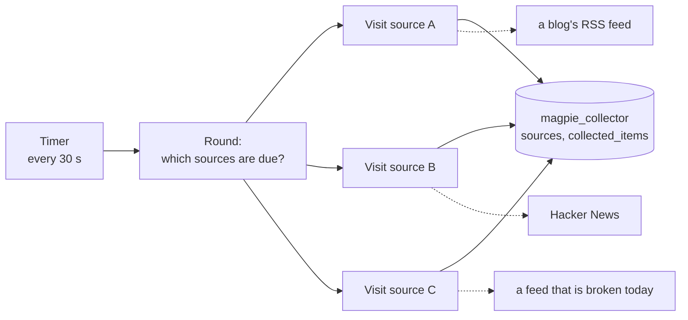
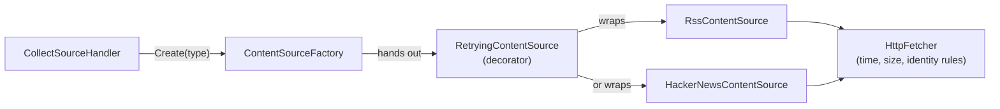
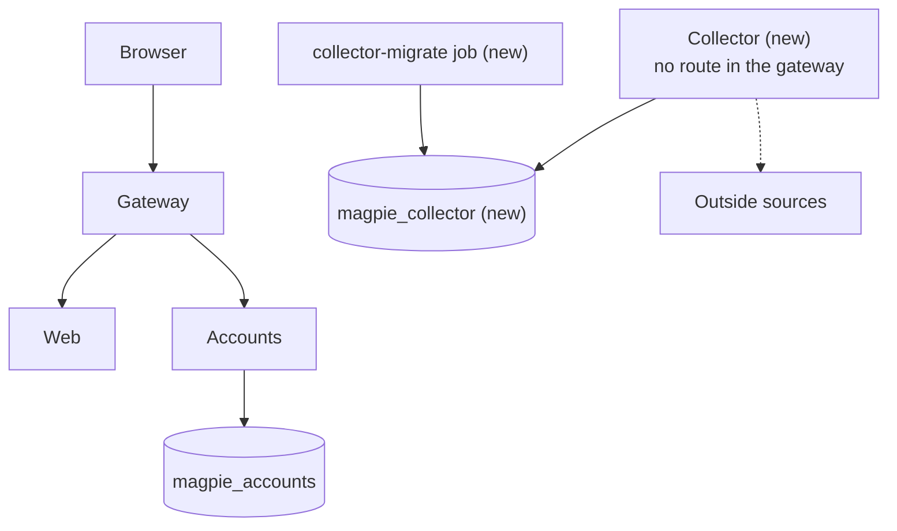
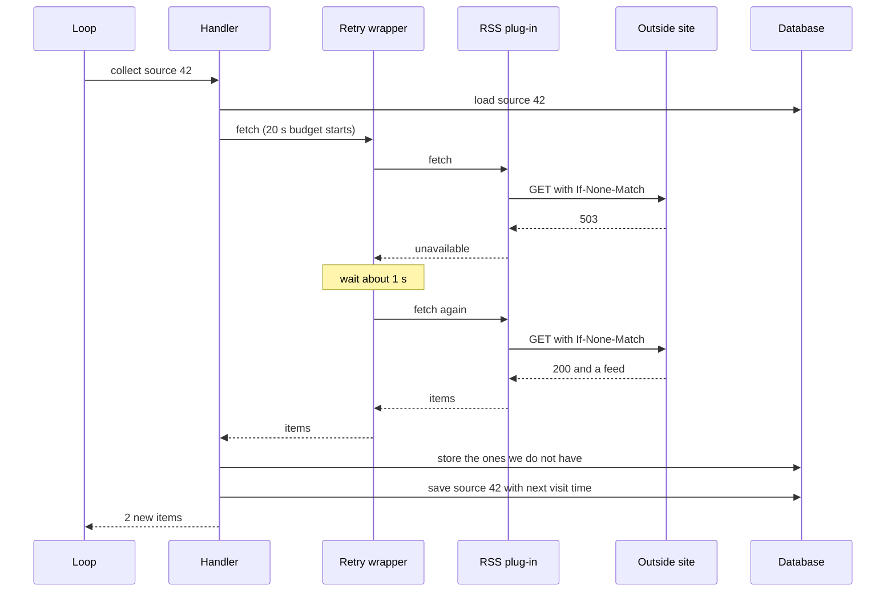
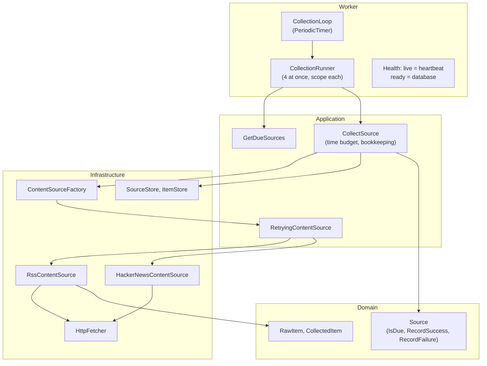
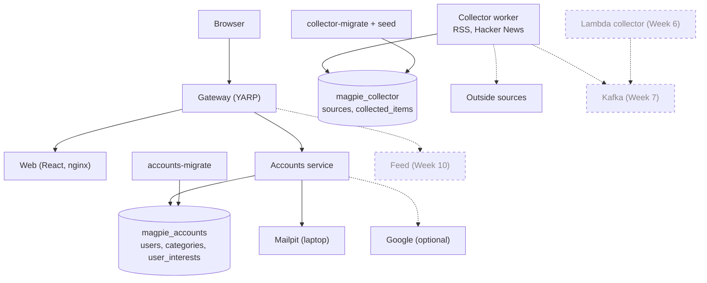

# Building Magpie: A Guided Journey from Empty Folder to Production-Grade System

## Chapter 5 (Week 5): Go Fetch. A Collector That Is Polite, Patient and Hard to Upset

> **What you will have at the end of this chapter:** a second service that wakes up on a timer, visits a list of outside sources (RSS feeds and Hacker News), and stores each new item's title, a short snippet and a link. One source hanging forever, or answering with nonsense, does not slow or stop the others. You will have used four classic design patterns because the problem asked for them, not because a book told you to.

| | |
|---|---|
| **Week** | 5 of 26 |
| **Plan step** | Step 4, Collectors (part 1) |
| **Time budget** | About 8 hours |
| **You need** | Chapter 4 finished and running |
| **Repository** | https://github.com/ankitchoubey800/magpie |
| **Code for this chapter** | Commit `b53e562` on branch `week-05` (pull request #4, stacked on `week-04`). Every link in this chapter points at that exact commit |

---

### How this chapter was checked (read this first)

| What | Where it was run | Result |
|---|---|---|
| Collector: 59 tests (48 unit, 11 against a real PostgreSQL with a pretend internet) | GitHub Actions | `Passed! - Failed: 0, Passed: 59, Skipped: 0, Total: 59` |
| Accounts: 90 tests, unchanged | GitHub Actions | `Passed: 90` |
| Website: lint, 35 tests, build; 5 browser journeys | GitHub Actions | Passed, unchanged |
| The collector's first migration, created by `dotnet ef migrations add` | GitHub Actions; generated files committed | Created; applied by the tests and by the Compose job |
| The break-it experiment: the real collector container against five badly behaved sources | GitHub Actions, Docker Compose | Real output in section 6 |
| The 8 starter sources: one request each, once, to confirm each address answers with a feed | GitHub Actions | All 8 answered `200` in the expected format |
| **Not run by anyone yet:** the collector fetching the real starter sources over hours; anything on your laptop | | You do this. Section 14 says what to watch for |

The full evidence is public: https://github.com/ankitchoubey800/magpie/actions/runs/43812289899

One honest gap against the weekly guide: it asks for 20 RSS feeds. The repository ships 8, because every source needs its terms read by a person first (that is this week's non-technical task, and it is yours). A test does collect 12 sources side by side, and nothing in the design changes between 8 and 20.

Two things broke on the way. A Hacker News story that had been deleted took the whole Hacker News visit down with it (Step 4), and a check script in CI had a quoting mistake that made a passing experiment look like a failure (Step 9).

---

## 1. The big picture

### What are we building this week?

Until now Magpie has had readers and their interests but nothing to show them. This week content starts arriving.

The **collector** is a program with no screen and no visitors. Every 30 seconds it asks its own database one question: "which sources are due for a visit?" For each one it goes to the source's address, reads what is there, and writes down anything new.



**Reading the diagram:** the timer starts a round. A round finds the due sources and visits several at once. Each visit talks to one outside site (dotted lines, because those sites are not ours and may misbehave) and writes its own result to the collector's database.

Think of a newspaper delivery person in reverse: a courier with a list of shops to visit, each on its own schedule. The courier must be **polite** (say who they are, do not come too often), **patient** (a shop that is briefly shut gets another knock) and **hard to upset** (a shop with a locked door must not make the courier miss every other shop).

### Why does it matter?

This is the first time our code depends on computers we do not control. Everything in the first four weeks failed in ways we could predict. Outside sites fail in every way there is: slow, down, half an answer, the wrong answer, an answer that never ends. Most of an architect's work on integration is deciding, calmly and in advance, what happens for each of those.

> 🧠 **Pause and think**
> A source accepts our connection and then says nothing, forever. We have 4 visits running at once and 100 sources. If we do nothing special, what happens to the other 99? (Answer in section 11.)

### This week's deliverables

| # | Deliverable | Where |
|---|---|---|
| 1 | Collector worker with its own database | `src/services/collector/` |
| 2 | Two plug-ins: RSS/Atom and Hacker News | `Infrastructure/Sources/` |
| 3 | A list of sources in a table, loaded from a file | `infra/seed/sources.json` |
| 4 | A holding table for collected items | `collected_items` |
| 5 | Break-it kit: five badly behaved sources | `infra/experiments/bad-sources/` |
| 6 | Design note: "add a new source in under an hour" | `docs/design-notes/` |
| 7 | Non-technical: your "source terms" sheet | yours to write |

---

## 2. Concepts first

### 2.1 A background worker

A web service waits to be asked. A **worker** acts on its own, usually on a timer or when a message arrives. In .NET the base class is `BackgroundService`: you write one method, `ExecuteAsync`, and the host runs it for the life of the program and hands you a token that is cancelled when the program should stop.

For the timer we use `PeriodicTimer`. Its useful property is that it never overlaps itself. If a round takes 50 seconds and the tick is 30, the next round starts when the first has finished, not on top of it.

### 2.2 Four design patterns, each answering a real question

A **design pattern** is a named solution to a problem that keeps coming back. The names matter because they let two developers say in one word what would take a paragraph.

| The question we actually have | Pattern | In our code |
|---|---|---|
| "Sources come in different kinds. How does the loop stay ignorant of the kinds?" | **Strategy**: several interchangeable ways of doing one job, behind one interface | `IContentSource` with `FetchAsync` |
| "Every source describes items its own way. How do we get one shape?" | **Adapter**: translate someone else's shape into ours | each plug-in turns RSS XML or Hacker News JSON into `RawItem` |
| "Given a row that says `Rss`, who picks the right class?" | **Factory**: one place that decides which object to hand out | `ContentSourceFactory` |
| "Every plug-in needs retries. How do we avoid writing them in each?" | **Decorator**: wrap an object in another with the same interface that adds behaviour | `RetryingContentSource` |

Everyday pictures. Strategy: a travel adapter kit where every plug fits the same socket in your bag. Adapter: an interpreter. Factory: the receptionist who sends you to the right desk. Decorator: a phone case, the phone still works the same way, and now it also survives a drop.



**Reading the diagram:** the handler asks the factory for "whatever handles this type". It receives a retrying wrapper and never learns what is inside. Both plug-ins reach the outside world through one shared fetcher, so the safety rules are written once.

> 🪑 **Architect's chair**
> The test of a plug-in design is what a plug-in is *not allowed* to do. Ours may not touch the database, decide when it runs, retry, or hide errors. Because it implements none of the safety rules, it cannot forget one.

### 2.3 Timeouts: every wait needs an end

A call with no time limit is a promise to wait forever. We set three, from inside out:

| Limit | Default | Protects against |
|---|---|---|
| One HTTP request | 8 s | a site that stops answering |
| One whole visit to a source (all tries, parsing, saving) | 20 s | a visit made of many slow steps |
| The size of one answer | 2,000,000 bytes | an answer that never ends, or is absurdly large |

The size limit is a kind of timeout measured in bytes instead of seconds.

### 2.4 Retries, backoff and jitter

Some failures are worth a second try (the site is restarting) and some are not (the page does not exist). We separate them with two exception types:

- `SourceUnavailableException`: "could not get an answer". Network error, timeout, status 5xx, 429 or 408. **Retry.**
- `SourceContentException`: "got an answer and it is no good". Not a feed, 404, too large. **Do not retry**, the same request will give the same nonsense.

**Backoff** means waiting longer before each new try: 1 second, then 2. **Jitter** means adding a little randomness to each wait. Without jitter, a thousand collectors that all failed at the same moment all come back at the same moment, and knock the recovering site over again. That stampede has a name: the *thundering herd*.

We back off at two speeds:

| | Within one visit | Between visits |
|---|---|---|
| Who does it | `RetryingContentSource` | `Source.RecordFailure` |
| Waits | 1 s, 2 s (plus jitter), 3 tries in all | the normal interval, doubled for each failure in a row, at most 24 hours |
| Purpose | ride out a hiccup | stop bothering a site that is really broken |

### 2.5 Isolation: one bad source must not hurt the others

Ships are built with **bulkheads**: walls that keep a leak in one compartment from flooding the ship. Ours are:

1. Each visit has its own time budget (2.3).
2. Each visit gets its own **scope**: its own database session and its own handler objects. A failure cannot leave half-finished work behind for the next visit.
3. Each visit's outcome is written on that source's own row. Errors do not travel upward.
4. A fixed number of visits run at once (4). A flood of due sources cannot exhaust memory or connections.

### 2.6 Being a good guest

We are visiting other people's servers, uninvited. Four courtesies:

- **Say who you are.** Every request carries a `User-Agent` such as `MagpieCollector/0.1 (+https://your-page)`. A site owner who is unhappy can find you instead of blocking you blind.
- **Ask "has it changed?"** A **conditional GET** sends back the label (`ETag`) or date (`Last-Modified`) the site gave us last time. If nothing changed the site answers `304 Not Modified` with no body. Cheap for both sides.
- **Do not come too often.** No source may be visited more often than every 5 minutes; the code refuses.
- **Take little.** A title, a snippet of at most 500 characters and a link back. Never the article.

And one that is not code: **read the terms.** A feed being public does not mean any use of it is allowed.

### 2.7 Reading XML safely

RSS and Atom are XML. Old XML features (a "DTD") let a document refer to other files or expand tiny text into gigabytes. We refuse any document that contains one. This is one line of settings and it closes a whole family of attacks.

### 2.8 `IHttpClientFactory`

Creating a new `HttpClient` per request slowly runs the machine out of network sockets. Keeping one forever misses changes in the site's address. `IHttpClientFactory` manages a pool for you. We register one named client, `"sources"`, with the timeout and User-Agent set once.

### 2.9 A service owns its data

The collector gets its own database, `magpie_collector`, on the same PostgreSQL server. It never reads Accounts' tables. Where it needs to mention a topic it stores the topic's **slug** as plain text (`"programming"`) with no foreign key. That means the two can drift apart. We accept that, and say so in the decision record.

### 2.10 Liveness for a worker

A web service proves it is alive by answering. A worker could have a perfectly healthy web endpoint while its loop died an hour ago. So the loop records a **heartbeat** after each round, and the liveness check asks "when was the last one?"

> ❓ **No silly questions**
> **Q: Why not use a ready-made library such as Polly for retries?**
> A: In real projects you usually would (and .NET ships resilience helpers built on it). Writing 50 lines once teaches what those libraries are doing. Section 9 lists it as the first thing to swap.
> **Q: I come from Azure. What is the equivalent?**
> A: A timer-triggered Azure Function is the same idea with the loop provided for you. Week 6 builds the AWS version of exactly that (a scheduled Lambda).

---

## 3. Architecture and decisions

### 3.1 What changes



**Reading the diagram:** the left side is untouched. The collector stands apart: the gateway does not know it exists, because nothing outside ever calls it.

### 3.2 One visit, step by step



**Reading the diagram:** the handler owns the time budget and the bookkeeping. The retry wrapper sits between it and the plug-in and absorbs one short failure. Whatever happens, the last database step runs.

### 3.3 The two tables

| `sources` | |
|---|---|
| `Id`, `Name`, `Type`, `Address` (unique) | what and where |
| `CategoryHint` | topic slug, or empty |
| `FetchIntervalMinutes`, `Enabled` | schedule |
| `NextFetchAtUtc`, `LastFetchedAtUtc` | when |
| `ConsecutiveFailures`, `LastError` | health |
| `ETag`, `LastModified` | for "has it changed?" |

| `collected_items` | |
|---|---|
| `Id`, `SourceId`, `ExternalId` | unique together: the same item is never stored twice |
| `Url`, `Title`, `Summary`, `Author`, `PublishedAtUtc` | the little we keep |
| `CategoryHint`, `CollectedAtUtc` | copied from the source; when we saw it |

`collected_items` is a **holding table**. In week 7 a message queue replaces it.

### 3.4 Decisions

| Decision | Chosen | Main reason |
|---|---|---|
| Where collecting lives | Its own service and database (ADR-0006) | A hostile outside site must never share resources with sign-in |
| How kinds of source vary | Plug-ins behind one interface | New kind = one class |
| Where safety rules live | Around the plug-ins, never in them | Cannot be forgotten |
| Schedule | A `NextFetchAtUtc` per source, checked every 30 s | Each source has its own pace; survives restarts |
| Retries | Our own small decorator | Teaching; swap for a library later |
| Hosting shape | A small web app with a background loop | Reuses the standard health endpoints |

### 3.5 Files changed from earlier weeks

| File | Change |
|---|---|
| `Magpie.slnx` | five new projects |
| `infra/docker-compose.yml`, `infra/.env.example` | two new services, four new settings |
| `.github/workflows/ci.yml` | break-it step |
| `README.md` | status and folder list |

Nothing in Accounts, the gateway or the website changes this week.

---

## 4. Implementation guide

Branch: `git switch week-04 && git switch -c week-05`.

### Step 1: Five projects

**What:** the same four layers as Accounts, with `Worker` in place of `Api`, plus tests.
**Why:** same conventions, so the second service feels familiar.

```bash
C=src/services/collector
dotnet new classlib -n Magpie.Collector.Domain          -o $C/Magpie.Collector.Domain
dotnet new classlib -n Magpie.Collector.Application     -o $C/Magpie.Collector.Application
dotnet new classlib -n Magpie.Collector.Infrastructure  -o $C/Magpie.Collector.Infrastructure
dotnet new web      -n Magpie.Collector.Worker          -o $C/Magpie.Collector.Worker
dotnet new xunit    -n Magpie.Collector.Tests           -o $C/Magpie.Collector.Tests
rm $C/*/Class1.cs $C/Magpie.Collector.Tests/UnitTest1.cs
for p in Domain Application Infrastructure Worker Tests; do dotnet sln add $C/Magpie.Collector.$p; done
```

Then replace each project file with these. They hold the references and packages:

**`src/services/collector/Magpie.Collector.Domain/Magpie.Collector.Domain.csproj`**

```xml
<Project Sdk="Microsoft.NET.Sdk">

  <PropertyGroup>
    <TargetFramework>net10.0</TargetFramework>
    <ImplicitUsings>enable</ImplicitUsings>
    <Nullable>enable</Nullable>
  </PropertyGroup>

</Project>
```

**`src/services/collector/Magpie.Collector.Application/Magpie.Collector.Application.csproj`**

```xml
<Project Sdk="Microsoft.NET.Sdk">

  <ItemGroup>
    <ProjectReference Include="..\Magpie.Collector.Domain\Magpie.Collector.Domain.csproj" />
    <ProjectReference Include="..\..\..\shared\Magpie.Mediator\Magpie.Mediator.csproj" />
  </ItemGroup>

  <PropertyGroup>
    <TargetFramework>net10.0</TargetFramework>
    <ImplicitUsings>enable</ImplicitUsings>
    <Nullable>enable</Nullable>
  </PropertyGroup>

</Project>
```

**`src/services/collector/Magpie.Collector.Infrastructure/Magpie.Collector.Infrastructure.csproj`**

```xml
<Project Sdk="Microsoft.NET.Sdk">

  <ItemGroup>
    <ProjectReference Include="..\Magpie.Collector.Application\Magpie.Collector.Application.csproj" />
  </ItemGroup>

  <ItemGroup>
    <FrameworkReference Include="Microsoft.AspNetCore.App" />
  </ItemGroup>

  <ItemGroup>
    <PackageReference Include="Npgsql.EntityFrameworkCore.PostgreSQL" Version="10.0.*" />
  </ItemGroup>

  <!-- Tests may use the plug-ins and the parser directly. -->
  <ItemGroup>
    <InternalsVisibleTo Include="Magpie.Collector.Tests" />
  </ItemGroup>

  <PropertyGroup>
    <TargetFramework>net10.0</TargetFramework>
    <ImplicitUsings>enable</ImplicitUsings>
    <Nullable>enable</Nullable>
  </PropertyGroup>

</Project>
```

**`src/services/collector/Magpie.Collector.Worker/Magpie.Collector.Worker.csproj`**

```xml
<Project Sdk="Microsoft.NET.Sdk.Web">

  <ItemGroup>
    <ProjectReference Include="..\Magpie.Collector.Application\Magpie.Collector.Application.csproj" />
    <ProjectReference Include="..\Magpie.Collector.Infrastructure\Magpie.Collector.Infrastructure.csproj" />
    <ProjectReference Include="..\..\..\shared\Magpie.Defaults\Magpie.Defaults.csproj" />
  </ItemGroup>

  <!-- Needed only by the "dotnet ef" command-line tool that creates migrations. -->
  <ItemGroup>
    <PackageReference Include="Microsoft.EntityFrameworkCore.Design" Version="10.0.*">
      <PrivateAssets>all</PrivateAssets>
      <IncludeAssets>runtime; build; native; contentfiles; analyzers; buildtransitive</IncludeAssets>
    </PackageReference>
  </ItemGroup>

  <!-- Lets the test project see the Program class. -->
  <ItemGroup>
    <InternalsVisibleTo Include="Magpie.Collector.Tests" />
  </ItemGroup>

  <PropertyGroup>
    <TargetFramework>net10.0</TargetFramework>
    <Nullable>enable</Nullable>
    <ImplicitUsings>enable</ImplicitUsings>
  </PropertyGroup>

</Project>
```

**`src/services/collector/Magpie.Collector.Tests/Magpie.Collector.Tests.csproj`**

```xml
<Project Sdk="Microsoft.NET.Sdk">

  <PropertyGroup>
    <TargetFramework>net10.0</TargetFramework>
    <ImplicitUsings>enable</ImplicitUsings>
    <Nullable>enable</Nullable>
    <IsPackable>false</IsPackable>
  </PropertyGroup>

  <ItemGroup>
    <PackageReference Include="coverlet.collector" Version="6.0.4" />
    <PackageReference Include="Microsoft.NET.Test.Sdk" Version="17.14.1" />
    <PackageReference Include="Testcontainers.PostgreSql" Version="4.*" />
    <PackageReference Include="xunit" Version="2.9.3" />
    <PackageReference Include="xunit.runner.visualstudio" Version="3.1.4" />
  </ItemGroup>

  <ItemGroup>
    <Using Include="Xunit" />
  </ItemGroup>

  <ItemGroup>
    <ProjectReference Include="..\Magpie.Collector.Worker\Magpie.Collector.Worker.csproj" />
  </ItemGroup>

</Project>
```

> **GitHub (verified at commit `b53e562`):** [`Magpie.Collector.Domain.csproj`](https://github.com/ankitchoubey800/magpie/blob/b53e562/src/services/collector/Magpie.Collector.Domain/Magpie.Collector.Domain.csproj) · [`Magpie.Collector.Application.csproj`](https://github.com/ankitchoubey800/magpie/blob/b53e562/src/services/collector/Magpie.Collector.Application/Magpie.Collector.Application.csproj) · [`Magpie.Collector.Infrastructure.csproj`](https://github.com/ankitchoubey800/magpie/blob/b53e562/src/services/collector/Magpie.Collector.Infrastructure/Magpie.Collector.Infrastructure.csproj) · [`Magpie.Collector.Worker.csproj`](https://github.com/ankitchoubey800/magpie/blob/b53e562/src/services/collector/Magpie.Collector.Worker/Magpie.Collector.Worker.csproj) · [`Magpie.Collector.Tests.csproj`](https://github.com/ankitchoubey800/magpie/blob/b53e562/src/services/collector/Magpie.Collector.Tests/Magpie.Collector.Tests.csproj) · [`Magpie.slnx`](https://github.com/ankitchoubey800/magpie/blob/b53e562/Magpie.slnx)

**Check:** `dotnet build Magpie.slnx` succeeds (empty projects).

> ❓ **Q&A**
> **Q: Why is the worker made with `dotnet new web` and not `dotnet new worker`?**
> A: So it can serve `/health/live` and `/health/ready` like every other service, with the helpers we already wrote. The cost is a web server that listens and does almost nothing.
> **Q: What is `InternalsVisibleTo`?**
> A: Classes marked `internal` are hidden outside their project. This line lets the test project, and only it, see them.

### Step 2: Domain, the rules about sources and items

**What:** four small files with no dependencies.
**Why:** the scheduling and politeness rules belong where no framework can get in their way, and where they are trivial to test.

**`src/services/collector/Magpie.Collector.Domain/SourceType.cs`**

```csharp
namespace Magpie.Collector.Domain;

/// <summary>
/// The kinds of place we know how to collect from. Each value has exactly one
/// plug-in. YouTube and Bluesky join in week 6.
/// </summary>
public enum SourceType
{
    Rss = 1,
    HackerNews = 2,
}
```

**`src/services/collector/Magpie.Collector.Domain/Source.cs`**

```csharp
namespace Magpie.Collector.Domain;

/// <summary>
/// One place we collect from: a feed address and everything we remember about
/// visiting it. The rules about WHEN to visit again live here, so the worker
/// loop never has to do date arithmetic.
/// </summary>
public sealed class Source
{
    /// <summary>We never visit any source more often than this, however it is configured.</summary>
    public const int MinimumIntervalMinutes = 5;

    /// <summary>However often a source fails, we still look again at least this often.</summary>
    public static readonly TimeSpan LongestWait = TimeSpan.FromHours(24);

    public Guid Id { get; private set; }

    public string Name { get; private set; }

    public SourceType Type { get; private set; }

    public string Address { get; private set; }

    /// <summary>
    /// The slug of the topic this source is mostly about ("programming"), or
    /// null. It is a hint for the tagger in week 9. It is plain text on
    /// purpose: categories belong to the Accounts service, and services do not
    /// reach into each other's tables.
    /// </summary>
    public string? CategoryHint { get; private set; }

    public int FetchIntervalMinutes { get; private set; }

    public bool Enabled { get; private set; }

    public DateTimeOffset? LastFetchedAtUtc { get; private set; }

    public DateTimeOffset NextFetchAtUtc { get; private set; }

    public string? LastError { get; private set; }

    public int ConsecutiveFailures { get; private set; }

    /// <summary>The "version labels" the source gave us last time. Sending them back lets it answer "nothing new".</summary>
    public string? ETag { get; private set; }

    public string? LastModified { get; private set; }

    // EF Core fills the object through this constructor when loading a row.
    private Source(Guid id, string name, SourceType type, string address, string? categoryHint, int fetchIntervalMinutes, bool enabled)
    {
        Id = id;
        Name = name;
        Type = type;
        Address = address;
        CategoryHint = categoryHint;
        FetchIntervalMinutes = fetchIntervalMinutes;
        Enabled = enabled;
    }

    public static Source Create(
        string name, SourceType type, string address, string? categoryHint, int fetchIntervalMinutes, DateTimeOffset nowUtc)
    {
        if (string.IsNullOrWhiteSpace(name))
        {
            throw new ArgumentException("A source needs a name.", nameof(name));
        }

        if (!Uri.TryCreate(address, UriKind.Absolute, out var uri) || (uri.Scheme != Uri.UriSchemeHttp && uri.Scheme != Uri.UriSchemeHttps))
        {
            throw new ArgumentException("A source address must be a full http or https address.", nameof(address));
        }

        if (fetchIntervalMinutes < MinimumIntervalMinutes)
        {
            throw new ArgumentOutOfRangeException(
                nameof(fetchIntervalMinutes), $"Sources may not be fetched more often than every {MinimumIntervalMinutes} minutes.");
        }

        return new Source(Guid.CreateVersion7(), name.Trim(), type, address.Trim(), categoryHint?.Trim(), fetchIntervalMinutes, enabled: true)
        {
            NextFetchAtUtc = nowUtc, // a new source is due straight away
        };
    }

    public bool IsDue(DateTimeOffset nowUtc) => Enabled && NextFetchAtUtc <= nowUtc;

    /// <summary>The visit worked (including "nothing new"). Come back after the normal interval.</summary>
    public void RecordSuccess(DateTimeOffset nowUtc, string? etag, string? lastModified)
    {
        LastFetchedAtUtc = nowUtc;
        LastError = null;
        ConsecutiveFailures = 0;
        ETag = etag ?? ETag;
        LastModified = lastModified ?? LastModified;
        NextFetchAtUtc = nowUtc.AddMinutes(FetchIntervalMinutes);
    }

    /// <summary>
    /// The visit failed. Wait LONGER each time it fails in a row (the interval
    /// doubles), so a struggling site is left in peace instead of being hammered.
    /// </summary>
    public void RecordFailure(DateTimeOffset nowUtc, string error)
    {
        LastFetchedAtUtc = nowUtc;
        ConsecutiveFailures++;
        LastError = error.Length <= 500 ? error : error[..500];
        NextFetchAtUtc = nowUtc + WaitAfterFailures(ConsecutiveFailures);
    }

    private TimeSpan WaitAfterFailures(int failures)
    {
        // 1 failure: 1x the interval. 2: 2x. 3: 4x. 4: 8x ... never more than 24 hours.
        var doublings = Math.Min(failures - 1, 16);
        var wait = TimeSpan.FromMinutes(FetchIntervalMinutes * Math.Pow(2, doublings));
        return wait < LongestWait ? wait : LongestWait;
    }
}
```

Read `RecordFailure` slowly. The wait is the normal interval multiplied by 2 for every failure in a row, never more than 24 hours. One success resets it.

**`src/services/collector/Magpie.Collector.Domain/RawItem.cs`**

```csharp
using System.Net;
using System.Text.RegularExpressions;

namespace Magpie.Collector.Domain;

/// <summary>
/// One piece of content in OUR shape, whatever shape the source used.
/// Every plug-in's job ends by producing these.
///
/// It also enforces the project's content rule: a title, a SHORT snippet and a
/// link back to the original. Never the full text.
/// </summary>
public sealed partial record RawItem
{
    public const int MaxTitleLength = 300;
    public const int MaxSummaryLength = 500;

    /// <summary>The source's own id for this item. With the source id, it tells us "seen this one already".</summary>
    public string ExternalId { get; }

    public string Url { get; }

    public string Title { get; }

    public string? Summary { get; }

    public DateTimeOffset? PublishedAtUtc { get; }

    public string? Author { get; }

    private RawItem(string externalId, string url, string title, string? summary, DateTimeOffset? publishedAtUtc, string? author)
    {
        ExternalId = externalId;
        Url = url;
        Title = title;
        Summary = summary;
        PublishedAtUtc = publishedAtUtc;
        Author = author;
    }

    /// <summary>
    /// Returns null when the item is unusable (no title, or no proper link).
    /// One bad item must never spoil the rest of a feed.
    /// </summary>
    public static RawItem? TryCreate(
        string? externalId, string? url, string? title, string? summary, DateTimeOffset? publishedAt, string? author)
    {
        var cleanTitle = ToPlainText(title, MaxTitleLength);
        if (cleanTitle is null
            || !Uri.TryCreate(url?.Trim(), UriKind.Absolute, out var link)
            || (link.Scheme != Uri.UriSchemeHttp && link.Scheme != Uri.UriSchemeHttps))
        {
            return null;
        }

        return new RawItem(
            string.IsNullOrWhiteSpace(externalId) ? link.AbsoluteUri : externalId.Trim(),
            link.AbsoluteUri,
            cleanTitle,
            ToPlainText(summary, MaxSummaryLength),
            publishedAt?.ToUniversalTime(),
            ToPlainText(author, 100));
    }

    /// <summary>Removes HTML tags, decodes things like "&amp;amp;", squeezes spaces, and cuts to a maximum length.</summary>
    private static string? ToPlainText(string? input, int maxLength)
    {
        if (string.IsNullOrWhiteSpace(input))
        {
            return null;
        }

        var text = WebUtility.HtmlDecode(HtmlTag().Replace(input, " "));
        text = Whitespace().Replace(text, " ").Trim();
        if (text.Length == 0)
        {
            return null;
        }

        return text.Length <= maxLength ? text : text[..(maxLength - 1)].TrimEnd() + "…";
    }

    [GeneratedRegex("<[^>]*>")]
    private static partial Regex HtmlTag();

    [GeneratedRegex(@"\s+")]
    private static partial Regex Whitespace();
}
```

`TryCreate` returns nothing rather than throwing when an item is unusable. One broken item in a feed of fifty is normal on the real web and must not spoil the other forty-nine.

**`src/services/collector/Magpie.Collector.Domain/CollectedItem.cs`**

```csharp
namespace Magpie.Collector.Domain;

/// <summary>
/// A RawItem that has been written to the holding table, with a note of where
/// and when we got it. In week 7 this table is replaced by a Kafka topic.
/// </summary>
public sealed class CollectedItem
{
    public Guid Id { get; private set; }

    public Guid SourceId { get; private set; }

    public string ExternalId { get; private set; }

    public string Url { get; private set; }

    public string Title { get; private set; }

    public string? Summary { get; private set; }

    public DateTimeOffset? PublishedAtUtc { get; private set; }

    public string? Author { get; private set; }

    public string? CategoryHint { get; private set; }

    public DateTimeOffset CollectedAtUtc { get; private set; }

    private CollectedItem(
        Guid id, Guid sourceId, string externalId, string url, string title, string? summary,
        DateTimeOffset? publishedAtUtc, string? author, string? categoryHint, DateTimeOffset collectedAtUtc)
    {
        Id = id;
        SourceId = sourceId;
        ExternalId = externalId;
        Url = url;
        Title = title;
        Summary = summary;
        PublishedAtUtc = publishedAtUtc;
        Author = author;
        CategoryHint = categoryHint;
        CollectedAtUtc = collectedAtUtc;
    }

    public static CollectedItem From(Source source, RawItem item, DateTimeOffset nowUtc) => new(
        Guid.CreateVersion7(), source.Id, item.ExternalId, item.Url, item.Title, item.Summary,
        item.PublishedAtUtc, item.Author, source.CategoryHint, nowUtc);
}
```

> **GitHub (verified at commit `b53e562`):** [`SourceType.cs`](https://github.com/ankitchoubey800/magpie/blob/b53e562/src/services/collector/Magpie.Collector.Domain/SourceType.cs) · [`Source.cs`](https://github.com/ankitchoubey800/magpie/blob/b53e562/src/services/collector/Magpie.Collector.Domain/Source.cs) · [`RawItem.cs`](https://github.com/ankitchoubey800/magpie/blob/b53e562/src/services/collector/Magpie.Collector.Domain/RawItem.cs) · [`CollectedItem.cs`](https://github.com/ankitchoubey800/magpie/blob/b53e562/src/services/collector/Magpie.Collector.Domain/CollectedItem.cs)

**Check:** `dotnet build src/services/collector/Magpie.Collector.Domain`. Open the project file: no references.

> ❓ **Q&A**
> **Q: Why strip HTML from titles and snippets here?**
> A: Feeds often put HTML inside descriptions. We store plain text so nothing downstream ever has to wonder whether a title is safe to show.
> **Q: Why does the Domain take "now" as a parameter instead of asking the clock?**
> A: So a test can say "it is 31 minutes later" without waiting 31 minutes.

### Step 3: Application, the plug-in contract and the two use cases

**What:** the interface every plug-in implements, the retry wrapper, the ports to storage, one query and one command.
**Why:** this layer is the whole behaviour of the collector with no HTTP and no database in sight.

The contract (Strategy), the factory's interface, and the two kinds of failure:

**`src/services/collector/Magpie.Collector.Application/Sources/IContentSource.cs`**

```csharp
using Magpie.Collector.Domain;

namespace Magpie.Collector.Application.Sources;

/// <summary>
/// THE plug-in contract (the "Strategy" pattern): one method that every kind
/// of source implements in its own way. The rest of the collector only ever
/// sees this interface, so adding a source type changes nothing else.
///
/// What a plug-in may do: call its source and translate the answer into RawItems.
/// What it may NOT do: touch the database, schedule itself, retry, or swallow
/// errors. Those jobs belong to the code around it.
/// </summary>
public interface IContentSource
{
    /// <exception cref="SourceUnavailableException">Could not be reached, or answered with a temporary error. Worth another try.</exception>
    /// <exception cref="SourceContentException">Answered, but with something we cannot read. Trying again will not help.</exception>
    Task<FetchOutcome> FetchAsync(FetchRequest request, CancellationToken cancellationToken);
}

/// <summary>Where to fetch from, and the "version labels" from last time (if any).</summary>
public sealed record FetchRequest(string Address, string? ETag, string? LastModified, int MaxItems);

public sealed record FetchOutcome(IReadOnlyList<RawItem> Items, string? ETag, string? LastModified)
{
    /// <summary>The source said "nothing has changed since your last visit".</summary>
    public static readonly FetchOutcome NotModified = new([], null, null);
}

/// <summary>Picks the plug-in for a source type (the "Factory" pattern).</summary>
public interface IContentSourceFactory
{
    IContentSource Create(SourceType type);
}

public sealed class SourceUnavailableException(string message, Exception? innerException = null)
    : Exception(message, innerException);

public sealed class SourceContentException(string message, Exception? innerException = null)
    : Exception(message, innerException);
```

The decorator:

**`src/services/collector/Magpie.Collector.Application/Sources/RetryingContentSource.cs`**

```csharp
namespace Magpie.Collector.Application.Sources;

/// <summary>How patient the retry wrapper is.</summary>
public sealed record RetrySettings(int MaxAttempts, TimeSpan FirstDelay)
{
    public static readonly RetrySettings Default = new(MaxAttempts: 3, FirstDelay: TimeSpan.FromSeconds(1));
}

/// <summary>
/// Wraps ANY plug-in and adds "try again a few times" (the "Decorator"
/// pattern). It implements the same interface as the thing it wraps, so
/// callers cannot tell the difference, and plug-ins stay free of retry code.
///
/// Two details matter more than the loop itself:
///  - each wait is longer than the last (1s, 2s, 4s...), so a struggling site gets room to recover;
///  - each wait has a random part ("jitter"), so a thousand collectors that
///    failed together do not all come back at the same instant.
/// </summary>
public sealed class RetryingContentSource(
    IContentSource inner,
    RetrySettings settings,
    Func<TimeSpan, CancellationToken, Task>? delay = null,
    Func<double>? random = null) : IContentSource
{
    private readonly Func<TimeSpan, CancellationToken, Task> _delay = delay ?? Task.Delay;
    private readonly Func<double> _random = random ?? Random.Shared.NextDouble;

    public async Task<FetchOutcome> FetchAsync(FetchRequest request, CancellationToken cancellationToken)
    {
        for (var attempt = 1; ; attempt++)
        {
            try
            {
                return await inner.FetchAsync(request, cancellationToken);
            }
            catch (SourceUnavailableException) when (attempt < settings.MaxAttempts)
            {
                // Only "unavailable" is retried. Unreadable content (SourceContentException)
                // would be just as unreadable a second later, so it goes straight up.
                await _delay(DelayBefore(attempt + 1), cancellationToken);
            }
        }
    }

    /// <summary>Attempt 2 waits about 1x the first delay, attempt 3 about 2x, attempt 4 about 4x, each plus up to 50% extra.</summary>
    private TimeSpan DelayBefore(int attempt)
    {
        var growing = settings.FirstDelay * Math.Pow(2, attempt - 2);
        var jitter = growing * (_random() * 0.5);
        return growing + jitter;
    }
}
```

Notice it takes the "wait" and the "random number" as functions. Production passes the real ones. Tests pass ones that return at once and record what was asked, so the retry tests run in milliseconds.

The ports:

**`src/services/collector/Magpie.Collector.Application/Collecting/CollectorPorts.cs`**

```csharp
using Magpie.Collector.Domain;

namespace Magpie.Collector.Application.Collecting;

/// <summary>The door to the sources table.</summary>
public interface ISourceStore
{
    /// <summary>Ids of sources whose next visit is now or overdue, most overdue first.</summary>
    Task<IReadOnlyList<Guid>> GetDueIdsAsync(DateTimeOffset nowUtc, int max, CancellationToken cancellationToken);

    Task<Source?> FindAsync(Guid id, CancellationToken cancellationToken);

    Task SaveAsync(Source source, CancellationToken cancellationToken);
}

/// <summary>The door to the holding table for collected items.</summary>
public interface IItemStore
{
    /// <summary>Stores the items we have not seen before from this source. Returns how many were new.</summary>
    Task<int> AddNewAsync(Source source, IReadOnlyList<RawItem> items, DateTimeOffset nowUtc, CancellationToken cancellationToken);
}

/// <summary>Limits that apply to every visit, whatever the source.</summary>
public sealed record CollectionLimits(TimeSpan PerSourceTimeout, int MaxItemsPerFetch);
```

The query, "which sources are due?":

**`src/services/collector/Magpie.Collector.Application/Collecting/GetDueSources.cs`**

```csharp
using Magpie.Mediator;

namespace Magpie.Collector.Application.Collecting;

/// <summary>Query: "which sources should be visited now?"</summary>
public sealed record GetDueSourcesQuery(int Max) : IQuery<IReadOnlyList<Guid>>;

public sealed class GetDueSourcesHandler(ISourceStore sources, TimeProvider timeProvider)
    : IRequestHandler<GetDueSourcesQuery, IReadOnlyList<Guid>>
{
    public Task<IReadOnlyList<Guid>> HandleAsync(GetDueSourcesQuery request, CancellationToken cancellationToken) =>
        sources.GetDueIdsAsync(timeProvider.GetUtcNow(), request.Max, cancellationToken);
}
```

The command, "visit this one source":

**`src/services/collector/Magpie.Collector.Application/Collecting/CollectSource.cs`**

```csharp
using Magpie.Collector.Application.Sources;
using Magpie.Mediator;

namespace Magpie.Collector.Application.Collecting;

/// <summary>Command: "visit this one source now and store what is new".</summary>
public sealed record CollectSourceCommand(Guid SourceId) : ICommand<CollectSourceResult>;

public sealed record CollectSourceResult(Guid SourceId, bool Succeeded, int NewItems, string? Error);

/// <summary>
/// The heart of the collector. Read it as a promise: WHATEVER happens to this
/// source (slow, down, nonsense), the outcome is written on the source's own
/// row and nothing escapes to disturb the others.
/// </summary>
public sealed class CollectSourceHandler(
    ISourceStore sources,
    IItemStore items,
    IContentSourceFactory factory,
    CollectionLimits limits,
    TimeProvider timeProvider) : IRequestHandler<CollectSourceCommand, CollectSourceResult>
{
    public async Task<CollectSourceResult> HandleAsync(CollectSourceCommand request, CancellationToken cancellationToken)
    {
        var source = await sources.FindAsync(request.SourceId, cancellationToken);
        if (source is null || !source.IsDue(timeProvider.GetUtcNow()))
        {
            return new CollectSourceResult(request.SourceId, false, 0, "Source not found or not due.");
        }

        // A stopwatch for this ONE source. When it runs out, the token below is
        // cancelled and every await underneath gives up.
        using var deadline = CancellationTokenSource.CreateLinkedTokenSource(cancellationToken);
        deadline.CancelAfter(limits.PerSourceTimeout);

        CollectSourceResult result;
        try
        {
            var plugIn = factory.Create(source.Type);
            var outcome = await plugIn.FetchAsync(
                new FetchRequest(source.Address, source.ETag, source.LastModified, limits.MaxItemsPerFetch), deadline.Token);

            var added = await items.AddNewAsync(source, outcome.Items, timeProvider.GetUtcNow(), deadline.Token);

            source.RecordSuccess(timeProvider.GetUtcNow(), outcome.ETag, outcome.LastModified);
            result = new CollectSourceResult(source.Id, true, added, null);
        }
        catch (Exception exception) when (exception is SourceUnavailableException or SourceContentException)
        {
            result = Fail(exception.Message);
        }
        catch (OperationCanceledException) when (!cancellationToken.IsCancellationRequested)
        {
            // OUR stopwatch ran out (not a shutdown of the whole service).
            result = Fail($"Gave up after {limits.PerSourceTimeout.TotalSeconds:0} seconds.");
        }

        // Saved with the caller's token, not the stopwatch's: even a source that
        // used up all its time must still get its failure written down.
        await sources.SaveAsync(source, cancellationToken);
        return result;

        CollectSourceResult Fail(string error)
        {
            source.RecordFailure(timeProvider.GetUtcNow(), error);
            return new CollectSourceResult(source.Id, false, 0, error);
        }
    }
}
```

This handler is the most important file of the week. Three details:

1. **The stopwatch.** `CreateLinkedTokenSource` makes a token that is cancelled when *either* the program is stopping *or* our 20 seconds run out.
2. **Telling the two apart.** `catch (OperationCanceledException) when (!cancellationToken.IsCancellationRequested)` means "our stopwatch, not a shutdown". A shutdown is allowed to travel upward.
3. **The final save uses the caller's token.** If it used the stopwatch's, a source that used all its time could never have its failure written down, and would be tried again 30 seconds later, forever.

> **GitHub (verified at commit `b53e562`):** [`IContentSource.cs`](https://github.com/ankitchoubey800/magpie/blob/b53e562/src/services/collector/Magpie.Collector.Application/Sources/IContentSource.cs) · [`RetryingContentSource.cs`](https://github.com/ankitchoubey800/magpie/blob/b53e562/src/services/collector/Magpie.Collector.Application/Sources/RetryingContentSource.cs) · [`CollectorPorts.cs`](https://github.com/ankitchoubey800/magpie/blob/b53e562/src/services/collector/Magpie.Collector.Application/Collecting/CollectorPorts.cs) · [`GetDueSources.cs`](https://github.com/ankitchoubey800/magpie/blob/b53e562/src/services/collector/Magpie.Collector.Application/Collecting/GetDueSources.cs) · [`CollectSource.cs`](https://github.com/ankitchoubey800/magpie/blob/b53e562/src/services/collector/Magpie.Collector.Application/Collecting/CollectSource.cs)

**Check:** `dotnet build src/services/collector/Magpie.Collector.Application`.

> ❓ **Q&A**
> **Q: The handler catches only two exception types. What about everything else?**
> A: Anything else is a bug of ours, and should be loud. The runner (Step 6) catches it one level up, logs it as an error, and carries on with the other sources.
> **Q: Why does `GetDueSources` return ids and not the sources themselves?**
> A: Each visit runs in its own scope and loads its own copy. Passing loaded objects between scopes is how two database sessions end up arguing over one row.

### Step 4: Infrastructure, talking to the outside world

**What:** settings, the one shared fetcher, the feed reader, two plug-ins, the factory.
**Why:** every rule about *how we behave as a guest* lives in `HttpFetcher`, once.

**`src/services/collector/Magpie.Collector.Infrastructure/CollectorOptions.cs`**

```csharp
using System.ComponentModel.DataAnnotations;

namespace Magpie.Collector.Infrastructure;

/// <summary>Typed settings for the collector, from the "Collector" section, checked at start-up.</summary>
public sealed class CollectorOptions
{
    public const string SectionName = "Collector";

    /// <summary>
    /// Where the owner of a site we visit can read about this collector and reach
    /// its operator. It goes into the User-Agent header of every request. Being
    /// identifiable and contactable is the first rule of polite collecting, so
    /// the service refuses to start without it.
    /// </summary>
    [Required, Url]
    public string ContactUrl { get; set; } = "";

    /// <summary>How often the loop wakes up to look for sources that are due.</summary>
    [Range(1, 3600)]
    public int TickSeconds { get; set; } = 30;

    /// <summary>How many sources may be visited at the same time.</summary>
    [Range(1, 32)]
    public int MaxParallelSources { get; set; } = 4;

    /// <summary>The whole budget for ONE source per visit, retries included.</summary>
    [Range(1, 300)]
    public int PerSourceTimeoutSeconds { get; set; } = 20;

    /// <summary>The budget for one single web request.</summary>
    [Range(1, 120)]
    public int HttpTimeoutSeconds { get; set; } = 8;

    [Range(1, 500)]
    public int MaxItemsPerFetch { get; set; } = 50;

    /// <summary>We stop reading an answer after this many bytes. Nobody's feed needs to be bigger.</summary>
    [Range(1_000, 50_000_000)]
    public int MaxResponseBytes { get; set; } = 2_000_000;
}

public sealed class CollectorDatabaseOptions
{
    public const string SectionName = "ConnectionStrings";

    [Required(ErrorMessage =
        "Connection string 'CollectorDb' is missing. Set it with user-secrets (local run) " +
        "or the ConnectionStrings__CollectorDb environment variable (containers).")]
    public string? CollectorDb { get; set; }
}
```

`ContactUrl` is required. Start the collector without it and it refuses, with a message. A collector that cannot say who runs it should not run.

**`src/services/collector/Magpie.Collector.Infrastructure/Sources/HttpFetcher.cs`**

```csharp
using System.Net;
using System.Net.Http.Headers;
using Magpie.Collector.Application.Sources;
using Microsoft.Extensions.Options;

namespace Magpie.Collector.Infrastructure.Sources;

/// <summary>What came back from one polite web request.</summary>
internal sealed record FetchedDocument(bool NotModified, byte[] Body, string? ETag, string? LastModified);

/// <summary>
/// The ONE place the collector talks to the outside web. Both plug-ins use it,
/// so the safety rules are written once: a time limit, a size limit, and the
/// translation of every kind of trouble into our two exception types.
/// </summary>
internal sealed class HttpFetcher(IHttpClientFactory httpClientFactory, IOptions<CollectorOptions> options)
{
    public const string ClientName = "sources";

    public async Task<FetchedDocument> GetAsync(string address, string? etag, string? lastModified, CancellationToken cancellationToken)
    {
        using var request = new HttpRequestMessage(HttpMethod.Get, address);

        // "Conditional GET": hand back the version labels from last time. A
        // well-behaved server answers 304 Not Modified with an empty body,
        // which costs both sides almost nothing.
        if (etag is not null && EntityTagHeaderValue.TryParse(etag, out var parsedTag))
        {
            request.Headers.IfNoneMatch.Add(parsedTag);
        }

        if (lastModified is not null && DateTimeOffset.TryParse(lastModified, out var since))
        {
            request.Headers.IfModifiedSince = since;
        }

        try
        {
            var client = httpClientFactory.CreateClient(ClientName);

            // ResponseHeadersRead: do not download the body yet. We want to
            // look at the status and the size first.
            using var response = await client.SendAsync(request, HttpCompletionOption.ResponseHeadersRead, cancellationToken);

            if (response.StatusCode == HttpStatusCode.NotModified)
            {
                return new FetchedDocument(true, [], etag, lastModified);
            }

            if ((int)response.StatusCode >= 500 || response.StatusCode is HttpStatusCode.TooManyRequests or HttpStatusCode.RequestTimeout)
            {
                // The server's side, and probably temporary.
                throw new SourceUnavailableException($"The source answered {(int)response.StatusCode}.");
            }

            if (!response.IsSuccessStatusCode)
            {
                // 404, 403, 410...: asking again in a second will not change it.
                throw new SourceContentException($"The source answered {(int)response.StatusCode}.");
            }

            var body = await ReadLimitedAsync(response, cancellationToken);
            return new FetchedDocument(
                false,
                body,
                response.Headers.ETag?.ToString(),
                response.Content.Headers.LastModified?.ToString("R"));
        }
        catch (HttpRequestException exception)
        {
            // Could not connect, name not found, connection dropped...
            throw new SourceUnavailableException("The source could not be reached.", exception);
        }
        catch (OperationCanceledException) when (!cancellationToken.IsCancellationRequested)
        {
            // HttpClient's own time limit fired (not our caller giving up).
            throw new SourceUnavailableException("The source took too long to answer.");
        }
    }

    private async Task<byte[]> ReadLimitedAsync(HttpResponseMessage response, CancellationToken cancellationToken)
    {
        var limit = options.Value.MaxResponseBytes;
        if (response.Content.Headers.ContentLength > limit)
        {
            throw new SourceContentException($"The answer is larger than {limit} bytes.");
        }

        // The declared length can be missing or a lie, so count while reading.
        await using var stream = await response.Content.ReadAsStreamAsync(cancellationToken);
        using var buffer = new MemoryStream();
        var chunk = new byte[16 * 1024];
        int read;
        while ((read = await stream.ReadAsync(chunk, cancellationToken)) > 0)
        {
            if (buffer.Length + read > limit)
            {
                throw new SourceContentException($"The answer is larger than {limit} bytes.");
            }

            buffer.Write(chunk, 0, read);
        }

        return buffer.ToArray();
    }
}
```

Find, in that file: where the "has it changed?" headers are added, where `304` becomes "nothing new", which statuses mean "try again", and where the size limit is enforced while reading rather than after.

**`src/services/collector/Magpie.Collector.Infrastructure/Sources/FeedParser.cs`**

```csharp
using System.Xml;
using System.Xml.Linq;
using Magpie.Collector.Application.Sources;
using Magpie.Collector.Domain;

namespace Magpie.Collector.Infrastructure.Sources;

/// <summary>
/// Turns the text of a feed into RawItems (the "Adapter" pattern: their shape
/// in, our shape out). It understands the two formats almost every feed uses:
/// RSS 2.0 (a list of "item") and Atom (a list of "entry").
///
/// It is a pure function: bytes in, items out, no network. That makes it the
/// easiest part of the collector to test, and the part most worth testing,
/// because feeds in the wild are messy.
/// </summary>
internal static class FeedParser
{
    private static readonly XNamespace Atom = "http://www.w3.org/2005/Atom";

    public static IReadOnlyList<RawItem> Parse(byte[] document, int maxItems)
    {
        XDocument xml;
        try
        {
            // XML has features that let a document include files or expand to
            // gigabytes. A feed has no honest use for them, so they are off.
            var settings = new XmlReaderSettings
            {
                DtdProcessing = DtdProcessing.Prohibit,
                XmlResolver = null,
                MaxCharactersInDocument = 20_000_000,
            };
            using var stream = new MemoryStream(document);
            using var reader = XmlReader.Create(stream, settings);
            xml = XDocument.Load(reader);
        }
        catch (XmlException exception)
        {
            throw new SourceContentException("The answer is not a readable feed.", exception);
        }

        var root = xml.Root;
        var items = root?.Name.LocalName switch
        {
            "rss" => root.Descendants("item").Select(FromRssItem),
            "feed" when root.Name.Namespace == Atom => root.Elements(Atom + "entry").Select(FromAtomEntry),
            _ => throw new SourceContentException("The answer is XML, but neither an RSS nor an Atom feed."),
        };

        // Unusable entries (no title or link) are dropped one by one; the rest of the feed still counts.
        return items.OfType<RawItem>().Take(maxItems).ToList();
    }

    private static RawItem? FromRssItem(XElement item) => RawItem.TryCreate(
        externalId: (string?)item.Element("guid"),
        url: (string?)item.Element("link"),
        title: (string?)item.Element("title"),
        summary: (string?)item.Element("description"),
        publishedAt: ParseDate((string?)item.Element("pubDate")),
        author: (string?)item.Element("author") ?? (string?)item.Element(XName.Get("creator", "http://purl.org/dc/elements/1.1/")));

    private static RawItem? FromAtomEntry(XElement entry)
    {
        // An entry can carry several links; the page for humans is rel="alternate" (or has no rel at all).
        var link = entry.Elements(Atom + "link")
            .FirstOrDefault(l => ((string?)l.Attribute("rel") ?? "alternate") == "alternate")
            ?.Attribute("href")?.Value;

        return RawItem.TryCreate(
            externalId: (string?)entry.Element(Atom + "id"),
            url: link,
            title: (string?)entry.Element(Atom + "title"),
            summary: (string?)entry.Element(Atom + "summary") ?? (string?)entry.Element(Atom + "content"),
            publishedAt: ParseDate((string?)entry.Element(Atom + "published") ?? (string?)entry.Element(Atom + "updated")),
            author: (string?)entry.Element(Atom + "author")?.Element(Atom + "name"));
    }

    // Dates in feeds come in many spellings. If we cannot read one, we simply do not know the date.
    private static DateTimeOffset? ParseDate(string? text) =>
        DateTimeOffset.TryParse(text, System.Globalization.CultureInfo.InvariantCulture,
            System.Globalization.DateTimeStyles.AssumeUniversal, out var parsed)
            ? parsed
            : null;
}
```

**`src/services/collector/Magpie.Collector.Infrastructure/Sources/RssContentSource.cs`**

```csharp
using Magpie.Collector.Application.Sources;

namespace Magpie.Collector.Infrastructure.Sources;

/// <summary>The plug-in for RSS and Atom feeds: fetch politely, then hand the text to the parser.</summary>
internal sealed class RssContentSource(HttpFetcher http) : IContentSource
{
    public async Task<FetchOutcome> FetchAsync(FetchRequest request, CancellationToken cancellationToken)
    {
        var document = await http.GetAsync(request.Address, request.ETag, request.LastModified, cancellationToken);
        if (document.NotModified)
        {
            return FetchOutcome.NotModified;
        }

        return new FetchOutcome(FeedParser.Parse(document.Body, request.MaxItems), document.ETag, document.LastModified);
    }
}
```

Look how small the plug-in is. That is the design working.

**`src/services/collector/Magpie.Collector.Infrastructure/Sources/HackerNewsContentSource.cs`**

```csharp
using System.Text.Json;
using Magpie.Collector.Application.Sources;
using Magpie.Collector.Domain;

namespace Magpie.Collector.Infrastructure.Sources;

/// <summary>
/// The plug-in for Hacker News. Its public API works in two steps: one address
/// returns a list of story ids, and each story is then fetched on its own.
/// The source's Address is the list (for example ".../v0/topstories.json").
/// </summary>
internal sealed class HackerNewsContentSource(HttpFetcher http) : IContentSource
{
    /// <summary>How many story requests may be in flight at once. Polite, and still quick.</summary>
    private const int ParallelStories = 5;

    public async Task<FetchOutcome> FetchAsync(FetchRequest request, CancellationToken cancellationToken)
    {
        var list = await http.GetAsync(request.Address, request.ETag, request.LastModified, cancellationToken);
        if (list.NotModified)
        {
            return FetchOutcome.NotModified;
        }

        long[] ids;
        try
        {
            ids = JsonSerializer.Deserialize<long[]>(list.Body) ?? [];
        }
        catch (JsonException exception)
        {
            throw new SourceContentException("The story list is not a list of numbers.", exception);
        }

        // ".../v0/topstories.json" -> ".../v0/item/123.json"
        var baseAddress = request.Address[..(request.Address.LastIndexOf('/') + 1)];
        var wanted = ids.Take(request.MaxItems).ToArray();
        var stories = new RawItem?[wanted.Length];

        await Parallel.ForEachAsync(
            Enumerable.Range(0, wanted.Length),
            new ParallelOptions { MaxDegreeOfParallelism = ParallelStories, CancellationToken = cancellationToken },
            async (index, token) =>
            {
                try
                {
                    var story = await http.GetAsync($"{baseAddress}item/{wanted[index]}.json", null, null, token);
                    stories[index] = ToRawItem(story.Body);
                }
                catch (SourceContentException)
                {
                    // This one story is gone or unreadable. Skip it and keep the rest.
                    // (A SourceUnavailableException is NOT caught here: if the whole
                    // site is struggling, the visit should fail and be retried.)
                }
            });

        return new FetchOutcome(stories.OfType<RawItem>().ToList(), list.ETag, list.LastModified);
    }

    /// <summary>The Adapter step: one Hacker News story in, one RawItem (or nothing) out.</summary>
    private static RawItem? ToRawItem(byte[] json)
    {
        try
        {
            using var document = JsonDocument.Parse(json);
            var story = document.RootElement;
            if (story.ValueKind != JsonValueKind.Object || Text("type") != "story" || Flag("deleted") || Flag("dead"))
            {
                return null; // comments, job adverts, removed stories
            }

            var id = story.GetProperty("id").GetInt64();
            var discussion = $"https://news.ycombinator.com/item?id={id}";
            var published = story.TryGetProperty("time", out var time)
                ? DateTimeOffset.FromUnixTimeSeconds(time.GetInt64())
                : (DateTimeOffset?)null;

            // "Ask HN" posts have no outside link: the discussion page IS the content.
            return RawItem.TryCreate($"hn-{id}", Text("url") ?? discussion, Text("title"), Text("text"), published, Text("by"));

            string? Text(string name) =>
                story.TryGetProperty(name, out var value) && value.ValueKind == JsonValueKind.String ? value.GetString() : null;

            bool Flag(string name) => story.TryGetProperty(name, out var value) && value.ValueKind == JsonValueKind.True;
        }
        catch (Exception exception) when (exception is JsonException or KeyNotFoundException or InvalidOperationException)
        {
            return null; // one unreadable story must not lose the other 29
        }
    }
}
```

Hacker News has no feed. Its public API gives a list of story numbers, then one small document per story. The plug-in fetches five at a time and adapts each to a `RawItem`.

> 🔎 **Found by running it**
> The first version let any failure on a single story end the whole visit. The test for a deleted story (the API answers `404` for it) failed: one missing story meant zero stories collected. Now a story whose answer is unusable is skipped, while "the site is unavailable" still fails the visit so the retry wrapper can do its job. It is the bulkhead idea again, one level down.

**`src/services/collector/Magpie.Collector.Infrastructure/Sources/ContentSourceFactory.cs`**

```csharp
using Magpie.Collector.Application.Sources;
using Magpie.Collector.Domain;
using Microsoft.Extensions.DependencyInjection;

namespace Magpie.Collector.Infrastructure.Sources;

/// <summary>
/// The Factory: the single place that knows which class handles which source
/// type. Adding a source type means one new plug-in class, one registration
/// line, and one line in this switch. Nothing else changes.
///
/// Every plug-in is handed out already wrapped in the retry decorator, so no
/// caller can forget to retry and no plug-in has to remember to.
/// </summary>
internal sealed class ContentSourceFactory(IServiceProvider services, RetrySettings retrySettings) : IContentSourceFactory
{
    public IContentSource Create(SourceType type)
    {
        IContentSource plugIn = type switch
        {
            SourceType.Rss => services.GetRequiredService<RssContentSource>(),
            SourceType.HackerNews => services.GetRequiredService<HackerNewsContentSource>(),
            _ => throw new NotSupportedException($"No plug-in is registered for source type '{type}'."),
        };

        return new RetryingContentSource(plugIn, retrySettings);
    }
}
```

> **GitHub (verified at commit `b53e562`):** [`CollectorOptions.cs`](https://github.com/ankitchoubey800/magpie/blob/b53e562/src/services/collector/Magpie.Collector.Infrastructure/CollectorOptions.cs) · [`HttpFetcher.cs`](https://github.com/ankitchoubey800/magpie/blob/b53e562/src/services/collector/Magpie.Collector.Infrastructure/Sources/HttpFetcher.cs) · [`FeedParser.cs`](https://github.com/ankitchoubey800/magpie/blob/b53e562/src/services/collector/Magpie.Collector.Infrastructure/Sources/FeedParser.cs) · [`RssContentSource.cs`](https://github.com/ankitchoubey800/magpie/blob/b53e562/src/services/collector/Magpie.Collector.Infrastructure/Sources/RssContentSource.cs) · [`HackerNewsContentSource.cs`](https://github.com/ankitchoubey800/magpie/blob/b53e562/src/services/collector/Magpie.Collector.Infrastructure/Sources/HackerNewsContentSource.cs) · [`ContentSourceFactory.cs`](https://github.com/ankitchoubey800/magpie/blob/b53e562/src/services/collector/Magpie.Collector.Infrastructure/Sources/ContentSourceFactory.cs)

**Check:** it will not build until Step 5 adds the persistence files the registration refers to. Carry on.

> ❓ **Q&A**
> **Q: Why is 429 "try again" but 404 not?**
> A: 429 means "you are asking too fast", which time cures. 404 means "there is nothing here", which time does not.
> **Q: Does the factory's `switch` not break the "no switch on type" idea?**
> A: There has to be exactly one place that knows all the kinds. The pattern's promise is that there is *only* one, and that it does nothing except choose.

### Step 5: Infrastructure, storage and wiring

**`src/services/collector/Magpie.Collector.Infrastructure/Persistence/CollectorDbContext.cs`**

```csharp
using Magpie.Collector.Domain;
using Microsoft.EntityFrameworkCore;

namespace Magpie.Collector.Infrastructure.Persistence;

/// <summary>
/// The collector's OWN database (magpie_collector). No other service reads or
/// writes these tables, and this service touches nobody else's.
/// </summary>
public sealed class CollectorDbContext(DbContextOptions<CollectorDbContext> options) : DbContext(options)
{
    public DbSet<Source> Sources => Set<Source>();

    public DbSet<CollectedItem> Items => Set<CollectedItem>();

    protected override void OnModelCreating(ModelBuilder builder)
    {
        builder.Entity<Source>(source =>
        {
            source.ToTable("sources");
            source.HasKey(s => s.Id);
            source.Property(s => s.Id).ValueGeneratedNever();
            source.Property(s => s.Name).HasMaxLength(200);
            source.Property(s => s.Address).HasMaxLength(2000);
            source.Property(s => s.CategoryHint).HasMaxLength(64);
            source.Property(s => s.LastError).HasMaxLength(500);
            source.Property(s => s.Type).HasConversion<string>().HasMaxLength(32); // stored as "Rss", readable in psql

            // The same address must not be collected twice.
            source.HasIndex(s => s.Address).IsUnique();

            // The scheduler's question, every tick: "enabled sources, soonest first".
            source.HasIndex(s => new { s.Enabled, s.NextFetchAtUtc }).HasDatabaseName("ix_sources_due");
        });

        builder.Entity<CollectedItem>(item =>
        {
            item.ToTable("collected_items");
            item.HasKey(i => i.Id);
            item.Property(i => i.Id).ValueGeneratedNever();
            item.Property(i => i.ExternalId).HasMaxLength(2000);
            item.Property(i => i.Url).HasMaxLength(2000);
            item.Property(i => i.Title).HasMaxLength(RawItem.MaxTitleLength);
            item.Property(i => i.Summary).HasMaxLength(RawItem.MaxSummaryLength);
            item.Property(i => i.Author).HasMaxLength(100);
            item.Property(i => i.CategoryHint).HasMaxLength(64);

            item.HasOne<Source>().WithMany().HasForeignKey(i => i.SourceId).OnDelete(DeleteBehavior.Cascade);

            // The duplicate guard. Our code checks first, but if two collectors
            // ever race, THIS is what stops the same item being stored twice.
            item.HasIndex(i => new { i.SourceId, i.ExternalId }).IsUnique().HasDatabaseName("ux_collected_items_source_external");
        });
    }
}
```

Two indexes follow last week's rule, "added for a named question": `ix_sources_due` answers "which enabled sources are due?", and the unique index on source plus external id is what makes storing an item twice impossible, even if our code has a bug.

**`src/services/collector/Magpie.Collector.Infrastructure/Persistence/Stores.cs`**

```csharp
using Magpie.Collector.Application.Collecting;
using Magpie.Collector.Domain;
using Microsoft.EntityFrameworkCore;

namespace Magpie.Collector.Infrastructure.Persistence;

internal sealed class SourceStore(CollectorDbContext database) : ISourceStore
{
    public async Task<IReadOnlyList<Guid>> GetDueIdsAsync(DateTimeOffset nowUtc, int max, CancellationToken cancellationToken) =>
        await database.Sources
            .AsNoTracking()
            .Where(source => source.Enabled && source.NextFetchAtUtc <= nowUtc)
            .OrderBy(source => source.NextFetchAtUtc) // most overdue first, so nobody starves
            .Select(source => source.Id)
            .Take(max)
            .ToListAsync(cancellationToken);

    public Task<Source?> FindAsync(Guid id, CancellationToken cancellationToken) =>
        database.Sources.FirstOrDefaultAsync(source => source.Id == id, cancellationToken);

    // The source was loaded through this same DbContext, so it is already tracked:
    // saving writes exactly the columns that changed.
    public Task SaveAsync(Source source, CancellationToken cancellationToken) =>
        database.SaveChangesAsync(cancellationToken);
}

internal sealed class ItemStore(CollectorDbContext database) : IItemStore
{
    public async Task<int> AddNewAsync(
        Source source, IReadOnlyList<RawItem> items, DateTimeOffset nowUtc, CancellationToken cancellationToken)
    {
        if (items.Count == 0)
        {
            return 0;
        }

        // A feed repeats itself: most of what we fetch, we already have. Ask the
        // database which of these ids are known, in ONE query, and keep the rest.
        var incoming = items.DistinctBy(item => item.ExternalId).ToList();
        var incomingIds = incoming.Select(item => item.ExternalId).ToList();
        var known = await database.Items
            .AsNoTracking()
            .Where(item => item.SourceId == source.Id && incomingIds.Contains(item.ExternalId))
            .Select(item => item.ExternalId)
            .ToListAsync(cancellationToken);

        var fresh = incoming
            .Where(item => !known.Contains(item.ExternalId))
            .Select(item => CollectedItem.From(source, item, nowUtc))
            .ToList();

        database.Items.AddRange(fresh);
        await database.SaveChangesAsync(cancellationToken);
        return fresh.Count;
    }
}
```

`AddNewAsync` asks one question for the whole batch ("which of these ids do we already have?") instead of one per item.

**`src/services/collector/Magpie.Collector.Infrastructure/Persistence/SourceSeeder.cs`**

```csharp
using System.Text.Json;
using System.Text.Json.Serialization;
using Magpie.Collector.Domain;
using Microsoft.EntityFrameworkCore;
using Microsoft.Extensions.DependencyInjection;

namespace Magpie.Collector.Infrastructure.Persistence;

/// <summary>One entry of the sources file (see infra/seed/sources.json).</summary>
public sealed record SourceSeed(string Name, SourceType Type, string Address, string? CategoryHint, int FetchIntervalMinutes);

public static class CollectorDatabase
{
    private static readonly JsonSerializerOptions SeedJson = new(JsonSerializerDefaults.Web)
    {
        Converters = { new JsonStringEnumConverter() },
        ReadCommentHandling = JsonCommentHandling.Skip,
    };

    /// <summary>Creates the database if needed and brings its tables up to date. Run by "--migrate".</summary>
    public static async Task MigrateCollectorDatabaseAsync(this IServiceProvider services, CancellationToken cancellationToken = default)
    {
        await using var scope = services.CreateAsyncScope();
        await scope.ServiceProvider.GetRequiredService<CollectorDbContext>().Database.MigrateAsync(cancellationToken);
    }

    /// <summary>
    /// Adds the sources from a JSON file that are not in the table yet (matched
    /// by address). Safe to run again and again. Returns how many were added.
    /// </summary>
    public static async Task<int> SeedSourcesAsync(this IServiceProvider services, string jsonFile, CancellationToken cancellationToken = default)
    {
        var seeds = JsonSerializer.Deserialize<List<SourceSeed>>(await File.ReadAllTextAsync(jsonFile, cancellationToken), SeedJson) ?? [];

        await using var scope = services.CreateAsyncScope();
        var database = scope.ServiceProvider.GetRequiredService<CollectorDbContext>();
        var now = scope.ServiceProvider.GetRequiredService<TimeProvider>().GetUtcNow();

        var existing = await database.Sources.Select(source => source.Address).ToListAsync(cancellationToken);
        var added = seeds
            .Where(seed => !existing.Contains(seed.Address))
            .Select(seed => Source.Create(seed.Name, seed.Type, seed.Address, seed.CategoryHint, seed.FetchIntervalMinutes, now))
            .ToList();

        database.Sources.AddRange(added);
        await database.SaveChangesAsync(cancellationToken);
        return added.Count;
    }
}
```

**`src/services/collector/Magpie.Collector.Infrastructure/Persistence/CollectorDatabaseHealthCheck.cs`**

```csharp
using Microsoft.Extensions.Diagnostics.HealthChecks;

namespace Magpie.Collector.Infrastructure.Persistence;

/// <summary>Readiness: can the collector reach its own database right now?</summary>
internal sealed class CollectorDatabaseHealthCheck(CollectorDbContext database) : IHealthCheck
{
    public async Task<HealthCheckResult> CheckHealthAsync(HealthCheckContext context, CancellationToken cancellationToken = default) =>
        await database.Database.CanConnectAsync(cancellationToken)
            ? HealthCheckResult.Healthy()
            : HealthCheckResult.Unhealthy("PostgreSQL did not answer.");
}
```

**`src/services/collector/Magpie.Collector.Infrastructure/DependencyInjection.cs`**

```csharp
using System.Net;
using Magpie.Collector.Application.Collecting;
using Magpie.Collector.Application.Sources;
using Magpie.Collector.Infrastructure.Persistence;
using Magpie.Collector.Infrastructure.Sources;
using Microsoft.EntityFrameworkCore;
using Microsoft.Extensions.DependencyInjection;
using Microsoft.Extensions.Options;

namespace Magpie.Collector.Infrastructure;

public static class DependencyInjection
{
    public static IServiceCollection AddCollectorInfrastructure(this IServiceCollection services)
    {
        // --- Settings, checked at start-up ---
        services.AddOptions<CollectorOptions>()
            .BindConfiguration(CollectorOptions.SectionName)
            .ValidateDataAnnotations()
            .ValidateOnStart();

        services.AddOptions<CollectorDatabaseOptions>()
            .BindConfiguration(CollectorDatabaseOptions.SectionName)
            .ValidateDataAnnotations()
            .ValidateOnStart();

        services.AddSingleton(serviceProvider =>
        {
            var options = serviceProvider.GetRequiredService<IOptions<CollectorOptions>>().Value;
            return new CollectionLimits(TimeSpan.FromSeconds(options.PerSourceTimeoutSeconds), options.MaxItemsPerFetch);
        });
        services.AddSingleton(RetrySettings.Default);

        // --- The collector's own database ---
        services.AddDbContext<CollectorDbContext>((serviceProvider, options) =>
            options.UseNpgsql(serviceProvider.GetRequiredService<IOptions<CollectorDatabaseOptions>>().Value.CollectorDb));

        services.AddScoped<ISourceStore, SourceStore>();
        services.AddScoped<IItemStore, ItemStore>();
        services.AddHealthChecks().AddCheck<CollectorDatabaseHealthCheck>("postgresql", tags: ["ready"]);

        // --- The outside web ---
        // IHttpClientFactory hands out HttpClients that share a pool of
        // connections. Creating "new HttpClient()" per request is a classic way
        // to run a busy server out of network sockets.
        services.AddHttpClient(HttpFetcher.ClientName, (serviceProvider, client) =>
            {
                var options = serviceProvider.GetRequiredService<IOptions<CollectorOptions>>().Value;
                client.Timeout = TimeSpan.FromSeconds(options.HttpTimeoutSeconds);

                // Say honestly who we are and where to complain.
                client.DefaultRequestHeaders.UserAgent.ParseAdd($"MagpieCollector/0.1 (+{options.ContactUrl})");
                client.DefaultRequestHeaders.Accept.ParseAdd(
                    "application/rss+xml, application/atom+xml, application/xml, application/json;q=0.9, */*;q=0.1");
            })
            .ConfigurePrimaryHttpMessageHandler(() => new SocketsHttpHandler
            {
                AllowAutoRedirect = true,
                MaxAutomaticRedirections = 3,
                AutomaticDecompression = DecompressionMethods.All,
                PooledConnectionLifetime = TimeSpan.FromMinutes(5), // notice when a site moves to a new address
            });

        services.AddScoped<HttpFetcher>();

        // --- Plug-ins and the factory that hands them out ---
        services.AddScoped<RssContentSource>();
        services.AddScoped<HackerNewsContentSource>();
        services.AddScoped<IContentSourceFactory, ContentSourceFactory>();

        return services;
    }
}
```

> **GitHub (verified at commit `b53e562`):** [`CollectorDbContext.cs`](https://github.com/ankitchoubey800/magpie/blob/b53e562/src/services/collector/Magpie.Collector.Infrastructure/Persistence/CollectorDbContext.cs) · [`Stores.cs`](https://github.com/ankitchoubey800/magpie/blob/b53e562/src/services/collector/Magpie.Collector.Infrastructure/Persistence/Stores.cs) · [`SourceSeeder.cs`](https://github.com/ankitchoubey800/magpie/blob/b53e562/src/services/collector/Magpie.Collector.Infrastructure/Persistence/SourceSeeder.cs) · [`CollectorDatabaseHealthCheck.cs`](https://github.com/ankitchoubey800/magpie/blob/b53e562/src/services/collector/Magpie.Collector.Infrastructure/Persistence/CollectorDatabaseHealthCheck.cs) · [`DependencyInjection.cs`](https://github.com/ankitchoubey800/magpie/blob/b53e562/src/services/collector/Magpie.Collector.Infrastructure/DependencyInjection.cs)

**Check:** `dotnet build src/services/collector/Magpie.Collector.Infrastructure` succeeds.

> ❓ **Q&A**
> **Q: Sources are in a table. Why also a JSON file?**
> A: The table is the truth at run time. The file is how a list gets into a fresh database, reviewed in a pull request like code. Seeding only adds addresses that are missing, so running it twice is harmless.
> **Q: Could two collectors store the same item at the same moment?**
> A: With one collector, no. With two, the unique index would reject the second, and that visit would be recorded as failed and tried again later. Section 7 covers running more than one.

### Step 6: The worker

**`src/services/collector/Magpie.Collector.Worker/Collecting/CollectionRunner.cs`**

```csharp
using Magpie.Collector.Application.Collecting;
using Magpie.Collector.Infrastructure;
using Magpie.Mediator;
using Microsoft.Extensions.Options;

namespace Magpie.Collector.Worker.Collecting;

/// <summary>
/// One round of collecting: find the sources that are due and visit them, a
/// few at a time. The loop calls this on every tick; tests call it directly.
/// </summary>
public sealed class CollectionRunner(
    IServiceScopeFactory scopes, IOptions<CollectorOptions> options, ILogger<CollectionRunner> logger)
{
    public async Task<IReadOnlyList<CollectSourceResult>> RunOnceAsync(CancellationToken cancellationToken)
    {
        var settings = options.Value;

        IReadOnlyList<Guid> due;
        await using (var scope = scopes.CreateAsyncScope())
        {
            due = await scope.ServiceProvider.GetRequiredService<IMediator>()
                .SendAsync(new GetDueSourcesQuery(Max: settings.MaxParallelSources * 10), cancellationToken);
        }

        var results = new List<CollectSourceResult>();

        // Several sources at once, but never more than MaxParallelSources.
        await Parallel.ForEachAsync(
            due,
            new ParallelOptions { MaxDegreeOfParallelism = settings.MaxParallelSources, CancellationToken = cancellationToken },
            async (sourceId, token) =>
            {
                try
                {
                    // Each source gets its own scope, and so its own DbContext:
                    // a DbContext must never be shared between parallel tasks.
                    await using var scope = scopes.CreateAsyncScope();
                    var result = await scope.ServiceProvider.GetRequiredService<IMediator>()
                        .SendAsync(new CollectSourceCommand(sourceId), token);

                    lock (results)
                    {
                        results.Add(result);
                    }

                    if (result.Succeeded)
                    {
                        logger.LogInformation("Collected source {SourceId}: {NewItems} new items", result.SourceId, result.NewItems);
                    }
                    else
                    {
                        logger.LogWarning("Source {SourceId} failed: {Error}", result.SourceId, result.Error);
                    }
                }
                catch (Exception exception) when (exception is not OperationCanceledException)
                {
                    // The last safety net. Expected failures are handled inside the
                    // use case; this catches the unexpected (a bug, the database
                    // down) so that ONE source can never stop the round.
                    logger.LogError(exception, "Unexpected error while collecting source {SourceId}", sourceId);
                }
            });

        return results;
    }
}
```

`Parallel.ForEachAsync` with a maximum is bulkhead number 4. `CreateAsyncScope` per source is bulkhead number 2.

**`src/services/collector/Magpie.Collector.Worker/Collecting/CollectionLoop.cs`**

```csharp
using Magpie.Collector.Infrastructure;
using Microsoft.Extensions.Diagnostics.HealthChecks;
using Microsoft.Extensions.Options;

namespace Magpie.Collector.Worker.Collecting;

/// <summary>Remembers when the loop last completed a round, so a health check can notice if it stops.</summary>
public sealed class LoopHeartbeat(TimeProvider timeProvider)
{
    private long _lastBeatTicks = timeProvider.GetUtcNow().UtcTicks;

    public DateTimeOffset LastBeatUtc => new(Interlocked.Read(ref _lastBeatTicks), TimeSpan.Zero);

    public void Beat() => Interlocked.Exchange(ref _lastBeatTicks, timeProvider.GetUtcNow().UtcTicks);
}

/// <summary>
/// The background service: wake up every few seconds for as long as the
/// program runs, and do one round. BackgroundService is ASP.NET Core's base
/// class for "a job that lives alongside the web server".
/// </summary>
public sealed class CollectionLoop(
    CollectionRunner runner, LoopHeartbeat heartbeat, IOptions<CollectorOptions> options, ILogger<CollectionLoop> logger)
    : BackgroundService
{
    protected override async Task ExecuteAsync(CancellationToken stoppingToken)
    {
        // PeriodicTimer ticks at a steady pace and never overlaps itself: if a
        // round takes longer than the interval, the next tick simply waits.
        using var timer = new PeriodicTimer(TimeSpan.FromSeconds(options.Value.TickSeconds));
        logger.LogInformation("Collector loop started; looking for due sources every {Seconds} seconds", options.Value.TickSeconds);

        do
        {
            try
            {
                await runner.RunOnceAsync(stoppingToken);
            }
            catch (Exception exception) when (exception is not OperationCanceledException)
            {
                // If a whole round fails (database down, say), log it and try
                // again on the next tick. A background loop that dies silently
                // is one of the hardest failures to notice.
                logger.LogError(exception, "A collection round failed; trying again on the next tick");
            }

            heartbeat.Beat();
        }
        while (await timer.WaitForNextTickAsync(stoppingToken));
    }
}

/// <summary>
/// Liveness for a worker: "has the loop gone round recently?" A web service
/// proves it is alive by answering. A worker has to be asked a better question.
/// </summary>
public sealed class LoopHealthCheck(LoopHeartbeat heartbeat, IOptions<CollectorOptions> options, TimeProvider timeProvider) : IHealthCheck
{
    public Task<HealthCheckResult> CheckHealthAsync(HealthCheckContext context, CancellationToken cancellationToken = default)
    {
        // Allow a slow round: every due source may use its whole time budget.
        var allowed = TimeSpan.FromSeconds(options.Value.TickSeconds * 3 + options.Value.PerSourceTimeoutSeconds * 10);
        var silence = timeProvider.GetUtcNow() - heartbeat.LastBeatUtc;

        return Task.FromResult(silence <= allowed
            ? HealthCheckResult.Healthy()
            : HealthCheckResult.Unhealthy($"The collection loop has not completed a round for {silence.TotalSeconds:0} seconds."));
    }
}
```

**`src/services/collector/Magpie.Collector.Worker/Program.cs`**

```csharp
using Magpie.Collector.Application.Collecting;
using Magpie.Collector.Infrastructure;
using Magpie.Collector.Infrastructure.Persistence;
using Magpie.Collector.Worker.Collecting;
using Magpie.Defaults;

// The collector is a WORKER: it has no pages and no public API. It is still
// built as a small web application, for one reason: so that it can answer the
// same /health/live and /health/ready questions as every other Magpie service.

var builder = WebApplication.CreateBuilder(args);

builder.AddMagpieDefaults("collector");

builder.Services.AddCollectorInfrastructure();

builder.Services.AddSingleton(TimeProvider.System);
builder.Services.AddMagpieMediator(typeof(CollectSourceCommand).Assembly);

builder.Services.AddSingleton<CollectionRunner>();
builder.Services.AddSingleton<LoopHeartbeat>();

// One-off jobs do not start the loop.
var isOneOffJob = args.Contains("--migrate") || args.Contains("--seed-sources");
if (!isOneOffJob)
{
    builder.Services.AddHostedService<CollectionLoop>();
    builder.Services.AddHealthChecks()
        .AddCheck<LoopHealthCheck>("collection-loop", tags: [MagpieDefaultsExtensions.LiveTag]);
}

var app = builder.Build();

// "--migrate"                 create or update the collector's tables, then exit
// "--seed-sources <file>"     add sources from a JSON file that are not there yet, then exit
// The two can be combined; migration runs first.
if (isOneOffJob)
{
    if (args.Contains("--migrate"))
    {
        await app.Services.MigrateCollectorDatabaseAsync();
    }

    var seedFlag = Array.IndexOf(args, "--seed-sources");
    if (seedFlag >= 0)
    {
        var added = await app.Services.SeedSourcesAsync(args[seedFlag + 1]);
        app.Logger.LogInformation("Seeded {Count} new sources", added);
    }

    return;
}

app.UseMagpieDefaults();
app.MapMagpieHealthEndpoints();

app.Run();
```

**`src/services/collector/Magpie.Collector.Worker/appsettings.json`**

```json
{
  "Logging": {
    "LogLevel": {
      "Default": "Information",
      "Microsoft.AspNetCore": "Warning",
      "Microsoft.EntityFrameworkCore": "Warning",
      "System.Net.Http.HttpClient": "Warning"
    }
  },
  "AllowedHosts": "*",
  "Collector": {
    "ContactUrl": "",
    "TickSeconds": 30,
    "MaxParallelSources": 4,
    "PerSourceTimeoutSeconds": 20,
    "HttpTimeoutSeconds": 8,
    "MaxItemsPerFetch": 50,
    "MaxResponseBytes": 2000000
  }
}
```

> **GitHub (verified at commit `b53e562`):** [`CollectionRunner.cs`](https://github.com/ankitchoubey800/magpie/blob/b53e562/src/services/collector/Magpie.Collector.Worker/Collecting/CollectionRunner.cs) · [`CollectionLoop.cs`](https://github.com/ankitchoubey800/magpie/blob/b53e562/src/services/collector/Magpie.Collector.Worker/Collecting/CollectionLoop.cs) · [`Program.cs`](https://github.com/ankitchoubey800/magpie/blob/b53e562/src/services/collector/Magpie.Collector.Worker/Program.cs) · [`appsettings.json`](https://github.com/ankitchoubey800/magpie/blob/b53e562/src/services/collector/Magpie.Collector.Worker/appsettings.json) · [`launchSettings.json`](https://github.com/ankitchoubey800/magpie/blob/b53e562/src/services/collector/Magpie.Collector.Worker/Properties/launchSettings.json)

**Check:** `dotnet build Magpie.slnx` succeeds. Do not run it yet: there are no tables.

> ❓ **Q&A**
> **Q: The loop catches every exception and carries on. Is that not hiding errors?**
> A: It logs them as errors, and the heartbeat still beats, because the loop *is* alive. What it must never do is die quietly. If the database is down, readiness reports it (section 6 shows this happening for real).
> **Q: Why is the runner a singleton but the handler created per visit?**
> A: The runner holds no data, only the recipe for a round. The handler holds a database session, which must never be shared between visits running at once.

### Step 7: The first migration

```bash
dotnet tool update --global dotnet-ef --version "10.0.*"
export ConnectionStrings__CollectorDb="Host=localhost;Database=design_time_only"
export Collector__ContactUrl="https://example.com"
dotnet ef migrations add InitialCollector \
  --project src/services/collector/Magpie.Collector.Infrastructure \
  --startup-project src/services/collector/Magpie.Collector.Worker \
  --output-dir Persistence/Migrations
```

The two `export` lines are needed because the tool starts the program to learn about its tables, and the program refuses to start without its required settings. Nothing connects to that database.

> **GitHub (verified at commit `b53e562`):** [`Migrations`](https://github.com/ankitchoubey800/magpie/blob/b53e562/src/services/collector/Magpie.Collector.Infrastructure/Persistence/Migrations)

**Check:** three new files under `Persistence/Migrations`. Open the one without `Designer` in its name and find both tables and the three indexes.

> ⚠️ **Watch out**
> On Windows PowerShell use `$env:ConnectionStrings__CollectorDb = "..."` instead of `export`.

### Step 8: Tests

**What:** 48 fast tests of rules and plug-ins, and 11 that run the whole collector against a real PostgreSQL and a pretend internet.

The pretend internet. It replaces the very last link in the chain (the part of `HttpClient` that touches the network), so everything above it is the real code:

**`src/services/collector/Magpie.Collector.Tests/Fakes/StubWeb.cs`**

```csharp
using System.Net;
using System.Text;

namespace Magpie.Collector.Tests.Fakes;

/// <summary>
/// A pretend internet. Tests say what each address answers; the collector's
/// real HttpClient talks to this instead of the network. Every request that
/// arrives is kept, so tests can check exactly what was sent.
/// </summary>
public sealed class StubWeb : HttpMessageHandler, IHttpClientFactory
{
    private readonly Dictionary<string, Func<HttpRequestMessage, CancellationToken, Task<HttpResponseMessage>>> _routes = [];

    public List<HttpRequestMessage> Requests { get; } = [];

    public int RequestsTo(string address) => Requests.Count(request => request.RequestUri!.AbsoluteUri == address);

    public StubWeb Returns(string address, string body, string contentType = "application/rss+xml", string? etag = null) =>
        On(address, (request, _) =>
        {
            // Behave like a real server that supports "has it changed?" questions.
            if (etag is not null && request.Headers.IfNoneMatch.Any(tag => tag.Tag == etag))
            {
                return Task.FromResult(new HttpResponseMessage(HttpStatusCode.NotModified));
            }

            var response = new HttpResponseMessage(HttpStatusCode.OK) { Content = new StringContent(body, Encoding.UTF8, contentType) };
            if (etag is not null)
            {
                response.Headers.TryAddWithoutValidation("ETag", etag);
            }

            return Task.FromResult(response);
        });

    public StubWeb ReturnsStatus(string address, HttpStatusCode status) =>
        On(address, (_, _) => Task.FromResult(new HttpResponseMessage(status)));

    /// <summary>A server that accepts the connection and then never answers.</summary>
    public StubWeb HangsForever(string address) =>
        On(address, async (_, cancellationToken) =>
        {
            await Task.Delay(Timeout.Infinite, cancellationToken);
            return new HttpResponseMessage(HttpStatusCode.OK);
        });

    public StubWeb On(string address, Func<HttpRequestMessage, CancellationToken, Task<HttpResponseMessage>> answer)
    {
        _routes[address] = answer;
        return this;
    }

    protected override Task<HttpResponseMessage> SendAsync(HttpRequestMessage request, CancellationToken cancellationToken)
    {
        lock (Requests)
        {
            Requests.Add(request);
        }

        return _routes.TryGetValue(request.RequestUri!.AbsoluteUri, out var answer)
            ? answer(request, cancellationToken)
            : Task.FromResult(new HttpResponseMessage(HttpStatusCode.NotFound));
    }

    // Lets unit tests hand this object to code that asks for an IHttpClientFactory.
    public HttpClient CreateClient(string name) => new(this, disposeHandler: false) { Timeout = TimeSpan.FromSeconds(2) };
}
```

**`src/services/collector/Magpie.Collector.Tests/Fakes/SampleFeeds.cs`**

```csharp
namespace Magpie.Collector.Tests.Fakes;

/// <summary>Small hand-written feeds in the two formats, plus some rubbish.</summary>
public static class SampleFeeds
{
    public const string Rss = """
        <?xml version="1.0" encoding="UTF-8"?>
        <rss version="2.0" xmlns:dc="http://purl.org/dc/elements/1.1/">
          <channel>
            <title>Example Blog</title>
            <link>https://blog.example.com/</link>
            <item>
              <title>First &amp; foremost</title>
              <link>https://blog.example.com/first</link>
              <guid>post-1</guid>
              <pubDate>Tue, 10 Nov 2026 08:30:00 GMT</pubDate>
              <dc:creator>Asha</dc:creator>
              <description><![CDATA[<p>Hello <b>world</b>.</p>   <p>Second paragraph.</p>]]></description>
            </item>
            <item>
              <title>Second post</title>
              <link>https://blog.example.com/second</link>
              <guid>post-2</guid>
            </item>
            <item>
              <title>An item with no link is skipped</title>
            </item>
          </channel>
        </rss>
        """;

    public const string Atom = """
        <?xml version="1.0" encoding="utf-8"?>
        <feed xmlns="http://www.w3.org/2005/Atom">
          <title>Example Atom Feed</title>
          <entry>
            <id>tag:example.com,2026:entry-1</id>
            <title>An Atom entry</title>
            <link rel="self" href="https://example.com/api/entry-1"/>
            <link rel="alternate" href="https://example.com/entry-1"/>
            <published>2026-11-12T09:00:00Z</published>
            <author><name>Ben</name></author>
            <summary>Short and plain.</summary>
          </entry>
        </feed>
        """;

    public const string NotXml = "<html><body><h1>503 Service Temporarily Unavailable</h1><br>nginx";

    public const string XmlButNotAFeed = "<?xml version=\"1.0\"?><sitemap><url>https://example.com/</url></sitemap>";

    /// <summary>A document that tries to use the dangerous XML features we switched off.</summary>
    public const string WithDtd = """
        <?xml version="1.0"?>
        <!DOCTYPE rss [ <!ENTITY big "aaaaaaaaaaaaaaaaaaaaaaaaaaaaaaaaaaaaaaaa"> ]>
        <rss version="2.0"><channel><item><title>&big;</title><link>https://example.com/x</link></item></channel></rss>
        """;
}
```

**`src/services/collector/Magpie.Collector.Tests/Fakes/ManualClock.cs`**

```csharp
namespace Magpie.Collector.Tests.Fakes;

/// <summary>A calendar clock that only moves when a test says so ("it is now 31 minutes later").</summary>
public sealed class ManualClock(DateTimeOffset start) : TimeProvider
{
    private DateTimeOffset _now = start;

    public override DateTimeOffset GetUtcNow() => _now;

    public void Advance(TimeSpan by) => _now += by;
}
```

Unit tests (shown: the retry wrapper; the others follow the same style and are linked below):

**`src/services/collector/Magpie.Collector.Tests/Unit/RetryingContentSourceTests.cs`**

```csharp
using Magpie.Collector.Application.Sources;

namespace Magpie.Collector.Tests.Unit;

public class RetryingContentSourceTests
{
    /// <summary>A plug-in that fails a set number of times and then succeeds.</summary>
    private sealed class FlakySource(int failuresBeforeSuccess, Func<Exception> failure) : IContentSource
    {
        public int Calls { get; private set; }

        public Task<FetchOutcome> FetchAsync(FetchRequest request, CancellationToken cancellationToken)
        {
            Calls++;
            return Calls <= failuresBeforeSuccess ? throw failure() : Task.FromResult(FetchOutcome.NotModified);
        }
    }

    private static readonly FetchRequest AnyRequest = new("https://example.com/feed", null, null, 50);
    private static readonly RetrySettings ThreeTries = new(MaxAttempts: 3, FirstDelay: TimeSpan.FromSeconds(1));

    private readonly List<TimeSpan> _waits = [];

    // Records each wait instead of really waiting, and uses "no randomness" unless told otherwise.
    private RetryingContentSource Wrap(IContentSource inner, double random = 0) =>
        new(inner, ThreeTries, (wait, _) => { _waits.Add(wait); return Task.CompletedTask; }, () => random);

    [Fact]
    public async Task A_source_that_recovers_is_tried_again_until_it_works()
    {
        var flaky = new FlakySource(2, () => new SourceUnavailableException("down"));

        await Wrap(flaky).FetchAsync(AnyRequest, CancellationToken.None);

        Assert.Equal(3, flaky.Calls);
    }

    [Fact]
    public async Task Each_wait_is_twice_as_long_as_the_one_before()
    {
        var flaky = new FlakySource(2, () => new SourceUnavailableException("down"));

        await Wrap(flaky).FetchAsync(AnyRequest, CancellationToken.None);

        Assert.Equal([TimeSpan.FromSeconds(1), TimeSpan.FromSeconds(2)], _waits.ToArray());
    }

    [Fact]
    public async Task Jitter_adds_up_to_half_as_much_again()
    {
        var flaky = new FlakySource(2, () => new SourceUnavailableException("down"));

        await Wrap(flaky, random: 1.0).FetchAsync(AnyRequest, CancellationToken.None);

        Assert.Equal([TimeSpan.FromSeconds(1.5), TimeSpan.FromSeconds(3)], _waits.ToArray());
    }

    [Fact]
    public async Task After_the_last_attempt_the_failure_is_passed_on()
    {
        var alwaysDown = new FlakySource(int.MaxValue, () => new SourceUnavailableException("down"));

        await Assert.ThrowsAsync<SourceUnavailableException>(() => Wrap(alwaysDown).FetchAsync(AnyRequest, CancellationToken.None));

        Assert.Equal(3, alwaysDown.Calls);
        Assert.Equal(2, _waits.Count);
    }

    [Fact]
    public async Task Unreadable_content_is_not_retried_because_it_would_be_just_as_unreadable()
    {
        var garbage = new FlakySource(int.MaxValue, () => new SourceContentException("not a feed"));

        await Assert.ThrowsAsync<SourceContentException>(() => Wrap(garbage).FetchAsync(AnyRequest, CancellationToken.None));

        Assert.Equal(1, garbage.Calls);
        Assert.Empty(_waits);
    }
}
```

The test host, which wires the collector exactly as `Program.cs` does and then swaps three things:

**`src/services/collector/Magpie.Collector.Tests/Integration/CollectorTestHost.cs`**

```csharp
using Magpie.Collector.Application.Collecting;
using Magpie.Collector.Application.Sources;
using Magpie.Collector.Domain;
using Magpie.Collector.Infrastructure;
using Magpie.Collector.Infrastructure.Persistence;
using Magpie.Collector.Infrastructure.Sources;
using Magpie.Collector.Tests.Fakes;
using Magpie.Collector.Worker.Collecting;
using Magpie.Defaults;
using Microsoft.EntityFrameworkCore;
using Microsoft.Extensions.Configuration;
using Microsoft.Extensions.DependencyInjection;
using Npgsql;
using Testcontainers.PostgreSql;

namespace Magpie.Collector.Tests.Integration;

/// <summary>One real PostgreSQL server in Docker, shared by all the tests in this project.</summary>
public sealed class CollectorPostgres : IAsyncLifetime
{
    private readonly PostgreSqlContainer _postgres = new PostgreSqlBuilder("postgres:18").Build();

    public Task InitializeAsync() => _postgres.StartAsync();

    public Task DisposeAsync() => _postgres.DisposeAsync().AsTask();

    /// <summary>
    /// Every test gets its OWN empty database on that server. The collector
    /// visits "all sources that are due", so tests sharing one table would
    /// trip over each other's sources.
    /// </summary>
    public string NewDatabase() =>
        new NpgsqlConnectionStringBuilder(_postgres.GetConnectionString()) { Database = $"collector_{Guid.NewGuid():N}" }.ConnectionString;
}

[CollectionDefinition(Name)]
public sealed class CollectorCollection : ICollectionFixture<CollectorPostgres>
{
    public const string Name = "collector";
}

/// <summary>
/// The whole collector, wired exactly as Program.cs wires it, with three
/// replacements: the internet (StubWeb), the calendar (ManualClock), and
/// shorter time limits so the "hanging source" test takes seconds, not minutes.
/// </summary>
public sealed class CollectorTestHost : IAsyncDisposable
{
    public static readonly DateTimeOffset Start = new(2026, 11, 16, 9, 0, 0, TimeSpan.Zero);

    private readonly ServiceProvider _services;

    public StubWeb Web { get; } = new();

    public ManualClock Clock { get; } = new(Start);

    private CollectorTestHost(string connectionString)
    {
        var configuration = new ConfigurationBuilder()
            .AddInMemoryCollection(new Dictionary<string, string?>
            {
                ["ConnectionStrings:CollectorDb"] = connectionString,
                ["Collector:ContactUrl"] = "https://magpie.test/about-our-collector",
                ["Collector:HttpTimeoutSeconds"] = "1",
                ["Collector:PerSourceTimeoutSeconds"] = "2",
                ["Collector:MaxParallelSources"] = "4",
            })
            .Build();

        var services = new ServiceCollection();
        services.AddSingleton<IConfiguration>(configuration);
        services.AddLogging();
        services.AddCollectorInfrastructure();
        services.AddMagpieMediator(typeof(CollectSourceCommand).Assembly);
        services.AddSingleton<CollectionRunner>();

        // The three replacements. For a service registered twice, the LAST registration wins.
        services.AddSingleton<TimeProvider>(Clock);
        services.AddSingleton(new RetrySettings(MaxAttempts: 2, FirstDelay: TimeSpan.FromMilliseconds(50)));
        services.AddHttpClient(HttpFetcher.ClientName).ConfigurePrimaryHttpMessageHandler(() => Web);

        _services = services.BuildServiceProvider();
    }

    public static async Task<CollectorTestHost> StartAsync(CollectorPostgres postgres)
    {
        var host = new CollectorTestHost(postgres.NewDatabase());
        await host._services.MigrateCollectorDatabaseAsync();
        return host;
    }

    public IServiceProvider Services => _services;

    public Task<IReadOnlyList<CollectSourceResult>> RunOneRoundAsync() =>
        _services.GetRequiredService<CollectionRunner>().RunOnceAsync(CancellationToken.None);

    public async Task<Guid> AddSourceAsync(string name, string address, SourceType type = SourceType.Rss, int intervalMinutes = 30)
    {
        await using var scope = _services.CreateAsyncScope();
        var database = scope.ServiceProvider.GetRequiredService<CollectorDbContext>();
        var source = Source.Create(name, type, address, "programming", intervalMinutes, Clock.GetUtcNow());
        database.Sources.Add(source);
        await database.SaveChangesAsync();
        return source.Id;
    }

    public async Task<Source> SourceAsync(Guid id)
    {
        await using var scope = _services.CreateAsyncScope();
        return await scope.ServiceProvider.GetRequiredService<CollectorDbContext>().Sources.AsNoTracking().SingleAsync(source => source.Id == id);
    }

    public async Task<List<CollectedItem>> ItemsAsync(Guid sourceId)
    {
        await using var scope = _services.CreateAsyncScope();
        return await scope.ServiceProvider.GetRequiredService<CollectorDbContext>().Items.AsNoTracking()
            .Where(item => item.SourceId == sourceId).OrderBy(item => item.ExternalId).ToListAsync();
    }

    public ValueTask DisposeAsync() => _services.DisposeAsync();
}
```

And the tests. The fifth one is this week's break-it experiment in miniature:

**`src/services/collector/Magpie.Collector.Tests/Integration/CollectingTests.cs`**

```csharp
using System.Diagnostics;
using System.Net;
using Magpie.Collector.Domain;
using Magpie.Collector.Infrastructure.Persistence;
using Magpie.Collector.Tests.Fakes;

namespace Magpie.Collector.Tests.Integration;

// The real collector against a real PostgreSQL, with a pretend internet.
[Collection(CollectorCollection.Name)]
public class CollectingTests(CollectorPostgres postgres)
{
    private const string Feed = "https://blog.example.com/feed.xml";

    [Fact]
    public async Task A_due_source_is_fetched_and_its_items_are_stored()
    {
        await using var host = await CollectorTestHost.StartAsync(postgres);
        host.Web.Returns(Feed, SampleFeeds.Rss);
        var sourceId = await host.AddSourceAsync("Example Blog", Feed, intervalMinutes: 30);

        var results = await host.RunOneRoundAsync();

        var result = Assert.Single(results);
        Assert.True(result.Succeeded);
        Assert.Equal(2, result.NewItems);

        var items = await host.ItemsAsync(sourceId);
        Assert.Equal(["post-1", "post-2"], items.Select(item => item.ExternalId).ToArray());
        Assert.Equal("First & foremost", items[0].Title);
        Assert.Equal("programming", items[0].CategoryHint);

        var source = await host.SourceAsync(sourceId);
        Assert.Null(source.LastError);
        Assert.Equal(CollectorTestHost.Start.AddMinutes(30), source.NextFetchAtUtc);
    }

    [Fact]
    public async Task A_source_that_is_not_due_yet_is_left_alone()
    {
        await using var host = await CollectorTestHost.StartAsync(postgres);
        host.Web.Returns(Feed, SampleFeeds.Rss);
        await host.AddSourceAsync("Example Blog", Feed, intervalMinutes: 30);
        await host.RunOneRoundAsync();

        host.Clock.Advance(TimeSpan.FromMinutes(29));
        var results = await host.RunOneRoundAsync();

        Assert.Empty(results);
        Assert.Equal(1, host.Web.RequestsTo(Feed));
    }

    [Fact]
    public async Task Fetching_the_same_feed_again_stores_nothing_twice()
    {
        await using var host = await CollectorTestHost.StartAsync(postgres);
        host.Web.Returns(Feed, SampleFeeds.Rss);
        var sourceId = await host.AddSourceAsync("Example Blog", Feed, intervalMinutes: 30);
        await host.RunOneRoundAsync();

        host.Clock.Advance(TimeSpan.FromMinutes(31));
        var second = Assert.Single(await host.RunOneRoundAsync());

        Assert.True(second.Succeeded);
        Assert.Equal(0, second.NewItems);
        Assert.Equal(2, (await host.ItemsAsync(sourceId)).Count);
    }

    [Fact]
    public async Task The_second_visit_asks_has_it_changed_and_accepts_no()
    {
        await using var host = await CollectorTestHost.StartAsync(postgres);
        host.Web.Returns(Feed, SampleFeeds.Rss, etag: "\"version-7\"");
        var sourceId = await host.AddSourceAsync("Example Blog", Feed, intervalMinutes: 30);
        await host.RunOneRoundAsync();
        Assert.Equal("\"version-7\"", (await host.SourceAsync(sourceId)).ETag);

        host.Clock.Advance(TimeSpan.FromMinutes(31));
        var second = Assert.Single(await host.RunOneRoundAsync());

        Assert.True(second.Succeeded); // "nothing new" is a success, not a failure
        Assert.Equal(0, second.NewItems);
        Assert.Contains(host.Web.Requests[1].Headers.IfNoneMatch, tag => tag.Tag == "\"version-7\"");
    }

    // This is the week's break-it experiment, written as a test.
    [Fact]
    public async Task One_hanging_source_and_one_talking_nonsense_do_not_stop_the_healthy_ones()
    {
        await using var host = await CollectorTestHost.StartAsync(postgres);
        host.Web
            .Returns("https://good.example/feed.xml", SampleFeeds.Rss)
            .Returns("https://also-good.example/atom.xml", SampleFeeds.Atom)
            .Returns("https://garbage.example/feed.xml", SampleFeeds.NotXml, "text/html")
            .HangsForever("https://hang.example/feed.xml")
            .ReturnsStatus("https://gone.example/feed.xml", HttpStatusCode.NotFound);
        var good = await host.AddSourceAsync("Good", "https://good.example/feed.xml");
        var alsoGood = await host.AddSourceAsync("Also good", "https://also-good.example/atom.xml");
        var garbage = await host.AddSourceAsync("Garbage", "https://garbage.example/feed.xml");
        var hang = await host.AddSourceAsync("Hang", "https://hang.example/feed.xml");
        var gone = await host.AddSourceAsync("Gone", "https://gone.example/feed.xml");

        var stopwatch = Stopwatch.StartNew();
        var results = await host.RunOneRoundAsync();
        stopwatch.Stop();

        // The healthy sources were collected in full...
        Assert.Equal(2, (await host.ItemsAsync(good)).Count);
        Assert.Single(await host.ItemsAsync(alsoGood));

        // ...each broken source has its own failure written on its own row...
        Assert.Contains("not a readable feed", (await host.SourceAsync(garbage)).LastError);
        Assert.Contains("404", (await host.SourceAsync(gone)).LastError);
        var hanging = await host.SourceAsync(hang);
        Assert.NotNull(hanging.LastError);
        Assert.Equal(1, hanging.ConsecutiveFailures);
        Assert.True(hanging.NextFetchAtUtc > host.Clock.GetUtcNow());

        // ...and the whole round was bounded by the per-source budget (2 seconds in tests), not by the hang.
        Assert.Equal(5, results.Count);
        Assert.True(stopwatch.Elapsed < TimeSpan.FromSeconds(8), $"The round took {stopwatch.Elapsed.TotalSeconds:0.0} seconds.");
    }

    [Fact]
    public async Task A_source_that_keeps_failing_is_visited_less_and_less_often()
    {
        await using var host = await CollectorTestHost.StartAsync(postgres);
        host.Web.Returns(Feed, SampleFeeds.NotXml, "text/html");
        var sourceId = await host.AddSourceAsync("Broken", Feed, intervalMinutes: 30);

        await host.RunOneRoundAsync();                        // 1st failure: wait 30 minutes
        host.Clock.Advance(TimeSpan.FromMinutes(30));
        await host.RunOneRoundAsync();                        // 2nd failure: wait 60 minutes

        var source = await host.SourceAsync(sourceId);
        Assert.Equal(2, source.ConsecutiveFailures);
        Assert.Equal(host.Clock.GetUtcNow().AddMinutes(60), source.NextFetchAtUtc);

        // Then the site is repaired: one success wipes the slate clean.
        host.Web.Returns(Feed, SampleFeeds.Rss);
        host.Clock.Advance(TimeSpan.FromMinutes(60));
        await host.RunOneRoundAsync();
        Assert.Equal(0, (await host.SourceAsync(sourceId)).ConsecutiveFailures);
    }

    [Fact]
    public async Task A_short_outage_is_ridden_out_by_the_retry_wrapper_within_one_visit()
    {
        await using var host = await CollectorTestHost.StartAsync(postgres);
        var calls = 0;
        host.Web.On(Feed, (_, _) => Task.FromResult(++calls == 1
            ? new HttpResponseMessage(HttpStatusCode.ServiceUnavailable)
            : new HttpResponseMessage(HttpStatusCode.OK) { Content = new StringContent(SampleFeeds.Rss) }));
        var sourceId = await host.AddSourceAsync("Flaky", Feed);

        var result = Assert.Single(await host.RunOneRoundAsync());

        Assert.True(result.Succeeded);
        Assert.Equal(2, calls);
        Assert.Equal(0, (await host.SourceAsync(sourceId)).ConsecutiveFailures);
    }

    [Fact]
    public async Task Many_sources_are_collected_side_by_side_without_mixing_anything_up()
    {
        await using var host = await CollectorTestHost.StartAsync(postgres);
        var ids = new List<Guid>();
        for (var n = 1; n <= 12; n++)
        {
            var address = $"https://site{n}.example/feed.xml";
            host.Web.Returns(address, SampleFeeds.Rss.Replace("post-", $"site{n}-post-"));
            ids.Add(await host.AddSourceAsync($"Site {n}", address));
        }

        var results = await host.RunOneRoundAsync();

        Assert.Equal(12, results.Count(result => result.Succeeded));
        foreach (var (id, n) in ids.Select((id, index) => (id, index + 1)))
        {
            Assert.Equal([$"site{n}-post-1", $"site{n}-post-2"], (await host.ItemsAsync(id)).Select(item => item.ExternalId).ToArray());
        }
    }

    [Fact]
    public async Task Hacker_news_stories_are_collected_through_the_same_loop()
    {
        await using var host = await CollectorTestHost.StartAsync(postgres);
        host.Web
            .Returns("https://hn.example/v0/topstories.json", "[7]", "application/json")
            .Returns("https://hn.example/v0/item/7.json",
                """{"id":7,"type":"story","title":"A story","url":"https://example.com/story","by":"asha","time":1794830400}""", "application/json");
        var sourceId = await host.AddSourceAsync("Hacker News", "https://hn.example/v0/topstories.json", SourceType.HackerNews);

        await host.RunOneRoundAsync();

        var item = Assert.Single(await host.ItemsAsync(sourceId));
        Assert.Equal("hn-7", item.ExternalId);
        Assert.Equal("https://example.com/story", item.Url);
    }

    [Fact]
    public async Task Every_request_says_who_we_are_and_where_to_reach_us()
    {
        await using var host = await CollectorTestHost.StartAsync(postgres);
        host.Web.Returns(Feed, SampleFeeds.Rss);
        await host.AddSourceAsync("Example Blog", Feed);

        await host.RunOneRoundAsync();

        var userAgent = host.Web.Requests[0].Headers.UserAgent.ToString();
        Assert.Contains("MagpieCollector/", userAgent);
        Assert.Contains("https://magpie.test/about-our-collector", userAgent);
    }

    [Fact]
    public async Task Seeding_from_a_file_adds_new_sources_once_and_only_once()
    {
        await using var host = await CollectorTestHost.StartAsync(postgres);
        var file = Path.GetTempFileName();
        await File.WriteAllTextAsync(file, """
            [
              // comments are allowed in the seed file
              { "name": "Example Blog", "type": "Rss", "address": "https://blog.example.com/feed.xml", "categoryHint": "programming", "fetchIntervalMinutes": 60 },
              { "name": "Hacker News", "type": "HackerNews", "address": "https://hn.example/v0/topstories.json", "categoryHint": null, "fetchIntervalMinutes": 15 }
            ]
            """);

        var first = await host.Services.SeedSourcesAsync(file);
        var second = await host.Services.SeedSourcesAsync(file);

        Assert.Equal(2, first);
        Assert.Equal(0, second);
    }
}
```

> **GitHub (verified at commit `b53e562`):** [`StubWeb.cs`](https://github.com/ankitchoubey800/magpie/blob/b53e562/src/services/collector/Magpie.Collector.Tests/Fakes/StubWeb.cs) · [`SampleFeeds.cs`](https://github.com/ankitchoubey800/magpie/blob/b53e562/src/services/collector/Magpie.Collector.Tests/Fakes/SampleFeeds.cs) · [`ManualClock.cs`](https://github.com/ankitchoubey800/magpie/blob/b53e562/src/services/collector/Magpie.Collector.Tests/Fakes/ManualClock.cs) · [`SourceTests.cs`](https://github.com/ankitchoubey800/magpie/blob/b53e562/src/services/collector/Magpie.Collector.Tests/Unit/SourceTests.cs) · [`RawItemTests.cs`](https://github.com/ankitchoubey800/magpie/blob/b53e562/src/services/collector/Magpie.Collector.Tests/Unit/RawItemTests.cs) · [`FeedParserTests.cs`](https://github.com/ankitchoubey800/magpie/blob/b53e562/src/services/collector/Magpie.Collector.Tests/Unit/FeedParserTests.cs) · [`PlugInTests.cs`](https://github.com/ankitchoubey800/magpie/blob/b53e562/src/services/collector/Magpie.Collector.Tests/Unit/PlugInTests.cs) · [`RetryingContentSourceTests.cs`](https://github.com/ankitchoubey800/magpie/blob/b53e562/src/services/collector/Magpie.Collector.Tests/Unit/RetryingContentSourceTests.cs) · [`CollectorTestHost.cs`](https://github.com/ankitchoubey800/magpie/blob/b53e562/src/services/collector/Magpie.Collector.Tests/Integration/CollectorTestHost.cs) · [`CollectingTests.cs`](https://github.com/ankitchoubey800/magpie/blob/b53e562/src/services/collector/Magpie.Collector.Tests/Integration/CollectingTests.cs)

**Check** (Docker must be running):

```bash
dotnet test src/services/collector/Magpie.Collector.Tests
```

Expected last line, as seen on GitHub: `Passed!  - Failed: 0, Passed: 59, Skipped: 0, Total: 59`.

> ❓ **Q&A**
> **Q: Why a separate database for every test?**
> A: The collector visits "all sources that are due". Tests sharing one table would visit each other's sources. A fresh database costs a fraction of a second and removes the problem entirely.
> **Q: No test visits a real website. Is that not a gap?**
> A: Deliberately. A test that depends on someone else's site fails when *they* have a bad day, and hammers them every time we push. The real sites are checked once, by hand (Step 9), and then by watching the collector run.

### Step 9: Sources, Docker, Compose and CI

The starter list. Comments are allowed in this file:

**`infra/seed/sources.json`**

```json
[
  // The starter list of places the collector visits.
  //
  // BEFORE you add a source: read its terms of use and note them in your
  // "source terms" sheet (the week 5 non-technical task). We only ever keep a
  // title, a short snippet and a link back to the original.
  //
  // "type" is Rss (also used for Atom feeds) or HackerNews.
  // "categoryHint" is the slug of a topic from the Accounts service, or null.
  // "fetchIntervalMinutes" may not be lower than 5.
  { "name": "Hacker News: top stories", "type": "HackerNews", "address": "https://hacker-news.firebaseio.com/v0/topstories.json", "categoryHint": "programming", "fetchIntervalMinutes": 15 },
  { "name": "The GitHub Blog", "type": "Rss", "address": "https://github.blog/feed/", "categoryHint": "programming", "fetchIntervalMinutes": 60 },
  { "name": ".NET Blog", "type": "Rss", "address": "https://devblogs.microsoft.com/dotnet/feed/", "categoryHint": "programming", "fetchIntervalMinutes": 120 },
  { "name": "AWS News Blog", "type": "Rss", "address": "https://aws.amazon.com/blogs/aws/feed/", "categoryHint": "cloud-devops", "fetchIntervalMinutes": 120 },
  { "name": "The Cloudflare Blog", "type": "Rss", "address": "https://blog.cloudflare.com/rss/", "categoryHint": "cloud-devops", "fetchIntervalMinutes": 120 },
  { "name": "Martin Fowler", "type": "Rss", "address": "https://martinfowler.com/feed.atom", "categoryHint": "programming", "fetchIntervalMinutes": 240 },
  { "name": "Kubernetes Blog", "type": "Rss", "address": "https://kubernetes.io/feed.xml", "categoryHint": "cloud-devops", "fetchIntervalMinutes": 240 },
  { "name": "NASA", "type": "Rss", "address": "https://www.nasa.gov/feed/", "categoryHint": "space", "fetchIntervalMinutes": 120 }
]
```

Each address was requested once from a GitHub runner while writing this chapter and answered with a feed in the expected format. That is all that was checked. **Their terms were not reviewed for you**; that is your task before you rely on them.

The image:

**`src/services/collector/Dockerfile`**

```dockerfile
# Build from the REPOSITORY ROOT:
#   docker build -f src/services/collector/Dockerfile .

FROM mcr.microsoft.com/dotnet/sdk:10.0 AS build
WORKDIR /src

COPY global.json ./
COPY src/shared/Magpie.Defaults/Magpie.Defaults.csproj src/shared/Magpie.Defaults/
COPY src/shared/Magpie.Mediator/Magpie.Mediator.csproj src/shared/Magpie.Mediator/
COPY src/services/collector/Magpie.Collector.Domain/Magpie.Collector.Domain.csproj src/services/collector/Magpie.Collector.Domain/
COPY src/services/collector/Magpie.Collector.Application/Magpie.Collector.Application.csproj src/services/collector/Magpie.Collector.Application/
COPY src/services/collector/Magpie.Collector.Infrastructure/Magpie.Collector.Infrastructure.csproj src/services/collector/Magpie.Collector.Infrastructure/
COPY src/services/collector/Magpie.Collector.Worker/Magpie.Collector.Worker.csproj src/services/collector/Magpie.Collector.Worker/
RUN dotnet restore src/services/collector/Magpie.Collector.Worker/Magpie.Collector.Worker.csproj

COPY src/shared/ src/shared/
COPY src/services/collector/ src/services/collector/
RUN dotnet publish src/services/collector/Magpie.Collector.Worker/Magpie.Collector.Worker.csproj \
    --configuration Release --no-restore --output /app/publish

FROM mcr.microsoft.com/dotnet/aspnet:10.0 AS final
WORKDIR /app
COPY --from=build /app/publish .
USER $APP_UID
EXPOSE 8080
ENTRYPOINT ["dotnet", "Magpie.Collector.Worker.dll"]
```

Add to `infra/docker-compose.yml`, above `web:`:

```yaml
  collector-migrate:
    image: magpie-collector
    build:
      context: ..
      dockerfile: src/services/collector/Dockerfile
    command: ["--migrate", "--seed-sources", "/seed/sources.json"]
    environment:
      ConnectionStrings__CollectorDb: "Host=postgres;Port=5432;Database=magpie_collector;Username=${POSTGRES_USER};Password=${POSTGRES_PASSWORD};Timeout=5;Command Timeout=30"
    volumes:
      - ${COLLECTOR_SEED_FILE:-./seed/sources.json}:/seed/sources.json:ro
    depends_on:
      postgres:
        condition: service_healthy
    restart: "no"

  collector:
    image: magpie-collector
    build:
      context: ..
      dockerfile: src/services/collector/Dockerfile
    environment:
      ConnectionStrings__CollectorDb: "Host=postgres;Port=5432;Database=magpie_collector;Username=${POSTGRES_USER};Password=${POSTGRES_PASSWORD};Timeout=5;Command Timeout=10"
      Collector__ContactUrl: "${COLLECTOR_CONTACT_URL}"
      Collector__TickSeconds: "${COLLECTOR_TICK_SECONDS:-30}"
      Collector__PerSourceTimeoutSeconds: "${COLLECTOR_PER_SOURCE_TIMEOUT_SECONDS:-20}"
      Collector__HttpTimeoutSeconds: "${COLLECTOR_HTTP_TIMEOUT_SECONDS:-8}"
    depends_on:
      postgres:
        condition: service_healthy
      collector-migrate:
        condition: service_completed_successfully
    extra_hosts:
      - "host.docker.internal:host-gateway"
    ports:
      - "127.0.0.1:5102:8080"
```

Add to `infra/.env.example` **and to your own `infra/.env`** (Compose reads `.env`; the example is only the template):

```bash
COLLECTOR_CONTACT_URL=https://github.com/ankitchoubey800/magpie
COLLECTOR_TICK_SECONDS=30
COLLECTOR_SEED_FILE=./seed/sources.json
# COLLECTOR_SEED_FILE=./experiments/bad-sources/sources.json
```

Change `COLLECTOR_CONTACT_URL` to a page of your own.

> **GitHub (verified at commit `b53e562`):** [`sources.json`](https://github.com/ankitchoubey800/magpie/blob/b53e562/infra/seed/sources.json) · [`Dockerfile`](https://github.com/ankitchoubey800/magpie/blob/b53e562/src/services/collector/Dockerfile) · [`docker-compose.yml`](https://github.com/ankitchoubey800/magpie/blob/b53e562/infra/docker-compose.yml) · [`.env.example`](https://github.com/ankitchoubey800/magpie/blob/b53e562/infra/.env.example) · [`ci.yml`](https://github.com/ankitchoubey800/magpie/blob/b53e562/.github/workflows/ci.yml)

**Check:**

```bash
docker compose -f infra/docker-compose.yml up --build -d
curl http://localhost:5102/health/ready
docker compose -f infra/docker-compose.yml exec -T postgres psql -U magpie -d magpie_collector -c \
  'SELECT s."Name", count(i."Id") AS items, s."ConsecutiveFailures", s."LastError" FROM sources s LEFT JOIN collected_items i ON i."SourceId" = s."Id" GROUP BY s."Id" ORDER BY 1;'
```

Within a minute you should see every source with items and no errors. This is the first time anyone runs the collector against the real sources, so if one shows an error, read section 10 before assuming you made a mistake.

> ⚠️ **Watch out**
> The migration job's log shows one alarming line, `database "magpie_collector" does not exist`, just before it creates that database. It is the tool checking, not a failure. The same happened in CI.

> 🔎 **Found by running it**
> The first CI run reported failure even though the experiment's table showed exactly the right result. The check script used `$$` to quote SQL, and in a shell `$$` means "this process's number". The experiment was right and the check was wrong. Lesson: when a check fails, read what it printed before you touch the code under test.

> ❓ **Q&A**
> **Q: Both collector services name the same image. Is it built twice?**
> A: No. One image, two ways of starting it: once with `--migrate --seed-sources` (runs and exits), once with no arguments (runs the loop).
> **Q: What is `extra_hosts` for?**
> A: It lets the container reach a program on your own machine under the name `host.docker.internal`. Only the experiment in section 6 needs it.

### Step 10: Write down the decision

> **GitHub (verified at commit `b53e562`):** [`0006-collector-plug-ins-and-own-database.md`](https://github.com/ankitchoubey800/magpie/blob/b53e562/docs/adr/0006-collector-plug-ins-and-own-database.md) · [`week-05-add-a-source-in-under-an-hour.md`](https://github.com/ankitchoubey800/magpie/blob/b53e562/docs/design-notes/week-05-add-a-source-in-under-an-hour.md) · [`README.md`](https://github.com/ankitchoubey800/magpie/blob/b53e562/README.md)

The design note is a draft. Exercise 1 in section 11 asks you to add a plug-in and time yourself; put your real time in the note.

Commit and push:

```bash
git add -A && git commit -m "Week 5: collector worker with RSS and Hacker News plug-ins"
git push -u origin week-05
```

---

## 5. How the pieces fit together



**Reading the diagram:** arrows point inward and downward, as in Accounts. The Worker knows about a timer and nothing about RSS. The Domain knows about schedules and nothing about HTTP. Swap PostgreSQL or add a source type and only the Infrastructure box changes.

---

## 6. Break it on purpose: one source hangs, one talks nonsense

The kit is a tiny web server with five addresses:

**`infra/experiments/bad-sources/server.py`**

```text
"""Week 5 break-it kit: a tiny web server full of badly behaved "sources".

    python3 infra/experiments/bad-sources/server.py        # listens on port 9099

  /good.xml   a normal little feed with three items
  /garbage    an HTML error page pretending to be a feed
  /hang       accepts the connection and never answers
  /flaky      fails twice with 503, then behaves like /good.xml
  /huge       an endless answer (tests the size limit)

Point the collector at it with infra/experiments/bad-sources/sources.json.
From inside Docker, this machine is called "host.docker.internal".
"""
import time
from http.server import BaseHTTPRequestHandler, ThreadingHTTPServer

GOOD = b"""<?xml version="1.0" encoding="UTF-8"?>
<rss version="2.0"><channel><title>Good feed</title>
<item><title>First item</title><link>https://example.com/1</link><guid>good-1</guid><description>One.</description></item>
<item><title>Second item</title><link>https://example.com/2</link><guid>good-2</guid><description>Two.</description></item>
<item><title>Third item</title><link>https://example.com/3</link><guid>good-3</guid><description>Three.</description></item>
</channel></rss>"""

flaky_calls = 0


class Handler(BaseHTTPRequestHandler):
    def do_GET(self):
        global flaky_calls
        print(f"request: {self.path}   user-agent: {self.headers.get('User-Agent')}", flush=True)

        if self.path == "/good.xml":
            self.answer(200, "application/rss+xml", GOOD)
        elif self.path == "/garbage":
            self.answer(200, "text/html", b"<html><body><h1>It works!</h1><p>This is not a feed.")
        elif self.path == "/hang":
            time.sleep(3600)
        elif self.path == "/flaky":
            flaky_calls += 1
            if flaky_calls <= 2:
                self.answer(503, "text/plain", b"try again later")
            else:
                self.answer(200, "application/rss+xml", GOOD.replace(b"good-", b"flaky-"))
        elif self.path == "/huge":
            self.send_response(200)
            self.send_header("Content-Type", "application/rss+xml")
            self.end_headers()
            try:
                while True:
                    self.wfile.write(b"<x>" + b"a" * 65536 + b"</x>")
            except OSError:
                pass  # the collector hung up, as it should
        else:
            self.answer(404, "text/plain", b"not found")

    def answer(self, status, content_type, body):
        self.send_response(status)
        self.send_header("Content-Type", content_type)
        self.send_header("Content-Length", str(len(body)))
        self.end_headers()
        self.wfile.write(body)

    def log_message(self, *args):
        pass  # we print our own, shorter line above


if __name__ == "__main__":
    print("bad-sources server listening on http://0.0.0.0:9099", flush=True)
    ThreadingHTTPServer(("0.0.0.0", 9099), Handler).serve_forever()
```

> ✏️ **Pencil time**
> Before running: for each of `good`, `flaky`, `garbage`, `hang`, `huge`, predict the number of items collected, and the error text if any. Then predict how long the first round takes with a 12 second budget per source.

Run it:

```bash
# terminal 1
python3 infra/experiments/bad-sources/server.py

# terminal 2: in infra/.env set
#   COLLECTOR_SEED_FILE=./experiments/bad-sources/sources.json
#   COLLECTOR_TICK_SECONDS=3
# and add
#   COLLECTOR_PER_SOURCE_TIMEOUT_SECONDS=12
#   COLLECTOR_HTTP_TIMEOUT_SECONDS=2
docker compose -f infra/docker-compose.yml down -v     # -v wipes your local data: fresh start
docker compose -f infra/docker-compose.yml up --build -d
```

After about 20 seconds, run the query from Step 9. The real result from GitHub Actions:

```text
  source   | items | failures |                last_error
-----------+-------+----------+------------------------------------------
 1 good    |     3 |        0 |
 2 flaky   |     3 |        0 |
 3 garbage |     0 |        1 | The answer is not a readable feed.
 4 hang    |     0 |        1 | The source took too long to answer.
 5 huge    |     0 |        1 | The answer is larger than 2000000 bytes.
```

And what the "sources" saw, proof that we introduce ourselves:

```text
request: /good.xml   user-agent: MagpieCollector/0.1 (+https://github.com/ankitchoubey800/magpie)
```

What to notice:

- **good** was collected in the first second. The collector's own log shows the two instant failures and the good source finishing together, and the hanging source giving up about ten seconds later, alone.
- **flaky** failed twice with 503 and then succeeded, inside one visit. Zero failures recorded: the retry wrapper absorbed it.
- **garbage** and **huge** failed at once and were not retried.
- **hang** was tried three times at 2 seconds each, then recorded. It will next be tried in 5 minutes, then 10, then 20.
- The liveness check stayed healthy throughout.

A second, unplanned experiment came free. Later in the same CI job an older test stops the database on purpose. The collector logged `A collection round failed; trying again on the next tick`, stayed alive, and its liveness check kept answering. That is the loop's catch-all doing its job.

**Now break the protection** to see what it was for: set `COLLECTOR_HTTP_TIMEOUT_SECONDS=600` and `COLLECTOR_PER_SOURCE_TIMEOUT_SECONDS=600`, start fresh, and watch. Predict first, then write down what happens to the hanging source's row, and to the *second* round.

---

## 7. Production considerations

| Topic | Today | Before real users |
|---|---|---|
| **More than one collector** | One. Two would both pick the same due sources and do double work | Claim sources with a database lock (`FOR UPDATE SKIP LOCKED`) or hand visits out through a queue. Week 7 brings the queue |
| **Where requests can go** | Any address in the table | If readers can ever submit sources, block private network addresses first. A collector that fetches any URL is a classic way into an internal network (the attack is called SSRF) |
| **robots.txt** | Not read. We only fetch feeds and APIs made for programs | Read and obey it before fetching ordinary web pages |
| **Per-site pace** | Minimum interval per source | Also limit requests per *host*, since many feeds can live on one site |
| **Watching it** | Log lines and two columns | Counters and alerts on failure rate and "items per hour" (Week 22) |
| **A source that never recovers** | Backs off to once a day, forever | Disable after N days and tell a person |
| **The holding table** | Grows forever | Replaced by a queue in Week 7 |
| **Secrets** | None needed yet | YouTube keys arrive in Week 6 |
| **Cost** | A small always-on container | Compare with a scheduled function that costs nothing while idle (Week 6) |

---

## 8. Architect's perspective

**What was the real decision this week?** Not "RSS or Hacker News". It was *where the safety rules live*. Put them in each plug-in and every new plug-in is a new chance to forget one. Put them around the plug-ins and a new source type is a small, boring change. Boring changes are what you want at 20 source types.

**Patterns are answers, so start from the question.** Nobody sat down to "use the Decorator pattern". We had retries to add to every plug-in and did not want them written twice. The name came afterwards and is useful mostly for talking.

**Design for the failure you will certainly have.** With thousands of outside sources, at every moment some are broken. That is the normal state, not an incident. So failure is a column in a table and a slower schedule, not an exception that wakes someone up.

**What would I challenge in a review?**

- "What happens when the source list is 5,000 long and half are due at once?" (Four at a time, about a second each: 2,500 visits take around ten minutes. Fine at this size; the design note has the arithmetic.)
- "Who notices a source that has been failing for a week?" (Today: nobody. Honest answer, listed in section 7.)
- "Can the plug-in interface survive a source that pushes to us instead of being polled?" (No. That would be a different kind of collector, and that is fine.)

> 🪑 **Architect's chair**
> Write the sentence a site owner would read if they looked up your User-Agent. If you would be uncomfortable with them reading it, change what the collector does, not the sentence.

---

## 9. Alternatives and trade-offs

| Choice | We chose | Alternative | When the alternative wins |
|---|---|---|---|
| Retry code | Own 50-line decorator | Polly, or .NET's built-in HTTP resilience | Almost any real project. **Optional swap now, sensible later** |
| Scheduling | Timer + `NextFetchAtUtc` column | Quartz.NET, Hangfire, or cloud schedulers | Many job types, calendars, dashboards |
| Hosting | Always-on container | Scheduled serverless function | Spiky or rare work; Week 6 builds one to compare |
| Feed reading | `XDocument`, about 85 lines | `System.ServiceModel.Syndication` or a feed library | Odd feeds in the wild; we may meet some |
| Source list | Table, seeded from a file | Config file only; an admin screen | File only: tiny fixed lists. Admin screen: Week 18 |
| Plug-in loading | Compiled in | Loaded from separate files at run time | Third parties write plug-ins |
| Database | Separate database, same server | Separate server; or a schema in the shared database | Separate server: real isolation at higher cost. Shared schema: never, it invites joins |

**Essential this week:** the worker, the plug-in contract, the three limits, the two speeds of backoff, isolation, the break-it run.
**Optional:** Atom support, the `huge` and `flaky` sources in the kit, the parallel-sources test.

---

## 10. Common mistakes and troubleshooting

### Mistakes beginners make this week

| Mistake | Why it hurts | Instead |
|---|---|---|
| No timeout on an outside call | One silent site freezes a worker thread forever | A limit on every wait |
| Retrying everything | A 404 retried three times is three wasted, impolite requests | Retry only "could not get an answer" |
| Retrying with no delay | You join the stampede that is keeping the site down | Backoff and jitter |
| `new HttpClient()` per request | Sockets run out under load | `IHttpClientFactory` |
| Catching `Exception` and moving on silently | The source looks healthy and collects nothing | Record the failure where a person will see it |
| One shared database session for all visits | Parallel visits corrupt each other's work | A scope per visit |
| A default User-Agent | Site owners block what they cannot identify | Name and contact address |
| Storing the article text | Legal and storage trouble | Title, snippet, link |

### When something goes wrong

| What you see | Likely cause | Fix |
|---|---|---|
| Collector exits at once: `ContactUrl ... required` | `COLLECTOR_CONTACT_URL` missing from `infra/.env` | Add it |
| `collector-migrate` fails: seed file not found | `COLLECTOR_SEED_FILE` path wrong (it is relative to `infra/`) | Fix the path |
| `NETSDK1004` during Docker build | A project's `.csproj` is not copied before `restore` in the Dockerfile | Add the `COPY` line (same fix as last week) |
| A real source shows `403` or `429` | The site limits or blocks automated visitors | Raise its interval; read its terms; if it persists, remove it |
| A real source shows `not a readable feed` | The address returns a web page, or an unusual feed dialect | Open the address in a browser; if it is a real feed, save a sample and add a parser test |
| Experiment: every source "took too long" | The container cannot reach your machine | Is `server.py` running? On Linux, is the `extra_hosts` line present? Is a firewall blocking port 9099? |
| Experiment shows old results | The database still holds last run's rows | `docker compose down -v` before `up` |
| `dotnet ef` fails: connection string required | The two `export` lines were not set in this terminal | Set them (Step 7) |
| Items never increase after the first round | Correct: nothing new, or `304 Not Modified` | Look at `LastFetchedAtUtc` moving forward |

---

## 11. Knowledge check

### Pause-and-think answer (from section 1)

With no time limit, the visit to the silent source never ends and permanently occupies one of the 4 slots. The other 99 still get collected, on 3 slots. Then a second silent source takes another slot. When 4 sources hang, collecting stops completely, with no error anywhere. A slow leak like this is worse than a crash because nothing announces it.

### Concept questions

1. What is the difference between `SourceUnavailableException` and `SourceContentException`, and why do we need two?
2. What does jitter prevent?
3. Name the four bulkheads in the collector.
4. What does a `304` answer mean, and which two headers make it possible?
5. Why does the collector store a category slug as text and not a foreign key?
6. Why is "the web endpoint answers" not a good liveness check for a worker?
7. Which class is the only one that knows every source type?

<details><summary>Answers</summary>

1. "No answer" versus "a bad answer". Only the first is worth retrying.
2. Many clients retrying at the same instant and knocking a recovering site over again.
3. A time budget per visit; a scope per visit; outcome recorded on the source's own row; a fixed number of visits at once.
4. "Nothing changed since you last asked." `If-None-Match` (with the `ETag`) and `If-Modified-Since` (with `Last-Modified`).
5. The categories live in another service's database. Services do not share tables, so there is nothing to point a foreign key at.
6. The loop can die while the web server lives. The heartbeat asks about the loop itself.
7. `ContentSourceFactory`.

</details>

### Practical exercises

1. **Add a plug-in and time yourself.** Many sites publish a "JSON Feed" (a feed as JSON instead of XML). Add `SourceType.JsonFeed`, a plug-in, one factory line, and unit tests against a sample you write. Target: under an hour. Put your real time in the design note.
2. **Disable after ten failures.** Add the rule to `Source`, with tests. Does it need a migration?
3. **Per-host politeness.** Sketch (on paper) how you would stop two sources on the same site being visited in the same second.
4. **Read a plan.** Run `EXPLAIN` on the "due sources" question. With 8 rows PostgreSQL will not use the index. Why not? (Chapter 4 has the answer.)

### Interview-style questions with model answers

**"How would you design a system that pulls data from hundreds of third-party sources?"**
> I would separate what varies from what must not. What varies is how each kind of source is read, so that goes behind one small interface, one implementation per kind. What must not vary is safety: a time limit on every call, a size limit, retries only for failures that time can cure, with growing delays and some randomness, and isolation so each source's failure is recorded against that source and slows only that source's schedule. I would put those rules around the plug-ins, not in them, so a new source type cannot forget one. Then I would test it by pointing it at sources that hang, lie and never stop talking.

**"Explain exponential backoff and jitter, and when not to retry at all."**
> Backoff means each retry waits longer than the last, typically doubling, so a struggling service gets room to recover. Jitter adds randomness so that many clients do not all come back at the same moment. I do not retry when the answer will not change: a missing page, a malformed document, a rejected request. And I am careful retrying anything that changes data, unless the operation is safe to repeat.

**"Why did you give the collector its own database?"**
> So that it can change, fail and scale on its own. If two services share tables, neither can change them without the other, and a heavy query from one slows the other. The price is that I cannot join across them, so the collector refers to categories by a stable name and accepts they can drift. I wrote that trade-off down.

**"A background job stopped working three days ago and nobody noticed. How do you prevent that?"**
> Three things. The loop must not die silently: catch, log, continue. Liveness must ask the job itself, with a heartbeat, not just the process. And there should be a business signal, such as "items collected in the last hour", with an alert when it reaches zero. We have the first two; the third comes with monitoring in a later week.

### Self-marking

Give yourself a point per concept question answered without notes. 6 or 7: carry on. 4 or 5: reread sections 2.4 and 2.5. Fewer: run the break-it experiment again and explain each row aloud.

---

## 12. Completion checklist

**Built**

- [ ] `dotnet test Magpie.slnx` shows 59 collector tests and 90 accounts tests passed on your machine
- [ ] `docker compose up` starts the collector and `http://localhost:5102/health/ready` is healthy
- [ ] The real starter sources show items in `collected_items`
- [ ] The break-it experiment run by you, table saved
- [ ] The pull request's three checks are green

**Understood**

- [ ] Worker versus web service
- [ ] Strategy, Adapter, Factory, Decorator, each in one sentence of your own
- [ ] The three limits and the two speeds of backoff
- [ ] The four bulkheads
- [ ] Conditional GET
- [ ] Why the collector owns its database

**The five closing items**

- [ ] 1. **Design note** "Add a new source in under an hour", with your timed result from exercise 1
- [ ] 2. **Working code and tests on your machine**, output saved
- [ ] 3. **Break-it experiment** run by you, including the "remove the protection" part, with predictions and conclusion
- [ ] 4. **Explain-back**, 150 to 300 words, in `docs/explain-back/week-05.md`
- [ ] 5. **Interview questions** answered without notes and marked

**Non-technical**

- [ ] **Source terms sheet.** One row per source: name, address, link to its terms, what they allow (automated access? how often? may titles and snippets be shown with a link?), date checked, your decision. Start with the 8 in the seed file, then grow the list to 20 feeds you have checked
- [ ] Set `COLLECTOR_CONTACT_URL` to a page of yours that says what the collector does and how to reach you

When every box is ticked: merge (merge commit) and `git tag week-05-done && git push --tags`.

---

## 13. Cumulative architecture overview (version 5, after Week 5)

### System map



**Reading the diagram:** two services now, each with its own database on one server. They do not talk to each other yet. Dashed boxes are planned.

### What exists

| Component | Responsibility today | Added | Changed |
|---|---|---|---|
| Gateway | Routes; forwards the reader's address, scheme and host | Week 1 | |
| Accounts service | Accounts, sign-in, reset, Google, categories, interests | Week 1 | Weeks 2, 3, 4 |
| **Collector worker** | **Visits sources on a schedule; stores new items; isolates failures** | Week 5 | |
| Web | Auth pages, onboarding, topic settings | Week 1 | Weeks 2, 3, 4 |
| PostgreSQL | `magpie_accounts`; **`magpie_collector`** | Week 1 | Weeks 2, 4, 5 |
| Magpie.Defaults | Logging, errors, health, forwarded headers, mediator registration | Week 1 | Weeks 2, 3, 4 |
| Magpie.Mediator | Requests and handlers; **now used by two services** | Week 4 | |
| Tests | Unit, integration, component, browser | Week 1 | every week |

### Conventions (additions this week in **bold**)

| Topic | Convention |
|---|---|
| Public API addresses | `/api/<service>/...`, forwarded unchanged; reader-owned data under `/me/` |
| Errors | Problem Details with `service`, `traceId`, optional `code` and `errors` |
| Layers | `Domain` references nothing. `Application` references `Domain` and `Magpie.Mediator`. `Infrastructure` implements ports. `Api` **or `Worker`** is the composition root |
| Use cases | A request record and a handler in one file, sent through `IMediator` |
| Data access | Specific ports per feature; no generic repository |
| **Data ownership** | **One database per service. No reads of another service's tables. References across services are plain values (a slug), never foreign keys** |
| **Outside calls** | **Only through a shared fetcher that sets identity, a time limit and a size limit. Two failure types: "unavailable" (retry) and "bad content" (do not)** |
| **Retries** | **Only for failures time can cure; growing delay with jitter; a small fixed number of tries** |
| **Workers** | **Hosted as a small web app for health endpoints. Liveness = heartbeat of the loop. The loop never dies on an error. Work for one item runs in its own scope with its own time budget, and records its own outcome** |
| **Plug-ins** | **Translate only. No storage, no scheduling, no retries, no hidden errors** |
| **One-off jobs** | **`--migrate`, and now `--seed-sources <file>`; safe to repeat** |
| Rules | Each rule in the innermost place that can express it |
| Sign-in | Cookie `magpie.session`; no login secret in JavaScript |
| Changing data | With `X-XSRF-TOKEN`; a `GET` never changes anything |
| Settings | Typed options validated at start-up |
| Database changes | Migrations, applied only by `--migrate`; additive first |
| Frontend | Feature folders; `apiClient.ts`; server data through TanStack Query |
| Tests | `Unit/`, `Integration/`, `e2e/`. **Tests never call real outside sites; the network is replaced at the lowest link. Time is a `TimeProvider` the test controls** |
| Git | One branch and pull request per week, stacked; merge commits |

### Decision log

| ADR | Decision | Week |
|---|---|---|
| 0001 | Separate services behind one gateway | 1 |
| 0002 | Clean Architecture layers inside each .NET service | 1 |
| 0003 | Cookie sessions for the browser | 2 |
| 0004 | An outside sign-in is never linked by email alone | 3 |
| 0005 | Specific read and write ports; no generic repository; our own mediator | 4 |
| 0006 | Collector is a separate worker with its own database and plug-in sources | 5 |

---

## 14. Before we start Week 6

### Things only you can do

1. Run everything locally. Let the collector run against the real sources for an evening and look at the table the next morning: which sources failed, and why?
2. Write the source terms sheet and grow the list to 20 checked feeds.
3. Set your own contact page.
4. Design note with your timed exercise, explain-back, interview questions.
5. Merge the stacked pull requests in order (#1, #2, #3, #4), each with a merge commit.

### Differences from the weekly guide (to record in the progress log)

| What the guide said | What we built | Why |
|---|---|---|
| "20 RSS feeds and Hacker News are collected" | 8 starter sources shipped; a test collects 12 side by side; you extend to 20 | Each source's terms must be read by a person first |
| Break-it: "one source hangs, one returns garbage" | Five sources: good, flaky, garbage, hang, huge | The extra three show retries working and the size limit |
| A worker | A worker hosted as a small web app | Standard health endpoints |
| Retries with backoff and jitter | Two speeds: inside a visit, and between visits | A broken site should be visited less, not just retried |
| (not mentioned) | XML safety settings; a required contact address | Both are cheap and belong from day one |

### Carried into Week 6 (collectors, part 2)

| Item | Why it matters |
|---|---|
| **YouTube and Bluesky plug-ins** | The first sources with keys and quotas; the first real test of "under an hour" |
| **A scheduled Lambda collector** | Same job, different hosting; compare cost and behaviour with this week's always-on worker |
| **Secrets** | API keys must not live in files |
| **Unverified here:** behaviour against real sites over time | Your overnight run tells us which feeds need parser fixes |

### Carried further ahead

| Item | When |
|---|---|
| Holding table replaced by Kafka | Week 7 |
| Several collectors without double work | Week 7 |
| Category hints checked by the tagger | Week 9 |
| Alerts on failing sources and "items per hour" | Week 22 |
| Admin screen for sources | Week 18 |
| Blocking private addresses if readers can add sources | Before that feature exists |
| Everything still open from Chapters 2 to 4 | As listed there |

### Sources checked while writing this chapter

- The eight starter addresses: each requested once from a GitHub runner on 16 November 2026 and found to answer `200` with RSS, Atom or (for Hacker News) the expected list. Their terms of use were not reviewed.
- The Hacker News API shape (`topstories.json`, `item/<id>.json`) is from its public documentation as the author knows it, and the live list endpoint was confirmed to answer; the per-story shape is exercised only by tests with sample data until you run it.
- All output in section 6: the run linked at the top of this chapter.
- Domain rules, the retry wrapper, the feed reader and both plug-ins were compiled and run locally before the first push; everything touching EF Core or Docker was first run on GitHub.
